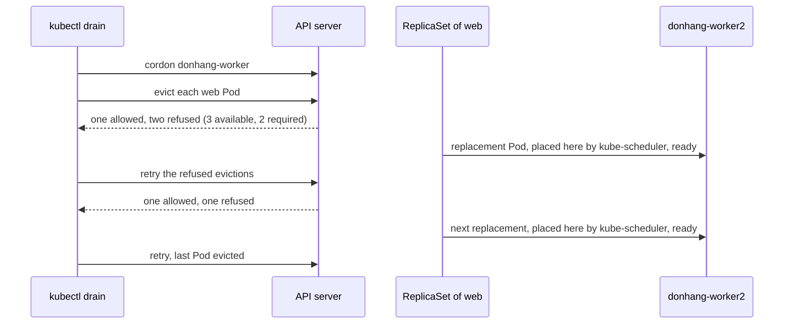

## Before you start

- [[k8s.l3.highly-available-entry-point]] — replicas spread over nodes survive losing one; here you take a node away on purpose.
- [[k8s.l2.storage-classes]] — a claim on `standard` ties its Pods to one node.
- [[k8s.l1.replicasets]] — a deleted Pod is replaced from the template; emptying a node relies on that to restart its Pods elsewhere.

## The situation

`donhang-worker` needs maintenance, such as the kubelet upgrade the next lesson plans, and a node being worked on should run nothing. Right now the three Pods of a `web` Deployment in `lifecycle-lessons` all run on it, next to Pods from earlier lessons. Stopping the node stops all three at once. Deleting them by hand is not much better: nothing stops you from deleting the last one while its replacement is still starting. You want the node empty, but the application never down to fewer copies than it can spare. How do you empty a node for maintenance while keeping enough copies of each application running?

## Core concepts

- **cordon** — marking a node unschedulable, so kube-scheduler places no new Pod on it, except Pods that run one per node, while the Pods already there keep running; `kubectl cordon` sets the mark and `kubectl uncordon` clears it.
- Eviction — a request to the API server to delete one Pod, which the API server checks first and refuses when the deletion would break a rule protecting that Pod.
- **drain (node)** — cordoning a node, then evicting its Pods so their controllers (the object that created each Pod and replaces it when deleted, such as the ReplicaSet behind a Deployment) recreate them on other nodes; `kubectl drain` does both.
- **PodDisruptionBudget (PDB)** — an object that selects Pods by label and sets `minAvailable` or `maxUnavailable`, how many of them must stay available or may be missing, where available means the Pod is ready (its readiness probe passes, or, with no probe, its containers are running); the API server refuses an eviction that would break it.

## How it works



Say a PodDisruptionBudget named `web`, shown in the next section, requires 2 of the 3 `web` Pods to stay available.

The drain first cordons the node, so no new Pod lands there, apart from the ones that run on every node. It then asks the API server for one eviction per Pod. For each request, the API server checks the count of ready selected Pods, kept in the budget's status, against `minAvailable`. Three are available and two are required, so one eviction is allowed and the others are refused. `kubectl drain` waits and retries each refusal.

The ReplicaSet replaces the evicted Pod from its template. kube-scheduler skips the cordoned node, so the new Pod lands on `donhang-worker2`. Once it is ready, three are available again and the next retry is allowed. The node empties one Pod at a time, never faster than replacements become ready.

Before any eviction, `kubectl drain` evicts nothing if it finds Pods it cannot safely hand over. Pods that run one per node, such as those of kindnet (kind's CNI plugin), would be recreated on the same node at once; `--ignore-daemonsets` leaves them. kubectl's messages and that flag call these Pods DaemonSet-managed. A Pod with an `emptyDir`, a scratch folder deleted with its Pod, needs `--delete-emptydir-data`. A Pod no controller would replace needs `--force`, and is then gone.

A budget only answers evictions. A node that crashes, a `kubectl delete pod` and a Deployment's rolling update never ask it, so it cannot hold them back.

## In the Đơn Hàng system

The budget the script applies first:

```yaml file=deploy/k8s/lessons/web-pdb.yaml tag=stage-3 lines=1-14
# lesson: k8s.l3.draining-nodes
# A budget for the three web Pods of scripts/k8s/drain.sh: at least two of
# them available at any time. The API server refuses an eviction that would
# leave fewer, so a drain takes them one by one.
apiVersion: policy/v1
kind: PodDisruptionBudget
metadata:
  name: web
  namespace: lifecycle-lessons
spec:
  minAvailable: 2
  selector:
    matchLabels:
      app: web
```

The selector `app: web` matches the labels `kubectl create deployment web` gives its Pods. With three replicas, `maxUnavailable: 1` would allow the same evictions. `web-pdb-strict.yaml` is the same object with `minAvailable: 3`, which allows no eviction at all.

Earlier in `scripts/k8s/drain.sh`, outside the excerpt, the script starts the three `web` Pods on `donhang-worker` by cordoning `donhang-worker2` while they start, cordons `donhang-worker` once to show the Pods stay, and lets a drain refuse a Pod named `lonely` that no controller owns. Then:

```bash file=scripts/k8s/drain.sh tag=stage-3 lines=47-70
# lesson: k8s.l3.draining-nodes
# Under web-pdb.yaml, 2 of 3 available: each eviction waits until the Pod
# before it has a ready replacement on donhang-worker2.
show kubectl apply -f deploy/k8s/lessons/web-pdb.yaml
drain donhang-worker --ignore-daemonsets --pod-selector=app=web --timeout=180s
pods web
show kubectl uncordon donhang-worker
echo

# lesson: k8s.l3.draining-nodes
# Under web-pdb-strict.yaml, 3 of 3: no eviction is allowed, the drain
# retries until its timeout, and the node goes back into service.
kubectl delete pod -n lifecycle-lessons -l app=web --field-selector spec.nodeName=donhang-worker2 --wait=false >/dev/null
kubectl cordon donhang-worker2 >/dev/null
kubectl rollout status deployment/web -n lifecycle-lessons --timeout=180s >/dev/null
kubectl uncordon donhang-worker2 >/dev/null
show kubectl apply -f deploy/k8s/lessons/web-pdb-strict.yaml
drain donhang-worker --ignore-daemonsets --pod-selector=app=web --timeout=30s || true
show kubectl uncordon donhang-worker
# A budget limits evictions only: deleting a Pod directly goes through.
web_pod=$(kubectl get pods -n lifecycle-lessons -l app=web -o jsonpath='{.items[0].metadata.name}')
echo "\$ kubectl delete pod <a web Pod> -n lifecycle-lessons"
kubectl delete pod "$web_pod" -n lifecycle-lessons --wait=false | sed "s/$web_pod/<a web Pod>/"
echo
```

`--pod-selector=app=web` limits the drain to the `web` Pods, so other lessons' Pods on the node are left alone. `show` prints a command before running it, `pods web` lists the `web` Pods with their status and node, and `drain`, defined at the top of the script, prints each repeated line once. Between the two drains, the script deletes the `web` Pods on `donhang-worker2`, then cordons that node until their replacements are ready, to put them back on `donhang-worker`; in the lab, two of the three were on it for the second drain. After the excerpt, it starts `store`, a one-replica Deployment with no budget whose claim is on `standard`, and drains its node with `--pod-selector=app=store`.

```text output=true
$ kubectl cordon donhang-worker
node/donhang-worker cordoned
$ kubectl get node donhang-worker -o custom-columns=NODE:.metadata.name,UNSCHEDULABLE:.spec.unschedulable
NODE             UNSCHEDULABLE
donhang-worker   true
POD           STATUS    NODE
web-...-...   Running   donhang-worker...
web-...-...   Running   donhang-worker...
web-...-...   Running   donhang-worker...
$ kubectl uncordon donhang-worker
node/donhang-worker uncordoned

$ kubectl drain donhang-worker
cannot delete cannot delete Pods that declare no controller (use --force to override): lifecycle-lessons/lonely
cannot delete DaemonSet-managed Pods (use --ignore-daemonsets to ignore): kube-system/kindnet-..., kube-system/kube-proxy-..., metallb-system/speaker-...
cannot delete Pods with local storage (use --delete-emptydir-data to override): donhang/db-...-..., ha-lessons/traefik-ha-...-...
...
$ kubectl apply -f deploy/k8s/lessons/web-pdb.yaml
poddisruptionbudget.policy/web created
$ kubectl drain donhang-worker --ignore-daemonsets --pod-selector=app=web --timeout=180s
node/donhang-worker cordoned
evicting pod lifecycle-lessons/web-...-...
evicting pod lifecycle-lessons/web-...-...
evicting pod lifecycle-lessons/web-...-...
error when evicting pods/"web-...-..." -n "lifecycle-lessons" (will retry after 5s): Cannot evict pod as it would violate the pod's disruption budget.
error when evicting pods/"web-...-..." -n "lifecycle-lessons" (will retry after 5s): Cannot evict pod as it would violate the pod's disruption budget.
pod/web-...-... evicted
pod/web-...-... evicted
pod/web-...-... evicted
node/donhang-worker drained
...
$ kubectl apply -f deploy/k8s/lessons/web-pdb-strict.yaml
poddisruptionbudget.policy/web configured
$ kubectl drain donhang-worker --ignore-daemonsets --pod-selector=app=web --timeout=30s
node/donhang-worker cordoned
...
error: unable to drain node "donhang-worker" due to error: [error when evicting pods/"web-...-..." -n "lifecycle-lessons": global timeout reached: 30s, error when evicting pods/"web-...-..." -n "lifecycle-lessons": global timeout reached: 30s], continuing command...
...
$ kubectl uncordon donhang-worker
node/donhang-worker uncordoned
$ kubectl delete pod <a web Pod> -n lifecycle-lessons
pod "<a web Pod>" deleted from lifecycle-lessons namespace

store (claim store-data on standard) runs on donhang-worker
$ kubectl drain donhang-worker --ignore-daemonsets --pod-selector=app=store --timeout=60s
node/donhang-worker cordoned
evicting pod lifecycle-lessons/store-...-...
pod/store-...-... evicted
node/donhang-worker drained
POD             STATUS    NODE
store-...-...   Pending   <none>
$ kubectl uncordon donhang-worker
node/donhang-worker uncordoned
POD             STATUS    NODE
store-...-...   Running   donhang-worker...
```

Read it in four parts:

1. After `cordon`, the node shows `UNSCHEDULABLE true` and all three `web` Pods still run on it.
2. A plain drain lists every Pod it refuses to touch and stops, evicting nothing (kubectl repeats `cannot delete` on the `lonely` line).
3. Under `minAvailable: 2`, two evictions are refused and retried, yet the drain ends with `drained`; under `minAvailable: 3`, it retries until `global timeout reached: 30s`, while a direct `kubectl delete pod` goes straight through.
4. `store` is evicted and stays `Pending` with no node until its node is uncordoned, because its volume is a folder on that node: draining the node of a single-copy store like this one is an outage.

## Seniors often assume…

- **"A PodDisruptionBudget protects Pods when a node crashes."** → Actually a budget is consulted only when someone asks for an eviction, and a crash asks nobody; once those Pods are gone, fewer are available, so the budget allows fewer evictions, or none, until replacements are ready. You notice this when a node stops and every Pod on it goes at once, whatever `minAvailable` says.
- **"`minAvailable: 1` on a one-replica Deployment keeps it safe during maintenance."** → Actually it allows zero evictions, so every drain of that Pod's node retries until its `--timeout`, or forever without one, as the drain under `web-pdb-strict.yaml` did; it does not keep the Pod up if the node fails either. If the application must keep serving during maintenance, it needs a second replica on another node. You notice this when a drain prints `Cannot evict pod as it would violate the pod's disruption budget.` again and again for one Pod.
- **"`kubectl cordon` moves the Pods off the node."** → Actually it only stops new Pods from landing there; moving them is the eviction step of a drain. You notice this when `kubectl get pods` still lists all three `web` Pods on `donhang-worker` after `UNSCHEDULABLE true`.

## Try it (3 minutes)

From the root of the Đơn Hàng repository, with Docker Desktop running and `kubectl` and kind installed:

1. Run `scripts/k8s/drain.sh`. It creates `donhang` if it is missing, which takes longer than this exercise, and uncordons both workers however it ends.
2. Find the drain under `web-pdb.yaml` and the one under `web-pdb-strict.yaml`, then the `store` lines.

Expected result: the first drain prints `Cannot evict pod as it would violate the pod's disruption budget.` and still ends with `node/donhang-worker drained`; the second reports `global timeout reached: 30s` and never prints `drained`; `store` shows `Pending` with node `<none>` until its node is uncordoned, then `Running`.

## Connections

- [[k8s.l3.highly-available-entry-point]] — the planned counterpart: spread keeps replicas on several nodes; a budget keeps enough up while one is emptied.
- [[k8s.l2.storage-classes]] — the reason `store` stays `Pending`: a volume on `standard` lives on one node.
- [[k8s.l1.replicasets]] — the controller that recreates every evicted Pod on another node.
- [[k8s.l1.rolling-updates]] — another way Pods leave, limited by the Deployment's own settings, not budgets.
- [[k8s.l2.statefulsets]] — Pods with their own claims, which on `standard` meet the same `Pending` as `store`.
- [[k8s.l3.kubeadm]] — the kubelet a drain makes room to upgrade.
- [[k8s.l3.cluster-upgrades]] — prerequisite for: every worker is drained, upgraded and uncordoned in turn.

## Five-line summary

1. Draining a node evicts its Pods only as fast as their PodDisruptionBudgets allow, so applications keep the copies they need while the node empties.
2. `kubectl cordon` stops new Pods landing on a node; `kubectl drain` cordons it, then evicts its Pods for their controllers to recreate elsewhere.
3. A drain evicts nothing while the node runs per-node Pods, Pods with an `emptyDir` or Pods no controller replaces, until flags allow it.
4. The API server refuses evictions that would break `minAvailable` or `maxUnavailable`; `kubectl drain` retries until it succeeds or reaches its `--timeout`, if set.
5. Budgets do not stop node crashes, direct deletes or rolling updates, and a Pod tied to one node's volume stays `Pending` until that node returns.
