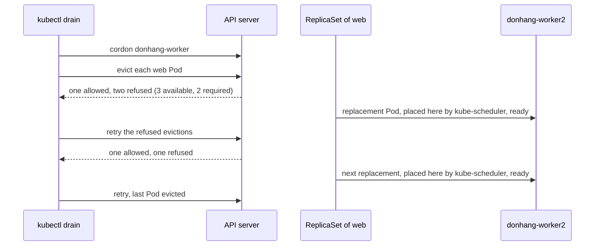

## Bạn cần biết trước

- [[k8s.l3.highly-available-entry-point]] — các replica rải trên nhiều node thì sống sót khi mất một node. Ở bài này, bạn chủ động rút một node ra.
- [[k8s.l2.storage-classes]] — claim trên `standard` buộc các Pod của nó vào một node.
- [[k8s.l1.replicasets]] — Pod bị xóa sẽ được tạo lại từ template. Làm trống một node dựa vào điều đó để khởi động lại các Pod ở nơi khác.

## Tình huống

`donhang-worker` cần bảo trì, chẳng hạn nâng cấp kubelet như bài sau sẽ lên kế hoạch, và node đang được bảo trì không nên chạy gì. Lúc này cả ba Pod của Deployment `web` trong `lifecycle-lessons` đều chạy trên node đó, cạnh các Pod từ những bài trước. Tắt node là tắt cả ba cùng lúc. Xóa tay từng Pod cũng không khá hơn mấy: không gì ngăn bạn xóa Pod cuối cùng trong khi Pod thay thế vẫn đang khởi động. Bạn muốn node trống, nhưng ứng dụng không bao giờ xuống dưới số bản sao mà nó chịu được. Làm sao làm trống một node để bảo trì mà vẫn giữ đủ bản sao của mỗi ứng dụng đang chạy?

## Khái niệm cốt lõi

- **cordon** (Đánh dấu node không nhận Pod mới; Pod đang chạy trên đó vẫn chạy) — đánh dấu một node là không thể xếp lịch, để kube-scheduler không đặt Pod mới nào lên đó, trừ các Pod chạy mỗi node một bản, còn các Pod đã ở đó vẫn chạy tiếp. `kubectl cordon` đặt dấu này, `kubectl uncordon` gỡ nó.
- Eviction — một yêu cầu gửi API server để xóa một Pod. API server kiểm tra trước, và từ chối khi lần xóa đó sẽ phá một quy tắc đang bảo vệ Pod.
- **drain (node)** (Cordon một node rồi evict mọi Pod trên đó để controller tạo lại chúng ở node khác, trước khi bảo trì) — cordon một node, rồi evict các Pod của nó để controller của chúng (object đã tạo ra mỗi Pod và thay Pod khi bị xóa, như ReplicaSet đứng sau một Deployment) tạo lại chúng trên node khác. `kubectl drain` làm cả hai bước.
- **PodDisruptionBudget (PDB)** (Object giới hạn số Pod của một nhóm được evict cùng lúc khi bảo trì; không che chở khi node hỏng) — object chọn Pod theo label và đặt `minAvailable` hoặc `maxUnavailable`, tức số Pod phải còn sẵn sàng hoặc số Pod được phép thiếu. Sẵn sàng ở đây nghĩa là Pod đã ready: readiness probe của nó đạt, hoặc khi không có probe thì các container của nó đang chạy. API server từ chối eviction nào làm vỡ budget.

## Cơ chế hoạt động



Giả sử một PodDisruptionBudget tên `web`, có ở phần sau, yêu cầu 2 trong 3 Pod `web` luôn sẵn sàng.

Trước hết, drain cordon node để không Pod mới nào rơi vào đó, trừ các Pod chạy trên mọi node. Sau đó nó gửi API server một yêu cầu eviction cho mỗi Pod. Với từng yêu cầu, API server so số Pod được chọn đang ready, lưu trong status của budget, với `minAvailable`. Ba Pod đang sẵn sàng và cần hai, nên một eviction được chấp nhận, các eviction còn lại bị từ chối. `kubectl drain` chờ rồi thử lại từng yêu cầu bị từ chối.

ReplicaSet thay Pod vừa bị evict bằng một Pod mới từ template. kube-scheduler bỏ qua node đã cordon, nên Pod mới rơi vào `donhang-worker2`. Khi Pod đó ready, lại có ba Pod sẵn sàng và lần thử kế tiếp được chấp nhận. Node trống dần từng Pod một, không bao giờ nhanh hơn tốc độ các Pod thay thế ready.

Trước mọi eviction, nếu thấy Pod nào không thể bàn giao an toàn, `kubectl drain` không evict gì cả. Các Pod chạy mỗi node một bản, như Pod của kindnet (CNI plugin của kind), sẽ được tạo lại ngay trên chính node đó. `--ignore-daemonsets` để yên chúng. Thông báo của kubectl và tên flag này gọi các Pod đó là DaemonSet-managed. Pod có `emptyDir`, một thư mục tạm bị xóa cùng Pod, cần `--delete-emptydir-data`. Pod không có controller nào thay thế thì cần `--force`, và sau đó nó mất hẳn.

Budget chỉ trả lời các yêu cầu eviction. Node bị crash, lệnh `kubectl delete pod` và rolling update của Deployment không hề hỏi budget, nên budget không chặn được chúng.

## Trong hệ thống Đơn Hàng

Budget mà script apply trước:

```yaml file=deploy/k8s/lessons/web-pdb.yaml tag=stage-3 lines=1-14
# lesson: k8s.l3.draining-nodes
# A budget for the three web Pods of scripts/k8s/drain.sh: at least two of
# them available at any time. The API server refuses an eviction that would
# leave fewer, so a drain takes them one by one.
apiVersion: policy/v1
kind: PodDisruptionBudget
metadata:
  name: web
  namespace: lifecycle-lessons
spec:
  minAvailable: 2
  selector:
    matchLabels:
      app: web
```

Selector `app: web` khớp với label mà `kubectl create deployment web` gắn cho các Pod của nó. Với ba replica, `maxUnavailable: 1` cũng cho phép đúng những eviction đó. `web-pdb-strict.yaml` là cùng object nhưng với `minAvailable: 3`, không cho phép eviction nào.

Ở đoạn trước trong `scripts/k8s/drain.sh`, nằm ngoài đoạn trích, script khởi động ba Pod `web` trên `donhang-worker` bằng cách cordon `donhang-worker2` trong lúc chúng khởi động. Script cordon `donhang-worker` một lần để cho thấy các Pod vẫn ở lại, và để một lần drain từ chối Pod tên `lonely` không có controller nào sở hữu. Sau đó:

```bash file=scripts/k8s/drain.sh tag=stage-3 lines=47-70
# lesson: k8s.l3.draining-nodes
# Under web-pdb.yaml, 2 of 3 available: each eviction waits until the Pod
# before it has a ready replacement on donhang-worker2.
show kubectl apply -f deploy/k8s/lessons/web-pdb.yaml
drain donhang-worker --ignore-daemonsets --pod-selector=app=web --timeout=180s
pods web
show kubectl uncordon donhang-worker
echo

# lesson: k8s.l3.draining-nodes
# Under web-pdb-strict.yaml, 3 of 3: no eviction is allowed, the drain
# retries until its timeout, and the node goes back into service.
kubectl delete pod -n lifecycle-lessons -l app=web --field-selector spec.nodeName=donhang-worker2 --wait=false >/dev/null
kubectl cordon donhang-worker2 >/dev/null
kubectl rollout status deployment/web -n lifecycle-lessons --timeout=180s >/dev/null
kubectl uncordon donhang-worker2 >/dev/null
show kubectl apply -f deploy/k8s/lessons/web-pdb-strict.yaml
drain donhang-worker --ignore-daemonsets --pod-selector=app=web --timeout=30s || true
show kubectl uncordon donhang-worker
# A budget limits evictions only: deleting a Pod directly goes through.
web_pod=$(kubectl get pods -n lifecycle-lessons -l app=web -o jsonpath='{.items[0].metadata.name}')
echo "\$ kubectl delete pod <a web Pod> -n lifecycle-lessons"
kubectl delete pod "$web_pod" -n lifecycle-lessons --wait=false | sed "s/$web_pod/<a web Pod>/"
echo
```

`--pod-selector=app=web` giới hạn drain vào các Pod `web`, nên Pod của các bài khác trên node được để yên. `show` in một lệnh trước khi chạy nó, `pods web` liệt kê các Pod `web` cùng trạng thái và node của chúng, còn `drain`, định nghĩa ở đầu script, in mỗi dòng lặp lại một lần. Giữa hai lần drain, script xóa các Pod `web` trên `donhang-worker2`, rồi cordon node đó tới khi các Pod thay thế ready, để đưa chúng về `donhang-worker`. Trong bài lab, lúc drain lần hai có hai trong ba Pod nằm trên đó. Sau đoạn trích, script khởi động `store`, một Deployment một replica không có budget, với claim trên `standard`, rồi drain node của nó bằng `--pod-selector=app=store`.

```text output=true
$ kubectl cordon donhang-worker
node/donhang-worker cordoned
$ kubectl get node donhang-worker -o custom-columns=NODE:.metadata.name,UNSCHEDULABLE:.spec.unschedulable
NODE             UNSCHEDULABLE
donhang-worker   true
POD           STATUS    NODE
web-...-...   Running   donhang-worker...
web-...-...   Running   donhang-worker...
web-...-...   Running   donhang-worker...
$ kubectl uncordon donhang-worker
node/donhang-worker uncordoned

$ kubectl drain donhang-worker
cannot delete cannot delete Pods that declare no controller (use --force to override): lifecycle-lessons/lonely
cannot delete DaemonSet-managed Pods (use --ignore-daemonsets to ignore): kube-system/kindnet-..., kube-system/kube-proxy-..., metallb-system/speaker-...
cannot delete Pods with local storage (use --delete-emptydir-data to override): donhang/db-...-..., ha-lessons/traefik-ha-...-...
...
$ kubectl apply -f deploy/k8s/lessons/web-pdb.yaml
poddisruptionbudget.policy/web created
$ kubectl drain donhang-worker --ignore-daemonsets --pod-selector=app=web --timeout=180s
node/donhang-worker cordoned
evicting pod lifecycle-lessons/web-...-...
evicting pod lifecycle-lessons/web-...-...
evicting pod lifecycle-lessons/web-...-...
error when evicting pods/"web-...-..." -n "lifecycle-lessons" (will retry after 5s): Cannot evict pod as it would violate the pod's disruption budget.
error when evicting pods/"web-...-..." -n "lifecycle-lessons" (will retry after 5s): Cannot evict pod as it would violate the pod's disruption budget.
pod/web-...-... evicted
pod/web-...-... evicted
pod/web-...-... evicted
node/donhang-worker drained
...
$ kubectl apply -f deploy/k8s/lessons/web-pdb-strict.yaml
poddisruptionbudget.policy/web configured
$ kubectl drain donhang-worker --ignore-daemonsets --pod-selector=app=web --timeout=30s
node/donhang-worker cordoned
...
error: unable to drain node "donhang-worker" due to error: [error when evicting pods/"web-...-..." -n "lifecycle-lessons": global timeout reached: 30s, error when evicting pods/"web-...-..." -n "lifecycle-lessons": global timeout reached: 30s], continuing command...
...
$ kubectl uncordon donhang-worker
node/donhang-worker uncordoned
$ kubectl delete pod <a web Pod> -n lifecycle-lessons
pod "<a web Pod>" deleted from lifecycle-lessons namespace

store (claim store-data on standard) runs on donhang-worker
$ kubectl drain donhang-worker --ignore-daemonsets --pod-selector=app=store --timeout=60s
node/donhang-worker cordoned
evicting pod lifecycle-lessons/store-...-...
pod/store-...-... evicted
node/donhang-worker drained
POD             STATUS    NODE
store-...-...   Pending   <none>
$ kubectl uncordon donhang-worker
node/donhang-worker uncordoned
POD             STATUS    NODE
store-...-...   Running   donhang-worker...
```

Đọc kết quả theo bốn phần:

1. Sau `cordon`, node hiện `UNSCHEDULABLE true` và cả ba Pod `web` vẫn chạy trên đó.
2. Một lệnh drain trơn liệt kê mọi Pod nó không chịu đụng tới rồi dừng, không evict gì (kubectl lặp chữ `cannot delete` ở dòng `lonely`).
3. Với `minAvailable: 2`, hai eviction bị từ chối rồi được thử lại, nhưng drain vẫn kết thúc bằng `drained`. Với `minAvailable: 3`, drain thử lại tới khi gặp `global timeout reached: 30s`, trong khi một lệnh `kubectl delete pod` trực tiếp đi qua ngay.
4. `store` bị evict và nằm ở `Pending` không có node cho tới khi node của nó được uncordon, vì volume của nó là một thư mục trên node đó: drain node của một kho dữ liệu chỉ có một bản sao như thế này là gây ra sự cố ngừng dịch vụ.

## Senior hay nhầm rằng…

- **"PodDisruptionBudget bảo vệ Pod khi node bị crash."** → Thực ra budget chỉ được hỏi khi có ai đó yêu cầu eviction, còn crash thì không hỏi ai cả. Khi các Pod đó mất, số Pod sẵn sàng giảm, nên budget cho phép ít eviction hơn, hoặc không cho cái nào, tới khi các Pod thay thế ready. Bạn sẽ nhận ra khi một node dừng và mọi Pod trên đó mất cùng lúc, bất kể `minAvailable` ghi gì.
- **"Đặt `minAvailable: 1` cho Deployment một replica là an toàn khi bảo trì."** → Thực ra nó không cho phép eviction nào, nên mọi lần drain node chứa Pod đó đều thử lại tới khi hết `--timeout`, hoặc mãi mãi nếu không đặt, giống lần drain dưới `web-pdb-strict.yaml`. Nó cũng không giữ Pod chạy khi node hỏng. Nếu ứng dụng phải tiếp tục phục vụ trong lúc bảo trì, nó cần replica thứ hai trên một node khác. Bạn sẽ nhận ra khi drain in đi in lại `Cannot evict pod as it would violate the pod's disruption budget.` cho cùng một Pod.
- **"`kubectl cordon` chuyển các Pod ra khỏi node."** → Thực ra nó chỉ ngăn Pod mới rơi vào đó. Chuyển Pod đi là bước eviction của drain. Bạn sẽ nhận ra khi `kubectl get pods` vẫn liệt kê cả ba Pod `web` trên `donhang-worker` sau khi đã thấy `UNSCHEDULABLE true`.

## Thử ngay (3 phút)

Ở thư mục gốc của repo Đơn Hàng, khi Docker Desktop đang chạy và đã cài `kubectl` cùng kind:

1. Chạy `scripts/k8s/drain.sh`. Script tạo `donhang` nếu chưa có, việc này lâu hơn thời gian của bài tập, và uncordon cả hai worker dù script kết thúc theo cách nào.
2. Tìm lần drain dưới `web-pdb.yaml` và lần drain dưới `web-pdb-strict.yaml`, rồi tới các dòng của `store`.

Kết quả mong đợi: lần drain đầu in `Cannot evict pod as it would violate the pod's disruption budget.` nhưng vẫn kết thúc bằng `node/donhang-worker drained`. Lần thứ hai báo `global timeout reached: 30s` và không bao giờ in `drained`. `store` hiện `Pending` với node `<none>` cho tới khi node của nó được uncordon, rồi chuyển sang `Running`.

## Liên hệ

- [[k8s.l3.highly-available-entry-point]] — phần đối ứng khi đã có kế hoạch: rải Pod giữ replica trên nhiều node, còn budget giữ đủ Pod chạy trong lúc một node được làm trống.
- [[k8s.l2.storage-classes]] — lý do `store` nằm ở `Pending`: volume trên `standard` chỉ nằm trên một node.
- [[k8s.l1.replicasets]] — controller tạo lại mọi Pod bị evict trên một node khác.
- [[k8s.l1.rolling-updates]] — một đường khác để Pod rời đi, bị giới hạn bởi thiết lập riêng của Deployment, không phải budget.
- [[k8s.l2.statefulsets]] — các Pod có claim riêng, khi nằm trên `standard` cũng gặp đúng cảnh `Pending` như `store`.
- [[k8s.l3.kubeadm]] — kubelet mà drain dọn chỗ để nâng cấp.
- [[k8s.l3.cluster-upgrades]] — bài cần bài này: lần lượt từng worker được drain, nâng cấp rồi uncordon.

## Tóm tắt 5 dòng

1. Drain một node chỉ evict Pod nhanh tới mức PodDisruptionBudget của chúng cho phép, nên ứng dụng giữ đủ số bản sao cần thiết trong lúc node trống dần.
2. `kubectl cordon` ngăn Pod mới rơi vào node. `kubectl drain` cordon node, rồi evict các Pod của nó để controller tạo lại chúng ở nơi khác.
3. Drain không evict gì khi node còn chạy Pod mỗi node một bản, Pod có `emptyDir` hay Pod không có controller thay thế, cho tới khi có flag cho phép.
4. API server từ chối eviction làm vỡ `minAvailable` hoặc `maxUnavailable`. `kubectl drain` thử lại tới khi thành công hoặc hết `--timeout`, nếu có đặt.
5. Budget không chặn được node crash, lệnh xóa trực tiếp hay rolling update, và Pod gắn với volume của một node sẽ nằm ở `Pending` tới khi node đó quay lại.
