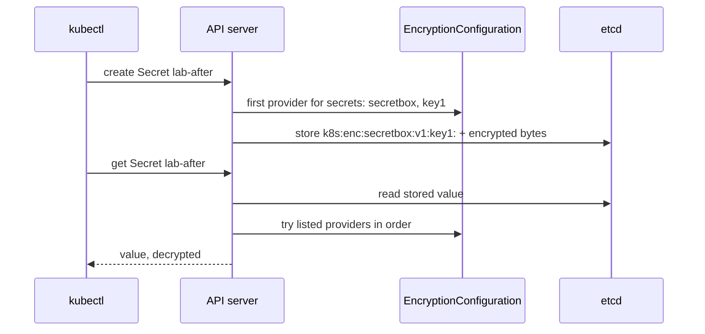

## Before you start

- [[k8s.l3.etcd-snapshots]] — a snapshot holds every Secret, readable by whoever has the file; this lesson makes the Secrets in it unreadable.
- [[k8s.l3.roles-and-role-bindings]] — RBAC decides who reads Secrets through the API server; this lesson protects the other path, etcd's own files.
- [[k8s.l1.secrets]] — a Secret's value is only base64, an encoding with no key; this lesson adds a key where etcd stores it.

## The situation

The last lesson ended with a warning: `backups/etcd/donhang-lifecycle.db` holds every Secret of its cluster, and anyone who opens the file can read them. The same is true of etcd's data folder on any control-plane node, including the one of `donhang`. Your Roles decide who may run `kubectl get secret`, but a copied snapshot or a copied disk never asks the API server. You could guard every copy forever. Or the copies could be useless without something kept apart from them. How do you keep the Secrets in etcd, and in every copy of it, unreadable without a key?

## Core concepts

- **encryption at rest** — encrypting data before it is written to storage such as etcd, so its files and snapshots cannot be read without the key; here, the API server encrypts each Secret before etcd stores it.
- `EncryptionConfiguration` — a file the API server reads when it starts (by default), named by its flag `--encryption-provider-config`, listing the resources to encrypt and the providers to use, in order.
- Provider — one way the API server stores data: `secretbox` encrypts with a key from the file, `identity` stores data as it is, and `kms` asks a key service outside the cluster, a separate server that holds its key and encrypts or decrypts on request, so that key is not on the node's disk.
- Key — the random 32 bytes, written in base64 in the file, that `secretbox` encrypts and decrypts with; whoever holds it can read what it encrypted.

## How it works



In the situation above, nothing stands between a Secret and etcd: by default the API server writes Secrets to etcd unencrypted, so the value in a snapshot is the value you created.

Encryption at rest is a setting of the API server, not of etcd. You start the API server with `--encryption-provider-config` pointing at an `EncryptionConfiguration` file. For each listed resource, the file names providers in order. The first provider encrypts every new write. When the API server reads, the listed providers that match the stored value try, in order, to decrypt it. That is why the lab lists `identity` after `secretbox`: Secrets stored before the change are plain, and `identity` still reads them.

The diagram follows one write and one read; its arrows to `EncryptionConfiguration` stand for the settings loaded at start, not a new read of the file. On create, the API server encrypts with `secretbox` and key `key1`, then stores the result behind a prefix naming the provider and the key: `k8s:enc:secretbox:v1:key1:`. etcd only stores bytes; it never sees the key. On a read, the API server decrypts the value and returns the Secret as before. A snapshot copies what etcd holds, so it now holds the encrypted bytes too.

Two things do not change. Secrets already stored stay as they were until something writes them again. And a read through the API server is decrypted for anyone RBAC allows, because the API server holds the key.

## In the Đơn Hàng system

`scripts/dev-secrets.sh` writes the file once per learner, into `secrets/`, which Git ignores:

```bash file=scripts/dev-secrets.sh tag=stage-3 lines=86-106
# lesson: k8s.l3.encryption-at-rest
# From stage-3: the file scripts/k8s/encryption-at-rest.sh gives the API
# server of donhang-lifecycle. Secrets are encrypted with the first provider,
# secretbox, and a random 32-byte key; identity, listed after it, still
# reads the Secrets written before, unencrypted.
if [ ! -f secrets/encryption-config.yaml ]; then
  cat > secrets/encryption-config.yaml <<CONFIG
apiVersion: apiserver.config.k8s.io/v1
kind: EncryptionConfiguration
resources:
  - resources:
      - secrets
    providers:
      - secretbox:
          keys:
            - name: key1
              secret: $(openssl rand -base64 32)
      - identity: {}
CONFIG
  echo "created secrets/encryption-config.yaml"
fi
```

Look at the order under `providers`: `secretbox` first, so it encrypts; `identity` second, so old plain Secrets stay readable. `openssl rand -base64 32` makes the key, and the key sits in this file as text.

`scripts/k8s/encryption-at-rest.sh` first writes `lab-before` and reads it from etcd with `etcdctl get`, through a function `etcd_read` defined at its top. `etcd_read` prints the key, the start of the stored value, and a line in parentheses saying whether the expected text appears in it. Then, in lines 29–47 outside the excerpts, the script copies the file onto the node, adds the flag and a volume to the API server's static Pod manifest, and waits until the kubelet has restarted the API server with the flag. The volume makes the node's folder `/etc/kubernetes/enc` visible inside the API server's container, so the path in the flag exists there.

```bash file=scripts/k8s/encryption-at-rest.sh tag=stage-3 lines=49-63
# lesson: k8s.l3.encryption-at-rest
# A Secret written now is stored encrypted: the value in etcd starts with
# k8s:enc:secretbox:v1:key1:. The one written before is still readable.
show kubectl create secret generic lab-after --from-literal=password=written-after
etcd_read lab-after written-after
etcd_read lab-before written-before
echo

# lesson: k8s.l3.encryption-at-rest
# Rewriting every Secret through the API server stores each one again,
# encrypted this time.
echo "\$ kubectl get secrets -A -o json | kubectl replace -f -"
echo "Secrets replaced: $(kubectl get secrets -A -o json | kubectl replace -f - | grep -c ' replaced$')"
etcd_read lab-before written-before
echo
```

```text output=true
$ kubectl create secret generic lab-before --from-literal=password=written-before
secret/lab-before created
$ kubectl exec -n kube-system etcd-donhang-lifecycle-control-plane -- etcdctl ... get /registry/secrets/default/lab-before
/registry/secrets/default/lab-before
k8s.
  (written-before is readable in it)

$ docker cp secrets/encryption-config.yaml donhang-lifecycle-control-plane:/etc/kubernetes/enc/encryption-config.yaml
$ docker exec donhang-lifecycle-control-plane grep -e encryption-provider-config -e 'path: /etc/kubernetes/enc' /etc/kubernetes/manifests/kube-apiserver.yaml
    - --encryption-provider-config=/etc/kubernetes/enc/encryption-config.yaml
      path: /etc/kubernetes/enc

$ kubectl create secret generic lab-after --from-literal=password=written-after
secret/lab-after created
$ kubectl exec -n kube-system etcd-donhang-lifecycle-control-plane -- etcdctl ... get /registry/secrets/default/lab-after
/registry/secrets/default/lab-after
k8s:enc:secretbox:v1:key1:
  (written-after is not in it as written)
$ kubectl exec -n kube-system etcd-donhang-lifecycle-control-plane -- etcdctl ... get /registry/secrets/default/lab-before
/registry/secrets/default/lab-before
k8s.
  (written-before is readable in it)

$ kubectl get secrets -A -o json | kubectl replace -f -
Secrets replaced: 3
$ kubectl exec -n kube-system etcd-donhang-lifecycle-control-plane -- etcdctl ... get /registry/secrets/default/lab-before
/registry/secrets/default/lab-before
k8s:enc:secretbox:v1:key1:
  (written-before is not in it as written)

$ kubectl get secret lab-before -o jsonpath='{.data.password}' | base64 -d
written-before

$ kind delete cluster --name donhang-lifecycle
Deleting cluster "donhang-lifecycle" ...
```

Read the etcd lines top to bottom. Before the flag, `lab-before` is stored starting with `k8s` and a non-printable byte, which the script prints as `.`, and `written-before` is readable in it. After the flag, `lab-after` starts with `k8s:enc:secretbox:v1:key1:` and its value is not. `lab-before` stays readable until `kubectl replace` writes every Secret back unchanged; `-f -` makes it read the Secrets from the pipe, and the count of 3 includes a Secret the cluster already had. The next read shows `lab-before` encrypted. The last command reads `lab-before` through the API server and gets `written-before`: encryption at rest changed what etcd holds, not what `kubectl` returns.

## Seniors often assume…

- **"Turning on encryption at rest encrypts the Secrets already stored."** → Actually the first provider applies only to writes, and old Secrets are not written until something updates them. You notice this when a Secret created before the change still shows its value in `etcdctl get`, as `lab-before` did, until `kubectl get secrets -A -o json | kubectl replace -f -` runs.
- **"Kubernetes encrypts Secrets in etcd out of the box."** → Actually the API server stores them unencrypted unless it is started with `--encryption-provider-config` and a file whose first provider is not `identity`. You notice this when `etcdctl get` on a fresh cluster shows the value, as the first read of `lab-before` does.
- **"A key kept in a file beside the API server protects against someone who copies the node's disk."** → Actually the key file is on that same disk, so a copy of the disk holds both the encrypted Secrets and the key. It protects copies of etcd's data and snapshots taken off the node, so a disk that leaves your hands must be wiped, or the key kept off it with `kms`. When a key service outside the cluster exists, `kms` is the stronger choice; without one, a local key still protects snapshots. You notice this when the folder `/etc/kubernetes/enc` sits next to `/var/lib/etcd`, etcd's data folder, on the same node.

## Try it (3 minutes)

From the root of the Đơn Hàng repository, with Docker Desktop running and `kubectl` and kind installed:

1. Run `scripts/k8s/encryption-at-rest.sh`. It runs `scripts/dev-secrets.sh` itself first, so you need not create the file. It creates `donhang-lifecycle` if it is missing, which can take longer than this exercise, and deletes it at the end. `donhang` is not touched.
2. Compare the three `etcdctl ... get /registry/secrets/default/lab-before` results.

Expected result: the first and second reads of `lab-before` end with `(written-before is readable in it)`; the third, after `kubectl replace`, starts with `k8s:enc:secretbox:v1:key1:` and ends with `(written-before is not in it as written)`; the last command prints `written-before`.

## Connections

- [[k8s.l3.etcd-snapshots]] — the fix for the problem it ended on: Secrets written or rewritten after the change are encrypted bytes in later snapshots.
- [[k8s.l3.roles-and-role-bindings]] — the other half: encryption at rest guards etcd's files, RBAC guards reads through the API server.
- [[k8s.l1.secrets]] — the same Secrets, now with a key behind the base64 where etcd stores them.
- [[devops.l3.sealed-secrets]] — the same idea one step earlier: Secrets encrypted in the config repository, before they reach the cluster.
- [[devops.l3.secret-rotation]] — rotating the values stored here; rotating the `secretbox` key itself is a separate task this lesson leaves out.
- [[k8s.l3.kubeadm]] — the static Pod manifest and the kubelet that restart the API server with the new flag.

## Five-line summary

1. Encryption at rest makes the API server encrypt Secrets before etcd stores them, so etcd's files and snapshots stay unreadable without the key.
2. By default the API server writes Secrets to etcd unencrypted; `etcdctl get` shows the value.
3. `--encryption-provider-config` names an `EncryptionConfiguration`: the first provider encrypts new writes; on a read, the listed providers that match the stored data are tried in order.
4. Secrets written before stay plain until rewritten, for example with `kubectl get secrets -A -o json | kubectl replace -f -`.
5. Reads through the API server still return values to anyone RBAC allows, and a local key file is copied with the node's disk.
