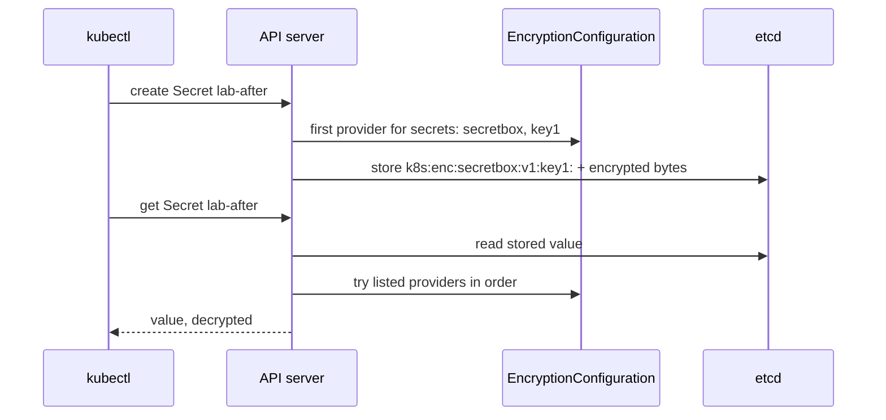

## Bạn cần biết trước

- [[k8s.l3.etcd-snapshots]] — snapshot chứa mọi Secret, ai có file là đọc được. Bài này làm cho các Secret trong đó không đọc được nữa.
- [[k8s.l3.roles-and-role-bindings]] — RBAC quyết định ai được đọc Secret qua API server. Bài này bảo vệ con đường còn lại: chính các file của etcd.
- [[k8s.l1.secrets]] — giá trị của Secret chỉ là base64, một kiểu mã hóa không có key. Bài này thêm một key ở chỗ etcd lưu nó.

## Tình huống

Bài trước kết thúc bằng một lời cảnh báo: `backups/etcd/donhang-lifecycle.db` chứa mọi Secret của cluster, ai mở file cũng đọc được. Thư mục dữ liệu của etcd trên mọi node control plane cũng vậy, kể cả node của `donhang`. Các Role quyết định ai được chạy `kubectl get secret`, nhưng một snapshot hay một ổ đĩa bị sao chép thì chẳng bao giờ hỏi API server. Bạn có thể canh giữ mọi bản sao mãi mãi. Hoặc làm cho các bản sao vô dụng nếu thiếu một thứ được cất riêng. Làm sao giữ cho Secret trong etcd, và trong mọi bản sao của nó, không đọc được nếu không có key?

## Khái niệm cốt lõi

- **mã hóa khi lưu** (encryption at rest) — mã hóa dữ liệu trước khi ghi xuống nơi lưu như etcd, để file và snapshot của nó không đọc được nếu thiếu key. Ở đây, API server mã hóa từng Secret trước khi etcd lưu.
- `EncryptionConfiguration` — file mà API server đọc khi khởi động (mặc định là vậy), được chỉ ra bằng flag `--encryption-provider-config`. File liệt kê các resource cần mã hóa và các provider dùng cho chúng, theo thứ tự.
- Provider — một phương thức API server dùng để lưu dữ liệu: `secretbox` mã hóa bằng một key nằm trong file, `identity` lưu dữ liệu nguyên trạng, còn `kms` nhờ một dịch vụ quản lý key bên ngoài cluster. Dịch vụ đó là một server riêng giữ key, mã hóa hoặc giải mã khi được yêu cầu, nên key không nằm trên ổ đĩa của node.
- Key — 32 byte ngẫu nhiên, viết dạng base64 trong file, mà `secretbox` dùng để mã hóa và giải mã. Ai giữ key là đọc được những gì nó đã mã hóa.

## Cơ chế hoạt động



Trong tình huống trên, không có gì chắn giữa Secret và etcd: mặc định API server ghi Secret vào etcd mà không mã hóa, nên giá trị nằm trong snapshot chính là giá trị bạn đã tạo.

Mã hóa khi lưu là một thiết lập của API server, không phải của etcd. Bạn khởi động API server với `--encryption-provider-config` trỏ tới một file `EncryptionConfiguration`. Với mỗi resource được liệt kê, file ghi tên các provider theo thứ tự. Provider đầu tiên mã hóa mọi lần ghi mới. Khi API server đọc, các provider trong danh sách khớp với giá trị đã lưu lần lượt thử giải mã nó. Vì thế bài lab đặt `identity` sau `secretbox`: các Secret lưu trước lần thay đổi vẫn ở dạng thường, và `identity` vẫn đọc được chúng.

Sơ đồ theo một lần ghi và một lần đọc. Các mũi tên tới `EncryptionConfiguration` là thiết lập đã nạp lúc khởi động, không phải một lần đọc file mới. Khi tạo, API server mã hóa bằng `secretbox` với key `key1`, rồi lưu kết quả sau một tiền tố ghi tên provider và key: `k8s:enc:secretbox:v1:key1:`. etcd chỉ lưu byte, không bao giờ thấy key. Khi đọc, API server giải mã giá trị và trả Secret về như trước. Snapshot sao chép những gì etcd đang giữ, nên giờ snapshot cũng chứa các byte đã mã hóa.

Có hai thứ không đổi. Secret đã lưu từ trước vẫn giữ nguyên dạng cũ cho tới khi có gì đó ghi lại chúng. Và một lần đọc qua API server vẫn được giải mã cho bất kỳ ai RBAC cho phép, vì API server giữ key.

## Trong hệ thống Đơn Hàng

`scripts/dev-secrets.sh` ghi file một lần cho mỗi người học, vào `secrets/`, thư mục Git bỏ qua:

```bash file=scripts/dev-secrets.sh tag=stage-3 lines=86-106
# lesson: k8s.l3.encryption-at-rest
# From stage-3: the file scripts/k8s/encryption-at-rest.sh gives the API
# server of donhang-lifecycle. Secrets are encrypted with the first provider,
# secretbox, and a random 32-byte key; identity, listed after it, still
# reads the Secrets written before, unencrypted.
if [ ! -f secrets/encryption-config.yaml ]; then
  cat > secrets/encryption-config.yaml <<CONFIG
apiVersion: apiserver.config.k8s.io/v1
kind: EncryptionConfiguration
resources:
  - resources:
      - secrets
    providers:
      - secretbox:
          keys:
            - name: key1
              secret: $(openssl rand -base64 32)
      - identity: {}
CONFIG
  echo "created secrets/encryption-config.yaml"
fi
```

Hãy để ý thứ tự dưới `providers`: `secretbox` đứng đầu nên nó mã hóa, `identity` đứng thứ hai nên các Secret cũ ở dạng thường vẫn đọc được. `openssl rand -base64 32` tạo key, và key nằm trong file này dưới dạng văn bản.

`scripts/k8s/encryption-at-rest.sh` trước hết ghi `lab-before` rồi đọc nó từ etcd bằng `etcdctl get`, qua hàm `etcd_read` định nghĩa ở đầu script. `etcd_read` in ra key, phần đầu của giá trị đã lưu, và một dòng trong ngoặc cho biết đoạn chữ cần tìm có xuất hiện trong đó hay không. Sau đó, ở các dòng 29–47 nằm ngoài các đoạn trích, script sao file lên node, thêm flag và một volume vào manifest static Pod của API server, rồi chờ tới khi kubelet khởi động lại API server với flag đó. Volume giúp thư mục `/etc/kubernetes/enc` của node hiện ra bên trong container của API server, nên đường dẫn trong flag tồn tại ở đó.

```bash file=scripts/k8s/encryption-at-rest.sh tag=stage-3 lines=49-63
# lesson: k8s.l3.encryption-at-rest
# A Secret written now is stored encrypted: the value in etcd starts with
# k8s:enc:secretbox:v1:key1:. The one written before is still readable.
show kubectl create secret generic lab-after --from-literal=password=written-after
etcd_read lab-after written-after
etcd_read lab-before written-before
echo

# lesson: k8s.l3.encryption-at-rest
# Rewriting every Secret through the API server stores each one again,
# encrypted this time.
echo "\$ kubectl get secrets -A -o json | kubectl replace -f -"
echo "Secrets replaced: $(kubectl get secrets -A -o json | kubectl replace -f - | grep -c ' replaced$')"
etcd_read lab-before written-before
echo
```

```text output=true
$ kubectl create secret generic lab-before --from-literal=password=written-before
secret/lab-before created
$ kubectl exec -n kube-system etcd-donhang-lifecycle-control-plane -- etcdctl ... get /registry/secrets/default/lab-before
/registry/secrets/default/lab-before
k8s.
  (written-before is readable in it)

$ docker cp secrets/encryption-config.yaml donhang-lifecycle-control-plane:/etc/kubernetes/enc/encryption-config.yaml
$ docker exec donhang-lifecycle-control-plane grep -e encryption-provider-config -e 'path: /etc/kubernetes/enc' /etc/kubernetes/manifests/kube-apiserver.yaml
    - --encryption-provider-config=/etc/kubernetes/enc/encryption-config.yaml
      path: /etc/kubernetes/enc

$ kubectl create secret generic lab-after --from-literal=password=written-after
secret/lab-after created
$ kubectl exec -n kube-system etcd-donhang-lifecycle-control-plane -- etcdctl ... get /registry/secrets/default/lab-after
/registry/secrets/default/lab-after
k8s:enc:secretbox:v1:key1:
  (written-after is not in it as written)
$ kubectl exec -n kube-system etcd-donhang-lifecycle-control-plane -- etcdctl ... get /registry/secrets/default/lab-before
/registry/secrets/default/lab-before
k8s.
  (written-before is readable in it)

$ kubectl get secrets -A -o json | kubectl replace -f -
Secrets replaced: 3
$ kubectl exec -n kube-system etcd-donhang-lifecycle-control-plane -- etcdctl ... get /registry/secrets/default/lab-before
/registry/secrets/default/lab-before
k8s:enc:secretbox:v1:key1:
  (written-before is not in it as written)

$ kubectl get secret lab-before -o jsonpath='{.data.password}' | base64 -d
written-before

$ kind delete cluster --name donhang-lifecycle
Deleting cluster "donhang-lifecycle" ...
```

Đọc các dòng etcd từ trên xuống. Trước khi có flag, `lab-before` được lưu bắt đầu bằng `k8s` và một byte không in được, script in byte này thành `.`, và `written-before` đọc được trong đó. Sau khi có flag, `lab-after` bắt đầu bằng `k8s:enc:secretbox:v1:key1:` và giá trị của nó thì không đọc được. `lab-before` vẫn đọc được cho tới khi `kubectl replace` ghi lại mọi Secret mà không đổi gì. `-f -` khiến lệnh đọc các Secret từ pipe, và con số 3 tính cả một Secret cluster đã có sẵn. Lần đọc tiếp theo cho thấy `lab-before` đã được mã hóa. Lệnh cuối đọc `lab-before` qua API server và nhận về `written-before`: mã hóa khi lưu thay đổi thứ etcd giữ, không thay đổi thứ `kubectl` trả về.

## Senior hay nhầm rằng…

- **"Bật mã hóa khi lưu là các Secret đã lưu cũng được mã hóa."** → Thực ra provider đầu tiên chỉ áp dụng cho các lần ghi, còn Secret cũ chưa được ghi lại cho tới khi có gì đó cập nhật chúng. Bạn sẽ nhận ra khi một Secret tạo trước lần thay đổi vẫn hiện giá trị trong `etcdctl get`, như `lab-before`, cho tới khi chạy `kubectl get secrets -A -o json | kubectl replace -f -`.
- **"Kubernetes mặc định đã mã hóa Secret trong etcd."** → Thực ra API server lưu chúng không mã hóa, trừ khi được khởi động với `--encryption-provider-config` và một file có provider đầu tiên không phải `identity`. Bạn sẽ nhận ra khi `etcdctl get` trên một cluster mới hiện ra giá trị, như lần đọc `lab-before` đầu tiên.
- **"Key nằm trong file cạnh API server bảo vệ được trước người sao chép ổ đĩa của node."** → Thực ra file key nằm trên chính ổ đĩa đó, nên bản sao ổ đĩa chứa cả Secret đã mã hóa lẫn key. Nó bảo vệ các bản sao dữ liệu etcd và snapshot được mang ra khỏi node, nên ổ đĩa nào rời khỏi tay bạn phải được xóa sạch, hoặc key phải được giữ ngoài ổ đĩa bằng `kms`. Khi có sẵn một dịch vụ quản lý key bên ngoài cluster, `kms` là lựa chọn mạnh hơn. Khi không có, key cục bộ vẫn bảo vệ được snapshot. Bạn sẽ nhận ra khi thư mục `/etc/kubernetes/enc` nằm cạnh `/var/lib/etcd`, thư mục dữ liệu của etcd, trên cùng một node.

## Thử ngay (3 phút)

Ở thư mục gốc của repo Đơn Hàng, khi Docker Desktop đang chạy và đã cài `kubectl` cùng kind:

1. Chạy `scripts/k8s/encryption-at-rest.sh`. Script tự chạy `scripts/dev-secrets.sh` trước, nên bạn không cần tạo file. Script tạo `donhang-lifecycle` nếu chưa có, có thể mất lâu hơn thời gian của bài tập này, và xóa nó ở cuối. `donhang` không bị đụng tới.
2. So sánh ba kết quả của `etcdctl ... get /registry/secrets/default/lab-before`.

Kết quả mong đợi: lần đọc `lab-before` thứ nhất và thứ hai kết thúc bằng `(written-before is readable in it)`. Lần thứ ba, sau `kubectl replace`, bắt đầu bằng `k8s:enc:secretbox:v1:key1:` và kết thúc bằng `(written-before is not in it as written)`. Lệnh cuối in ra `written-before`.

## Liên hệ

- [[k8s.l3.etcd-snapshots]] — cách sửa cho vấn đề bài đó kết thúc: Secret ghi hoặc ghi lại sau lần thay đổi là các byte đã mã hóa trong các snapshot về sau.
- [[k8s.l3.roles-and-role-bindings]] — nửa còn lại: mã hóa khi lưu canh giữ các file của etcd, RBAC canh giữ các lần đọc qua API server.
- [[k8s.l1.secrets]] — vẫn là các Secret đó, giờ có thêm một key đứng sau lớp base64 ở chỗ etcd lưu chúng.
- [[devops.l3.sealed-secrets]] — cùng ý tưởng nhưng sớm hơn một bước: Secret được mã hóa ngay trong repo cấu hình, trước khi tới cluster.
- [[devops.l3.secret-rotation]] — xoay vòng các giá trị lưu ở đây. Xoay vòng chính key của `secretbox` là một việc khác mà bài này không bàn.
- [[k8s.l3.kubeadm]] — manifest static Pod và kubelet, thứ khởi động lại API server với flag mới.

## Tóm tắt 5 dòng

1. Mã hóa khi lưu khiến API server mã hóa Secret trước khi etcd lưu, nên file và snapshot của etcd không đọc được nếu thiếu key.
2. Mặc định API server ghi Secret vào etcd mà không mã hóa, `etcdctl get` hiện ra giá trị.
3. `--encryption-provider-config` chỉ tới một `EncryptionConfiguration`: provider đầu tiên mã hóa các lần ghi mới, khi đọc thì các provider trong danh sách khớp với dữ liệu đã lưu được thử lần lượt.
4. Secret ghi từ trước vẫn ở dạng thường cho tới khi được ghi lại, ví dụ bằng `kubectl get secrets -A -o json | kubectl replace -f -`.
5. Đọc qua API server vẫn trả giá trị cho bất kỳ ai RBAC cho phép, và file key cục bộ bị sao chép cùng ổ đĩa của node.
