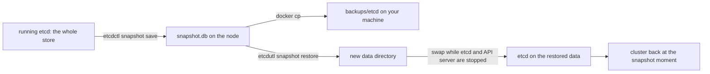

## Before you start

- [[k8s.l3.kubeadm]] — etcd runs as a static Pod on the control-plane node, with certificates kubeadm created; this lesson uses both to copy its data.
- [[k8s.l3.control-plane-ha]] — several etcd members survive a failed node; this lesson covers the failure they cannot help with.
- [[k8s.l2.scheduled-backups]] — the CronJob that dumps staging's databases; this lesson shows what that backup does not cover, and what it covers that etcd's does not.
- [[devops.l3.disaster-recovery-drill]] — rebuilding an environment from the config repository; this lesson compares that rebuild with bringing back a copy of the cluster's store.

## The situation

Every object you created in this track, from the first Deployment to the custom resources of this module, is stored in etcd on the control-plane node. The nightly CronJob dumps the database, and the DR drill rebuilt staging from the config repository. A teammate asks two questions: what if the control-plane node's disk dies, and what if someone deletes the wrong namespace? Three etcd members would not help with the second, because they hold the same data and the deletion reaches all of them. Nothing you have built copies etcd itself. How do you save the cluster's objects at one moment, and what does bringing them back undo?

## Core concepts

- **etcd snapshot** — a file holding a copy of etcd's whole store at one moment; restoring it returns every object of the cluster to that moment.
- `etcdctl` — etcd's command-line client, which talks to a running etcd over its client port; `etcdctl snapshot save` writes a snapshot through that port.
- `etcdutl` — etcd's administration tool, which works directly on etcd's files instead of a running etcd; `etcdutl snapshot restore` turns a snapshot into a data directory.
- Data directory — the folder where an etcd member keeps its data; on a kubeadm node it is `/var/lib/etcd`, mounted into etcd's static Pod from the node.

## How it works



In the situation above, the store you want to save is the one etcd keeps for `donhang`. The lab works on a throwaway one-node cluster, `donhang-lifecycle`: kind runs kubeadm inside its node, a Docker container, so etcd's static Pod and its folders are as on a kubeadm node, and a restore cannot damage `donhang`.

`etcdctl snapshot save` asks the running etcd for a copy of its store and writes it to a file. etcd trusts client certificates signed by its own certificate authority, the etcd CA kubeadm created, so the command passes that CA, a certificate and a key from `/etc/kubernetes/pki/etcd`. A copy that stays on the node is lost with the node, so the script copies it to your machine.

A restore has two steps. `etcdutl snapshot restore` reads the file and writes a new data directory; the running etcd does not see it. Then etcd must start on that directory. The Kubernetes docs set the order: stop every API server, restore etcd, start the API servers again, so that nothing keeps serving data from before the restore. The script stops both static Pods by moving their manifests out of `/etc/kubernetes/manifests`, swaps the folders, and moves the manifests back; the kubelet starts both on the restored data. The docs also recommend restarting `kube-scheduler`, `kube-controller-manager`, which runs the built-in control loops, and the kubelet afterwards, so none of them relies on stale data; the lab does not.

From then on, the API server serves what the snapshot held: objects created after it are gone, and objects deleted after it are back. The restore does not pick objects; it returns the whole store to one moment.

## In the Đơn Hàng system

`scripts/k8s/etcd-snapshot.sh` sources `scripts/lib/lifecycle.sh`, outside the excerpts, which defines `show` (print a command after `$`, then run it), sets `$lc_node` and `$etcd_pod` to the names of the node container and etcd's Pod, points `kubectl` at `donhang-lifecycle`, and makes `etcdctl` and `etcdutl` run inside etcd's Pod; `etcdctl` also gets the client port and the CA, certificate and key from `/etc/kubernetes/pki/etcd`.

```bash file=scripts/k8s/etcd-snapshot.sh tag=stage-3 lines=13-29
# lesson: k8s.l3.etcd-snapshots
# A ConfigMap that exists when the snapshot is taken.
show kubectl create configmap before --from-literal=taken=before-the-snapshot
# etcdctl, inside etcd's Pod, through the client port with the
# certificates kubeadm created: the whole store, written to a file in
# /var/lib/etcd, which the Pod mounts from the node.
echo "\$ kubectl exec -n kube-system $etcd_pod -- etcdctl --endpoints=https://127.0.0.1:2379 \\"
echo "    --cacert=... --cert=... --key=... snapshot save /var/lib/etcd/snapshot.db"
etcdctl snapshot save /var/lib/etcd/snapshot.db 2>&1 | grep -o 'Snapshot saved at .*'
# Off the node: a snapshot that stays on the node is lost with the node.
mkdir -p backups/etcd
echo "\$ docker cp $lc_node:/var/lib/etcd/snapshot.db backups/etcd/donhang-lifecycle.db"
docker cp "$lc_node:/var/lib/etcd/snapshot.db" backups/etcd/donhang-lifecycle.db 2>/dev/null
echo "copied: $(ls backups/etcd/donhang-lifecycle.db)"
# A ConfigMap created after the snapshot.
show kubectl create configmap after --from-literal=taken=after-the-snapshot
show kubectl get configmaps before after
```

Look at the order: `before`, then the snapshot, then `after`. `etcdctl` connects to `https://127.0.0.1:2379`, etcd's client port. The snapshot is written to `/var/lib/etcd`, the folder the Pod mounts from the node; the node is a Docker container, so `docker cp` copies the file to `backups/etcd/` on your machine.

```bash file=scripts/k8s/etcd-snapshot.sh tag=stage-3 lines=32-53
# lesson: k8s.l3.etcd-snapshots
# etcdutl writes a new data folder from the snapshot, for a member with the
# name and peer address etcd's static Pod uses. The running etcd does not
# see it yet.
ip=$(kubectl get node "$lc_node" -o jsonpath='{.status.addresses[0].address}')
echo "\$ kubectl exec -n kube-system $etcd_pod -- etcdutl snapshot restore /var/lib/etcd/snapshot.db \\"
echo "    --data-dir /var/lib/etcd/restored --name $lc_node --initial-cluster $lc_node=https://<node address>:2380 ..."
etcdutl snapshot restore /var/lib/etcd/snapshot.db --data-dir /var/lib/etcd/restored --name "$lc_node" \
  --initial-cluster "$lc_node=https://$ip:2380" --initial-advertise-peer-urls "https://$ip:2380" >/dev/null 2>&1
echo

# lesson: k8s.l3.etcd-snapshots
# Swap the data: the static Pods of etcd and the API server leave the
# manifests folder, so the kubelet stops them; the restored member folder
# takes the old one's place; the manifests come back, and the kubelet
# starts both again on the restored data.
node() { echo "\$ docker exec $lc_node sh -c '$*'"; docker exec "$lc_node" sh -c "$*"; }
node 'mkdir -p /root/stopped && mv /etc/kubernetes/manifests/etcd.yaml /etc/kubernetes/manifests/kube-apiserver.yaml /root/stopped/'
until [ -z "$(docker exec "$lc_node" crictl ps -q --name '^(etcd|kube-apiserver)$')" ]; do sleep 2; done
node 'mv /var/lib/etcd/member /var/lib/etcd/member.before-restore && mv /var/lib/etcd/restored/member /var/lib/etcd/member'
node 'mv /root/stopped/etcd.yaml /root/stopped/kube-apiserver.yaml /etc/kubernetes/manifests/'
api_wait
```

`ip` is the node's address, read from its Node object, and `node` prints a command and runs it inside the node container. `etcdutl` writes `/var/lib/etcd/restored` for a member with the node's name and peer address. The peer address is where etcd members reach each other, port `2380`, apart from the client port `2379`; the restored member carries the name and peer address that etcd's static Pod already uses. The `until` loop waits until `crictl`, the container runtime's command-line client, lists no `etcd` or `kube-apiserver` container. The old `member` folder is kept as `member.before-restore`. `api_wait`, from `lifecycle.sh`, waits until the API server answers again; the script then runs `kubectl get configmaps before after` once more.

```text output=true
$ kind create cluster --name donhang-lifecycle --config deploy/k8s/kind-lifecycle-config.yaml --kubeconfig secrets/donhang-lifecycle.kubeconfig
$ kubectl get nodes -o custom-columns=NAME:.metadata.name,VERSION:.status.nodeInfo.kubeletVersion
NAME                              VERSION
donhang-lifecycle-control-plane   v1.34.11

$ kubectl create configmap before --from-literal=taken=before-the-snapshot
configmap/before created
$ kubectl exec -n kube-system etcd-donhang-lifecycle-control-plane -- etcdctl --endpoints=https://127.0.0.1:2379 \
    --cacert=... --cert=... --key=... snapshot save /var/lib/etcd/snapshot.db
Snapshot saved at /var/lib/etcd/snapshot.db
$ docker cp donhang-lifecycle-control-plane:/var/lib/etcd/snapshot.db backups/etcd/donhang-lifecycle.db
copied: backups/etcd/donhang-lifecycle.db
$ kubectl create configmap after --from-literal=taken=after-the-snapshot
configmap/after created
$ kubectl get configmaps before after
NAME     DATA   AGE
before   1      ...
after    1      ...

$ kubectl exec -n kube-system etcd-donhang-lifecycle-control-plane -- etcdutl snapshot restore /var/lib/etcd/snapshot.db \
    --data-dir /var/lib/etcd/restored --name donhang-lifecycle-control-plane --initial-cluster donhang-lifecycle-control-plane=https://<node address>:2380 ...

$ docker exec donhang-lifecycle-control-plane sh -c 'mkdir -p /root/stopped && mv /etc/kubernetes/manifests/etcd.yaml /etc/kubernetes/manifests/kube-apiserver.yaml /root/stopped/'
$ docker exec donhang-lifecycle-control-plane sh -c 'mv /var/lib/etcd/member /var/lib/etcd/member.before-restore && mv /var/lib/etcd/restored/member /var/lib/etcd/member'
$ docker exec donhang-lifecycle-control-plane sh -c 'mv /root/stopped/etcd.yaml /root/stopped/kube-apiserver.yaml /etc/kubernetes/manifests/'

$ kubectl get configmaps before after
NAME     DATA   AGE
before   1      ...
Error from server (NotFound): configmaps "after" not found
```

Before the restore, both ConfigMaps exist. After it, `before` is there and `after` is `NotFound`: the API server reads the restored store, in which `after` was never written. Nothing deleted `after`; the whole store went back to the moment of the snapshot.

What the file does not hold matters as much. etcd keeps objects, not the data they point to: the rows of the database on the claim `data-db-0` live on a volume, and images live in a registry, which needs its own copy because the snapshot keeps only the image names. The snapshot keeps the claim object, not the data on its volume, so the dumps of k8s.l2.scheduled-backups are still needed. The file does hold every Secret, and by default Kubernetes stores Secrets in etcd unencrypted, so anyone who can read `backups/etcd/donhang-lifecycle.db` can read them. When you keep snapshots, store and guard them like the secrets themselves.

## Seniors often assume…

- **"An etcd snapshot also backs up the data in persistent volumes."** → Actually etcd stores the PersistentVolumeClaim and PersistentVolume objects, not the files on the volume behind them. You notice this when a restored cluster lists the claim `data-db-0` but the database on it holds whatever the volume holds now, or nothing if the volume was lost.
- **"Restoring a snapshot brings back only the objects that were lost."** → Actually a restore replaces the whole store, so every change made after the snapshot is undone, wanted or not. You notice this when `after`, created after the snapshot and never deleted, is `NotFound` once the restore finishes.
- **"A cluster managed through GitOps never needs an etcd backup."** → Actually the config repository holds only what was committed to it. When the lost objects are in it, letting Argo CD sync them again from the config repository is the smaller repair, since it recreates them without undoing the changes made since the last snapshot; objects that live only in the cluster, such as a ConfigMap created with `kubectl` like `before`, come back only from a snapshot. You notice this when a rebuild from Git is `Synced` but something created by hand is missing.

## Try it (3 minutes)

From the root of the Đơn Hàng repository, with Docker Desktop running and `kubectl` and kind installed:

1. Run `scripts/k8s/etcd-snapshot.sh`. It deletes and recreates `donhang-lifecycle`, which can take longer than this exercise; it has finished when it prints the `NotFound` line. `donhang` is not touched.
2. Compare the two `kubectl get configmaps before after` results, then list `backups/etcd/`.

Expected result: the first result lists `before` and `after`; the second lists `before` and ends with `Error from server (NotFound): configmaps "after" not found`; `backups/etcd/` contains `donhang-lifecycle.db`.

## Connections

- [[k8s.l3.kubeadm]] — the static Pods and the etcd certificates this lesson stops, swaps under and connects with.
- [[k8s.l3.control-plane-ha]] — the opposite failure: members protect against a lost node, a snapshot against a wrong change that every member accepted.
- [[k8s.l2.scheduled-backups]] — the other half of a cluster backup: the data on volumes that a snapshot does not hold.
- [[devops.l3.disaster-recovery-drill]] — the alternative repair: rebuild from the config repository, touching only what Git holds.
- [[devops.l3.restore-testing]] — the same rule for etcd: a snapshot counts once a restore from it has worked, as in this lab.
- [[devops.l3.rpo-and-rto]] — the age of the last snapshot is how much of the cluster's changes a restore loses.
- [[k8s.l3.operator-pattern]] — controllers compare objects with what exists, so after a restore they work from the rewound objects; the docs recommend restarting `kube-scheduler`, `kube-controller-manager` and the kubelet so none of them keeps stale data.
- [[k8s.l3.encryption-at-rest]] — the next lesson: keeping the Secrets in etcd and in its snapshots unreadable.

## Five-line summary

1. Restoring an etcd snapshot returns every object in the cluster to the moment the snapshot was taken, not only the lost ones.
2. `etcdctl snapshot save` copies the whole store through etcd's client port, with the etcd certificates kubeadm created.
3. `etcdutl snapshot restore` writes a new data directory; etcd and the API server are stopped while etcd is moved onto it.
4. A snapshot holds objects, not data on volumes or images, so database dumps and registry copies are still needed.
5. A snapshot holds every Secret, unencrypted by default, so the file is stored and protected like the secrets themselves.
