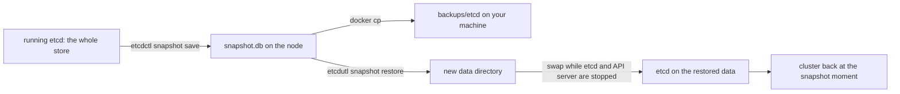

## Bạn cần biết trước

- [[k8s.l3.kubeadm]] — etcd chạy dưới dạng static Pod trên node control plane, với các chứng chỉ do kubeadm tạo. Bài này dùng cả hai để sao chép dữ liệu của etcd.
- [[k8s.l3.control-plane-ha]] — nhiều etcd member giúp cluster sống qua một node hỏng. Bài này bàn về loại sự cố mà chúng không giúp được.
- [[k8s.l2.scheduled-backups]] — CronJob dump các database của staging. Bài này chỉ ra thứ bản backup đó không bao phủ, và thứ nó bao phủ mà bản sao của etcd thì không.
- [[devops.l3.disaster-recovery-drill]] — dựng lại một môi trường từ repo cấu hình. Bài này so sánh cách dựng lại đó với cách đưa về một bản sao kho dữ liệu của cluster.

## Tình huống

Mọi object bạn tạo trong track này, từ Deployment đầu tiên tới các custom resource của module này, đều nằm trong etcd trên node control plane. CronJob hằng đêm dump database, còn buổi diễn tập DR đã dựng lại staging từ repo cấu hình. Một đồng nghiệp hỏi hai câu: nếu ổ đĩa của node control plane hỏng thì sao, và nếu ai đó xóa nhầm namespace thì sao? Ba etcd member không giúp được ở câu thứ hai, vì chúng giữ cùng một dữ liệu và lệnh xóa tới được cả ba. Chưa có thứ gì bạn dựng sao chép chính etcd. Làm sao lưu lại các object của cluster tại một thời điểm, và đưa chúng về thì sẽ hoàn tác những gì?

## Khái niệm cốt lõi

- **etcd snapshot** (Bản sao toàn bộ dữ liệu etcd tại một thời điểm; khôi phục nó đưa mọi object của cluster về thời điểm đó) — một file chứa bản sao toàn bộ kho dữ liệu của etcd tại một thời điểm. Khôi phục file này thì mọi object của cluster quay về thời điểm đó.
- `etcdctl` — client dòng lệnh của etcd, nói chuyện với một etcd đang chạy qua client port. `etcdctl snapshot save` ghi một snapshot qua port đó.
- `etcdutl` — công cụ quản trị của etcd, làm việc thẳng trên các file của etcd thay vì với một etcd đang chạy. `etcdutl snapshot restore` biến một snapshot thành một thư mục dữ liệu.
- Thư mục dữ liệu (data directory) — thư mục nơi một etcd member giữ dữ liệu. Trên node kubeadm, đó là `/var/lib/etcd`, được mount từ node vào static Pod của etcd.

## Cơ chế hoạt động



Trong tình huống trên, kho dữ liệu bạn muốn lưu là kho etcd giữ cho `donhang`. Bài lab làm trên một cluster một node dùng xong bỏ, `donhang-lifecycle`. kind chạy kubeadm bên trong node, vốn là một container Docker, nên static Pod của etcd và các thư mục đi kèm giống hệt trên một node kubeadm. Khôi phục ở đây không thể làm hỏng `donhang`.

`etcdctl snapshot save` yêu cầu etcd đang chạy đưa ra một bản sao kho dữ liệu và ghi nó ra file. etcd chỉ tin chứng chỉ client do certificate authority riêng của etcd ký, tức etcd CA mà kubeadm đã tạo. Vì thế lệnh truyền vào CA đó, một chứng chỉ và một key lấy từ `/etc/kubernetes/pki/etcd`. Bản sao nằm lại trên node sẽ mất cùng node, nên script sao nó về máy của bạn.

Khôi phục gồm hai bước. `etcdutl snapshot restore` đọc file và ghi ra một thư mục dữ liệu mới, etcd đang chạy không nhìn thấy thư mục này. Sau đó etcd phải khởi động trên thư mục đó. Tài liệu Kubernetes quy định thứ tự: dừng mọi API server, khôi phục etcd, rồi khởi động lại các API server, để không gì tiếp tục trả dữ liệu từ trước lần khôi phục. Script dừng cả hai static Pod bằng cách chuyển manifest của chúng ra khỏi `/etc/kubernetes/manifests`, hoán đổi thư mục, rồi chuyển manifest về. kubelet khởi động cả hai trên dữ liệu đã khôi phục. Tài liệu cũng khuyên sau đó khởi động lại `kube-scheduler`, `kube-controller-manager` (thành phần chạy các vòng điều khiển có sẵn) và kubelet, để không thành phần nào dựa vào dữ liệu cũ. Bài lab không làm bước này.

Từ lúc đó, API server trả về những gì snapshot chứa: object tạo sau snapshot biến mất, object xóa sau snapshot quay lại. Khôi phục không chọn từng object. Nó đưa cả kho dữ liệu về một thời điểm.

## Trong hệ thống Đơn Hàng

`scripts/k8s/etcd-snapshot.sh` nạp `scripts/lib/lifecycle.sh` bằng `source`, file này nằm ngoài các đoạn trích. Nó định nghĩa `show` (in một lệnh sau `$` rồi chạy lệnh đó), gán cho `$lc_node` và `$etcd_pod` tên của container node và Pod của etcd, trỏ `kubectl` tới `donhang-lifecycle`, và cho `etcdctl` cùng `etcdutl` chạy bên trong Pod của etcd. `etcdctl` còn được truyền client port cùng CA, chứng chỉ và key từ `/etc/kubernetes/pki/etcd`.

```bash file=scripts/k8s/etcd-snapshot.sh tag=stage-3 lines=13-29
# lesson: k8s.l3.etcd-snapshots
# A ConfigMap that exists when the snapshot is taken.
show kubectl create configmap before --from-literal=taken=before-the-snapshot
# etcdctl, inside etcd's Pod, through the client port with the
# certificates kubeadm created: the whole store, written to a file in
# /var/lib/etcd, which the Pod mounts from the node.
echo "\$ kubectl exec -n kube-system $etcd_pod -- etcdctl --endpoints=https://127.0.0.1:2379 \\"
echo "    --cacert=... --cert=... --key=... snapshot save /var/lib/etcd/snapshot.db"
etcdctl snapshot save /var/lib/etcd/snapshot.db 2>&1 | grep -o 'Snapshot saved at .*'
# Off the node: a snapshot that stays on the node is lost with the node.
mkdir -p backups/etcd
echo "\$ docker cp $lc_node:/var/lib/etcd/snapshot.db backups/etcd/donhang-lifecycle.db"
docker cp "$lc_node:/var/lib/etcd/snapshot.db" backups/etcd/donhang-lifecycle.db 2>/dev/null
echo "copied: $(ls backups/etcd/donhang-lifecycle.db)"
# A ConfigMap created after the snapshot.
show kubectl create configmap after --from-literal=taken=after-the-snapshot
show kubectl get configmaps before after
```

Hãy để ý thứ tự: `before`, rồi snapshot, rồi `after`. `etcdctl` kết nối tới `https://127.0.0.1:2379`, client port của etcd. Snapshot được ghi vào `/var/lib/etcd`, thư mục mà Pod mount từ node. Node là một container Docker, nên `docker cp` sao file về `backups/etcd/` trên máy của bạn.

```bash file=scripts/k8s/etcd-snapshot.sh tag=stage-3 lines=32-53
# lesson: k8s.l3.etcd-snapshots
# etcdutl writes a new data folder from the snapshot, for a member with the
# name and peer address etcd's static Pod uses. The running etcd does not
# see it yet.
ip=$(kubectl get node "$lc_node" -o jsonpath='{.status.addresses[0].address}')
echo "\$ kubectl exec -n kube-system $etcd_pod -- etcdutl snapshot restore /var/lib/etcd/snapshot.db \\"
echo "    --data-dir /var/lib/etcd/restored --name $lc_node --initial-cluster $lc_node=https://<node address>:2380 ..."
etcdutl snapshot restore /var/lib/etcd/snapshot.db --data-dir /var/lib/etcd/restored --name "$lc_node" \
  --initial-cluster "$lc_node=https://$ip:2380" --initial-advertise-peer-urls "https://$ip:2380" >/dev/null 2>&1
echo

# lesson: k8s.l3.etcd-snapshots
# Swap the data: the static Pods of etcd and the API server leave the
# manifests folder, so the kubelet stops them; the restored member folder
# takes the old one's place; the manifests come back, and the kubelet
# starts both again on the restored data.
node() { echo "\$ docker exec $lc_node sh -c '$*'"; docker exec "$lc_node" sh -c "$*"; }
node 'mkdir -p /root/stopped && mv /etc/kubernetes/manifests/etcd.yaml /etc/kubernetes/manifests/kube-apiserver.yaml /root/stopped/'
until [ -z "$(docker exec "$lc_node" crictl ps -q --name '^(etcd|kube-apiserver)$')" ]; do sleep 2; done
node 'mv /var/lib/etcd/member /var/lib/etcd/member.before-restore && mv /var/lib/etcd/restored/member /var/lib/etcd/member'
node 'mv /root/stopped/etcd.yaml /root/stopped/kube-apiserver.yaml /etc/kubernetes/manifests/'
api_wait
```

`ip` là địa chỉ của node, đọc từ Node object, còn `node` in một lệnh rồi chạy lệnh đó bên trong container node. `etcdutl` ghi `/var/lib/etcd/restored` cho một member mang tên và peer address của node. Peer address là nơi các etcd member gọi tới nhau, port `2380`, tách biệt với client port `2379`. Member đã khôi phục mang đúng tên và peer address mà static Pod của etcd đang dùng. Vòng `until` chờ tới khi `crictl`, client dòng lệnh của container runtime, không còn liệt kê container `etcd` hay `kube-apiserver` nào. Thư mục `member` cũ được giữ lại dưới tên `member.before-restore`. `api_wait`, đến từ `lifecycle.sh`, chờ tới khi API server trả lời lại. Sau đó script chạy `kubectl get configmaps before after` thêm một lần.

```text output=true
$ kind create cluster --name donhang-lifecycle --config deploy/k8s/kind-lifecycle-config.yaml --kubeconfig secrets/donhang-lifecycle.kubeconfig
$ kubectl get nodes -o custom-columns=NAME:.metadata.name,VERSION:.status.nodeInfo.kubeletVersion
NAME                              VERSION
donhang-lifecycle-control-plane   v1.34.11

$ kubectl create configmap before --from-literal=taken=before-the-snapshot
configmap/before created
$ kubectl exec -n kube-system etcd-donhang-lifecycle-control-plane -- etcdctl --endpoints=https://127.0.0.1:2379 \
    --cacert=... --cert=... --key=... snapshot save /var/lib/etcd/snapshot.db
Snapshot saved at /var/lib/etcd/snapshot.db
$ docker cp donhang-lifecycle-control-plane:/var/lib/etcd/snapshot.db backups/etcd/donhang-lifecycle.db
copied: backups/etcd/donhang-lifecycle.db
$ kubectl create configmap after --from-literal=taken=after-the-snapshot
configmap/after created
$ kubectl get configmaps before after
NAME     DATA   AGE
before   1      ...
after    1      ...

$ kubectl exec -n kube-system etcd-donhang-lifecycle-control-plane -- etcdutl snapshot restore /var/lib/etcd/snapshot.db \
    --data-dir /var/lib/etcd/restored --name donhang-lifecycle-control-plane --initial-cluster donhang-lifecycle-control-plane=https://<node address>:2380 ...

$ docker exec donhang-lifecycle-control-plane sh -c 'mkdir -p /root/stopped && mv /etc/kubernetes/manifests/etcd.yaml /etc/kubernetes/manifests/kube-apiserver.yaml /root/stopped/'
$ docker exec donhang-lifecycle-control-plane sh -c 'mv /var/lib/etcd/member /var/lib/etcd/member.before-restore && mv /var/lib/etcd/restored/member /var/lib/etcd/member'
$ docker exec donhang-lifecycle-control-plane sh -c 'mv /root/stopped/etcd.yaml /root/stopped/kube-apiserver.yaml /etc/kubernetes/manifests/'

$ kubectl get configmaps before after
NAME     DATA   AGE
before   1      ...
Error from server (NotFound): configmaps "after" not found
```

Trước khi khôi phục, cả hai ConfigMap đều tồn tại. Sau khi khôi phục, `before` vẫn còn và `after` là `NotFound`: API server đọc kho dữ liệu đã khôi phục, trong đó `after` chưa từng được ghi. Không có gì xóa `after`. Cả kho dữ liệu đã quay về thời điểm chụp snapshot.

Thứ file không chứa cũng quan trọng không kém. etcd giữ object, không giữ dữ liệu mà object trỏ tới. Các dòng của database trên claim `data-db-0` nằm trên một volume, còn image nằm trong registry, và registry cần bản sao riêng vì snapshot chỉ giữ tên image. Snapshot giữ claim object, không giữ dữ liệu trên volume đằng sau nó, nên các bản dump của k8s.l2.scheduled-backups vẫn cần. File có chứa mọi Secret, và mặc định Kubernetes lưu Secret trong etcd mà không mã hóa, nên ai đọc được `backups/etcd/donhang-lifecycle.db` cũng đọc được các Secret đó. Khi giữ snapshot, hãy cất và bảo vệ chúng như chính các secret.

## Senior hay nhầm rằng…

- **"Snapshot etcd cũng sao lưu dữ liệu trong persistent volume."** → Thực ra etcd lưu object PersistentVolumeClaim và PersistentVolume, không lưu các file trên volume đằng sau chúng. Bạn sẽ nhận ra khi cluster đã khôi phục liệt kê claim `data-db-0`, nhưng database trên đó chứa những gì volume đang có lúc này, hoặc chẳng có gì nếu volume đã mất.
- **"Khôi phục snapshot chỉ mang về những object đã mất."** → Thực ra khôi phục thay cả kho dữ liệu, nên mọi thay đổi sau snapshot đều bị hoàn tác, dù muốn hay không. Bạn sẽ nhận ra khi `after`, tạo sau snapshot và chưa từng bị xóa, là `NotFound` sau khi khôi phục xong.
- **"Cluster quản lý bằng GitOps không bao giờ cần backup etcd."** → Thực ra repo cấu hình chỉ giữ những gì đã được commit vào đó. Khi các object bị mất có trong repo, để Argo CD sync lại chúng từ repo cấu hình là cách sửa nhỏ hơn, vì Argo CD tạo lại chúng mà không hoàn tác các thay đổi từ snapshot gần nhất. Object chỉ sống trong cluster, như một ConfigMap tạo bằng `kubectl` giống `before`, chỉ quay lại được từ snapshot. Bạn sẽ nhận ra khi bản dựng lại từ Git đã `Synced` nhưng thiếu một thứ tạo bằng tay.

## Thử ngay (3 phút)

Ở thư mục gốc của repo Đơn Hàng, khi Docker Desktop đang chạy và đã cài `kubectl` cùng kind:

1. Chạy `scripts/k8s/etcd-snapshot.sh`. Script xóa rồi tạo lại `donhang-lifecycle`, có thể mất lâu hơn thời gian của bài tập này. Script xong khi in dòng `NotFound`. `donhang` không bị đụng tới.
2. So sánh hai kết quả của `kubectl get configmaps before after`, rồi liệt kê `backups/etcd/`.

Kết quả mong đợi: kết quả đầu liệt kê `before` và `after`. Kết quả thứ hai liệt kê `before` và kết thúc bằng `Error from server (NotFound): configmaps "after" not found`. `backups/etcd/` chứa `donhang-lifecycle.db`.

## Liên hệ

- [[k8s.l3.kubeadm]] — các static Pod và chứng chỉ etcd mà bài này dừng, hoán đổi dữ liệu bên dưới và dùng để kết nối.
- [[k8s.l3.control-plane-ha]] — sự cố ngược lại: các member bảo vệ khỏi mất một node, còn snapshot bảo vệ khỏi một thay đổi sai mà mọi member đều đã nhận.
- [[k8s.l2.scheduled-backups]] — nửa còn lại của backup cluster: dữ liệu trên volume mà snapshot không chứa.
- [[devops.l3.disaster-recovery-drill]] — cách sửa thay thế: dựng lại từ repo cấu hình, chỉ đụng tới những gì Git giữ.
- [[devops.l3.restore-testing]] — cùng quy tắc đó cho etcd: một snapshot chỉ được tính khi đã khôi phục thành công từ nó, như trong bài lab này.
- [[devops.l3.rpo-and-rto]] — snapshot gần nhất cũ bao lâu thì một lần khôi phục làm mất bấy nhiêu thay đổi của cluster.
- [[k8s.l3.operator-pattern]] — controller so sánh object với những gì đang tồn tại, nên sau khi khôi phục chúng làm việc từ các object đã quay ngược. Tài liệu khuyên khởi động lại `kube-scheduler`, `kube-controller-manager` và kubelet để không thành phần nào giữ dữ liệu cũ.
- [[k8s.l3.encryption-at-rest]] — bài tiếp theo: giữ cho Secret trong etcd và trong snapshot không đọc được.

## Tóm tắt 5 dòng

1. Khôi phục snapshot etcd đưa mọi object trong cluster về thời điểm chụp snapshot, không chỉ những object đã mất.
2. `etcdctl snapshot save` sao toàn bộ kho dữ liệu qua client port của etcd, với các chứng chỉ etcd do kubeadm tạo.
3. `etcdutl snapshot restore` ghi một thư mục dữ liệu mới. etcd và API server được dừng trong lúc etcd được chuyển sang thư mục đó.
4. Snapshot giữ object, không giữ dữ liệu trên volume hay image, nên vẫn cần dump database và bản sao registry.
5. Snapshot chứa mọi Secret, mặc định không mã hóa, nên file được cất giữ và bảo vệ như chính các secret.
