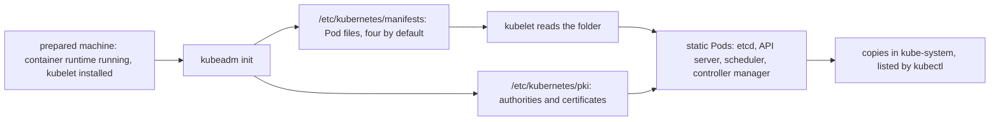

## Before you start

- [[k8s.l3.control-plane-ha]] — every control-plane node runs the API server, etcd and kube-scheduler; this lesson shows what starts them there.
- [[k8s.l3.cni-plugins]] — every working cluster needs a CNI plugin, and kind installs kindnet while building `donhang`; this lesson shows that step is separate from building the control plane.
- [[k8s.l3.clusters-without-a-cloud]] — on machines you run yourself, nobody hands you a ready cluster; this lesson covers the tool that builds one on them.

## The situation

The customer from the bare-metal module has three machines ready, and you must turn them into a cluster. On your laptop, kind built `donhang` with one command, so you look at what it left on the control-plane node. `kubectl get pods -n kube-system` lists `kube-apiserver-donhang-control-plane` and `etcd-donhang-control-plane`, yet no Deployment created them. That is odd: every Deployment is stored through the API server, and here the API server itself runs as a Pod. Something on the node started it with no API server to ask. What builds a control plane on a prepared machine, and what starts its Pods before any API server exists?

## Core concepts

- **kubeadm** — the official command-line tool that turns machines with a container runtime running and the kubelet installed into a cluster: `kubeadm init` sets up the first control-plane node, and `kubeadm join` adds each further node.
- **static Pod** — a Pod the kubelet runs straight from a manifest file in a folder on its own node, without asking the API server; the API server only shows a copy of it.
- Container runtime — the program on a node that starts and stops containers when the kubelet asks; kind's nodes use containerd.
- Certificate authority — a key and certificate kept only to sign other certificates; a program that trusts the authority accepts every certificate it signed.
- Certificate expiry — the date written into a certificate after which it is no longer valid, whatever still uses it.

## How it works



In the situation above, kind ran kubeadm inside the node container `donhang-control-plane`. The diagram starts one step earlier, with a prepared machine. kubeadm expects a container runtime and the kubelet to be installed already, and installs neither. kind's node image ships them; on the customer's machines, preparing them is your job.

`kubeadm init` then does the two things the diagram shows side by side. It creates the cluster's certificate authorities, three of them, under `/etc/kubernetes/pki` and signs certificates for the components: most sit in `pki`, and the scheduler's and controller manager's sit inside their kubeconfig files in `/etc/kubernetes`. By default it also writes one Pod manifest each for etcd, the API server, kube-scheduler and kube-controller-manager, the component that runs the built-in control loops, into `/etc/kubernetes/manifests`.

The kubelet watches that folder. For each file it starts the Pod's containers itself, as static Pods, with no API server involved; that is how the API server can run as a Pod before any API server exists. The components read these certificates and use them to trust each other. Once the API server answers, the kubelet creates a copy of each static Pod there, named after the node, and that copy is what `kubectl` listed.

`kubeadm join`, run on another prepared machine, adds it as a node; kind ran it on `donhang-worker` and `donhang-worker2`. Neither command installs a Pod network. Until a CNI plugin runs, nodes stay `NotReady`. kind installs kindnet as its own step after kubeadm; on your own machines, you choose and install one.

## In the Đơn Hàng system

`scripts/k8s/kubeadm.sh` only reads; it changes nothing on the node. `node`, defined above the excerpt, prints a command after `$` and runs it inside `donhang-control-plane` with `docker exec`.

```bash file=scripts/k8s/kubeadm.sh tag=stage-3 lines=10-17
# lesson: k8s.l3.kubeadm
# kind built each node with kubeadm, from the configuration it wrote to
# /kind/kubeadm.conf. kubeadm found the kubelet and the container runtime
# (containerd) already installed and running.
node kubeadm version -o short
node systemctl is-active kubelet containerd
node grep -m 1 '^kind:' /kind/kubeadm.conf
echo
```

In the capture below, `kubeadm version` prints `v1.34.11`, the version of `donhang`'s node image. `systemctl is-active` answers `active` twice: the kubelet and containerd are installed and running on the node; kind's node image shipped both, and kubeadm installed neither. The first `kind:` line of `/kind/kubeadm.conf` reads `ClusterConfiguration`, one type of kubeadm configuration object; this lesson does not open the rest of the file. In the next excerpt, `show`, from `scripts/lib/network-lessons.sh`, prints a command and runs it on your machine.

```bash file=scripts/k8s/kubeadm.sh tag=stage-3 lines=19-36
# lesson: k8s.l3.kubeadm
# Static Pods: the kubelet starts the control plane from these files, with
# no API server to ask. The API server then shows a copy of each, named
# after the node.
node ls /etc/kubernetes/manifests
show kubectl get pods -n kube-system -l tier=control-plane -o custom-columns=POD:.metadata.name,NODE:.spec.nodeName
echo

# lesson: k8s.l3.kubeadm
# The certificate authorities (ca, etcd/ca, front-proxy-ca) kubeadm init
# created, and the certificates it signed with them for the components.
node ls /etc/kubernetes/pki /etc/kubernetes/pki/etcd
echo

# lesson: k8s.l3.kubeadm
# Certificates expire one year after they were signed, the authorities ten
# years after.
node kubeadm certs check-expiration 2>/dev/null | grep -v '^\[check-expiration\]'
```

```text output=true
$ docker exec donhang-control-plane kubeadm version -o short
v1.34.11
$ docker exec donhang-control-plane systemctl is-active kubelet containerd
active
active
$ docker exec donhang-control-plane grep -m 1 ^kind: /kind/kubeadm.conf
kind: ClusterConfiguration

$ docker exec donhang-control-plane ls /etc/kubernetes/manifests
etcd.yaml
kube-apiserver.yaml
kube-controller-manager.yaml
kube-scheduler.yaml
$ kubectl get pods -n kube-system -l tier=control-plane -o custom-columns=POD:.metadata.name,NODE:.spec.nodeName
POD                                             NODE
etcd-donhang-control-plane                      donhang-control-plane
kube-apiserver-donhang-control-plane            donhang-control-plane
kube-controller-manager-donhang-control-plane   donhang-control-plane
kube-scheduler-donhang-control-plane            donhang-control-plane

$ docker exec donhang-control-plane ls /etc/kubernetes/pki /etc/kubernetes/pki/etcd
/etc/kubernetes/pki:
apiserver-etcd-client.crt
apiserver-etcd-client.key
apiserver-kubelet-client.crt
apiserver-kubelet-client.key
apiserver.crt
apiserver.key
ca.crt
ca.key
etcd
front-proxy-ca.crt
front-proxy-ca.key
front-proxy-client.crt
front-proxy-client.key
sa.key
sa.pub

/etc/kubernetes/pki/etcd:
ca.crt
ca.key
healthcheck-client.crt
healthcheck-client.key
peer.crt
peer.key
server.crt
server.key

$ docker exec donhang-control-plane kubeadm certs check-expiration

CERTIFICATE   EXPIRES   RESIDUAL TIME   CERTIFICATE AUTHORITY   EXTERNALLY MANAGED
admin.conf                 ...   ...   ca               no      
apiserver                  ...   ...   ca               no      
apiserver-etcd-client      ...   ...   etcd-ca          no      
apiserver-kubelet-client   ...   ...   ca               no      
controller-manager.conf    ...   ...   ca               no      
etcd-healthcheck-client    ...   ...   etcd-ca          no      
etcd-peer                  ...   ...   etcd-ca          no      
etcd-server                ...   ...   etcd-ca          no      
front-proxy-client         ...   ...   front-proxy-ca   no      
scheduler.conf             ...   ...   ca               no      
super-admin.conf           ...   ...   ca               no      

CERTIFICATE AUTHORITY   EXPIRES   RESIDUAL TIME   EXTERNALLY MANAGED
ca               ...   9y   no      
etcd-ca          ...   9y   no      
front-proxy-ca   ...   9y   no      
```

The four files in `manifests` match the four Pods `kubectl` lists with the label `tier=control-plane`, each name ending in `-donhang-control-plane`, the node that runs it: these are the copies the kubelet created.

`pki` holds three certificate authorities, each a `.crt` and `.key` pair: `ca` for the cluster, `etcd/ca` for etcd, and `front-proxy-ca` for a way of extending the API server this course does not cover; the `check-expiration` table names them `ca`, `etcd-ca` and `front-proxy-ca`. Most other pairs are certificates they signed; `sa.key` and `sa.pub` are a plain key pair, not a certificate, which this lesson does not use. `apiserver.crt` is the one the API server presents to its clients; `apiserver-etcd-client.crt` is the one it presents to etcd, which checks client certificates against `etcd/ca`, so a certificate signed by `ca` does not pass.

The last command drops kubeadm's lines that start with `[check-expiration]`. The capture masks the dates and the certificates' residual time, which change with every run; the authorities show `9y`. By default kubeadm signs certificates valid for one year and authorities valid for ten. The rows ending in `.conf` are kubeconfig files with a certificate inside, such as `admin.conf`. By default, a kubeadm upgrade renews the certificates kubeadm manages on each node it upgrades, so a cluster whose control-plane nodes are upgraded less than a year apart does not reach the date.

kubeadm is not the only way to build a cluster on your own machines. Some distributions of Kubernetes, packages that install Kubernetes and its parts as one program, made for small machines bundle the container runtime, the control-plane components and a network plugin into one install. When the machines are small and the team wants fewer steps, that trade can suit; you give up choosing each part, which kubeadm leaves to you.

## Seniors often assume…

- **"kubeadm also creates the machines and installs everything a cluster needs."** → Actually kubeadm only builds a cluster on machines with a container runtime running and the kubelet installed, and it installs no Pod network. You notice this when a cluster built with `kubeadm init` and no CNI plugin lists its nodes as `NotReady`.
- **"The API server starts the other control-plane Pods, so nothing runs before it."** → Actually the kubelet starts etcd, kube-scheduler, kube-controller-manager and the API server itself from files on the node, without asking any API server. You notice this when `ls /etc/kubernetes/manifests` on `donhang-control-plane` lists `kube-apiserver.yaml` beside the others, and every control-plane Pod's name ends with the node's name.
- **"A cluster's certificates stay valid for as long as the cluster runs."** → Actually the certificates kubeadm signs expire one year after signing by default, unless a renewal, such as the one a kubeadm upgrade performs by default, replaces them first. You notice this when `kubeadm certs check-expiration` shows every certificate with a residual time under a year, while only the authorities show years.

## Try it (3 minutes)

From the root of the Đơn Hàng repository, with Docker Desktop running and `kubectl` installed:

1. Run `scripts/k8s/kubeadm.sh`. If the cluster `donhang` is gone, the script builds it first, which takes longer.
2. Find the files listed under `/etc/kubernetes/manifests`, the `POD` column, and the `RESIDUAL TIME` column of both tables.

Expected result: four files, `etcd.yaml`, `kube-apiserver.yaml`, `kube-controller-manager.yaml` and `kube-scheduler.yaml`; four Pods with the same names plus `-donhang-control-plane`; every certificate's residual time under one year, shown in days, and `9y` for `ca`, `etcd-ca` and `front-proxy-ca`.

## Connections

- [[k8s.l3.control-plane-ha]] — what each control-plane node runs; this lesson shows how kubeadm puts it there.
- [[k8s.l3.cni-plugins]] — the step kubeadm leaves out: the Pod network a separate plugin provides.
- [[k8s.l3.clusters-without-a-cloud]] — the same own-machines setting, one step earlier: before addresses and disks, someone has to build the cluster.
- [[k8s.l1.cluster-nodes-and-control-plane]] — the same `donhang` nodes, seen from outside as Docker containers.
- [[k8s.l3.api-request-checks]] — how the API server decides who a caller is; a certificate signed by the authority in `pki` is one way.
- [[foundation.l1.tls-and-https]] — the same certificates and authorities, used here between the cluster's own components.
- [[k8s.l3.cluster-upgrades]] — the upgrade that renews these certificates.

## Five-line summary

1. kubeadm turns machines with a container runtime running and the kubelet installed into a cluster, by writing certificates and static Pod files.
2. `kubeadm init` sets up the first control-plane node and `kubeadm join` adds the others; neither installs a Pod network.
3. The kubelet starts etcd, the API server, kube-scheduler and kube-controller-manager from `/etc/kubernetes/manifests`, without asking any API server.
4. `kubeadm init` creates the cluster's certificate authorities under `/etc/kubernetes/pki` and signs the certificates the components use to trust each other.
5. By default kubeadm's certificates last one year and its authorities ten; by default a kubeadm upgrade renews the certificates on each node it upgrades.
