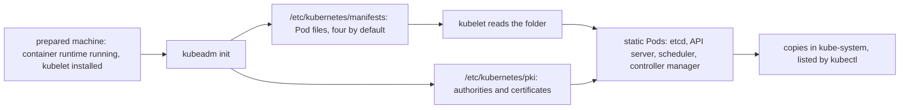

## Bạn cần biết trước

- [[k8s.l3.control-plane-ha]] — node control-plane nào cũng chạy API server, etcd và kube-scheduler. Bài này cho thấy cái gì khởi động chúng ở đó.
- [[k8s.l3.cni-plugins]] — cluster muốn chạy được phải có CNI plugin, và kind cài kindnet trong lúc dựng `donhang`. Bài này cho thấy bước đó tách riêng khỏi việc dựng control plane.
- [[k8s.l3.clusters-without-a-cloud]] — trên máy tự vận hành, không ai giao sẵn cho bạn một cluster. Bài này nói về công cụ dựng cluster trên những máy đó.

## Tình huống

Khách hàng ở module bare-metal đã chuẩn bị sẵn ba máy, và bạn phải biến chúng thành một cluster. Trên laptop, kind dựng `donhang` chỉ bằng một lệnh, nên bạn xem thử nó để lại gì trên node control-plane. `kubectl get pods -n kube-system` liệt kê `kube-apiserver-donhang-control-plane` và `etcd-donhang-control-plane`, nhưng không Deployment nào tạo ra chúng. Lạ ở chỗ: Deployment nào cũng được lưu qua API server, vậy mà ở đây chính API server lại chạy dưới dạng Pod. Có thứ gì đó trên node đã khởi động nó khi chưa có API server nào để hỏi. Cái gì dựng control plane trên một máy đã chuẩn bị, và cái gì khởi động các Pod của nó trước khi có API server?

## Khái niệm cốt lõi

- **kubeadm** (Công cụ chính thức dựng cluster trên máy đã chuẩn bị: init control plane, join node, nâng cấp) — công cụ dòng lệnh chính thức biến những máy đã có container runtime đang chạy và đã cài kubelet thành một cluster: `kubeadm init` dựng node control-plane đầu tiên, còn `kubeadm join` thêm từng node tiếp theo.
- **static Pod** (Pod mà kubelet chạy thẳng từ file manifest trên node, không cần API server) — Pod mà kubelet chạy thẳng từ một file manifest trong một thư mục trên chính node của nó, không hỏi API server. API server chỉ hiển thị một bản sao của Pod đó.
- Container runtime — chương trình trên node khởi động và dừng container khi kubelet yêu cầu. Các node của kind dùng containerd.
- Đơn vị cấp chứng chỉ (certificate authority, CA) — một cặp key và chứng chỉ chỉ dùng để ký các chứng chỉ khác. Chương trình nào tin đơn vị cấp chứng chỉ thì chấp nhận mọi chứng chỉ nó đã ký.
- Hạn của chứng chỉ — ngày ghi trong chứng chỉ, quá ngày đó chứng chỉ hết hiệu lực, dù còn thứ gì đang dùng nó.

## Cơ chế hoạt động



Trong tình huống trên, kind chạy kubeadm bên trong container node `donhang-control-plane`. Sơ đồ bắt đầu sớm hơn một bước, từ một máy đã chuẩn bị. kubeadm cần container runtime và kubelet có sẵn từ trước, và không tự cài thứ nào. Image node của kind đã kèm cả hai. Trên máy của khách hàng, chuẩn bị chúng là phần của bạn.

Sau đó `kubeadm init` làm hai việc mà sơ đồ vẽ song song. Nó tạo các đơn vị cấp chứng chỉ của cluster, tổng cộng ba cái, dưới `/etc/kubernetes/pki`, rồi ký chứng chỉ cho các thành phần. Phần lớn chứng chỉ nằm trong `pki`, còn chứng chỉ của scheduler và controller manager nằm bên trong file kubeconfig của chúng ở `/etc/kubernetes`. Mặc định, nó cũng ghi vào `/etc/kubernetes/manifests` mỗi thành phần một file manifest Pod: etcd, API server, kube-scheduler và kube-controller-manager, thành phần chạy các vòng điều khiển có sẵn.

kubelet theo dõi thư mục đó. Với mỗi file, nó tự khởi động các container của Pod dưới dạng static Pod, không cần API server. Nhờ vậy API server chạy được dưới dạng Pod trước khi có API server nào. Các thành phần đọc những chứng chỉ này và dùng chúng để tin nhau. Khi API server đã trả lời, kubelet tạo ở đó một bản sao của từng static Pod, đặt tên theo node, và `kubectl` liệt kê chính các bản sao này.

`kubeadm join`, chạy trên một máy đã chuẩn bị khác, thêm máy đó làm node. kind đã chạy lệnh này trên `donhang-worker` và `donhang-worker2`. Cả hai lệnh đều không cài mạng Pod. Khi chưa có CNI plugin chạy, các node vẫn ở `NotReady`. kind cài kindnet thành một bước riêng sau kubeadm. Trên máy của chính bạn, bạn tự chọn và cài một CNI plugin.

## Trong hệ thống Đơn Hàng

`scripts/k8s/kubeadm.sh` chỉ đọc, không thay đổi gì trên node. `node`, định nghĩa phía trên đoạn trích, in một lệnh sau `$` rồi chạy nó bên trong `donhang-control-plane` bằng `docker exec`.

```bash file=scripts/k8s/kubeadm.sh tag=stage-3 lines=10-17
# lesson: k8s.l3.kubeadm
# kind built each node with kubeadm, from the configuration it wrote to
# /kind/kubeadm.conf. kubeadm found the kubelet and the container runtime
# (containerd) already installed and running.
node kubeadm version -o short
node systemctl is-active kubelet containerd
node grep -m 1 '^kind:' /kind/kubeadm.conf
echo
```

Trong kết quả bên dưới, `kubeadm version` in `v1.34.11`, version của image node mà `donhang` dùng. `systemctl is-active` trả lời `active` hai lần: kubelet và containerd đã được cài và đang chạy trên node. Image node của kind đã kèm cả hai, kubeadm không cài thứ nào. Dòng `kind:` đầu tiên của `/kind/kubeadm.conf` là `ClusterConfiguration`, một loại object cấu hình của kubeadm. Bài này không mở phần còn lại của file. Ở đoạn trích tiếp theo, `show`, lấy từ `scripts/lib/network-lessons.sh`, in một lệnh rồi chạy nó trên máy bạn.

```bash file=scripts/k8s/kubeadm.sh tag=stage-3 lines=19-36
# lesson: k8s.l3.kubeadm
# Static Pods: the kubelet starts the control plane from these files, with
# no API server to ask. The API server then shows a copy of each, named
# after the node.
node ls /etc/kubernetes/manifests
show kubectl get pods -n kube-system -l tier=control-plane -o custom-columns=POD:.metadata.name,NODE:.spec.nodeName
echo

# lesson: k8s.l3.kubeadm
# The certificate authorities (ca, etcd/ca, front-proxy-ca) kubeadm init
# created, and the certificates it signed with them for the components.
node ls /etc/kubernetes/pki /etc/kubernetes/pki/etcd
echo

# lesson: k8s.l3.kubeadm
# Certificates expire one year after they were signed, the authorities ten
# years after.
node kubeadm certs check-expiration 2>/dev/null | grep -v '^\[check-expiration\]'
```

```text output=true
$ docker exec donhang-control-plane kubeadm version -o short
v1.34.11
$ docker exec donhang-control-plane systemctl is-active kubelet containerd
active
active
$ docker exec donhang-control-plane grep -m 1 ^kind: /kind/kubeadm.conf
kind: ClusterConfiguration

$ docker exec donhang-control-plane ls /etc/kubernetes/manifests
etcd.yaml
kube-apiserver.yaml
kube-controller-manager.yaml
kube-scheduler.yaml
$ kubectl get pods -n kube-system -l tier=control-plane -o custom-columns=POD:.metadata.name,NODE:.spec.nodeName
POD                                             NODE
etcd-donhang-control-plane                      donhang-control-plane
kube-apiserver-donhang-control-plane            donhang-control-plane
kube-controller-manager-donhang-control-plane   donhang-control-plane
kube-scheduler-donhang-control-plane            donhang-control-plane

$ docker exec donhang-control-plane ls /etc/kubernetes/pki /etc/kubernetes/pki/etcd
/etc/kubernetes/pki:
apiserver-etcd-client.crt
apiserver-etcd-client.key
apiserver-kubelet-client.crt
apiserver-kubelet-client.key
apiserver.crt
apiserver.key
ca.crt
ca.key
etcd
front-proxy-ca.crt
front-proxy-ca.key
front-proxy-client.crt
front-proxy-client.key
sa.key
sa.pub

/etc/kubernetes/pki/etcd:
ca.crt
ca.key
healthcheck-client.crt
healthcheck-client.key
peer.crt
peer.key
server.crt
server.key

$ docker exec donhang-control-plane kubeadm certs check-expiration

CERTIFICATE   EXPIRES   RESIDUAL TIME   CERTIFICATE AUTHORITY   EXTERNALLY MANAGED
admin.conf                 ...   ...   ca               no      
apiserver                  ...   ...   ca               no      
apiserver-etcd-client      ...   ...   etcd-ca          no      
apiserver-kubelet-client   ...   ...   ca               no      
controller-manager.conf    ...   ...   ca               no      
etcd-healthcheck-client    ...   ...   etcd-ca          no      
etcd-peer                  ...   ...   etcd-ca          no      
etcd-server                ...   ...   etcd-ca          no      
front-proxy-client         ...   ...   front-proxy-ca   no      
scheduler.conf             ...   ...   ca               no      
super-admin.conf           ...   ...   ca               no      

CERTIFICATE AUTHORITY   EXPIRES   RESIDUAL TIME   EXTERNALLY MANAGED
ca               ...   9y   no      
etcd-ca          ...   9y   no      
front-proxy-ca   ...   9y   no      
```

Bốn file trong `manifests` khớp với bốn Pod mà `kubectl` liệt kê theo label `tier=control-plane`. Tên Pod nào cũng kết thúc bằng `-donhang-control-plane`, tức node đang chạy nó: đây là các bản sao mà kubelet đã tạo.

`pki` chứa ba đơn vị cấp chứng chỉ, mỗi cái là một cặp `.crt` và `.key`: `ca` cho cluster, `etcd/ca` cho etcd, và `front-proxy-ca` cho một kiểu mở rộng API server mà khóa học này không đề cập. Bảng `check-expiration` gọi chúng là `ca`, `etcd-ca` và `front-proxy-ca`. Phần lớn các cặp còn lại là chứng chỉ do chúng ký. Riêng `sa.key` và `sa.pub` chỉ là một cặp key thường, không phải chứng chỉ, và bài này không dùng tới. `apiserver.crt` là chứng chỉ API server đưa ra cho client của nó. `apiserver-etcd-client.crt` là chứng chỉ nó đưa ra cho etcd. etcd kiểm tra chứng chỉ client theo `etcd/ca`, nên một chứng chỉ do `ca` ký sẽ không qua được.

Lệnh cuối bỏ các dòng của kubeadm bắt đầu bằng `[check-expiration]`. Kết quả ghi lại đã che ngày tháng và thời gian còn lại của các chứng chỉ, vì chúng đổi theo mỗi lần chạy. Các đơn vị cấp chứng chỉ hiện `9y`. Mặc định kubeadm ký chứng chỉ có hạn một năm và đơn vị cấp chứng chỉ có hạn mười năm. Các dòng kết thúc bằng `.conf` là file kubeconfig có chứng chỉ bên trong, chẳng hạn `admin.conf`. Mặc định, mỗi lần nâng cấp bằng kubeadm sẽ gia hạn các chứng chỉ mà kubeadm quản lý trên từng node được nâng cấp. Vì thế cluster nào có các node control-plane được nâng cấp cách nhau chưa tới một năm thì không chạm tới ngày hết hạn.

kubeadm không phải cách duy nhất để dựng cluster trên máy của chính bạn. Một số bản phân phối Kubernetes, tức gói cài Kubernetes và các phần của nó thành một chương trình, làm cho máy nhỏ, gộp container runtime, các thành phần control plane và một network plugin vào một lần cài. Khi máy nhỏ và team muốn ít bước hơn, đánh đổi đó có thể hợp lý. Đổi lại, bạn không được tự chọn từng phần, điều mà kubeadm để bạn quyết.

## Senior hay nhầm rằng…

- **"kubeadm cũng tạo máy và cài mọi thứ cluster cần."** → Thực ra kubeadm chỉ dựng cluster trên những máy đã có container runtime đang chạy và đã cài kubelet, và không cài mạng Pod. Bạn sẽ nhận ra khi một cluster dựng bằng `kubeadm init` mà chưa có CNI plugin liệt kê các node của nó ở trạng thái `NotReady`.
- **"API server khởi động các Pod control-plane khác, nên trước nó không có gì chạy."** → Thực ra kubelet khởi động etcd, kube-scheduler, kube-controller-manager và cả chính API server từ các file trên node, không hỏi API server nào. Bạn sẽ nhận ra khi `ls /etc/kubernetes/manifests` trên `donhang-control-plane` liệt kê `kube-apiserver.yaml` cạnh các file khác, và tên Pod control-plane nào cũng kết thúc bằng tên node.
- **"Chứng chỉ của cluster còn hiệu lực chừng nào cluster còn chạy."** → Thực ra mặc định chứng chỉ do kubeadm ký hết hạn một năm sau khi ký, trừ khi được gia hạn trước đó, chẳng hạn bằng lần gia hạn mà nâng cấp kubeadm làm theo mặc định. Bạn sẽ nhận ra khi `kubeadm certs check-expiration` cho thấy mọi chứng chỉ đều còn dưới một năm, chỉ các đơn vị cấp chứng chỉ mới còn tính bằng năm.

## Thử ngay (3 phút)

Ở thư mục gốc của repo Đơn Hàng, với Docker Desktop đang chạy và đã cài `kubectl`:

1. Chạy `scripts/k8s/kubeadm.sh`. Nếu cluster `donhang` không còn, script dựng nó trước, nên lâu hơn.
2. Tìm các file liệt kê dưới `/etc/kubernetes/manifests`, cột `POD`, và cột `RESIDUAL TIME` của cả hai bảng.

Kết quả mong đợi: bốn file `etcd.yaml`, `kube-apiserver.yaml`, `kube-controller-manager.yaml` và `kube-scheduler.yaml`. Bốn Pod có cùng các tên đó, thêm `-donhang-control-plane`. Thời gian còn lại của mọi chứng chỉ dưới một năm, tính bằng ngày, còn `ca`, `etcd-ca` và `front-proxy-ca` hiện `9y`.

## Liên hệ

- [[k8s.l3.control-plane-ha]] — những gì mỗi node control-plane chạy. Bài này cho thấy kubeadm đặt chúng vào đó thế nào.
- [[k8s.l3.cni-plugins]] — bước mà kubeadm bỏ ra ngoài: mạng Pod do một plugin riêng cung cấp.
- [[k8s.l3.clusters-without-a-cloud]] — cùng bối cảnh máy tự vận hành, sớm hơn một bước: trước khi lo địa chỉ và ổ đĩa, phải có người dựng cluster.
- [[k8s.l1.cluster-nodes-and-control-plane]] — cũng các node của `donhang`, nhìn từ bên ngoài dưới dạng container Docker.
- [[k8s.l3.api-request-checks]] — cách API server xác định người gọi là ai. Chứng chỉ do đơn vị cấp chứng chỉ trong `pki` ký là một trong các cách đó.
- [[foundation.l1.tls-and-https]] — cũng chứng chỉ và đơn vị cấp chứng chỉ ấy, ở đây dùng giữa chính các thành phần của cluster.
- [[k8s.l3.cluster-upgrades]] — lần nâng cấp gia hạn các chứng chỉ này.

## Tóm tắt 5 dòng

1. kubeadm biến những máy đã có container runtime đang chạy và đã cài kubelet thành cluster, bằng cách ghi chứng chỉ và file static Pod.
2. `kubeadm init` dựng node control-plane đầu tiên, `kubeadm join` thêm các node còn lại. Không lệnh nào cài mạng Pod.
3. kubelet khởi động etcd, API server, kube-scheduler và kube-controller-manager từ `/etc/kubernetes/manifests`, không hỏi API server nào.
4. `kubeadm init` tạo các đơn vị cấp chứng chỉ của cluster dưới `/etc/kubernetes/pki` và ký các chứng chỉ mà các thành phần dùng để tin nhau.
5. Mặc định chứng chỉ của kubeadm có hạn một năm, đơn vị cấp chứng chỉ mười năm. Nâng cấp kubeadm mặc định gia hạn chứng chỉ trên từng node được nâng cấp.
