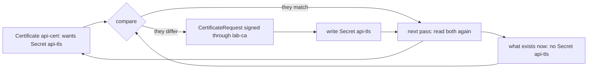

## Before you start

- [[k8s.l3.cert-manager]] — the Certificate `api-cert` and the Secret `api-tls` that cert-manager writes for it, which this lesson deletes.
- [[k8s.l1.control-plane-components]] — the control loop that compares desired state with what exists; an operator runs one more of them.
- [[k8s.l2.database-in-the-cluster]] — the work staging's single PostgreSQL server leaves to you: a standby, switching to it, backups.
- [[k8s.l3.cluster-roles]] — a ClusterRoleBinding grants a ServiceAccount rights in every namespace at once.

## The situation

While tidying the namespace `operator-lessons`, you delete the Secret `api-tls` by mistake. It held the certificate and key that cert-manager wrote for `api-cert` in the last lesson. You run nothing else and tell nobody, yet soon `kubectl get secret api-tls` finds it again, with a different certificate inside. Meanwhile, staging's PostgreSQL still runs as one server with no standby. A teammate asks whether some software in the cluster could look after the database the way cert-manager just looked after its Secret. What kind of program puts things back without being told, and what do you take on when you let one run your database?

## Core concepts

- **operator (Kubernetes)** — custom resources plus a controller, a program in the cluster that runs a control loop, for one piece of software, doing in code the routine work a person running that software would do by hand.
- Pass — one round of the loop, in which the controller reads the custom resource and the objects that exist now, compares them and acts on the difference.
- `CertificateRequest` — the object cert-manager creates each time it has a certificate signed for a Certificate; in this lab it is named after the Certificate with a number at the end, such as `api-cert-2`.
- The operator's rights — the RBAC rules bound to the ServiceAccount its controller runs as, which must cover every object it reads or writes, in every namespace it looks after.

## How it works



In the situation above, the operator is cert-manager, and the diagram is one pass of its loop. The two boxes on the left are its inputs. The Certificate is the custom resource: it describes the result wanted, a signed certificate for `donhang.localhost` in the Secret `api-tls`. The second input is what exists now, read through the API server. When you deleted `api-tls`, the two stopped matching.

At the compare step, the controller does not need to know that someone deleted anything. It sees only that the Certificate names a Secret that is not there, and that difference is enough. It has a new certificate signed through the Issuer `lab-ca`, recorded as a `CertificateRequest`, and writes it into a Secret with the old name. On the next pass the two sides match, and it does nothing.

This is the control loop that kube-scheduler and the kubelet run, applied to one application. Because a controller built this way compares states instead of replaying a list of changes, a change it missed, for instance while its Pod was restarting, still shows as a difference when it next compares, and it acts on it then.

What makes it an operator is the knowledge in the code. A person doing cert-manager's job by hand would notice the missing Secret, request a certificate and store it. Here those steps run inside the controller, started by the custom resource.

## In the Đơn Hàng system

The custom resource is the operator's whole input. This is the part of `deploy/k8s/lessons/api-certificate.yaml` below its comment:

```yaml file=deploy/k8s/lessons/api-certificate.yaml tag=stage-3 lines=7-18
apiVersion: cert-manager.io/v1
kind: Certificate
metadata:
  name: api-cert
  namespace: operator-lessons
spec:
  secretName: api-tls
  dnsNames:
    - donhang.localhost
  issuerRef:
    kind: Issuer
    name: lab-ca
```

Nothing in it says how to sign or what to do when the Secret is gone. It names only the result: the Secret `api-tls`, the name `donhang.localhost` and the Issuer `lab-ca`. The steps live in cert-manager's code.

Above the excerpt, `scripts/k8s/operator.sh` first runs `cert-manager.sh` if `api-cert` does not exist, then waits until it is `Ready`. It keeps the certificate's serial number in `before`; `serial` reads the current one with `openssl`, a command-line tool for reading certificates. `show` prints a command, then runs it. The `READY` column picks the `status` of the condition whose `type` is `Ready`.

```bash file=scripts/k8s/operator.sh tag=stage-3 lines=17-40
show kubectl delete secret api-tls -n operator-lessons
for _ in $(seq 60); do
  kubectl get secret api-tls -n operator-lessons >/dev/null 2>&1 && break
  sleep 1
done
kubectl wait --for=condition=Ready certificate/api-cert -n operator-lessons --timeout=120s >/dev/null
echo "\$ kubectl get secret api-tls -n operator-lessons"
kubectl get secret api-tls -n operator-lessons -o custom-columns=NAME:.metadata.name,TYPE:.type
echo

# lesson: k8s.l3.operator-pattern
# Same name, new certificate: cert-manager asked the Issuer once more, with
# the Certificate's second CertificateRequest (api-cert-2; right after
# cert-manager.sh, api-cert-1 issued the first certificate).
if [ "$(serial)" != "$before" ]; then echo "a new certificate: its serial number differs from the deleted one"; fi
show kubectl get certificaterequests -n operator-lessons \
  -o custom-columns=NAME:.metadata.name,ISSUER:.spec.issuerRef.name,READY:.status.conditions[?\(@.type==\"Ready\"\)].status
echo

# lesson: k8s.l3.operator-pattern
# To do that in every namespace, cert-manager's ServiceAccount may read
# every Secret in the cluster; a Pod's default ServiceAccount may not.
show kubectl auth can-i list secrets -A --as=system:serviceaccount:cert-manager:cert-manager
show kubectl auth can-i list secrets -A --as=system:serviceaccount:operator-lessons:default || true
```

```text output=true
$ kubectl delete secret api-tls -n operator-lessons
secret "api-tls" deleted from operator-lessons namespace
$ kubectl get secret api-tls -n operator-lessons
NAME      TYPE
api-tls   kubernetes.io/tls

a new certificate: its serial number differs from the deleted one
$ kubectl get certificaterequests -n operator-lessons -o custom-columns=NAME:.metadata.name,ISSUER:.spec.issuerRef.name,READY:.status.conditions[?(@.type=="Ready")].status
NAME         ISSUER   READY
api-cert-2   lab-ca   True

$ kubectl auth can-i list secrets -A --as=system:serviceaccount:cert-manager:cert-manager
yes
$ kubectl auth can-i list secrets -A --as=system:serviceaccount:operator-lessons:default
no
```

After the delete, the script only waits: its loop checks once a second, up to 60 times, and creates nothing. The Secret comes back with the same name and type `kubernetes.io/tls`, and the serial line confirms the certificate inside is new. The list shows a single request, `api-cert-2`, signed through `lab-ca` and `Ready`. The script's comment calls it the Certificate's second request. By default cert-manager keeps one request per Certificate and removes older ones, so `api-cert-1` is gone.

The last two commands ask the API server what two ServiceAccounts may do. cert-manager's ServiceAccount may list Secrets in every namespace (`-A`). The `default` ServiceAccount of `operator-lessons`, the one a Pod there runs as when its manifest names none, may not. The same grant lets cert-manager create and update Secrets there; `list` is just the action the script checks. It needs that reach to write a certificate wherever a Certificate lives. It also means a bug in cert-manager, or an upgrade that brings one, can reach every Secret in the cluster, not only the ones it wrote.

Staging has no such program for PostgreSQL. A PostgreSQL operator can take on the work the earlier lesson left to you, such as keeping standbys, switching to one when the server fails, and taking backups on a schedule, driven by a custom resource that describes the database. The lab installs none.

Whether to install one is a judgement with two conditions. An operator fits when its project is maintained, with fixes for the Kubernetes versions you run, and when your team learns how it behaves. Without both, an incident leaves you debugging the database and automation someone else wrote, at the same time.

## Seniors often assume…

- **"A controller reacts to each change event once, so a missed event is lost for good."** → Actually each pass compares the custom resource with what exists now, so the difference a missed change left behind is still there on the next pass, and the controller acts on it then. You notice this when `api-tls` comes back after `kubectl delete`, though nothing told cert-manager to act.
- **"A database operator removes the need to understand how the database replicates and fails over."** → Actually the operator runs the same standby and switching steps a person would, so their limits stay. By default the PostgreSQL server confirms a write without waiting for the standby to receive it, so a standby can trail the server by its replication lag. You notice this when, after a failover, the last few writes made just before it are missing, and only that lag explains why.
- **"Installing an operator only adds a few harmless new kinds to the cluster."** → Actually an operator usually brings a controller, often run as a Deployment, and the rights it needs, on top of its CRDs. cert-manager's manifest alone starts three Deployments next to its six CRDs. You notice this when `kubectl auth can-i list secrets -A` answers `yes` for cert-manager's ServiceAccount.

## Try it (3 minutes)

From the root of the Đơn Hàng repository, with Docker Desktop running, `kubectl` and `openssl` installed, and the `donhang` cluster from the earlier lessons running:

1. Run `scripts/k8s/operator.sh`. If `api-cert` is missing, the script runs `cert-manager.sh` first, which takes longer.
2. Find the line under `NAME      TYPE`, the line that starts with `a new certificate`, and the answers of the two `can-i` commands.

Expected result: `api-tls   kubernetes.io/tls`, then `a new certificate: its serial number differs from the deleted one`, then `yes` for cert-manager's ServiceAccount and `no` for `default`.

## Connections

- [[k8s.l3.cert-manager]] — the operator this lesson takes apart: its Certificate is the custom resource, its controller runs the loop.
- [[k8s.l1.control-plane-components]] — the same control loop, run by the cluster's own components for built-in kinds.
- [[k8s.l2.database-in-the-cluster]] — the left-over work a PostgreSQL operator could take on.
- [[k8s.l3.cluster-roles]] — the cluster-wide grant behind cert-manager's reach over every Secret.
- [[devops.l3.self-heal]] — the same compare-and-fix idea one layer up: Argo CD puts back objects changed away from Git.
- [[k8s.l2.statefulsets]] — the building block a database operator would create and manage for you.
- [[backend.l3.read-replicas]] — the streaming copy that standbys are built on, lag included.

## Five-line summary

1. An operator is custom resources plus a controller whose loop runs one piece of software, doing in code what a person did by hand.
2. Each pass compares the custom resource with what exists and acts on the difference, so a missed change is caught on a later pass.
3. Deleting `api-tls` is enough for cert-manager to issue a new certificate into a Secret of the same name.
4. A PostgreSQL operator can keep standbys, fail over and take backups; you still need to understand how it replicates and fails over.
5. An operator can run with wide rights, as cert-manager does; one fits when its project is maintained and your team knows how it behaves.
