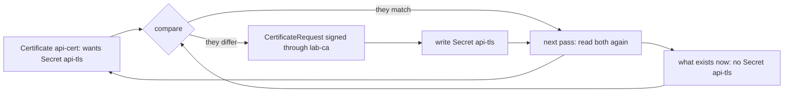

## Bạn cần biết trước

- [[k8s.l3.cert-manager]] — Certificate `api-cert` và Secret `api-tls` mà cert-manager ghi cho nó, Secret mà bài này sẽ xóa.
- [[k8s.l1.control-plane-components]] — vòng điều khiển so trạng thái mong muốn với những gì đang tồn tại. Operator chạy thêm một vòng như thế.
- [[k8s.l2.database-in-the-cluster]] — phần việc mà server PostgreSQL duy nhất của staging để lại cho bạn: một standby, chuyển sang nó, sao lưu.
- [[k8s.l3.cluster-roles]] — một ClusterRoleBinding trao quyền cho một ServiceAccount trong mọi namespace cùng lúc.

## Tình huống

Trong lúc dọn namespace `operator-lessons`, bạn lỡ tay xóa Secret `api-tls`. Secret này giữ chứng chỉ và key mà cert-manager đã ghi cho `api-cert` ở bài trước. Bạn không chạy thêm lệnh nào, cũng không báo ai, vậy mà chẳng bao lâu sau `kubectl get secret api-tls` lại tìm thấy nó, bên trong là một chứng chỉ khác. Trong khi đó, PostgreSQL của staging vẫn chạy một server, không có standby. Một đồng nghiệp hỏi liệu có phần mềm nào trong cluster trông database được như cách cert-manager vừa trông Secret của nó không. Loại chương trình nào tự đặt mọi thứ về chỗ cũ mà không cần ai bảo, và bạn gánh thêm những gì khi để một chương trình như thế vận hành database?

## Khái niệm cốt lõi

- **operator (Kubernetes)** (Custom resource kèm controller vận hành một phần mềm cụ thể, làm bằng code việc người vận hành vẫn làm tay) — custom resource cộng với một controller, tức chương trình trong cluster chạy một vòng điều khiển, dành riêng cho một phần mềm, làm bằng code những việc thường ngày mà người vận hành phần mềm đó vẫn làm tay.
- Lượt — một vòng của vòng lặp. Trong mỗi lượt, controller đọc custom resource và các object đang tồn tại, so chúng với nhau rồi hành động dựa trên phần chênh lệch.
- `CertificateRequest` — object mà cert-manager tạo mỗi lần cho ký một chứng chỉ theo một Certificate. Trong lab này, nó mang tên của Certificate kèm một con số ở cuối, chẳng hạn `api-cert-2`.
- Quyền của operator — các rule RBAC gắn với ServiceAccount mà controller của nó chạy dưới danh nghĩa. Chúng phải phủ mọi object nó đọc hoặc ghi, trong mọi namespace nó trông coi.

## Cơ chế hoạt động



Trong tình huống trên, operator chính là cert-manager, và sơ đồ là một lượt trong vòng lặp của nó. Hai ô bên trái là đầu vào. Certificate là custom resource: nó mô tả kết quả mong muốn, một chứng chỉ đã ký cho `donhang.localhost` nằm trong Secret `api-tls`. Đầu vào thứ hai là những gì đang tồn tại, đọc qua API server. Khi bạn xóa `api-tls`, hai bên hết khớp nhau.

Ở bước so sánh, controller không cần biết có ai đã xóa gì. Nó chỉ thấy Certificate ghi tên một Secret không có mặt, và chênh lệch đó là đủ. Nó cho ký một chứng chỉ mới qua Issuer `lab-ca`, ghi lại thành một `CertificateRequest`, rồi ghi chứng chỉ vào một Secret mang tên cũ. Tới lượt sau, hai bên đã khớp, và nó không làm gì.

Đây là vòng điều khiển mà kube-scheduler và kubelet vẫn chạy, áp vào một ứng dụng. Controller kiểu này so sánh trạng thái chứ không phát lại một danh sách thay đổi. Vì thế, một thay đổi nó bỏ lỡ, chẳng hạn trong lúc Pod của nó đang khởi động lại, vẫn hiện ra thành chênh lệch ở lần so sánh kế tiếp, và nó xử lý thay đổi đó lúc ấy.

Điều làm nên một operator là phần hiểu biết nằm trong code. Người làm tay công việc của cert-manager sẽ nhận ra Secret bị thiếu, xin một chứng chỉ rồi cất nó đi. Ở đây các bước đó chạy bên trong controller, và custom resource là thứ khởi động chúng.

## Trong hệ thống Đơn Hàng

Custom resource là toàn bộ đầu vào của operator. Đây là phần của `deploy/k8s/lessons/api-certificate.yaml` nằm dưới đoạn comment:

```yaml file=deploy/k8s/lessons/api-certificate.yaml tag=stage-3 lines=7-18
apiVersion: cert-manager.io/v1
kind: Certificate
metadata:
  name: api-cert
  namespace: operator-lessons
spec:
  secretName: api-tls
  dnsNames:
    - donhang.localhost
  issuerRef:
    kind: Issuer
    name: lab-ca
```

Trong file không có chỗ nào nói cách ký hay phải làm gì khi Secret biến mất. Nó chỉ nêu kết quả: Secret `api-tls`, tên `donhang.localhost` và Issuer `lab-ca`. Các bước nằm trong code của cert-manager.

Phía trên đoạn trích, `scripts/k8s/operator.sh` chạy `cert-manager.sh` trước nếu chưa có `api-cert`, rồi chờ tới khi nó `Ready`. Script giữ số serial của chứng chỉ trong `before`. `serial` đọc số hiện tại bằng `openssl`, một công cụ dòng lệnh để đọc chứng chỉ. `show` in ra một lệnh rồi chạy nó. Cột `READY` lấy `status` của condition có `type` là `Ready`.

```bash file=scripts/k8s/operator.sh tag=stage-3 lines=17-40
show kubectl delete secret api-tls -n operator-lessons
for _ in $(seq 60); do
  kubectl get secret api-tls -n operator-lessons >/dev/null 2>&1 && break
  sleep 1
done
kubectl wait --for=condition=Ready certificate/api-cert -n operator-lessons --timeout=120s >/dev/null
echo "\$ kubectl get secret api-tls -n operator-lessons"
kubectl get secret api-tls -n operator-lessons -o custom-columns=NAME:.metadata.name,TYPE:.type
echo

# lesson: k8s.l3.operator-pattern
# Same name, new certificate: cert-manager asked the Issuer once more, with
# the Certificate's second CertificateRequest (api-cert-2; right after
# cert-manager.sh, api-cert-1 issued the first certificate).
if [ "$(serial)" != "$before" ]; then echo "a new certificate: its serial number differs from the deleted one"; fi
show kubectl get certificaterequests -n operator-lessons \
  -o custom-columns=NAME:.metadata.name,ISSUER:.spec.issuerRef.name,READY:.status.conditions[?\(@.type==\"Ready\"\)].status
echo

# lesson: k8s.l3.operator-pattern
# To do that in every namespace, cert-manager's ServiceAccount may read
# every Secret in the cluster; a Pod's default ServiceAccount may not.
show kubectl auth can-i list secrets -A --as=system:serviceaccount:cert-manager:cert-manager
show kubectl auth can-i list secrets -A --as=system:serviceaccount:operator-lessons:default || true
```

```text output=true
$ kubectl delete secret api-tls -n operator-lessons
secret "api-tls" deleted from operator-lessons namespace
$ kubectl get secret api-tls -n operator-lessons
NAME      TYPE
api-tls   kubernetes.io/tls

a new certificate: its serial number differs from the deleted one
$ kubectl get certificaterequests -n operator-lessons -o custom-columns=NAME:.metadata.name,ISSUER:.spec.issuerRef.name,READY:.status.conditions[?(@.type=="Ready")].status
NAME         ISSUER   READY
api-cert-2   lab-ca   True

$ kubectl auth can-i list secrets -A --as=system:serviceaccount:cert-manager:cert-manager
yes
$ kubectl auth can-i list secrets -A --as=system:serviceaccount:operator-lessons:default
no
```

Sau lệnh xóa, script chỉ ngồi chờ: vòng lặp của nó kiểm tra mỗi giây một lần, tối đa 60 lần, và không tạo ra gì. Secret quay lại với đúng tên cũ và kiểu `kubernetes.io/tls`, còn dòng về số serial xác nhận chứng chỉ bên trong là chứng chỉ mới. Danh sách chỉ có một request, `api-cert-2`, được ký qua `lab-ca` và đã `Ready`. Comment của script gọi nó là request thứ hai của Certificate. Mặc định cert-manager chỉ giữ một request cho mỗi Certificate và xóa các request cũ hơn, nên `api-cert-1` không còn nữa.

Hai lệnh cuối hỏi API server xem hai ServiceAccount được phép làm gì. ServiceAccount của cert-manager được list Secret trong mọi namespace (`-A`). ServiceAccount `default` của `operator-lessons`, tức ServiceAccount mà Pod ở đó dùng khi manifest không ghi tên cái nào, thì không. Cùng quyền đó cho phép cert-manager tạo và cập nhật Secret ở khắp nơi. `list` chỉ là hành động mà script chọn để kiểm tra. cert-manager cần tầm với ấy để ghi chứng chỉ vào bất cứ đâu có Certificate. Nhưng nó cũng có nghĩa là một bug trong cert-manager, hay một lần nâng cấp mang bug theo, có thể chạm tới mọi Secret trong cluster, không chỉ những Secret nó đã ghi.

Staging không có chương trình nào như vậy cho PostgreSQL. Một operator PostgreSQL có thể nhận phần việc mà bài trước để lại cho bạn, như duy trì standby, chuyển sang standby khi server hỏng và sao lưu theo lịch, tất cả dựa trên một custom resource mô tả database. Lab không cài operator nào.

Có nên cài hay không là chuyện cân nhắc với hai điều kiện. Operator phù hợp khi dự án của nó còn được bảo trì, có bản sửa cho các version Kubernetes bạn đang chạy, và khi team bạn chịu tìm hiểu cách nó hoạt động. Thiếu một trong hai, lúc có sự cố bạn sẽ phải gỡ lỗi database và cùng lúc gỡ lỗi cả phần tự động hóa do người khác viết.

## Senior hay nhầm rằng…

- **"Controller phản ứng với mỗi sự kiện thay đổi đúng một lần, nên sự kiện bị lỡ là mất hẳn."** → Thực ra mỗi lượt so custom resource với những gì đang tồn tại, nên chênh lệch mà một thay đổi bị lỡ để lại vẫn còn đó ở lượt sau, và controller xử lý nó lúc ấy. Bạn sẽ nhận ra khi `api-tls` quay lại sau `kubectl delete`, dù không gì bảo cert-manager hành động.
- **"Có operator database rồi thì không cần hiểu database replicate và failover thế nào."** → Thực ra operator chạy đúng những bước duy trì standby và chuyển đổi mà một người sẽ làm, nên giới hạn của các bước đó vẫn còn nguyên. Mặc định server PostgreSQL xác nhận một lần ghi mà không chờ standby nhận được, nên standby có thể chậm hơn server đúng bằng replication lag. Bạn sẽ nhận ra khi, sau một lần failover, vài lần ghi cuối cùng ngay trước đó biến mất, và chỉ độ lag ấy giải thích được vì sao.
- **"Cài một operator chỉ thêm vào cluster vài kind mới vô hại."** → Thực ra ngoài các CRD, operator thường mang theo một controller, hay chạy dưới dạng Deployment, cùng các quyền nó cần. Riêng manifest của cert-manager đã khởi động ba Deployment bên cạnh sáu CRD. Bạn sẽ nhận ra khi `kubectl auth can-i list secrets -A` trả lời `yes` cho ServiceAccount của cert-manager.

## Thử ngay (3 phút)

Ở thư mục gốc của repo Đơn Hàng, với Docker Desktop đang chạy, đã cài `kubectl` và `openssl`, và cluster `donhang` từ các bài trước đang chạy:

1. Chạy `scripts/k8s/operator.sh`. Nếu chưa có `api-cert`, script chạy `cert-manager.sh` trước, nên lâu hơn.
2. Tìm dòng ngay dưới `NAME      TYPE`, dòng bắt đầu bằng `a new certificate`, và câu trả lời của hai lệnh `can-i`.

Kết quả mong đợi: `api-tls   kubernetes.io/tls`, rồi `a new certificate: its serial number differs from the deleted one`, rồi `yes` cho ServiceAccount của cert-manager và `no` cho `default`.

## Liên hệ

- [[k8s.l3.cert-manager]] — operator mà bài này mổ xẻ: Certificate của nó là custom resource, controller của nó chạy vòng lặp.
- [[k8s.l1.control-plane-components]] — cùng vòng điều khiển ấy, do chính các thành phần của cluster chạy cho các kind có sẵn.
- [[k8s.l2.database-in-the-cluster]] — phần việc còn lại mà một operator PostgreSQL có thể nhận.
- [[k8s.l3.cluster-roles]] — quyền trên toàn cluster đứng sau tầm với của cert-manager tới mọi Secret.
- [[devops.l3.self-heal]] — cùng ý tưởng so rồi sửa, ở tầng cao hơn: Argo CD đặt lại các object bị đổi khác với Git.
- [[k8s.l2.statefulsets]] — khối xây dựng mà một operator database sẽ tạo và quản lý hộ bạn.
- [[backend.l3.read-replicas]] — bản sao streaming làm nền cho standby, kèm cả độ lag.

## Tóm tắt 5 dòng

1. Operator là custom resource cộng với một controller có vòng lặp vận hành một phần mềm, làm bằng code việc người vẫn làm tay.
2. Mỗi lượt so custom resource với những gì đang tồn tại và hành động theo chênh lệch, nên thay đổi bị lỡ sẽ được bắt ở lượt sau.
3. Chỉ cần xóa `api-tls` là cert-manager cấp một chứng chỉ mới vào Secret cùng tên.
4. Operator PostgreSQL có thể duy trì standby, failover và sao lưu, nhưng bạn vẫn cần hiểu database replicate và failover thế nào.
5. Operator có thể chạy với quyền rộng, như cert-manager. Nó phù hợp khi dự án còn được bảo trì và team bạn hiểu cách nó hoạt động.
