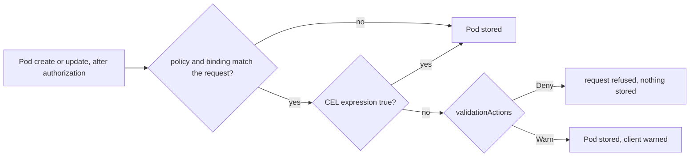

## Before you start

- [[k8s.l3.pod-security-admission]] — admission checks each Pod when it is created, and a new rule stops no Pod already running; this lesson writes such a rule itself.
- [[k8s.l3.cluster-roles]] — some objects have no namespace, and Argo CD applies whatever the config repository holds with rights over the whole cluster; this lesson's policy is both.
- [[devops.l3.verifying-before-deploy]] — `deploy-verified.sh` verifies an image's signature, then commits it as `tag@sha256:…`; the rule in this lesson insists on that form.

## The situation

Staging gets new api images through `deploy-verified.sh`: it checks the signature, then commits the image by digest to the config repository, but nothing forces that path. A teammate in a hurry sets staging's image to `ghcr.io/duyan11110/donhang-api:1.0.0` by hand, or starts a Pod with it using `kubectl run`. The tag `1.0.0` has no signature, and a later push can point it at other content. The API server stores the Pod and the image runs in staging. Pod Security admission says nothing, because it judges what a Pod may do, not how its image is named. How do you make the API server itself refuse a Pod whose image is named only by a tag?

## Core concepts

- **ValidatingAdmissionPolicy** — an object holding checks that the API server itself evaluates during admission; each check must come out true for the request to pass, and the feature is built into Kubernetes 1.34.
- **CEL (Common Expression Language)** — the expression language those checks are written in: short expressions over the request, such as `object.spec.containers`, that return true or false and cannot loop forever.
- ValidatingAdmissionPolicyBinding — the object that turns a policy on: it names the policy, chooses the requests it applies to, and sets `validationActions`, where `Deny` refuses a failing request, `Warn` admits it with a warning to the client and `Audit` admits it and records the failure in the API server's audit log, if it keeps one.
- **admission webhook** — a server outside the API server that the API server calls over HTTPS during admission, which can run any code to approve, refuse or change an object.

## How it works



In the situation above, the Pod named by tag passed authentication, authorization and the admission controllers, and none of them had a rule about image names. A ValidatingAdmissionPolicy adds that rule to admission, inside the API server.

The policy and its binding split the work. The policy says what to check and on which requests: Đơn Hàng's matches Pods on create and update and holds one CEL expression. The binding says where the policy applies, here the namespace `donhang`, and what a false result does. A request no binding matches is never checked, so a policy without a binding does nothing.

For a matching request, the API server evaluates the expression against the object in it. True lets the request through. False triggers the binding's actions: with `Deny` the client gets an error carrying the policy's message, with `Warn` the Pod is stored and the client sees a warning.

Admission checks requests that create, update or delete an object, before anything is stored; it never looks back at objects already stored. A new policy, or a binding switched to `Deny`, leaves running Pods alone; it judges a Pod when one is next created or updated.

The expression sees only what the API server already has, such as the object and who sent the request. It cannot ask the registry, so it can check how an image is named but not what that name points to or who signed it. Checks that need outside data run in an admission webhook, usually inside a policy engine: a program installed in the cluster that runs the webhook and holds rules written for it.

## In the Đơn Hàng system

```yaml file=deploy/gitops/config-repo/platform/policies/require-image-digest.yaml tag=stage-3 lines=14-38
      - apiGroups: [""]
        apiVersions: ["v1"]
        operations: ["CREATE", "UPDATE"]
        resources: ["pods"]
  validations:
    - expression: >-
        object.spec.containers.all(c,
          !c.image.startsWith('ghcr.io/duyan11110/') || c.image.contains('@sha256:'))
      message: "an image from ghcr.io/duyan11110/ must be named by digest (@sha256:...)"
---
# lesson: k8s.l3.admission-policies
# Where the policy applies, and what a failure does: Pods in staging's
# donhang, and Deny refuses them. (Warn would only warn the client; Audit
# would only record it in the API server's audit log.)
apiVersion: admissionregistration.k8s.io/v1
kind: ValidatingAdmissionPolicyBinding
metadata:
  name: require-image-digest
spec:
  policyName: require-image-digest
  validationActions: ["Deny"]
  matchResources:
    namespaceSelector:
      matchLabels:
        kubernetes.io/metadata.name: donhang
```

The excerpt starts inside the policy `require-image-digest`; the lines above it name the policy, set `failurePolicy: Fail` and open the rules that pick requests. A policy's `failurePolicy` covers errors in the policy itself, such as an expression that cannot be evaluated; `Fail` counts such an error as a failure, so here the request is refused. The rules match Pods on `CREATE` and `UPDATE`, so a Deployment edited by hand is stored, and the new Pods it asks for are refused. The expression reads: for every container `c` in `spec.containers`, the image either does not start with `ghcr.io/duyan11110/` or contains `@sha256:`. Images from other registries pass whatever their form. `deploy-verified.sh` commits `tag@sha256:…`, which contains the marker.

The binding selects namespaces by `kubernetes.io/metadata.name`, a label Kubernetes sets on every namespace to its name, so it applies only in `donhang`, and refuses failures. Both objects have no namespace. They reach staging through `apps/policies-staging.yaml`, an Argo CD Application that syncs `platform/policies` from the config repository, so whoever can write there can change or remove the rule.

```bash file=scripts/k8s/admission-policy.sh tag=stage-3 lines=37-61
echo "== running Pods in donhang that the policy warns about"
warned=0
for pod in $(kubectl get pods -n donhang --field-selector status.phase=Running -o name); do
  if kubectl get "$pod" -n donhang -o yaml | kubectl replace --dry-run=server -f - 2>&1 | grep -q 'require-image-digest'; then
    echo "$pod"
    warned=$((warned + 1))
  fi
done
echo "$warned of $(kubectl get pods -n donhang --field-selector status.phase=Running -o name | wc -l) Pods"
echo

# lesson: k8s.l3.admission-policies
# None would fail, so the binding becomes Deny: a Pod that names the api's
# image by tag only is refused before it is stored.
cp "$policy" "$config_repo/platform/policies/require-image-digest.yaml"
config_commit admission-policy.sh "Admission policy require-image-digest: deny"
sync_policies
echo "\$ kubectl run api-by-tag -n donhang --image=ghcr.io/duyan11110/donhang-api:1.0.0 --dry-run=server"
kubectl run api-by-tag -n donhang --image=ghcr.io/duyan11110/donhang-api:1.0.0 --dry-run=server 2>&1 | quiet || true

# CEL sees only the object: any digest passes, even one that names no
# image in the registry, let alone a signed one.
fake=sha256:$(printf '0%.0s' $(seq 64))
echo "\$ kubectl run api-by-digest -n donhang --image=ghcr.io/duyan11110/donhang-api@$fake --dry-run=server"
kubectl run api-by-digest -n donhang --image="ghcr.io/duyan11110/donhang-api@$fake" --dry-run=server 2>&1 | quiet
```

```text output=true
$ kubectl apply -f .gitops/donhang-config/apps/policies-staging.yaml
application.argoproj.io/policies-staging created
policies-staging: Synced, Healthy
$ kubectl get validatingadmissionpolicies,validatingadmissionpolicybindings
NAME                                                                                             VALIDATIONS   PARAMKIND   AGE
validatingadmissionpolicy.admissionregistration.k8s.io/require-image-digest                      1             <unset>     ...
validatingadmissionpolicy.admissionregistration.k8s.io/safe-upgrades.gateway.networking.k8s.io   2             <unset>     ...

NAME                                                                                                    POLICYNAME                                PARAMREF   AGE
validatingadmissionpolicybinding.admissionregistration.k8s.io/require-image-digest                      require-image-digest                      <unset>    ...
validatingadmissionpolicybinding.admissionregistration.k8s.io/safe-upgrades.gateway.networking.k8s.io   safe-upgrades.gateway.networking.k8s.io   <unset>    ...

== running Pods in donhang that the policy warns about
0 of 10 Pods

policies-staging: Synced, Healthy
$ kubectl run api-by-tag -n donhang --image=ghcr.io/duyan11110/donhang-api:1.0.0 --dry-run=server
The pods "api-by-tag" is invalid: : ValidatingAdmissionPolicy 'require-image-digest' with binding 'require-image-digest' denied request: an image from ghcr.io/duyan11110/ must be named by digest (@sha256:...)
$ kubectl run api-by-digest -n donhang --image=ghcr.io/duyan11110/donhang-api@sha256:0000000000000000000000000000000000000000000000000000000000000000 --dry-run=server
pod/api-by-digest created (server dry run)
```

Lines before the excerpt commit the policy with its binding switched to `Warn`, and apply `policies-staging`. Since admission skips running Pods, the loop takes each Pod in `donhang` whose `status.phase` is `Running` and sends it back unchanged with `kubectl replace --dry-run=server`: the API server admits it as an update, runs the policy, and stores nothing. A Pod that would fail shows up through a warning naming the policy. None does, because staging's overlay names every image from `ghcr.io/duyan11110/` by digest. The migration hooks are not `Running`, so the loop skips them, but they use the same form and pass under `Deny` too. Only then does the script commit the binding with `Deny`.

`api-by-tag` is refused with the policy's message. `api-by-digest` uses a digest of 64 zeros that names no image at all, and it passes: the expression only looks for `@sha256:` in a string. The `quiet` function drops Pod Security's warnings, which `donhang` prints at `restricted`. The second policy in the list came with the cluster's Gateway API resources; the `PARAMKIND` and `PARAMREF` columns are unused here.

## Seniors often assume…

- **"A custom admission rule always needs a policy engine installed in the cluster."** → Actually a ValidatingAdmissionPolicy is built into the API server of Kubernetes 1.34, so Đơn Hàng's rule is two objects in the config repository and nothing else runs. You notice this when `kubectl get validatingadmissionpolicies` lists policies on a cluster where nobody installed a policy engine.
- **"Requiring digests means every running image was verified."** → Actually the policy checks how an image is named, never whether anyone verified it, because CEL cannot see the registry or a signature. A digest committed by hand, without `deploy-verified.sh`, passes just as well. You notice this when `api-by-digest` is accepted above. Checking signatures at admission needs an admission webhook; Đơn Hàng runs none that checks images on staging, so signatures are still checked only on the commit path.
- **"A policy that blocks bad Pods costs nothing when it fails."** → Actually an admission webhook adds a server that every Pod it covers depends on. With `failurePolicy: Fail`, while it cannot be reached every covered Pod is refused, even the ones you start to repair the cluster; with `Ignore`, Pods get through unchecked until it returns. You notice this when the engine's Pods are down and new Pods fail with an error about calling the webhook. `Fail` fits when an unchecked Pod is worse than a stalled deploy, `Ignore` when the reverse holds.

## Try it (3 minutes)

From the root of the Đơn Hàng repository, with `donhang-staging` in the state the earlier k8s lessons left it:

1. Run `scripts/k8s/admission-policy.sh`.
2. Predict the result, then send the same tag-only Pod to the namespace `default`: `kubectl --context kind-donhang-staging run api-by-tag -n default --image=ghcr.io/duyan11110/donhang-api:1.0.0 --dry-run=server`.

Expected result: the script prints the output shown above; step 2 ends with `pod/api-by-tag created (server dry run)`.

<details><summary>Suggested answer</summary>

The binding selects only the namespace labelled `kubernetes.io/metadata.name: donhang`, so in `default` no binding matches and the expression is never evaluated. Covering more namespaces is a change to the binding in the config repository, not to the policy.

</details>

## Connections

- [[devops.l3.pinning-by-content]] — the reason for this rule: a tag can move, a digest cannot, and this policy refuses the tag-only form.
- [[devops.l3.signing-images]] — the signatures this policy cannot see; checking them at admission is left to a webhook.
- [[devops.l3.verifying-before-deploy]] — still the only place staging checks signatures; this policy refuses tag-only images in a Pod's `spec.containers`, not a digest committed by hand.
- [[k8s.l3.pod-security-admission]] — the built-in admission check with fixed levels; this lesson adds a rule you write yourself.

## Five-line summary

1. A ValidatingAdmissionPolicy adds your own CEL check to admission, evaluated by the API server itself, with nothing extra installed.
2. The policy says what to check; its binding says where it applies and whether a failure denies, warns or only audits.
3. Đơn Hàng's `require-image-digest` refuses Pods in `donhang` where an image in `spec.containers` from `ghcr.io/duyan11110/` lacks `@sha256:`; `Warn` first finds running Pods that would fail.
4. CEL sees only the request, never the registry: any digest passes, signed or not, so signatures are still checked on the commit path.
5. Signature checks at admission need a webhook; when it is down, `Fail` refuses covered Pods and `Ignore` lets them through unchecked.
