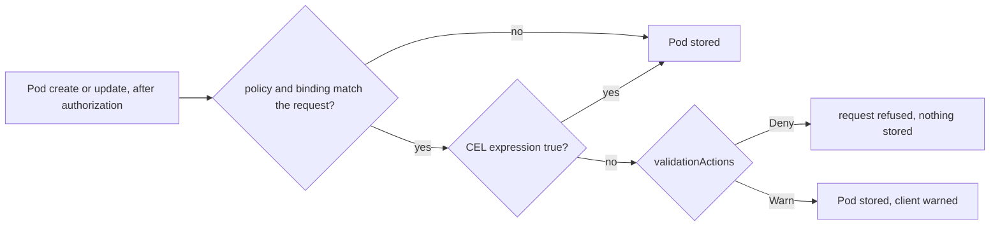

## Bạn cần biết trước

- [[k8s.l3.pod-security-admission]] — admission kiểm tra mỗi Pod lúc nó được tạo, và luật mới không dừng Pod nào đang chạy. Bài này tự viết một luật như thế.
- [[k8s.l3.cluster-roles]] — có những object không thuộc namespace nào, và Argo CD apply mọi thứ repo config chứa với quyền trên cả cluster. Policy trong bài này vừa là loại object đó, vừa đi theo đường đó.
- [[devops.l3.verifying-before-deploy]] — `deploy-verified.sh` xác minh chữ ký của image, rồi commit nó dưới dạng `tag@sha256:…`. Luật trong bài này bắt buộc đúng dạng đó.

## Tình huống

Staging nhận image api mới qua `deploy-verified.sh`: script kiểm tra chữ ký, rồi commit image theo digest vào repo config. Nhưng không gì bắt buộc phải đi đường đó. Một đồng nghiệp đang vội sửa tay image của staging thành `ghcr.io/duyan11110/donhang-api:1.0.0`, hoặc chạy một Pod với image đó bằng `kubectl run`. Tag `1.0.0` không có chữ ký, và một lần push sau có thể trỏ nó sang nội dung khác. API server vẫn lưu Pod, và image chạy trên staging. Pod Security admission không nói gì, vì nó xét những gì Pod được làm, không xét image được gọi tên ra sao. Làm sao để chính API server từ chối Pod có image chỉ được gọi bằng tag?

## Khái niệm cốt lõi

- **ValidatingAdmissionPolicy** (Luật kiểm object viết bằng CEL mà chính API server chạy lúc admission, không cần server riêng) — object chứa các kiểm tra mà chính API server tính trong bước admission. Mỗi kiểm tra phải ra true thì request mới qua. Tính năng này có sẵn trong Kubernetes 1.34.
- **CEL (Common Expression Language)** (Ngôn ngữ biểu thức ngắn, không vòng lặp vô hạn, Kubernetes dùng để viết luật kiểm object) — ngôn ngữ dùng để viết các kiểm tra đó: những biểu thức ngắn trên request, chẳng hạn `object.spec.containers`, trả về true hoặc false và không thể lặp mãi.
- ValidatingAdmissionPolicyBinding — object bật một policy lên: nó nêu tên policy, chọn những request policy áp vào, và đặt `validationActions`. Trong đó `Deny` từ chối request không đạt, `Warn` nhận request và gửi cảnh báo về cho client, còn `Audit` nhận request và ghi lỗi vào audit log của API server, nếu API server có giữ audit log.
- **admission webhook** (Server bên ngoài API server mà nó gọi qua HTTPS lúc admission để duyệt hoặc sửa object) — server nằm ngoài API server, được API server gọi qua HTTPS trong bước admission. Nó chạy được bất kỳ code nào để duyệt, từ chối hay sửa một object.

## Cơ chế hoạt động



Trong tình huống trên, Pod gọi image bằng tag đã qua xác thực, phân quyền và các admission controller, mà không bước nào có luật về tên image. ValidatingAdmissionPolicy thêm luật đó vào admission, ngay bên trong API server.

Policy và binding chia nhau công việc. Policy nói kiểm tra gì và trên những request nào: policy của Đơn Hàng khớp với Pod khi tạo và khi cập nhật, và chứa một biểu thức CEL. Binding nói policy áp ở đâu, ở đây là namespace `donhang`, và kết quả false thì làm gì. Request không khớp binding nào thì không bao giờ bị kiểm tra, nên policy không có binding chẳng làm gì cả.

Với request khớp, API server tính biểu thức trên object trong request. True thì request đi tiếp. False thì kích hoạt các action của binding: với `Deny`, client nhận một lỗi mang message của policy. Với `Warn`, Pod được lưu và client thấy một cảnh báo.

Admission kiểm tra các request tạo, cập nhật hoặc xóa object, trước khi lưu bất cứ thứ gì. Nó không bao giờ nhìn lại các object đã lưu. Một policy mới, hay một binding chuyển sang `Deny`, để yên các Pod đang chạy. Nó chỉ xét một Pod vào lần kế tiếp Pod đó được tạo hoặc cập nhật.

Biểu thức chỉ thấy những gì API server đã có sẵn, như object và ai gửi request. Nó không hỏi được registry, nên nó kiểm tra được image được gọi tên ra sao, nhưng không biết cái tên đó trỏ tới đâu hay ai đã ký. Kiểm tra cần dữ liệu bên ngoài phải chạy trong một admission webhook, thường nằm trong một policy engine: chương trình cài vào cluster, chạy webhook và giữ các luật viết riêng cho nó.

## Trong hệ thống Đơn Hàng

```yaml file=deploy/gitops/config-repo/platform/policies/require-image-digest.yaml tag=stage-3 lines=14-38
      - apiGroups: [""]
        apiVersions: ["v1"]
        operations: ["CREATE", "UPDATE"]
        resources: ["pods"]
  validations:
    - expression: >-
        object.spec.containers.all(c,
          !c.image.startsWith('ghcr.io/duyan11110/') || c.image.contains('@sha256:'))
      message: "an image from ghcr.io/duyan11110/ must be named by digest (@sha256:...)"
---
# lesson: k8s.l3.admission-policies
# Where the policy applies, and what a failure does: Pods in staging's
# donhang, and Deny refuses them. (Warn would only warn the client; Audit
# would only record it in the API server's audit log.)
apiVersion: admissionregistration.k8s.io/v1
kind: ValidatingAdmissionPolicyBinding
metadata:
  name: require-image-digest
spec:
  policyName: require-image-digest
  validationActions: ["Deny"]
  matchResources:
    namespaceSelector:
      matchLabels:
        kubernetes.io/metadata.name: donhang
```

Đoạn trích bắt đầu ở giữa policy `require-image-digest`. Các dòng phía trên đặt tên policy, đặt `failurePolicy: Fail` và mở phần rule chọn request. `failurePolicy` của policy áp cho lỗi nằm trong chính policy, chẳng hạn một biểu thức không tính được. `Fail` coi lỗi như thế là không đạt, nên ở đây request bị từ chối. Rule khớp Pod ở `CREATE` và `UPDATE`, nên một Deployment sửa tay vẫn được lưu, còn các Pod mới nó xin thì bị từ chối. Biểu thức đọc là: với mỗi container `c` trong `spec.containers`, image hoặc không bắt đầu bằng `ghcr.io/duyan11110/`, hoặc có chứa `@sha256:`. Image từ registry khác thì qua, dù viết dạng nào. `deploy-verified.sh` commit `tag@sha256:…`, dạng có chứa dấu hiệu này.

Binding chọn namespace theo `kubernetes.io/metadata.name`, label mà Kubernetes gắn lên mọi namespace với giá trị là tên của nó. Vì vậy binding chỉ áp trong `donhang`, và từ chối Pod không đạt. Cả hai object đều không thuộc namespace nào. Chúng tới staging qua `apps/policies-staging.yaml`, một Application của Argo CD sync `platform/policies` từ repo config. Vậy ai ghi được vào đó thì đổi hoặc xóa được luật này.

```bash file=scripts/k8s/admission-policy.sh tag=stage-3 lines=37-61
echo "== running Pods in donhang that the policy warns about"
warned=0
for pod in $(kubectl get pods -n donhang --field-selector status.phase=Running -o name); do
  if kubectl get "$pod" -n donhang -o yaml | kubectl replace --dry-run=server -f - 2>&1 | grep -q 'require-image-digest'; then
    echo "$pod"
    warned=$((warned + 1))
  fi
done
echo "$warned of $(kubectl get pods -n donhang --field-selector status.phase=Running -o name | wc -l) Pods"
echo

# lesson: k8s.l3.admission-policies
# None would fail, so the binding becomes Deny: a Pod that names the api's
# image by tag only is refused before it is stored.
cp "$policy" "$config_repo/platform/policies/require-image-digest.yaml"
config_commit admission-policy.sh "Admission policy require-image-digest: deny"
sync_policies
echo "\$ kubectl run api-by-tag -n donhang --image=ghcr.io/duyan11110/donhang-api:1.0.0 --dry-run=server"
kubectl run api-by-tag -n donhang --image=ghcr.io/duyan11110/donhang-api:1.0.0 --dry-run=server 2>&1 | quiet || true

# CEL sees only the object: any digest passes, even one that names no
# image in the registry, let alone a signed one.
fake=sha256:$(printf '0%.0s' $(seq 64))
echo "\$ kubectl run api-by-digest -n donhang --image=ghcr.io/duyan11110/donhang-api@$fake --dry-run=server"
kubectl run api-by-digest -n donhang --image="ghcr.io/duyan11110/donhang-api@$fake" --dry-run=server 2>&1 | quiet
```

```text output=true
$ kubectl apply -f .gitops/donhang-config/apps/policies-staging.yaml
application.argoproj.io/policies-staging created
policies-staging: Synced, Healthy
$ kubectl get validatingadmissionpolicies,validatingadmissionpolicybindings
NAME                                                                                             VALIDATIONS   PARAMKIND   AGE
validatingadmissionpolicy.admissionregistration.k8s.io/require-image-digest                      1             <unset>     ...
validatingadmissionpolicy.admissionregistration.k8s.io/safe-upgrades.gateway.networking.k8s.io   2             <unset>     ...

NAME                                                                                                    POLICYNAME                                PARAMREF   AGE
validatingadmissionpolicybinding.admissionregistration.k8s.io/require-image-digest                      require-image-digest                      <unset>    ...
validatingadmissionpolicybinding.admissionregistration.k8s.io/safe-upgrades.gateway.networking.k8s.io   safe-upgrades.gateway.networking.k8s.io   <unset>    ...

== running Pods in donhang that the policy warns about
0 of 10 Pods

policies-staging: Synced, Healthy
$ kubectl run api-by-tag -n donhang --image=ghcr.io/duyan11110/donhang-api:1.0.0 --dry-run=server
The pods "api-by-tag" is invalid: : ValidatingAdmissionPolicy 'require-image-digest' with binding 'require-image-digest' denied request: an image from ghcr.io/duyan11110/ must be named by digest (@sha256:...)
$ kubectl run api-by-digest -n donhang --image=ghcr.io/duyan11110/donhang-api@sha256:0000000000000000000000000000000000000000000000000000000000000000 --dry-run=server
pod/api-by-digest created (server dry run)
```

Các dòng trước đoạn trích commit policy với binding đặt ở `Warn`, rồi apply `policies-staging`. Vì admission bỏ qua Pod đang chạy, vòng lặp lấy từng Pod trong `donhang` có `status.phase` là `Running` và gửi lại nguyên trạng bằng `kubectl replace --dry-run=server`. API server nhận nó như một lần cập nhật, chạy policy, và không lưu gì. Pod nào sẽ trượt thì lộ ra qua một cảnh báo nêu tên policy. Không Pod nào trượt, vì overlay của staging gọi mọi image từ `ghcr.io/duyan11110/` bằng digest. Các migration hook không ở trạng thái `Running` nên vòng lặp bỏ qua chúng, nhưng chúng dùng cùng dạng đó và cũng qua được khi đã là `Deny`. Chỉ đến lúc này script mới commit binding với `Deny`.

`api-by-tag` bị từ chối kèm message của policy. `api-by-digest` dùng một digest gồm 64 số 0, không trỏ tới image nào cả, vậy mà vẫn qua: biểu thức chỉ tìm `@sha256:` trong một chuỗi. Hàm `quiet` bỏ các cảnh báo của Pod Security, thứ mà `donhang` in ra ở mức `restricted`. Policy thứ hai trong danh sách đi kèm các resource Gateway API của cluster. Cột `PARAMKIND` và `PARAMREF` không dùng tới ở đây.

## Senior hay nhầm rằng…

- **"Luật admission tự viết lúc nào cũng cần cài một policy engine vào cluster."** → Thực ra ValidatingAdmissionPolicy có sẵn trong API server của Kubernetes 1.34, nên luật của Đơn Hàng chỉ là hai object trong repo config, không có gì khác phải chạy. Bạn sẽ nhận ra khi `kubectl get validatingadmissionpolicies` liệt kê policy trên một cluster mà chẳng ai cài policy engine nào.
- **"Bắt buộc dùng digest nghĩa là mọi image đang chạy đều đã được xác minh."** → Thực ra policy kiểm tra image được gọi tên ra sao, chứ không bao giờ kiểm tra có ai đã xác minh nó chưa, vì CEL không nhìn thấy registry hay chữ ký. Một digest commit bằng tay, không qua `deploy-verified.sh`, vẫn qua y như vậy. Bạn sẽ nhận ra khi `api-by-digest` được chấp nhận ở trên. Muốn kiểm tra chữ ký lúc admission thì cần admission webhook. Đơn Hàng không chạy webhook nào kiểm tra image trên staging, nên chữ ký vẫn chỉ được kiểm tra trên đường commit.
- **"Policy chặn Pod xấu thì khi hỏng cũng chẳng tốn gì."** → Thực ra admission webhook thêm một server mà mọi Pod nó phủ đều phụ thuộc vào. Với `failurePolicy: Fail`, trong lúc không gọi được nó, mọi Pod thuộc phạm vi đều bị từ chối, kể cả những Pod bạn khởi động để sửa cluster. Với `Ignore`, Pod lọt qua mà không bị kiểm tra cho tới khi nó trở lại. Bạn sẽ nhận ra khi các Pod của engine bị sập và Pod mới thất bại với lỗi khi gọi webhook. `Fail` hợp khi một Pod không được kiểm tra còn tệ hơn một lần deploy bị kẹt, `Ignore` hợp khi điều ngược lại đúng.

## Thử ngay (3 phút)

Ở thư mục gốc của repo Đơn Hàng, với `donhang-staging` ở trạng thái mà các bài k8s trước để lại:

1. Chạy `scripts/k8s/admission-policy.sh`.
2. Đoán kết quả, rồi gửi cùng Pod chỉ có tag đó vào namespace `default`: `kubectl --context kind-donhang-staging run api-by-tag -n default --image=ghcr.io/duyan11110/donhang-api:1.0.0 --dry-run=server`.

Kết quả mong đợi: script in ra output như ở trên. Bước 2 kết thúc bằng `pod/api-by-tag created (server dry run)`.

<details><summary>Gợi ý đáp án</summary>

Binding chỉ chọn namespace mang label `kubernetes.io/metadata.name: donhang`, nên ở `default` không binding nào khớp và biểu thức không bao giờ được tính. Muốn phủ thêm namespace thì sửa binding trong repo config, không sửa policy.

</details>

## Liên hệ

- [[devops.l3.pinning-by-content]] — lý do của luật này: tag có thể dịch chuyển, digest thì không, và policy này từ chối dạng chỉ có tag.
- [[devops.l3.signing-images]] — những chữ ký mà policy này không nhìn thấy. Kiểm tra chúng lúc admission là việc của webhook.
- [[devops.l3.verifying-before-deploy]] — vẫn là chỗ duy nhất staging kiểm tra chữ ký. Policy này từ chối image chỉ có tag trong `spec.containers` của Pod, không từ chối digest commit bằng tay.
- [[k8s.l3.pod-security-admission]] — kiểm tra admission có sẵn với các mức cố định. Bài này thêm một luật do bạn tự viết.

## Tóm tắt 5 dòng

1. ValidatingAdmissionPolicy thêm kiểm tra CEL của riêng bạn vào admission, do chính API server tính, không cần cài thêm gì.
2. Policy nói kiểm tra gì. Binding của nó nói áp ở đâu và lỗi thì từ chối, cảnh báo hay chỉ ghi audit.
3. `require-image-digest` của Đơn Hàng từ chối Pod trong `donhang` có image trong `spec.containers` từ `ghcr.io/duyan11110/` mà thiếu `@sha256:`. `Warn` chạy trước để tìm Pod đang chạy nào sẽ trượt.
4. CEL chỉ thấy request, không bao giờ thấy registry: digest nào cũng qua, có ký hay không, nên chữ ký vẫn được kiểm tra trên đường commit.
5. Kiểm tra chữ ký lúc admission cần webhook. Khi webhook sập, `Fail` từ chối Pod thuộc phạm vi, còn `Ignore` cho chúng qua mà không kiểm tra.
