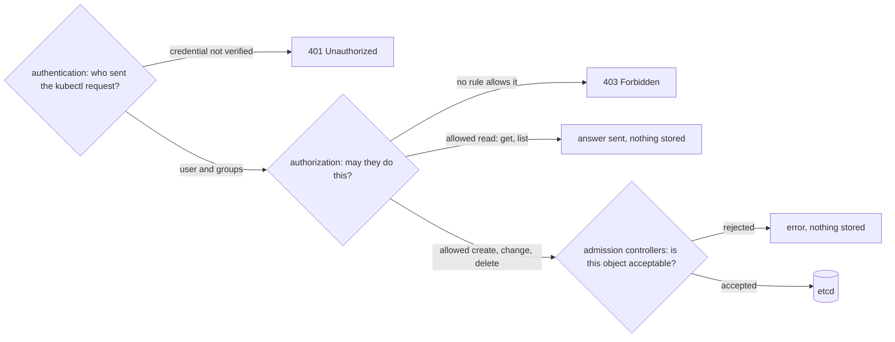

## Before you start

- [[k8s.l1.kubectl-and-the-api-server]] — every `kubectl` command is an HTTPS request to the API server, sent with the credentials in your kubeconfig; this lesson follows that request inside.
- [[k8s.l1.control-plane-components]] — the API server is the only part that writes to etcd; the checks here run before it does.
- [[backend.l1.protecting-an-endpoint]] — authentication first, then authorization, and `401` versus `403`; the API server makes the same split.

## The situation

A new teammate needs to work on `donhang-staging`, and you are asked to give them access. You open your kubeconfig, expecting to find the list of the cluster's users so you can add one more. There is no such list: only the server's address and a certificate.

Two more questions follow. Could anyone who knows that address change the cluster? And where would a rule such as "every Pod runs an image from our own registry" go? Before you grant anything, you want to see the path a request takes. What does the API server check on every request, and in what order?

## Core concepts

- Authentication — the API server's first check: finding out who sent the request from the credential it carries, as the api does with a JWT.
- A user, in Kubernetes — only a name inside a credential the API server trusts, such as a client certificate; the cluster stores no accounts for people.
- A client certificate — a certificate that the client, not the server, presents over TLS; the API server checks it and reads the user name and groups written in it.
- A group — a name a user belongs to, carried in the same credential; when authorization allows a group, every user in it gets that right.
- Authorization — the second check: whether this caller may use this verb on this kind of object in this namespace.
- **admission controller** — a part of the API server that inspects an object after authorization and may change it or reject it before etcd stores it.

## How it works



In the situation above, your `kubectl` request reaches the API server carrying the client certificate from your kubeconfig. Authentication reads it first. Kubernetes keeps no accounts for people: the user is whatever name a credential the API server trusts carries, and a client certificate names the user and its groups inside itself. So the teammate needs no account; they need a credential the API server can verify. A credential it cannot verify ends the request with `401 Unauthorized` before any permission is looked at.

Authorization comes next, and it gets only facts about the request, never the object itself: who is asking, the verb, the kind of object and its API group, its namespace and its name, when the request is about one named object. An API group is the family a kind of object belongs to; Pods are in the core group, which messages show as `""`. The verb is a word such as `get`, `list`, `create` or `delete`. If no rule allows that combination, the answer is `403 Forbidden`: the API server knows the caller and still refuses.

Admission controllers come last, and only for requests that create, change or delete objects. A read such as `get` or `list` has nothing to store, so it takes the other arrow and skips them. Unlike authorization, they see the whole object, so a check on its content, such as which image a Pod runs, belongs here. Any one of them can reject the request, and then nothing reaches etcd.

The order helps you read errors. A `401` says nothing about rights, and a `403` says nothing about what the object contains.

## In the Đơn Hàng system

```bash file=scripts/k8s/api-request-checks.sh tag=stage-3 lines=12-27
# lesson: k8s.l3.api-request-checks
# Authentication: the API server keeps no list of users. kind's kubeconfig
# holds a client certificate, and the user and groups are whatever that
# certificate names.
show kubectl auth whoami
echo

# A credential the API server cannot verify: 401, before any rule is read.
# (An empty kubeconfig, so that only the made-up token is sent.)
server=$(kubectl config view --minify -o jsonpath='{.clusters[0].cluster.server}')
empty=$(mktemp ./.empty-kubeconfig.XXXXXX)
echo "\$ kubectl get pods --token=not-a-real-token   (no certificate)"
command kubectl --kubeconfig="$empty" --server="$server" --insecure-skip-tls-verify --token=not-a-real-token \
  get pods -n security-lessons 2>&1 || true
rm -f "$empty"
echo
```

The script talks to `donhang-staging`, which kind, the tool that runs Đơn Hàng's lab clusters as containers, created. `show` is a small helper, defined earlier in the script and outside this excerpt, that prints a command and then runs it. Line 16 asks the API server who you are. The answer is `kubernetes-admin` in the group `kubeadm:cluster-admins`, both read from the certificate in kind's kubeconfig, plus `system:authenticated`, a group every authenticated caller gets. Lines 21–25 send the same server a made-up token and no certificate; the empty kubeconfig holds no copy of the server's certificate, so `--insecure-skip-tls-verify` skips checking the server, not your credential. The API server cannot verify it, and `kubectl` prints the `401` as `You must be logged in to the server (Unauthorized)`.

```bash file=scripts/k8s/api-request-checks.sh tag=stage-3 lines=29-40
# lesson: k8s.l3.api-request-checks
# Authorization only: kubectl auth can-i asks whether a caller may do one
# verb on one kind of object in one namespace, and changes nothing. An
# administrator may ask on behalf of another user with --as.
show kubectl auth can-i create deployments -n security-lessons
show kubectl auth can-i create deployments -n security-lessons --as=junior-dev || true
show kubectl auth can-i list pods -n security-lessons --as=junior-dev || true
echo

# A known caller without permission: 403, which kubectl prints as Forbidden.
echo "\$ kubectl get pods -n security-lessons --as=junior-dev"
kubectl get pods -n security-lessons --as=junior-dev 2>&1 || true
```

```text output=true
$ kubectl auth whoami
ATTRIBUTE                                           VALUE
Username                                            kubernetes-admin
Groups                                              [kubeadm:cluster-admins system:authenticated]
Extra: authentication.kubernetes.io/credential-id   [X509SHA256=...]

$ kubectl get pods --token=not-a-real-token   (no certificate)
error: You must be logged in to the server (Unauthorized)

$ kubectl auth can-i create deployments -n security-lessons
yes
$ kubectl auth can-i create deployments -n security-lessons --as=junior-dev
no
$ kubectl auth can-i list pods -n security-lessons --as=junior-dev
no

$ kubectl get pods -n security-lessons --as=junior-dev
Error from server (Forbidden): pods is forbidden: User "junior-dev" cannot list resource "pods" in API group "" in the namespace "security-lessons"
```

Line 33 asks only the authorization step for you, and the answer is `yes`. Line 34 asks the same for `junior-dev` with `--as`, and line 35 asks whether `junior-dev` may list Pods. The API server allows `--as` because `kubernetes-admin` may act as other users. Nothing in the cluster mentions `junior-dev`, yet the name is accepted: there is no list to check it against. No rule grants it anything, so both answers are `no`; the `|| true` after these two lines makes sure a `no` cannot stop the script.

Line 40 then really tries the read and gets the `403`. Its message names exactly what authorization worked with: user, verb, kind of object, API group and namespace. The verb is `list`, not `get`: `kubectl get pods` without a name asks for all Pods, and `get` is the verb for reading one named object.

## Seniors often assume…

- **"Kubernetes keeps a list of users that an administrator adds people to."** → Actually the cluster stores no accounts for people; a user is the name inside a credential the API server trusts, such as the client certificate in kind's kubeconfig. Giving someone access means giving them such a credential, then a rule that grants rights. You notice this when `--as=junior-dev` works for a name that nothing in the cluster mentions.
- **"Anyone who can reach the API server's address can change the cluster."** → Actually reaching the address gives a request no rights. A credential the API server cannot verify ends with `401`, and any request that gets past authentication still needs a rule that allows the verb, or gets `403`. You notice this when the script's made-up token gets `Unauthorized` from the same address your kubeconfig uses.
- **"Authorization can look inside an object, such as refusing Pods that run a certain image."** → Actually authorization sees only facts about the request, such as who, the verb, the kind of object and the namespace, never the object's fields. A rule on content needs an admission controller, which sees the whole object. You notice this when a `403` message names the user, verb, resource and namespace, and nothing about what the object contains.

## Try it (3 minutes)

From the root of the Đơn Hàng repository, with `donhang-staging` running (`scripts/devops/tofu-env.sh staging` creates it; the script creates the namespace `security-lessons` itself):

1. Run `scripts/k8s/api-request-checks.sh`.
2. Run `kubectl --context kind-donhang-staging auth can-i list pods -n security-lessons --as=nobody-at-all`.
3. For each refusal you saw, name the check that gave it.

Expected result: the script prints the output shown above, and step 2 prints `no` for a name that appears nowhere in the cluster.

<details><summary>Suggested answer</summary>

`Unauthorized` came from authentication: the made-up token was never verified, so no rule was read. Each `no` and the `Forbidden` line came from authorization: the caller's name was accepted, but no rule allows that verb on Pods in `security-lessons`. Admission controllers gave none of the refusals, since authorization had already said no.

</details>

## Connections

- [[backend.l1.protecting-an-endpoint]] — the same split one layer down: the api returns `401` and `403` for the same reasons.
- [[backend.l1.validating-a-jwt]] — authentication inside the api; here the API server makes the same first check for the whole cluster.
- [[backend.l2.role-based-access]] — the idea behind the rules authorization looks up.
- [[k8s.l3.roles-and-role-bindings]] — the next lesson: the rule that would turn `junior-dev`'s `no` into `yes`.
- [[k8s.l3.admission-policies]] — writing your own admission check on an object's content.

## Five-line summary

1. Every request to the API server is authenticated, then authorized; requests that create, change or delete objects then pass admission controllers before etcd stores anything.
2. Kubernetes keeps no accounts for people: a user is the name in a trusted credential; kind signs you in as `kubernetes-admin`.
3. A credential the API server cannot verify gets `401 Unauthorized`; a known caller without permission gets `403 Forbidden`.
4. `kubectl auth can-i` asks only the authorization step and changes nothing; with `--as`, an administrator asks for another user.
5. Authorization sees only facts about the request, such as who and the verb; checks on an object's content belong to admission controllers.
