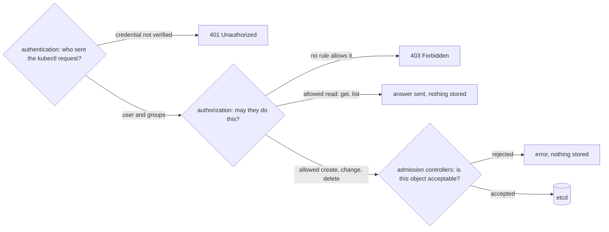

## Bạn cần biết trước

- [[k8s.l1.kubectl-and-the-api-server]] — mỗi lệnh `kubectl` là một request HTTPS tới API server, gửi kèm thông tin đăng nhập trong kubeconfig. Bài này đi theo request đó vào bên trong.
- [[k8s.l1.control-plane-components]] — API server là thành phần duy nhất ghi vào etcd. Các bước kiểm tra ở đây chạy trước khi nó ghi.
- [[backend.l1.protecting-an-endpoint]] — xác thực trước, phân quyền sau, và khác biệt giữa `401` với `403`. API server cũng chia đúng như vậy.

## Tình huống

Một đồng nghiệp mới cần làm việc trên `donhang-staging`, và bạn được nhờ cấp quyền cho họ. Bạn mở kubeconfig, định tìm danh sách user của cluster để thêm một người. Không có danh sách nào cả, chỉ có địa chỉ của server và một chứng chỉ.

Kéo theo đó là hai câu hỏi nữa. Ai biết địa chỉ đó thì có sửa được cluster không? Và một luật như "mọi Pod phải chạy image từ registry của chính mình" thì đặt ở đâu? Trước khi cấp gì, bạn muốn thấy đường đi của một request. API server kiểm tra những gì trên mỗi request, và theo thứ tự nào?

## Khái niệm cốt lõi

- Xác thực — bước kiểm tra đầu tiên của API server: tìm ra ai gửi request, dựa vào thông tin đăng nhập đi kèm, giống api làm với JWT.
- User trong Kubernetes — chỉ là một cái tên nằm trong thông tin đăng nhập mà API server tin, chẳng hạn một chứng chỉ client. Cluster không lưu tài khoản nào cho người dùng.
- Chứng chỉ client — chứng chỉ do phía client, chứ không phải server, đưa ra qua TLS. API server kiểm tra nó rồi đọc tên user và các nhóm ghi trong đó.
- Nhóm — một cái tên mà user thuộc về, nằm trong cùng thông tin đăng nhập. Khi phân quyền cho phép một nhóm, mọi user trong nhóm đều có quyền đó.
- Phân quyền — bước kiểm tra thứ hai: người gọi này có được dùng verb này trên loại object này trong namespace này hay không.
- **admission controller** (phần của API server xét object sau bước phân quyền, có thể sửa hoặc từ chối trước khi lưu vào etcd) — chạy bên trong API server, sau bước phân quyền. Nó xem object và có thể sửa hoặc từ chối object đó trước khi etcd lưu lại.

## Cơ chế hoạt động



Trong tình huống trên, request `kubectl` của bạn tới API server kèm chứng chỉ client lấy từ kubeconfig. Bước xác thực đọc nó trước tiên. Kubernetes không giữ tài khoản cho người dùng: user là bất kỳ cái tên nào nằm trong một thông tin đăng nhập mà API server tin, và chứng chỉ client tự ghi tên user cùng các nhóm của user bên trong nó. Vì vậy đồng nghiệp mới không cần tài khoản nào. Họ cần một thông tin đăng nhập mà API server kiểm chứng được. Thông tin đăng nhập không kiểm chứng được thì request dừng với `401 Unauthorized`, trước khi quyền nào được xem tới.

Tiếp theo là phân quyền, và bước này chỉ nhận các thông tin về request, không bao giờ nhận chính object: ai đang hỏi, verb, loại object và API group của nó, namespace, và tên object khi request nhắm vào một object có tên cụ thể. API group là họ mà một loại object thuộc về. Pod nằm trong core group, và các thông báo ghi group này là `""`. Verb là một từ như `get`, `list`, `create` hay `delete`. Nếu không luật nào cho phép tổ hợp đó, câu trả lời là `403 Forbidden`: API server biết người gọi là ai nhưng vẫn từ chối.

Admission controller đứng cuối cùng, và chỉ xét các request tạo, sửa hoặc xóa object. Một lệnh đọc như `get` hay `list` không có gì để lưu, nên nó đi theo nhánh còn lại và bỏ qua chúng. Khác với phân quyền, admission controller thấy toàn bộ object, nên kiểm tra về nội dung, chẳng hạn Pod chạy image nào, thuộc về chỗ này. Chỉ cần một admission controller từ chối là request bị từ chối, và không gì tới được etcd.

Thứ tự này giúp bạn đọc lỗi. Một `401` không nói gì về quyền, còn một `403` không nói gì về nội dung của object.

## Trong hệ thống Đơn Hàng

```bash file=scripts/k8s/api-request-checks.sh tag=stage-3 lines=12-27
# lesson: k8s.l3.api-request-checks
# Authentication: the API server keeps no list of users. kind's kubeconfig
# holds a client certificate, and the user and groups are whatever that
# certificate names.
show kubectl auth whoami
echo

# A credential the API server cannot verify: 401, before any rule is read.
# (An empty kubeconfig, so that only the made-up token is sent.)
server=$(kubectl config view --minify -o jsonpath='{.clusters[0].cluster.server}')
empty=$(mktemp ./.empty-kubeconfig.XXXXXX)
echo "\$ kubectl get pods --token=not-a-real-token   (no certificate)"
command kubectl --kubeconfig="$empty" --server="$server" --insecure-skip-tls-verify --token=not-a-real-token \
  get pods -n security-lessons 2>&1 || true
rm -f "$empty"
echo
```

Script làm việc với `donhang-staging`, cluster do kind tạo ra. kind là công cụ chạy các cluster lab của Đơn Hàng dưới dạng container. `show` là một hàm nhỏ, định nghĩa ở phần trước của script và nằm ngoài đoạn trích, in ra một lệnh rồi chạy nó. Dòng 16 hỏi API server bạn là ai. Câu trả lời là `kubernetes-admin` trong nhóm `kubeadm:cluster-admins`, cả hai đọc từ chứng chỉ trong kubeconfig của kind, cộng thêm `system:authenticated`, nhóm mà mọi người gọi đã qua xác thực đều có. Dòng 21–25 gửi tới cùng server đó một token bịa ra và không kèm chứng chỉ nào. Kubeconfig rỗng không chứa bản sao chứng chỉ của server, nên `--insecure-skip-tls-verify` bỏ qua bước kiểm tra server, chứ không bỏ qua thông tin đăng nhập của bạn. API server không kiểm chứng được token, và `kubectl` in `401` thành `You must be logged in to the server (Unauthorized)`.

```bash file=scripts/k8s/api-request-checks.sh tag=stage-3 lines=29-40
# lesson: k8s.l3.api-request-checks
# Authorization only: kubectl auth can-i asks whether a caller may do one
# verb on one kind of object in one namespace, and changes nothing. An
# administrator may ask on behalf of another user with --as.
show kubectl auth can-i create deployments -n security-lessons
show kubectl auth can-i create deployments -n security-lessons --as=junior-dev || true
show kubectl auth can-i list pods -n security-lessons --as=junior-dev || true
echo

# A known caller without permission: 403, which kubectl prints as Forbidden.
echo "\$ kubectl get pods -n security-lessons --as=junior-dev"
kubectl get pods -n security-lessons --as=junior-dev 2>&1 || true
```

```text output=true
$ kubectl auth whoami
ATTRIBUTE                                           VALUE
Username                                            kubernetes-admin
Groups                                              [kubeadm:cluster-admins system:authenticated]
Extra: authentication.kubernetes.io/credential-id   [X509SHA256=...]

$ kubectl get pods --token=not-a-real-token   (no certificate)
error: You must be logged in to the server (Unauthorized)

$ kubectl auth can-i create deployments -n security-lessons
yes
$ kubectl auth can-i create deployments -n security-lessons --as=junior-dev
no
$ kubectl auth can-i list pods -n security-lessons --as=junior-dev
no

$ kubectl get pods -n security-lessons --as=junior-dev
Error from server (Forbidden): pods is forbidden: User "junior-dev" cannot list resource "pods" in API group "" in the namespace "security-lessons"
```

Dòng 33 chỉ hỏi bước phân quyền thay cho bạn, và câu trả lời là `yes`. Dòng 34 hỏi đúng câu đó cho `junior-dev` bằng `--as`, còn dòng 35 hỏi `junior-dev` có được list Pod không. API server cho phép `--as` vì `kubernetes-admin` được quyền hành động thay user khác. Không chỗ nào trong cluster nhắc tới `junior-dev`, vậy mà cái tên vẫn được chấp nhận: không có danh sách nào để đối chiếu. Không luật nào cấp gì cho cái tên này, nên cả hai câu trả lời đều là `no`. `|| true` sau hai dòng này bảo đảm một câu `no` không làm script dừng.

Dòng 40 sau đó đọc thật và nhận `403`. Thông báo lỗi ghi đúng những gì bước phân quyền đã dùng: user, verb, loại object, API group và namespace. Verb là `list` chứ không phải `get`: `kubectl get pods` không kèm tên là hỏi lấy mọi Pod, còn `get` là verb để đọc một object có tên cụ thể.

## Senior hay nhầm rằng…

- **"Kubernetes giữ một danh sách user, quản trị viên thêm người vào đó."** → Thực ra cluster không lưu tài khoản nào cho người dùng. User là cái tên nằm trong một thông tin đăng nhập mà API server tin, như chứng chỉ client trong kubeconfig của kind. Cấp quyền cho ai đó nghĩa là đưa họ một thông tin đăng nhập như vậy, rồi thêm một luật cấp quyền. Bạn sẽ nhận ra khi `--as=junior-dev` vẫn chạy với một cái tên mà không chỗ nào trong cluster nhắc tới.
- **"Ai tới được địa chỉ của API server là sửa được cluster."** → Thực ra tới được địa chỉ không cho request quyền gì cả. Thông tin đăng nhập mà API server không kiểm chứng được thì dừng ở `401`, và request nào đã qua xác thực vẫn cần một luật cho phép verb đó, nếu không sẽ nhận `403`. Bạn sẽ nhận ra khi token bịa trong script nhận `Unauthorized` từ đúng địa chỉ mà kubeconfig của bạn dùng.
- **"Phân quyền nhìn được vào trong object, chẳng hạn từ chối các Pod chạy một image nào đó."** → Thực ra phân quyền chỉ thấy các thông tin về request, như ai, verb, loại object và namespace, không bao giờ thấy các trường của object. Luật về nội dung cần một admission controller, vì nó thấy toàn bộ object. Bạn sẽ nhận ra khi thông báo `403` ghi user, verb, resource và namespace, mà không nói gì về nội dung của object.

## Thử ngay (3 phút)

Ở thư mục gốc của repo Đơn Hàng, khi `donhang-staging` đang chạy (`scripts/devops/tofu-env.sh staging` tạo ra nó, còn script tự tạo namespace `security-lessons`):

1. Chạy `scripts/k8s/api-request-checks.sh`.
2. Chạy `kubectl --context kind-donhang-staging auth can-i list pods -n security-lessons --as=nobody-at-all`.
3. Với mỗi lần bị từ chối mà bạn thấy, gọi tên bước kiểm tra đã từ chối.

Kết quả mong đợi: script in ra output như ở trên, và bước 2 in `no` cho một cái tên không xuất hiện ở đâu trong cluster.

<details><summary>Gợi ý đáp án</summary>

`Unauthorized` đến từ bước xác thực: token bịa không bao giờ được kiểm chứng, nên không luật nào được đọc tới. Mỗi câu `no` và dòng `Forbidden` đến từ bước phân quyền: tên người gọi được chấp nhận, nhưng không luật nào cho phép verb đó trên Pod trong `security-lessons`. Không lần từ chối nào đến từ admission controller, vì bước phân quyền đã nói không từ trước.

</details>

## Liên hệ

- [[backend.l1.protecting-an-endpoint]] — cùng cách chia ở một tầng thấp hơn: api trả `401` và `403` vì đúng những lý do này.
- [[backend.l1.validating-a-jwt]] — xác thực bên trong api. Ở đây API server làm đúng bước kiểm tra đầu tiên đó cho cả cluster.
- [[backend.l2.role-based-access]] — ý tưởng đứng sau các luật mà bước phân quyền tra cứu.
- [[k8s.l3.roles-and-role-bindings]] — bài tiếp theo: luật sẽ biến câu `no` của `junior-dev` thành `yes`.
- [[k8s.l3.admission-policies]] — tự viết kiểm tra admission cho nội dung của object.

## Tóm tắt 5 dòng

1. Mọi request tới API server đều qua xác thực rồi phân quyền. Request tạo, sửa hoặc xóa object còn qua các admission controller trước khi etcd lưu bất cứ gì.
2. Kubernetes không giữ tài khoản cho người dùng: user là cái tên trong một thông tin đăng nhập được tin. kind cho bạn đăng nhập với tên `kubernetes-admin`.
3. Thông tin đăng nhập mà API server không kiểm chứng được nhận `401 Unauthorized`. Người gọi đã biết nhưng không có quyền nhận `403 Forbidden`.
4. `kubectl auth can-i` chỉ hỏi bước phân quyền và không thay đổi gì. Với `--as`, quản trị viên hỏi thay cho user khác.
5. Phân quyền chỉ thấy các thông tin về request, như ai và verb. Kiểm tra trên nội dung của object thuộc về admission controller.
