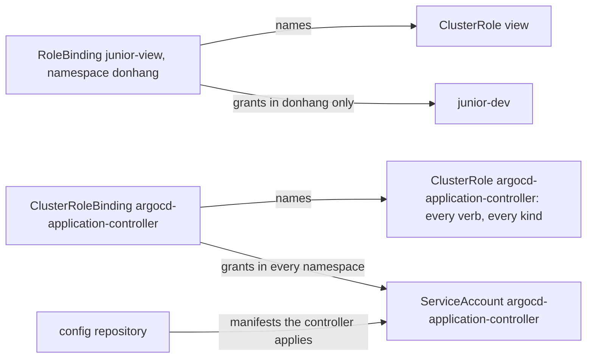

## Before you start

- [[k8s.l3.service-accounts]] — a program calls the API server as its ServiceAccount, with only what bindings give it.
- [[devops.l3.self-heal]] — with self-heal on, Argo CD undoes changes made by hand, so only a commit changes staging for good.
- [[devops.l3.verifying-before-deploy]] — in the lab, the commit to the config repository is the deploy step, and checks protect only what passes through it.

## The situation

A new colleague, signed in as `junior-dev`, needs to look around staging's `donhang` while learning the system: Pods, Deployments, ConfigMaps. The Role `pod-reader` from an earlier lesson lists only Pods, and only in `security-lessons`. Writing a longer Role, then copying it into every namespace they will need, feels like busywork. A teammate points to the cluster-wide roles Kubernetes ships with, and adds that staging is safe anyway, because the team keeps everyone's kubectl rights small. You wonder whether anything on staging already holds a cluster-wide role, and how much it allows. What does a role that spans the cluster grant, and who holds the widest one on staging?

## Core concepts

- A **ClusterRole** — a Role without a namespace: its rules can name cluster-wide kinds such as nodes and namespaces, and one ClusterRole can be reused in many namespaces.
- A **ClusterRoleBinding** — an object, itself without a namespace, that gives a ClusterRole to users, groups or ServiceAccounts in every namespace at once.
- `view` — a ClusterRole that Kubernetes creates in every cluster; it reads most objects in a namespace but not Secrets.
- `cluster-admin` — a ClusterRole that Kubernetes creates in every cluster; it allows every action on every kind.
- `argocd-application-controller` — the ServiceAccount, in namespace `argocd`, of the Argo CD program that applies the config repository's manifests to the cluster.

## How it works



In the situation above, the rules your colleague needs already exist in `view`. It is a ClusterRole: rules like a Role's, but no namespace of its own, so on its own it grants nothing anywhere. A binding decides where it applies.

A RoleBinding may name a ClusterRole instead of a Role. It then grants the ClusterRole's rules in the binding's own namespace only. `junior-view` in `donhang` gives `junior-dev` the `view` rules there, while `kube-system` stays closed. Another namespace can bind the same `view` with its own RoleBinding, without copying a single rule.

A ClusterRoleBinding grants a ClusterRole in every namespace at once, including namespaces created later. It also reaches kinds that belong to no namespace, such as nodes; a RoleBinding cannot grant nodes, whatever its ClusterRole lists.

`view` leaves out Secrets on purpose: a Secret can hold a credential that lets its reader call the API server as someone else. `cluster-admin` leaves out nothing.

Argo CD creates whatever the config repository holds. Its install manifest binds `argocd-application-controller` with a ClusterRoleBinding to a ClusterRole that allows every verb on every kind, the same reach as `cluster-admin`; both objects carry that name too. RBAC sees only the controller's ServiceAccount, not who wrote the commit it applies. Whoever can push to the config repository can therefore have the controller create objects RBAC would never let them create themselves: a ClusterRoleBinding that gives someone `cluster-admin`, or a Pod, written by the author, that receives any Secret as a file and can send its value wherever the author chose. So when people only need to look, give them `view`, and let changes reach the cluster through commits that pass code review.

## In the Đơn Hàng system

```yaml file=deploy/k8s/lessons/junior-view-binding.yaml tag=stage-3 lines=1-17
# lesson: k8s.l3.cluster-roles
# The built-in ClusterRole view, given to junior-dev by a RoleBinding: it
# applies in this binding's namespace, staging's donhang, and nowhere else.
# A ClusterRoleBinding would give it in every namespace at once.
apiVersion: rbac.authorization.k8s.io/v1
kind: RoleBinding
metadata:
  name: junior-view
  namespace: donhang
subjects:
  - kind: User
    name: junior-dev
    apiGroup: rbac.authorization.k8s.io
roleRef:
  kind: ClusterRole
  name: view
  apiGroup: rbac.authorization.k8s.io
```

This is the RoleBinding from the diagram. Compared with the `pod-reader` binding of the earlier lesson, the subject is the same; `roleRef` now has `kind: ClusterRole` and `name: view`, which nobody in Đơn Hàng wrote. The `namespace` under `metadata`, now `donhang`, is what limits the grant.

```bash file=scripts/k8s/cluster-roles.sh tag=stage-3 lines=14-36
show kubectl apply -f deploy/k8s/lessons/junior-view-binding.yaml
can_i list pods -n donhang
can_i list deployments -n donhang
can_i list pods -n kube-system
can_i get secrets -n donhang
can_i list nodes
can_i delete pods -n donhang
echo

# lesson: k8s.l3.cluster-roles
# Argo CD's application controller: a ClusterRoleBinding gives its
# ServiceAccount a ClusterRole whose one rule allows every verb on every
# kind in every API group, so it can create whatever the config repository
# holds. Whoever can commit there can, too.
sa=system:serviceaccount:argocd:argocd-application-controller
echo "\$ kubectl get clusterrolebinding argocd-application-controller"
kubectl get clusterrolebinding argocd-application-controller \
  -o jsonpath='roleRef: {.roleRef.kind} {.roleRef.name}{"\n"}subject: {.subjects[0].kind} {.subjects[0].namespace}/{.subjects[0].name}{"\n"}'
echo "\$ kubectl get clusterrole argocd-application-controller"
kubectl get clusterrole argocd-application-controller \
  -o jsonpath='{range .rules[*]}apiGroups={.apiGroups} resources={.resources} nonResourceURLs={.nonResourceURLs} verbs={.verbs}{"\n"}{end}'
echo "can $sa create clusterrolebindings? $(kubectl auth can-i create clusterrolebindings --as="$sa" 2>/dev/null)"
echo "can $sa get secrets in kube-system? $(kubectl auth can-i get secrets -n kube-system --as="$sa")"
```

```text output=true
$ kubectl apply -f deploy/k8s/lessons/junior-view-binding.yaml
rolebinding.rbac.authorization.k8s.io/junior-view created
$ kubectl auth can-i list pods -n donhang --as=junior-dev
yes
$ kubectl auth can-i list deployments -n donhang --as=junior-dev
yes
$ kubectl auth can-i list pods -n kube-system --as=junior-dev
no
$ kubectl auth can-i get secrets -n donhang --as=junior-dev
no
$ kubectl auth can-i list nodes --as=junior-dev
Warning: resource 'nodes' is not namespace scoped

no
$ kubectl auth can-i delete pods -n donhang --as=junior-dev
no

$ kubectl get clusterrolebinding argocd-application-controller
roleRef: ClusterRole argocd-application-controller
subject: ServiceAccount argocd/argocd-application-controller
$ kubectl get clusterrole argocd-application-controller
apiGroups=["*"] resources=["*"] nonResourceURLs= verbs=["*"]
apiGroups= resources= nonResourceURLs=["*"] verbs=["*"]
can system:serviceaccount:argocd:argocd-application-controller create clusterrolebindings? yes
can system:serviceaccount:argocd:argocd-application-controller get secrets in kube-system? yes
```

Above the excerpt, `show` prints a command before running it, every `kubectl` goes to the context `kind-donhang-staging`, and `can_i` on line 8 prints and runs `kubectl auth can-i` with `--as=junior-dev`, which asks the API server whether that user may do the action, without doing it, and prints yes or no. The first part answers `yes` only for reading Pods and Deployments in `donhang`. For nodes, kubectl first warns that they belong to no namespace.

The second part reads Argo CD's objects; `-o jsonpath` prints only the chosen fields of an object. The ClusterRole has two rules, not the one the comment mentions, each `*` for verbs. Kubernetes sorts kinds into named API groups, such as `rbac.authorization.k8s.io` for Roles and bindings, and a rule names groups as well as kinds. The first rule covers every API group and every kind. The second covers non-resource URLs, addresses of the API server that are not objects, such as its health checks. The last two lines ask as the ServiceAccount: it may create ClusterRoleBindings and read Secrets in `kube-system`.

## Seniors often assume…

- **"A RoleBinding to a ClusterRole grants it across the whole cluster."** → Actually it grants the ClusterRole's rules only in the RoleBinding's namespace; only a ClusterRoleBinding grants it everywhere. You notice this when `kubectl auth can-i list pods -n kube-system --as=junior-dev` answers `no` right after the same check in `donhang` answered `yes`.
- **"The built-in `view` role lets someone read Secrets."** → Actually `view` leaves Secrets out, because a Secret can hold a credential for acting as someone else. You notice this when `kubectl get secrets -n donhang --as=junior-dev` prints `Error from server (Forbidden): ...` while `kubectl get pods` works.
- **"Limiting people's kubectl rights limits what reaches the cluster under GitOps."** → Actually Argo CD's controller applies whatever the config repository holds, with every verb on every kind, so write access to that repository reaches as far as `cluster-admin`. You notice this when a commit adds an object to `envs/staging` that its author could never create with their own kubectl.

## Try it (3 minutes)

From the root of the Đơn Hàng repository, with `donhang-staging` still running from earlier lessons (`scripts/devops/tofu-env.sh staging up` creates it) and Argo CD installed in it (`scripts/devops/argocd-install.sh`, from [[devops.l3.argo-cd-applications]]):

1. Run `scripts/k8s/cluster-roles.sh`.
2. Predict the answers of `kubectl --context kind-donhang-staging auth can-i list configmaps -n donhang --as=junior-dev` and of the same command with `-n argocd`. Run both.

Expected result: the script prints the output shown above; step 2 prints `yes` for `donhang` and `no` for `argocd`.

<details><summary>Suggested answer</summary>

ConfigMaps are among the objects `view` reads, and `junior-view` grants `view` in `donhang`, so that answer is `yes`. No binding gives `junior-dev` anything in `argocd`, so the second answer is `no`. Giving them `view` everywhere would take one ClusterRoleBinding, and that would include `argocd` and every namespace created later.

</details>

## Connections

- [[k8s.l3.service-accounts]] — prerequisite: the controller is one more ServiceAccount, and its binding is what makes it powerful.
- [[devops.l3.self-heal]] — the other half of the same picture: self-heal undoes kubectl changes, while this ClusterRole lets the controller apply any commit.
- [[devops.l3.verifying-before-deploy]] — the same conclusion from the supply-chain side: control lives on the path into the config repository.
- [[devops.l3.argo-cd-applications]] — where Argo CD was installed from `install.yaml`, the manifest that also holds this ClusterRole.
- [[devops.l3.deploying-by-commit]] — the flow whose author this lesson shows is, in effect, a cluster administrator.
- [[k8s.l3.security-context]] — the next lesson: limiting what a container's process can do, rather than what a caller of the API server can do.

## Five-line summary

1. A ClusterRole has no namespace; a RoleBinding grants it in one namespace, a ClusterRoleBinding in all of them.
2. One ClusterRole, such as `view`, can be reused by RoleBindings in many namespaces without copying rules.
3. `view` reads most objects in a namespace but not Secrets; `cluster-admin` allows every action on every kind.
4. Argo CD's `argocd-application-controller` is bound cluster-wide to a ClusterRole allowing every verb on every kind.
5. With Argo CD installed as on staging, config repository write access is as powerful as `cluster-admin`; people who only need to look get `view`.
