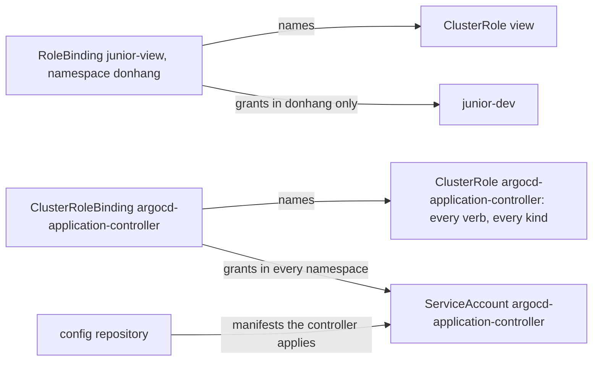

## Bạn cần biết trước

- [[k8s.l3.service-accounts]] — chương trình gọi API server dưới danh tính ServiceAccount của nó, và chỉ có những gì các binding cho nó.
- [[devops.l3.self-heal]] — khi bật self-heal, Argo CD hoàn tác mọi thay đổi làm bằng tay, nên chỉ một commit mới thay đổi được staging lâu dài.
- [[devops.l3.verifying-before-deploy]] — trong lab, commit vào repo cấu hình chính là bước deploy, và các bước kiểm tra chỉ bảo vệ được những gì đi qua nó.

## Tình huống

Một đồng nghiệp mới, đăng nhập dưới tên `junior-dev`, cần xem quanh `donhang` của staging trong lúc làm quen hệ thống: Pod, Deployment, ConfigMap. Role `pod-reader` ở bài trước chỉ liệt kê được Pod, và chỉ trong `security-lessons`. Viết một Role dài hơn rồi chép nó sang mọi namespace mà họ sẽ cần thì nghe như một mớ thao tác lặp đi lặp lại. Một người trong nhóm chỉ cho bạn các role phủ cả cluster mà Kubernetes có sẵn, và nói thêm rằng staging vẫn an toàn, vì nhóm luôn giữ quyền kubectl của mọi người ở mức nhỏ. Bạn tự hỏi trên staging đã có thứ gì đang giữ một role phủ cả cluster chưa, và nó cho phép tới đâu. Một role phủ cả cluster trao những gì, và ai trên staging giữ cái rộng nhất?

## Khái niệm cốt lõi

- **ClusterRole** (Role không thuộc namespace: phủ được loại object cấp cluster và dùng lại ở nhiều namespace) — một Role không có namespace: các rule của nó nêu được những loại object cấp cluster như node và namespace, và một ClusterRole dùng lại được ở nhiều namespace.
- **ClusterRoleBinding** (Object trao một ClusterRole trong mọi namespace cùng lúc) — một object, bản thân cũng không có namespace, trao một ClusterRole cho user, nhóm hoặc ServiceAccount trong mọi namespace cùng lúc.
- `view` — ClusterRole mà Kubernetes tạo sẵn trong mọi cluster. Nó đọc được hầu hết object trong một namespace, trừ Secret.
- `cluster-admin` — ClusterRole mà Kubernetes tạo sẵn trong mọi cluster. Nó cho phép mọi hành động trên mọi loại object.
- `argocd-application-controller` — ServiceAccount, trong namespace `argocd`, của chương trình Argo CD áp các manifest của repo cấu hình lên cluster.

## Cơ chế hoạt động



Trong tình huống trên, các rule mà đồng nghiệp của bạn cần đã có sẵn trong `view`. Đó là một ClusterRole: rule giống như của Role, nhưng không có namespace riêng, nên tự nó không trao gì ở đâu cả. Binding mới quyết định nó áp dụng ở đâu.

RoleBinding có thể nêu một ClusterRole thay cho Role. Khi đó nó trao các rule của ClusterRole chỉ trong chính namespace của binding. `junior-view` trong `donhang` cho `junior-dev` các rule của `view` ở đó, còn `kube-system` vẫn đóng. Namespace khác có thể bind cùng `view` đó bằng RoleBinding của riêng mình, không cần chép một rule nào.

ClusterRoleBinding trao một ClusterRole trong mọi namespace cùng lúc, kể cả namespace tạo ra sau này. Nó còn với tới những loại object không thuộc namespace nào, như node. RoleBinding thì không trao được quyền trên node, dù ClusterRole của nó liệt kê gì đi nữa.

`view` cố ý bỏ Secret ra ngoài: một Secret có thể chứa thông tin đăng nhập cho phép người đọc nó gọi API server dưới danh tính của người khác. `cluster-admin` thì không bỏ gì cả.

Argo CD tạo ra bất cứ thứ gì repo cấu hình chứa. Manifest cài đặt của nó dùng một ClusterRoleBinding để gắn `argocd-application-controller` với một ClusterRole cho phép mọi verb trên mọi loại object, tầm với ngang `cluster-admin`. Cả hai object này cũng mang tên đó. RBAC chỉ thấy ServiceAccount của controller, không thấy ai viết commit mà nó áp. Vì vậy ai push được vào repo cấu hình đều có thể khiến controller tạo ra những object mà RBAC không bao giờ cho chính họ tạo: một ClusterRoleBinding cho ai đó `cluster-admin`, hay một Pod do tác giả viết, nhận bất kỳ Secret nào dưới dạng file và gửi giá trị của nó tới bất cứ đâu tác giả muốn. Nên khi người ta chỉ cần xem, hãy cho họ `view`, và để thay đổi tới cluster qua các commit đã qua code review.

## Trong hệ thống Đơn Hàng

```yaml file=deploy/k8s/lessons/junior-view-binding.yaml tag=stage-3 lines=1-17
# lesson: k8s.l3.cluster-roles
# The built-in ClusterRole view, given to junior-dev by a RoleBinding: it
# applies in this binding's namespace, staging's donhang, and nowhere else.
# A ClusterRoleBinding would give it in every namespace at once.
apiVersion: rbac.authorization.k8s.io/v1
kind: RoleBinding
metadata:
  name: junior-view
  namespace: donhang
subjects:
  - kind: User
    name: junior-dev
    apiGroup: rbac.authorization.k8s.io
roleRef:
  kind: ClusterRole
  name: view
  apiGroup: rbac.authorization.k8s.io
```

Đây là RoleBinding trong sơ đồ. So với binding `pod-reader` của bài trước, subject vẫn vậy. `roleRef` giờ có `kind: ClusterRole` và `name: view`, thứ không ai trong Đơn Hàng viết ra. Chính `namespace` dưới `metadata`, giờ là `donhang`, giới hạn phạm vi trao quyền.

```bash file=scripts/k8s/cluster-roles.sh tag=stage-3 lines=14-36
show kubectl apply -f deploy/k8s/lessons/junior-view-binding.yaml
can_i list pods -n donhang
can_i list deployments -n donhang
can_i list pods -n kube-system
can_i get secrets -n donhang
can_i list nodes
can_i delete pods -n donhang
echo

# lesson: k8s.l3.cluster-roles
# Argo CD's application controller: a ClusterRoleBinding gives its
# ServiceAccount a ClusterRole whose one rule allows every verb on every
# kind in every API group, so it can create whatever the config repository
# holds. Whoever can commit there can, too.
sa=system:serviceaccount:argocd:argocd-application-controller
echo "\$ kubectl get clusterrolebinding argocd-application-controller"
kubectl get clusterrolebinding argocd-application-controller \
  -o jsonpath='roleRef: {.roleRef.kind} {.roleRef.name}{"\n"}subject: {.subjects[0].kind} {.subjects[0].namespace}/{.subjects[0].name}{"\n"}'
echo "\$ kubectl get clusterrole argocd-application-controller"
kubectl get clusterrole argocd-application-controller \
  -o jsonpath='{range .rules[*]}apiGroups={.apiGroups} resources={.resources} nonResourceURLs={.nonResourceURLs} verbs={.verbs}{"\n"}{end}'
echo "can $sa create clusterrolebindings? $(kubectl auth can-i create clusterrolebindings --as="$sa" 2>/dev/null)"
echo "can $sa get secrets in kube-system? $(kubectl auth can-i get secrets -n kube-system --as="$sa")"
```

```text output=true
$ kubectl apply -f deploy/k8s/lessons/junior-view-binding.yaml
rolebinding.rbac.authorization.k8s.io/junior-view created
$ kubectl auth can-i list pods -n donhang --as=junior-dev
yes
$ kubectl auth can-i list deployments -n donhang --as=junior-dev
yes
$ kubectl auth can-i list pods -n kube-system --as=junior-dev
no
$ kubectl auth can-i get secrets -n donhang --as=junior-dev
no
$ kubectl auth can-i list nodes --as=junior-dev
Warning: resource 'nodes' is not namespace scoped

no
$ kubectl auth can-i delete pods -n donhang --as=junior-dev
no

$ kubectl get clusterrolebinding argocd-application-controller
roleRef: ClusterRole argocd-application-controller
subject: ServiceAccount argocd/argocd-application-controller
$ kubectl get clusterrole argocd-application-controller
apiGroups=["*"] resources=["*"] nonResourceURLs= verbs=["*"]
apiGroups= resources= nonResourceURLs=["*"] verbs=["*"]
can system:serviceaccount:argocd:argocd-application-controller create clusterrolebindings? yes
can system:serviceaccount:argocd:argocd-application-controller get secrets in kube-system? yes
```

Phía trên đoạn trích, `show` in một lệnh rồi chạy nó, mọi lệnh `kubectl` đều đi tới context `kind-donhang-staging`, và `can_i` ở dòng 8 in rồi chạy `kubectl auth can-i` với `--as=junior-dev`. Lệnh này hỏi API server xem user đó có được làm hành động này không, mà không thực sự làm, rồi in yes hoặc no. Phần đầu chỉ trả lời `yes` khi hỏi đọc Pod và Deployment trong `donhang`. Với node, kubectl cảnh báo trước rằng chúng không thuộc namespace nào.

Phần thứ hai đọc các object của Argo CD. `-o jsonpath` chỉ in những trường được chọn của một object. ClusterRole có hai rule, chứ không phải một như comment nói, và rule nào cũng có `*` cho verb. Kubernetes xếp các loại object vào những API group có tên, như `rbac.authorization.k8s.io` cho Role và binding, và rule nêu cả group lẫn loại object. Rule đầu phủ mọi API group và mọi loại object. Rule thứ hai phủ non-resource URL, tức những địa chỉ của API server không phải object, như các health check của nó. Hai dòng cuối hỏi dưới danh tính ServiceAccount: nó được tạo ClusterRoleBinding và đọc Secret trong `kube-system`.

## Senior hay nhầm rằng…

- **"RoleBinding tới một ClusterRole trao nó trên toàn cluster."** → Thực ra nó chỉ trao các rule của ClusterRole trong namespace của RoleBinding, chỉ ClusterRoleBinding mới trao ở mọi nơi. Bạn sẽ nhận ra khi `kubectl auth can-i list pods -n kube-system --as=junior-dev` trả lời `no` ngay sau khi cùng câu hỏi đó trong `donhang` trả lời `yes`.
- **"Role `view` có sẵn cho phép người ta đọc Secret."** → Thực ra `view` bỏ Secret ra ngoài, vì một Secret có thể chứa thông tin đăng nhập để hành động dưới danh tính người khác. Bạn sẽ nhận ra khi `kubectl get secrets -n donhang --as=junior-dev` in `Error from server (Forbidden): ...` trong khi `kubectl get pods` vẫn chạy.
- **"Giới hạn quyền kubectl của mọi người là giới hạn được những gì tới cluster khi dùng GitOps."** → Thực ra controller của Argo CD áp bất cứ thứ gì repo cấu hình chứa, với mọi verb trên mọi loại object, nên quyền ghi vào repo đó với xa ngang `cluster-admin`. Bạn sẽ nhận ra khi một commit thêm vào `envs/staging` một object mà tác giả không bao giờ tạo được bằng kubectl của chính mình.

## Thử ngay (3 phút)

Ở thư mục gốc của repo Đơn Hàng, khi `donhang-staging` vẫn đang chạy từ các bài trước (`scripts/devops/tofu-env.sh staging up` tạo ra nó) và đã cài Argo CD trong đó (`scripts/devops/argocd-install.sh`, từ [[devops.l3.argo-cd-applications]]):

1. Chạy `scripts/k8s/cluster-roles.sh`.
2. Đoán câu trả lời của `kubectl --context kind-donhang-staging auth can-i list configmaps -n donhang --as=junior-dev` và của cùng lệnh đó với `-n argocd`. Chạy cả hai.

Kết quả mong đợi: script in ra output như ở trên, và bước 2 in `yes` cho `donhang`, `no` cho `argocd`.

<details><summary>Gợi ý đáp án</summary>

ConfigMap nằm trong số object mà `view` đọc được, và `junior-view` trao `view` trong `donhang`, nên câu trả lời đó là `yes`. Không binding nào cho `junior-dev` thứ gì trong `argocd`, nên câu trả lời thứ hai là `no`. Muốn cho họ `view` ở mọi nơi thì cần một ClusterRoleBinding, và nó sẽ gồm cả `argocd` lẫn mọi namespace tạo ra sau này.

</details>

## Liên hệ

- [[k8s.l3.service-accounts]] — bài tiên quyết: controller chỉ là thêm một ServiceAccount, và chính binding của nó làm nó mạnh.
- [[devops.l3.self-heal]] — nửa còn lại của cùng bức tranh: self-heal hoàn tác thay đổi bằng kubectl, còn ClusterRole này cho controller áp bất kỳ commit nào.
- [[devops.l3.verifying-before-deploy]] — cùng kết luận nhìn từ phía chuỗi cung ứng: quyền kiểm soát nằm trên đường đi vào repo cấu hình.
- [[devops.l3.argo-cd-applications]] — nơi Argo CD được cài từ `install.yaml`, manifest cũng chứa ClusterRole này.
- [[devops.l3.deploying-by-commit]] — luồng mà, như bài này cho thấy, người viết commit thực chất là một quản trị viên cluster.
- [[k8s.l3.security-context]] — bài tiếp theo: giới hạn những gì process của container làm được, thay vì những gì người gọi API server làm được.

## Tóm tắt 5 dòng

1. ClusterRole không có namespace. RoleBinding trao nó trong một namespace, ClusterRoleBinding trao trong tất cả.
2. Một ClusterRole, như `view`, dùng lại được bởi RoleBinding ở nhiều namespace mà không cần chép rule.
3. `view` đọc hầu hết object trong một namespace nhưng không đọc Secret, còn `cluster-admin` cho phép mọi hành động trên mọi loại object.
4. `argocd-application-controller` của Argo CD được bind trên toàn cluster với một ClusterRole cho phép mọi verb trên mọi loại object.
5. Khi Argo CD được cài như trên staging, quyền ghi vào repo cấu hình mạnh ngang `cluster-admin`. Người chỉ cần xem thì nhận `view`.
