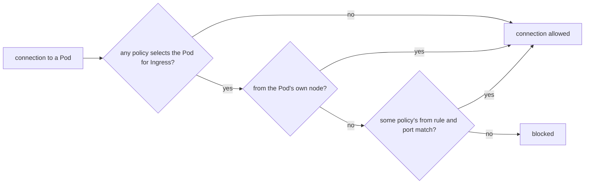

## Before you start

- [[k8s.l1.service-and-dns]] — a Pod reaches a Service in another namespace by a name such as `db.donhang.svc.cluster.local`; this lesson decides whether that connection is let through.
- [[k8s.l1.labels]] — label selectors choose a group of Pods by their labels; a NetworkPolicy uses them to name both the Pods it protects and the Pods allowed in.
- [[k8s.l2.staging-keeps-its-data]] — staging's `donhang` runs `db`, `rabbitmq`, the api, Notifications, Payments and the fake gateway, each Pod labelled with its `app`.
- [[k8s.l2.gateway-api]] — outside requests enter staging through the Gateway that Traefik carries out, so Traefik's Pods are the ones that connect to the api.

## The situation

You need to check that staging's PostgreSQL answers, so you start a throwaway Pod in the test namespace `security-lessons` and point `pg_isready`, PostgreSQL's command that only checks whether the server accepts connections, at `db.donhang.svc.cluster.local`. It answers at once. Nothing in `donhang` was told about your Pod, and the test namespace has no business there. The same path is open to every Pod in the cluster: a chart someone installs, a debugging Pod left running, or a container an attacker has taken over. Nothing on the network stands between them and `db`, `rabbitmq` or `redis`. How do you make staging's Pods accept connections only from the services that need them?

## Core concepts

- **NetworkPolicy** — an object in a namespace that selects Pods by label and lists the connections allowed to reach them, which the software that connects the cluster's Pods to each other carries out.
- Isolated Pod — a Pod that at least one NetworkPolicy selects for incoming connections; it accepts only what some policy allows, plus connections from its own node. `Ingress` in a policy's `policyTypes` means incoming connections to the selected Pods, not the Ingress object; `policyTypes` names the directions a policy isolates.
- Default-deny policy — a NetworkPolicy whose empty `podSelector: {}` selects every Pod in its namespace and allows nothing, so every Pod there becomes isolated.
- `from` rule — an entry in a policy's `ingress` list naming who may connect, by `podSelector` for Pods in the policy's namespace or `namespaceSelector` for whole namespaces, and on which `ports`.

## How it works



In the situation above, no NetworkPolicy exists in `donhang`, so the `db` Pod is not isolated and takes connections from any Pod in any namespace. Namespaces group objects for names and access rights on the API server; they draw no line on the network.

Once a policy selects the `db` Pod with `Ingress` in its `policyTypes`, the question changes. A connection gets through only if it comes from the Pod's own node or matches the `from` rule and port of some policy that selects the Pod. From the node means the node itself, such as its kubelet; an ordinary Pod scheduled on that node connects with its own address and needs a `from` rule like any other Pod. Policies only add allowed connections. When several select the same Pod, what they allow is combined, so their order does not matter and no policy can take away what another allows.

The API server only stores a NetworkPolicy. The component that wires Pods together on each node, chosen when the cluster is built, is what blocks connections. If that component does not support NetworkPolicies, the API server still accepts them and nothing is blocked. Staging's cluster runs on kind 0.33, and kind's default component for this, called kindnet, enforces them, so staging's policies take effect.

The kubelet runs on the node, so its probes keep reaching an isolated Pod. That is why a default-deny policy does not make every Pod in the namespace unready.

## In the Đơn Hàng system

```yaml file=deploy/gitops/config-repo-kustomize/base/network-policies.yaml tag=stage-3 lines=11-35
spec:
  podSelector: {}
  policyTypes: ["Ingress"]
---
# lesson: k8s.l3.network-policies
# PostgreSQL: only the services that use it, their migrations and the backup.
apiVersion: networking.k8s.io/v1
kind: NetworkPolicy
metadata:
  name: db
  namespace: donhang
spec:
  podSelector:
    matchLabels:
      app: db
  policyTypes: ["Ingress"]
  ingress:
    - from:
        - podSelector:
            matchExpressions:
              - key: app
                operator: In
                values: [api, migrate, notifications, notifications-migrate, payments, payments-migrate, db-backup]
      ports:
        - port: 5432
```

The first three lines are the end of `default-deny-ingress`, the file's first policy, whose name sits just above the excerpt: `podSelector: {}` and no `ingress` list, so every Pod in `donhang` is isolated. The policy `db` then opens port 5432 to Pods in `donhang` whose `app` label is one of seven values: the three services, their migration hooks and the backup job. A Pod in `security-lessons` matches none of it.

The rest of the file follows the same shape: one policy for each Pod that others connect to. Redis takes only the api; Mailpit, the test mail server Notifications sends email to, only Notifications; the fake gateway only Payments. Keycloak, the sign-in server, takes Traefik's Pods, the api and Payments. The api and Payments take connections from any Pod in the namespace `traefik`, chosen with `namespaceSelector` on the label `kubernetes.io/metadata.name`, which Kubernetes puts on every namespace.

```bash file=scripts/k8s/network-policy.sh tag=stage-3 lines=24-48
# lesson: k8s.l3.network-policies
# No NetworkPolicy in donhang yet: a Pod in any namespace reaches any Pod,
# here PostgreSQL from security-lessons.
show kubectl get networkpolicies -n donhang
reach_db
echo

# The policies of base/network-policies.yaml, committed: every Pod in
# donhang isolated for ingress, then one policy per service. kindnet, kind's
# network plugin, carries them out.
config_take base/network-policies.yaml
config_commit network-policy.sh "NetworkPolicies: nothing reaches donhang's Pods but what each service needs"
app_refresh
app_wait_sync "$(config_head --verify)" >/dev/null
app_wait Synced Healthy "$(config_head --verify)"
show kubectl get networkpolicies -n donhang
echo

# lesson: k8s.l3.network-policies
# The same connection now gets no answer; the api, which the policy db
# names, still reads the database, and every Pod is still ready: the
# kubelet's probes come from the Pod's own node, which is always allowed.
reach_db
echo "== GET $gateway/api/v1/products (the api reads PostgreSQL)"
curl -s -o /dev/null -w 'HTTP %{http_code}\n' "$gateway/api/v1/products"
```

```text output=true
$ kubectl get networkpolicies -n donhang
No resources found in donhang namespace.
$ kubectl exec probe -n security-lessons -- pg_isready -h db.donhang.svc.cluster.local -t 5
db.donhang.svc.cluster.local:5432 - accepting connections

staging: Synced, Healthy
$ kubectl get networkpolicies -n donhang
NAME                   POD-SELECTOR            AGE
db                     app=db                  ...
default-deny-ingress   <none>                  ...
fake-gateway           app=fake-gateway        ...
from-the-gateway       app in (api,payments)   ...
keycloak               app=keycloak            ...
mailpit                app=mailpit             ...
rabbitmq               app=rabbitmq            ...
redis                  app=redis               ...

$ kubectl exec probe -n security-lessons -- pg_isready -h db.donhang.svc.cluster.local -t 5
db.donhang.svc.cluster.local:5432 - no response
command terminated with exit code 2
== GET https://donhang.localhost:18443/api/v1/products (the api reads PostgreSQL)
HTTP 200
== Pods in donhang not ready: 0
```

Earlier lines, not shown, start the Pod `probe` in `security-lessons` and define `reach_db`, which runs `pg_isready` there with a 5-second timeout. The policies reach staging the GitOps way: the script commits the file to the config repository and waits for Argo CD to sync.

Before the commit, `probe` gets `accepting connections`. After it, the same command gets `no response`: the connection is blocked. `GET /api/v1/products` still returns `HTTP 200`, so the api, which the policy `db` names, still reads PostgreSQL. Lines after the excerpt count running Pods in `donhang` whose container is not ready: zero, since the probes come from the node.

## Seniors often assume…

- **"Pods in different namespaces cannot reach each other by default."** → Actually, with no NetworkPolicy, every Pod accepts connections from every Pod in the cluster; a namespace separates names and API rights, not traffic. You notice this when a Pod in `security-lessons` gets `accepting connections` from `db` in `donhang`.
- **"A NetworkPolicy the API server accepted is being enforced."** → Actually the API server only stores it; the component that connects Pods on each node must carry it out, and one without support blocks nothing and reports no error. You notice this when `kubectl get networkpolicies` lists your policy and the forbidden connection still succeeds.
- **"One NetworkPolicy can block a connection that another policy allows."** → Actually policies only add allowed connections; a Pod accepts whatever any policy selecting it allows. You notice this when a stricter policy added for `db` changes nothing, because the policy `db`'s `from` rule still lets the same Pods in.

## Try it (3 minutes)

From the root of the Đơn Hàng repository, with `donhang-staging` in the state the earlier k8s lessons left it (Kustomize layout of the config repository, staging's services running):

1. Run `scripts/k8s/network-policy.sh`.
2. Predict the result, then start a Pod inside `donhang` itself (`kubectl run` labels the Pod `run=probe`) and try the same check: `kubectl --context kind-donhang-staging run probe -n donhang --image=postgres:17.6-alpine --restart=Never --rm -i --command -- pg_isready -h db -t 5`.

Expected result: the script prints the output shown above; in step 2 kubectl may first print other lines, such as a PodSecurity warning; the `pg_isready` line ends in `no response`, even though the Pod runs in the same namespace as `db`.

<details><summary>Suggested answer</summary>

`kubectl run` labels its Pod `run=probe`, and the policy `db` lets in only Pods whose `app` label is one of its seven values. Being in `donhang` earns nothing: `podSelector` matches labels, so the default-deny policy isolates `db` from its own neighbours as well. To let a new service read the database, you add its `app` value to the policy `db` in the config repository.

</details>

## Connections

- [[k8s.l1.readiness-probes]] — the probes taught there still reach isolated Pods, because traffic from a Pod's own node is always allowed.
- [[k8s.l3.pod-security-admission]] — the same module's other namespace-wide guard: that one limits what a Pod may run, this one limits who may connect to it.
- [[k8s.l3.egress-policies]] — the other direction: limiting the connections a Pod opens, which first has to leave room for DNS.
- [[k8s.l3.admission-policies]] — the next lesson: a rule of Đơn Hàng's own, checked when a Pod is created.

## Five-line summary

1. A NetworkPolicy turns a Pod's open incoming traffic into an allow list of Pods and namespaces chosen by label.
2. Without any policy, every Pod accepts connections from every Pod in the cluster, across namespaces.
3. Once a policy selects a Pod for ingress, only its own node and what some policy allows get through; policies only add.
4. The API server just stores policies; the component wiring Pods together enforces them, and kindnet does in kind 0.33.
5. Staging isolates every Pod in `donhang`, then opens each service only to its callers; probes still pass.
