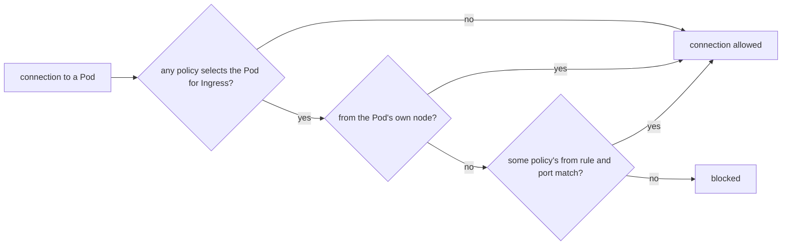

## Bạn cần biết trước

- [[k8s.l1.service-and-dns]] — Pod gọi tới một Service ở namespace khác bằng tên như `db.donhang.svc.cluster.local`. Bài này quyết định kết nối đó có được cho qua hay không.
- [[k8s.l1.labels]] — label selector chọn một nhóm Pod theo label của chúng. NetworkPolicy dùng selector để nêu cả Pod nó bảo vệ lẫn Pod được phép vào.
- [[k8s.l2.staging-keeps-its-data]] — `donhang` của staging chạy `db`, `rabbitmq`, api, Notifications, Payments và fake gateway, mỗi Pod mang label `app` của mình.
- [[k8s.l2.gateway-api]] — request từ bên ngoài vào staging qua Gateway do Traefik thực thi, nên Pod của Traefik là những Pod kết nối tới api.

## Tình huống

Bạn cần kiểm tra PostgreSQL của staging có trả lời không, nên bạn chạy một Pod dùng xong bỏ trong namespace thử nghiệm `security-lessons` và trỏ `pg_isready`, lệnh của PostgreSQL chỉ kiểm tra server có nhận kết nối hay không, vào `db.donhang.svc.cluster.local`. Nó trả lời ngay. Không ai trong `donhang` được báo gì về Pod của bạn, và namespace thử nghiệm chẳng có lý do gì để chạm vào đó. Đường này mở cho mọi Pod trong cluster: một chart ai đó cài vào, một Pod debug bị bỏ quên, hay một container đã bị kẻ tấn công chiếm. Trên mạng không có gì chắn giữa chúng với `db`, `rabbitmq` hay `redis`. Làm sao để các Pod của staging chỉ nhận kết nối từ những service thật sự cần chúng?

## Khái niệm cốt lõi

- **NetworkPolicy** (Object chọn Pod theo label và liệt kê kết nối được phép tới hoặc từ chúng; network plugin thực thi) — object nằm trong một namespace, chọn Pod theo label và liệt kê các kết nối được phép tới chúng. Phần mềm nối các Pod của cluster với nhau là thứ thực thi nó.
- Pod bị cô lập — Pod được ít nhất một NetworkPolicy chọn cho kết nối đi vào. Nó chỉ nhận những gì một policy nào đó cho phép, cộng với kết nối từ chính node của nó. `Ingress` trong `policyTypes` của policy nghĩa là kết nối đi vào các Pod được chọn, không phải object Ingress. `policyTypes` nêu những chiều mà policy cô lập.
- Policy chặn mặc định — NetworkPolicy có `podSelector: {}` rỗng, chọn mọi Pod trong namespace của nó và không cho phép gì, nên mọi Pod ở đó đều bị cô lập.
- Luật `from` — một mục trong danh sách `ingress` của policy, nêu ai được kết nối, bằng `podSelector` cho Pod trong namespace của policy hoặc `namespaceSelector` cho cả namespace, và trên những `ports` nào.

## Cơ chế hoạt động



Trong tình huống trên, `donhang` chưa có NetworkPolicy nào, nên Pod `db` không bị cô lập và nhận kết nối từ mọi Pod ở mọi namespace. Namespace gom object lại để đặt tên và chia quyền truy cập trên API server. Nó không vạch ranh giới nào trên mạng.

Khi một policy chọn Pod `db` và có `Ingress` trong `policyTypes`, câu hỏi đổi khác. Kết nối chỉ qua được nếu nó đến từ chính node của Pod, hoặc khớp luật `from` và port của một policy nào đó chọn Pod này. "Từ node" nghĩa là bản thân node, chẳng hạn kubelet của nó. Một Pod bình thường được xếp lên node đó kết nối bằng địa chỉ riêng của mình và cần luật `from` như mọi Pod khác. Policy chỉ cộng thêm kết nối được phép. Khi nhiều policy cùng chọn một Pod, những gì chúng cho phép được gộp lại, nên thứ tự của chúng không quan trọng và không policy nào lấy đi được thứ mà policy khác đã cho.

API server chỉ lưu NetworkPolicy. Thành phần nối các Pod với nhau trên mỗi node, được chọn lúc dựng cluster, mới là thứ chặn kết nối. Nếu thành phần đó không hỗ trợ NetworkPolicy, API server vẫn nhận chúng và không có gì bị chặn. Cluster của staging chạy trên kind 0.33, và thành phần mặc định của kind cho việc này, tên là kindnet, có thực thi chúng, nên các policy của staging có hiệu lực.

Kubelet chạy trên node, nên probe của nó vẫn tới được Pod bị cô lập. Vì thế policy chặn mặc định không làm mọi Pod trong namespace mất trạng thái sẵn sàng.

## Trong hệ thống Đơn Hàng

```yaml file=deploy/gitops/config-repo-kustomize/base/network-policies.yaml tag=stage-3 lines=11-35
spec:
  podSelector: {}
  policyTypes: ["Ingress"]
---
# lesson: k8s.l3.network-policies
# PostgreSQL: only the services that use it, their migrations and the backup.
apiVersion: networking.k8s.io/v1
kind: NetworkPolicy
metadata:
  name: db
  namespace: donhang
spec:
  podSelector:
    matchLabels:
      app: db
  policyTypes: ["Ingress"]
  ingress:
    - from:
        - podSelector:
            matchExpressions:
              - key: app
                operator: In
                values: [api, migrate, notifications, notifications-migrate, payments, payments-migrate, db-backup]
      ports:
        - port: 5432
```

Ba dòng đầu là phần cuối của `default-deny-ingress`, policy đầu tiên trong file, tên của nó nằm ngay trên đoạn trích: `podSelector: {}` và không có danh sách `ingress`, nên mọi Pod trong `donhang` đều bị cô lập. Sau đó policy `db` mở port 5432 cho các Pod trong `donhang` có label `app` là một trong bảy giá trị: ba service, migration hook của chúng và job backup. Pod trong `security-lessons` không khớp chỗ nào.

Phần còn lại của file theo cùng một khuôn: mỗi Pod mà Pod khác kết nối tới có một policy. Redis chỉ nhận api. Mailpit, mail server thử nghiệm mà Notifications gửi email tới, chỉ nhận Notifications. Fake gateway chỉ nhận Payments. Keycloak, server đăng nhập, nhận Pod của Traefik, api và Payments. Api và Payments nhận kết nối từ mọi Pod trong namespace `traefik`, chọn bằng `namespaceSelector` trên label `kubernetes.io/metadata.name`, label mà Kubernetes gắn cho mọi namespace.

```bash file=scripts/k8s/network-policy.sh tag=stage-3 lines=24-48
# lesson: k8s.l3.network-policies
# No NetworkPolicy in donhang yet: a Pod in any namespace reaches any Pod,
# here PostgreSQL from security-lessons.
show kubectl get networkpolicies -n donhang
reach_db
echo

# The policies of base/network-policies.yaml, committed: every Pod in
# donhang isolated for ingress, then one policy per service. kindnet, kind's
# network plugin, carries them out.
config_take base/network-policies.yaml
config_commit network-policy.sh "NetworkPolicies: nothing reaches donhang's Pods but what each service needs"
app_refresh
app_wait_sync "$(config_head --verify)" >/dev/null
app_wait Synced Healthy "$(config_head --verify)"
show kubectl get networkpolicies -n donhang
echo

# lesson: k8s.l3.network-policies
# The same connection now gets no answer; the api, which the policy db
# names, still reads the database, and every Pod is still ready: the
# kubelet's probes come from the Pod's own node, which is always allowed.
reach_db
echo "== GET $gateway/api/v1/products (the api reads PostgreSQL)"
curl -s -o /dev/null -w 'HTTP %{http_code}\n' "$gateway/api/v1/products"
```

```text output=true
$ kubectl get networkpolicies -n donhang
No resources found in donhang namespace.
$ kubectl exec probe -n security-lessons -- pg_isready -h db.donhang.svc.cluster.local -t 5
db.donhang.svc.cluster.local:5432 - accepting connections

staging: Synced, Healthy
$ kubectl get networkpolicies -n donhang
NAME                   POD-SELECTOR            AGE
db                     app=db                  ...
default-deny-ingress   <none>                  ...
fake-gateway           app=fake-gateway        ...
from-the-gateway       app in (api,payments)   ...
keycloak               app=keycloak            ...
mailpit                app=mailpit             ...
rabbitmq               app=rabbitmq            ...
redis                  app=redis               ...

$ kubectl exec probe -n security-lessons -- pg_isready -h db.donhang.svc.cluster.local -t 5
db.donhang.svc.cluster.local:5432 - no response
command terminated with exit code 2
== GET https://donhang.localhost:18443/api/v1/products (the api reads PostgreSQL)
HTTP 200
== Pods in donhang not ready: 0
```

Các dòng phía trước, không trích ở đây, khởi động Pod `probe` trong `security-lessons` và định nghĩa `reach_db`, hàm chạy `pg_isready` ở đó với thời gian chờ 5 giây. Các policy đến staging theo kiểu GitOps: script commit file vào repo cấu hình rồi chờ Argo CD sync.

Trước commit, `probe` nhận được `accepting connections`. Sau commit, cùng lệnh đó nhận `no response`: kết nối bị chặn. `GET /api/v1/products` vẫn trả về `HTTP 200`, nghĩa là api, Pod mà policy `db` có nêu tên, vẫn đọc được PostgreSQL. Các dòng sau đoạn trích đếm những Pod đang chạy trong `donhang` có container chưa sẵn sàng: không có Pod nào, vì probe đến từ node.

## Senior hay nhầm rằng…

- **"Mặc định Pod ở các namespace khác nhau không gọi được nhau."** → Thực ra khi không có NetworkPolicy nào, mọi Pod nhận kết nối từ mọi Pod trong cluster. Namespace tách tên và quyền trên API, không tách lưu lượng mạng. Bạn sẽ nhận ra khi một Pod trong `security-lessons` nhận được `accepting connections` từ `db` trong `donhang`.
- **"NetworkPolicy đã được API server nhận nghĩa là đang được thực thi."** → Thực ra API server chỉ lưu nó. Thành phần nối Pod trên mỗi node mới phải thực thi, và thành phần không hỗ trợ sẽ không chặn gì cũng không báo lỗi gì. Bạn sẽ nhận ra khi `kubectl get networkpolicies` liệt kê policy của bạn mà kết nối bị cấm vẫn thành công.
- **"Một NetworkPolicy có thể chặn kết nối mà policy khác cho phép."** → Thực ra policy chỉ cộng thêm kết nối được phép. Pod nhận mọi thứ mà bất kỳ policy nào chọn nó cho phép. Bạn sẽ nhận ra khi thêm một policy chặt hơn cho `db` mà không có gì thay đổi, vì luật `from` của policy `db` vẫn cho chính những Pod đó vào.

## Thử ngay (3 phút)

Ở thư mục gốc của repo Đơn Hàng, khi `donhang-staging` đang ở trạng thái mà các bài k8s trước để lại (repo cấu hình theo bố cục Kustomize, các service của staging đang chạy):

1. Chạy `scripts/k8s/network-policy.sh`.
2. Đoán trước kết quả, rồi khởi động một Pod ngay trong `donhang` (`kubectl run` gắn label `run=probe` cho Pod) và thử cùng phép kiểm tra: `kubectl --context kind-donhang-staging run probe -n donhang --image=postgres:17.6-alpine --restart=Never --rm -i --command -- pg_isready -h db -t 5`.

Kết quả mong đợi: script in ra output như ở trên. Ở bước 2, kubectl có thể in vài dòng khác trước, chẳng hạn cảnh báo PodSecurity. Dòng `pg_isready` kết thúc bằng `no response`, dù Pod chạy cùng namespace với `db`.

<details><summary>Gợi ý đáp án</summary>

`kubectl run` gắn label `run=probe` cho Pod của nó, còn policy `db` chỉ cho vào những Pod có label `app` là một trong bảy giá trị. Ở trong `donhang` không mang lại gì: `podSelector` so label, nên policy chặn mặc định cô lập `db` khỏi cả hàng xóm của nó. Muốn cho một service mới đọc database, bạn thêm giá trị `app` của service đó vào policy `db` trong repo cấu hình.

</details>

## Liên hệ

- [[k8s.l1.readiness-probes]] — các probe dạy ở bài đó vẫn tới được Pod bị cô lập, vì lưu lượng từ chính node của Pod luôn được cho phép.
- [[k8s.l3.pod-security-admission]] — lớp bảo vệ toàn namespace còn lại của module này: bài đó giới hạn Pod được chạy gì, bài này giới hạn ai được kết nối tới nó.
- [[k8s.l3.egress-policies]] — chiều ngược lại: giới hạn những kết nối mà Pod mở ra, mà trước hết phải chừa đường cho DNS.
- [[k8s.l3.admission-policies]] — bài tiếp theo: một luật riêng của Đơn Hàng, kiểm tra lúc Pod được tạo.

## Tóm tắt 5 dòng

1. NetworkPolicy biến lưu lượng đi vào vốn tự do của Pod thành danh sách cho phép gồm các Pod và namespace chọn theo label.
2. Khi không có policy nào, mọi Pod nhận kết nối từ mọi Pod trong cluster, kể cả khác namespace.
3. Khi một policy chọn Pod cho chiều đi vào, chỉ chính node của nó và những gì một policy nào đó cho phép mới qua được. Policy chỉ cộng thêm.
4. API server chỉ lưu policy. Thành phần nối các Pod với nhau mới thực thi chúng, và kindnet làm việc đó trong kind 0.33.
5. Staging cô lập mọi Pod trong `donhang`, rồi mở từng service chỉ cho những Pod gọi tới nó. Probe vẫn qua.
