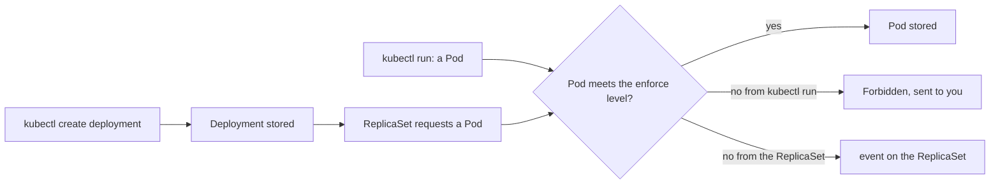

## Before you start

- [[k8s.l3.security-context]] — staging's base sets four securityContext fields on the .NET services; this lesson makes a namespace require settings like them.
- [[k8s.l3.api-request-checks]] — admission controllers check an object's content after authorization and before etcd stores it; this lesson meets one of them.
- [[k8s.l1.replicasets]] — a ReplicaSet creates Pods from its template, so the Pods a Deployment runs are requests the ReplicaSet makes, not you.
- [[devops.l3.one-state-per-environment]] — staging's platform layer, applied with OpenTofu, creates what the cluster needs before deployment, including the namespace `donhang`.

## The situation

The previous lesson's four settings protect the api only because its manifest sets them. Nothing stops the next manifest from leaving them out: a service copied from an old example, or a chart someone installs into `donhang`. You want the cluster to refuse such Pods, instead of trusting a reviewer to notice. In a test namespace you try a rule: a Pod you create directly is refused with a list of reasons, but a Deployment with the same container is accepted, and no Pod ever appears. You also wonder what the rule would do to the Pods already running in staging. How do you make a namespace refuse Pods that lack the security settings its workloads should have?

## Core concepts

- **Pod Security Standards** — three levels Kubernetes defines for what a Pod may ask of its node: `privileged` allows everything, `baseline` blocks known ways to gain power over the node such as a container marked `privileged: true` (a securityContext field that turns off most of the container's isolation from the node), and `restricted` also requires settings like the previous lesson's four.
- **Pod Security admission** — an admission controller built into the API server that checks each new Pod against the levels named in its namespace's labels.
- Mode label — a label `pod-security.kubernetes.io/<mode>: <level>` on a namespace, where the mode says what happens to a Pod that falls short of the level.
- The three modes — `enforce` rejects the Pod, `warn` admits it and sends a warning back to the client, `audit` admits it and adds a note to the request's record in the API server's audit log, a record of requests kept for administrators, when the API server keeps an audit log (Đơn Hàng's kind clusters are not set up to keep one).
- Server-side dry run — a request sent with `--dry-run=server`, which the API server checks completely, admission included, but does not store.

## How it works



In the situation above, the test namespace carries one label, `pod-security.kubernetes.io/enforce: restricted`. When a request to create a Pod reaches the API server, Pod Security admission reads the labels of the Pod's namespace and compares the Pod's manifest with each level they name. It only compares. It never adds a missing field, so a Pod is admitted or refused exactly as written.

A Pod you create yourself, with `kubectl run`, is checked while kubectl waits for the answer. The refusal comes straight back as `Error from server (Forbidden)`, with one entry per failed check.

A Deployment takes a longer path. `enforce` applies to Pods, not to the objects that create them, so the Deployment is accepted and stored. Its ReplicaSet then asks the API server for each Pod, and those requests are refused. Nobody waits on them: the ReplicaSet records an event, a short record the cluster keeps about an object saying what happened and why, read with `kubectl get events`. It tries again later; the Deployment shows no ready Pods.

In a namespace that also sets `warn` or `audit`, those modes check the Pod template inside a Deployment, so with `warn` applying the Deployment prints a warning.

A label applies to Pod requests made after it is set. It stops no running Pod; the API server checks the Pods already there and returns warnings naming those that fall short, grouping Pods with the same failures. With `--dry-run=server`, `kubectl label` returns those warnings without changing the label.

## In the Đơn Hàng system

```bash file=scripts/k8s/pod-security.sh tag=stage-3 lines=10-29
# lesson: k8s.l3.pod-security-admission
# A namespace labelled to enforce restricted, and a Pod with no
# securityContext at all: the API server refuses it and lists each check
# it fails. Nothing is created.
show kubectl apply -f deploy/k8s/lessons/restricted-namespace.yaml
echo "\$ kubectl run web --image=caddy:2.10.0 -n pod-security-lessons"
kubectl run web --image=caddy:2.10.0 -n pod-security-lessons 2>&1 | fold -s -w 120 || true
echo

# lesson: k8s.l3.pod-security-admission
# The same Pod template in a Deployment: the Deployment is accepted, since
# admission checks Pods, not what creates them. Its ReplicaSet's Pods are
# refused, and only the ReplicaSet's events say why.
echo "\$ kubectl create deployment web --image=caddy:2.10.0 -n pod-security-lessons"
kubectl create deployment web --image=caddy:2.10.0 -n pod-security-lessons 2>&1 | grep -v '^Warning'
sleep 5
show kubectl get deployment,replicaset,pods -n pod-security-lessons
echo "== the ReplicaSet's events"
kubectl get events -n pod-security-lessons --field-selector involvedObject.kind=ReplicaSet,reason=FailedCreate \
  -o jsonpath='{.items[-1:].message}{"\n"}' | sed -E 's/^\(combined from similar events\): //; s/^Error creating: //' | fold -s -w 120
```

```text output=true
$ kubectl apply -f deploy/k8s/lessons/restricted-namespace.yaml
namespace/pod-security-lessons created
$ kubectl run web --image=caddy:2.10.0 -n pod-security-lessons
Error from server (Forbidden): pods "web" is forbidden: violates PodSecurity "restricted:latest": 
allowPrivilegeEscalation != false (container "web" must set securityContext.allowPrivilegeEscalation=false), 
unrestricted capabilities (container "web" must set securityContext.capabilities.drop=["ALL"]), runAsNonRoot != true 
(pod or container "web" must set securityContext.runAsNonRoot=true), seccompProfile (pod or container "web" must set 
securityContext.seccompProfile.type to "RuntimeDefault" or "Localhost")

$ kubectl create deployment web --image=caddy:2.10.0 -n pod-security-lessons
deployment.apps/web created
$ kubectl get deployment,replicaset,pods -n pod-security-lessons
NAME                  READY   UP-TO-DATE   AVAILABLE   AGE
deployment.apps/web   0/1     0            0           ...

NAME                      DESIRED   CURRENT   READY   AGE
replicaset.apps/web-...   1         0         0       ...
== the ReplicaSet's events
pods "web-...-..." is forbidden: violates PodSecurity "restricted:latest": allowPrivilegeEscalation != false 
(container "caddy" must set securityContext.allowPrivilegeEscalation=false), unrestricted capabilities (container 
"caddy" must set securityContext.capabilities.drop=["ALL"]), runAsNonRoot != true (pod or container "caddy" must set 
securityContext.runAsNonRoot=true), seccompProfile (pod or container "caddy" must set 
securityContext.seccompProfile.type to "RuntimeDefault" or "Localhost")

$ kubectl label --dry-run=server --overwrite namespace donhang pod-security.kubernetes.io/enforce=restricted
existing pods in namespace "donhang" violate the new PodSecurity enforce level "restricted:latest"
db-0 (and 5 other pods): allowPrivilegeEscalation != false, unrestricted capabilities, runAsNonRoot != true, seccompProfile
namespace/donhang labeled (server dry run)
$ kubectl label --dry-run=server --overwrite namespace donhang pod-security.kubernetes.io/enforce=baseline
namespace/donhang not labeled (server dry run)

== the labels of donhang
{"kubernetes.io/metadata.name":"donhang"
"pod-security.kubernetes.io/audit":"restricted"
"pod-security.kubernetes.io/enforce":"baseline"
"pod-security.kubernetes.io/warn":"restricted"}
$ scripts/devops/tofu-env.sh staging platform plan
No changes. Your infrastructure matches the configuration.
```

Earlier lines of the script, not shown, define `show`, which prints a command before running it, and send every `kubectl` to `kind-donhang-staging`. `restricted-namespace.yaml` creates `pod-security-lessons` with the single label `enforce: restricted`. `caddy:2.10.0` with no securityContext fails four checks, the same four fields staging's base sets on the api. In `restricted:latest`, `latest` is the policy version, the one applied when the namespace names no version (this lesson never names one): the newest rules this API server has.

The Deployment half is the trap: `deployment.apps/web created`, a ReplicaSet that wants 1 Pod and has 0, and no Pod line. `grep -v '^Warning'` drops any line kubectl starts with `Warning`, so the output shows only the create result. The reason is not in the create output or in `kubectl get`; the script reads it from the ReplicaSet's events.

Lines after the excerpt run the two dry runs on staging's `donhang` and print its labels. `restricted` would refuse `db-0` and five other Pods that set none of the four fields, yet the result says `(server dry run)`: nothing changed. `baseline` returns no warning, and `not labeled` because the label already says `baseline`.

```hcl file=deploy/tofu/modules/donhang-platform/main.tf tag=stage-3 lines=43-53
# lesson: k8s.l3.pod-security-admission
# The namespace's Pod Security labels (from stage-3): enforce the level the
# environment gives, the strictest that all of its Pods pass; warn and audit
# at restricted, so that every Pod short of it is reported.
locals {
  pod_security_labels = {
    "pod-security.kubernetes.io/enforce" = var.pod_security_enforce
    "pod-security.kubernetes.io/warn"    = "restricted"
    "pod-security.kubernetes.io/audit"   = "restricted"
  }
}
```

Nobody ran `kubectl label` on `donhang`. The module `donhang-platform` puts these labels on its `kubernetes_namespace_v1` resource for `donhang`, earlier in the same file, so the namespace has carried them since `tofu-env.sh staging up` first created it. Staging's platform layer passes `pod_security_enforce = "baseline"`, the strictest level all its Pods pass, while `warn` and `audit` stay at `restricted` so every Pod short of it is still reported. When some Pods cannot pass `restricted` yet, this split keeps them running and keeps the gap visible. The plan at the end of the output finds no changes: the labels in the cluster match the code.

## Seniors often assume…

- **"`kubectl apply` fails when a Deployment breaks the namespace's Pod Security level."** → Actually the Deployment is accepted, because `enforce` checks only Pods; the ReplicaSet's requests for Pods are refused later, where you are not looking. You notice this when the apply succeeds, `kubectl get deployment` shows `0/1` for minutes, `kubectl get pods` lists nothing, and the reason sits in the ReplicaSet's events.
- **"Pod Security admission changes Pods so that they pass."** → Actually it only compares a Pod with the level and admits or refuses it as written; setting `runAsNonRoot` or dropping capabilities stays the manifest's job. You notice this when the refusal says `must set securityContext.runAsNonRoot=true` instead of a Pod appearing with it set.
- **"Labelling a namespace `restricted` stops the Pods already running there."** → Actually running Pods keep running; the label applies to Pods created after it, and the API server only warns about the existing ones. You notice this later, when a rollout or a deleted Pod needs a replacement and its ReplicaSet cannot create one.

## Try it (3 minutes)

From the root of the Đơn Hàng repository, with `donhang-staging` running (`scripts/devops/tofu-env.sh staging up` creates it):

1. Run `scripts/k8s/pod-security.sh`.
2. Predict what this command prints, then run it: `kubectl --context kind-donhang-staging label --dry-run=server --overwrite namespace donhang pod-security.kubernetes.io/enforce=privileged`.
3. Run `kubectl --context kind-donhang-staging get namespace donhang --show-labels`.

Expected result: the script prints the output shown above; step 2 prints `namespace/donhang labeled (server dry run)` with no warning line; step 3 still shows `enforce=baseline`.

<details><summary>Suggested answer</summary>

`privileged` allows everything, so no running Pod falls short of it and the API server returns no warning. The value differs from the current `baseline`, so kubectl reports `labeled`, but `--dry-run=server` means the API server stored nothing: the label stays `baseline`. Lowering a level never breaks a Pod; the dry run earns its keep when you raise one, as the `restricted` run in the script shows.

</details>

## Connections

- [[k8s.l3.security-context]] — prerequisite: there each manifest sets its own protections; here the namespace refuses Pods that lack them.
- [[k8s.l3.api-request-checks]] — the admission step named there, now with one admission controller at work and its `Forbidden` answer.
- [[devops.l3.tofu-modules]] — the same `donhang-platform` module, now also setting each environment's Pod Security labels from one variable.
- [[k8s.l3.admission-policies]] — the next lesson: a rule of Đơn Hàng's own that no Pod Security level contains.

## Five-line summary

1. Pod Security admission checks every new Pod against the Pod Security Standards level named in its namespace's labels.
2. The levels are `privileged`, `baseline` and `restricted`; `restricted` requires settings like those of a hardened securityContext.
3. `enforce` rejects a violating Pod, `warn` warns the client, `audit` records it in the audit log, if the API server keeps one.
4. `enforce` checks Pods, not Deployments: the Deployment is accepted, its Pods are refused, and the reason is in ReplicaSet events, not the apply output.
5. A new label stops no running Pod; `kubectl label --dry-run=server` lists the Pods a level would reject, without applying it.
