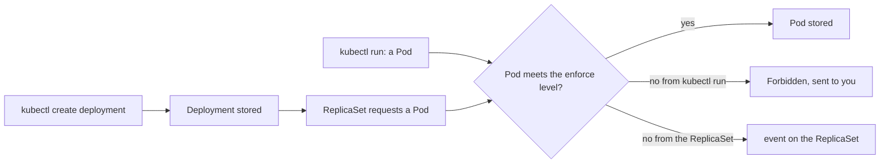

## Bạn cần biết trước

- [[k8s.l3.security-context]] — base của staging đặt bốn trường securityContext cho các service .NET. Bài này khiến một namespace đòi hỏi những thiết lập như vậy.
- [[k8s.l3.api-request-checks]] — admission controller kiểm tra nội dung của object sau bước phân quyền và trước khi etcd lưu nó. Bài này gặp một admission controller cụ thể.
- [[k8s.l1.replicasets]] — ReplicaSet tạo Pod từ template của nó, nên các Pod mà một Deployment chạy là request do ReplicaSet gửi, không phải do bạn.
- [[devops.l3.one-state-per-environment]] — platform layer của staging, apply bằng OpenTofu, tạo những gì cluster cần trước khi deploy, trong đó có namespace `donhang`.

## Tình huống

Bốn thiết lập ở bài trước chỉ bảo vệ api vì manifest của nó có đặt chúng. Không gì ngăn manifest kế tiếp bỏ chúng đi: một service chép từ ví dụ cũ, hay một chart ai đó cài vào `donhang`. Bạn muốn cluster tự từ chối những Pod như thế, thay vì trông vào người review để ý. Trong một namespace thử nghiệm, bạn thử một luật. Pod bạn tạo trực tiếp bị từ chối kèm một danh sách lý do, nhưng một Deployment với đúng container đó lại được chấp nhận, và không Pod nào xuất hiện. Bạn cũng băn khoăn luật này sẽ làm gì với các Pod đang chạy trên staging. Làm sao để một namespace từ chối những Pod thiếu các thiết lập bảo mật mà workload của nó cần có?

## Khái niệm cốt lõi

- **Pod Security Standards** (Ba mức bảo mật cho Pod do Kubernetes định nghĩa: privileged, baseline, restricted) — ba mức Kubernetes định nghĩa cho những gì một Pod được đòi hỏi từ node của nó. `privileged` cho phép mọi thứ. `baseline` chặn các cách đã biết để giành quyền trên node, chẳng hạn container đánh dấu `privileged: true` (một trường securityContext tắt gần hết sự cách ly giữa container và node). `restricted` còn đòi thêm các thiết lập như bốn trường ở bài trước.
- **Pod Security admission** (Admission controller có sẵn áp một mức Pod Security Standards cho namespace theo label của nó) — admission controller có sẵn trong API server, kiểm tra mỗi Pod mới theo các mức mà label của namespace chứa Pod đó nêu ra.
- Label chế độ — label `pod-security.kubernetes.io/<mode>: <level>` trên một namespace, trong đó chế độ cho biết chuyện gì xảy ra với Pod không đạt mức đó.
- Ba chế độ — `enforce` từ chối Pod. `warn` nhận Pod và gửi một cảnh báo về cho client. `audit` nhận Pod và thêm một ghi chú vào bản ghi của request trong audit log của API server, tức nhật ký các request giữ lại cho quản trị viên, nếu API server có giữ audit log (các cluster kind của Đơn Hàng không được cấu hình để giữ).
- Server-side dry run — request gửi kèm `--dry-run=server`. API server kiểm tra request đó đầy đủ, kể cả admission, nhưng không lưu gì.

## Cơ chế hoạt động



Trong tình huống trên, namespace thử nghiệm mang đúng một label, `pod-security.kubernetes.io/enforce: restricted`. Khi một request tạo Pod tới API server, Pod Security admission đọc label của namespace chứa Pod và so manifest của Pod với từng mức mà các label đó nêu. Nó chỉ so sánh. Nó không bao giờ thêm trường còn thiếu, nên Pod được nhận hay bị từ chối đúng như nó được viết.

Pod bạn tự tạo bằng `kubectl run` được kiểm tra trong lúc kubectl chờ câu trả lời. Lời từ chối trả thẳng về dưới dạng `Error from server (Forbidden)`, mỗi kiểm tra không đạt là một mục.

Deployment đi một đường dài hơn. `enforce` áp cho Pod, không áp cho object tạo ra Pod, nên Deployment được nhận và lưu lại. Sau đó ReplicaSet của nó xin API server từng Pod, và các request đó bị từ chối. Không ai chờ chúng cả. ReplicaSet ghi lại một event, tức bản ghi ngắn mà cluster giữ về một object, nói chuyện gì đã xảy ra và vì sao, đọc bằng `kubectl get events`. Nó thử lại sau, còn Deployment không có Pod nào sẵn sàng.

Ở namespace có đặt thêm `warn` hoặc `audit`, hai chế độ này kiểm tra cả Pod template bên trong Deployment. Vì vậy khi `warn` có hiệu lực, Deployment in ra một cảnh báo.

Label chỉ áp cho các request tạo Pod gửi tới sau khi nó được đặt. Nó không dừng Pod nào đang chạy. API server kiểm tra các Pod đang có và trả về cảnh báo nêu tên những Pod không đạt, gộp các Pod có cùng lỗi thành một dòng. Với `--dry-run=server`, `kubectl label` trả về các cảnh báo đó mà không đổi label.

## Trong hệ thống Đơn Hàng

```bash file=scripts/k8s/pod-security.sh tag=stage-3 lines=10-29
# lesson: k8s.l3.pod-security-admission
# A namespace labelled to enforce restricted, and a Pod with no
# securityContext at all: the API server refuses it and lists each check
# it fails. Nothing is created.
show kubectl apply -f deploy/k8s/lessons/restricted-namespace.yaml
echo "\$ kubectl run web --image=caddy:2.10.0 -n pod-security-lessons"
kubectl run web --image=caddy:2.10.0 -n pod-security-lessons 2>&1 | fold -s -w 120 || true
echo

# lesson: k8s.l3.pod-security-admission
# The same Pod template in a Deployment: the Deployment is accepted, since
# admission checks Pods, not what creates them. Its ReplicaSet's Pods are
# refused, and only the ReplicaSet's events say why.
echo "\$ kubectl create deployment web --image=caddy:2.10.0 -n pod-security-lessons"
kubectl create deployment web --image=caddy:2.10.0 -n pod-security-lessons 2>&1 | grep -v '^Warning'
sleep 5
show kubectl get deployment,replicaset,pods -n pod-security-lessons
echo "== the ReplicaSet's events"
kubectl get events -n pod-security-lessons --field-selector involvedObject.kind=ReplicaSet,reason=FailedCreate \
  -o jsonpath='{.items[-1:].message}{"\n"}' | sed -E 's/^\(combined from similar events\): //; s/^Error creating: //' | fold -s -w 120
```

```text output=true
$ kubectl apply -f deploy/k8s/lessons/restricted-namespace.yaml
namespace/pod-security-lessons created
$ kubectl run web --image=caddy:2.10.0 -n pod-security-lessons
Error from server (Forbidden): pods "web" is forbidden: violates PodSecurity "restricted:latest": 
allowPrivilegeEscalation != false (container "web" must set securityContext.allowPrivilegeEscalation=false), 
unrestricted capabilities (container "web" must set securityContext.capabilities.drop=["ALL"]), runAsNonRoot != true 
(pod or container "web" must set securityContext.runAsNonRoot=true), seccompProfile (pod or container "web" must set 
securityContext.seccompProfile.type to "RuntimeDefault" or "Localhost")

$ kubectl create deployment web --image=caddy:2.10.0 -n pod-security-lessons
deployment.apps/web created
$ kubectl get deployment,replicaset,pods -n pod-security-lessons
NAME                  READY   UP-TO-DATE   AVAILABLE   AGE
deployment.apps/web   0/1     0            0           ...

NAME                      DESIRED   CURRENT   READY   AGE
replicaset.apps/web-...   1         0         0       ...
== the ReplicaSet's events
pods "web-...-..." is forbidden: violates PodSecurity "restricted:latest": allowPrivilegeEscalation != false 
(container "caddy" must set securityContext.allowPrivilegeEscalation=false), unrestricted capabilities (container 
"caddy" must set securityContext.capabilities.drop=["ALL"]), runAsNonRoot != true (pod or container "caddy" must set 
securityContext.runAsNonRoot=true), seccompProfile (pod or container "caddy" must set 
securityContext.seccompProfile.type to "RuntimeDefault" or "Localhost")

$ kubectl label --dry-run=server --overwrite namespace donhang pod-security.kubernetes.io/enforce=restricted
existing pods in namespace "donhang" violate the new PodSecurity enforce level "restricted:latest"
db-0 (and 5 other pods): allowPrivilegeEscalation != false, unrestricted capabilities, runAsNonRoot != true, seccompProfile
namespace/donhang labeled (server dry run)
$ kubectl label --dry-run=server --overwrite namespace donhang pod-security.kubernetes.io/enforce=baseline
namespace/donhang not labeled (server dry run)

== the labels of donhang
{"kubernetes.io/metadata.name":"donhang"
"pod-security.kubernetes.io/audit":"restricted"
"pod-security.kubernetes.io/enforce":"baseline"
"pod-security.kubernetes.io/warn":"restricted"}
$ scripts/devops/tofu-env.sh staging platform plan
No changes. Your infrastructure matches the configuration.
```

Các dòng đầu của script, không trích ở đây, định nghĩa `show`, hàm in một lệnh rồi mới chạy nó, và gửi mọi lệnh `kubectl` tới `kind-donhang-staging`. `restricted-namespace.yaml` tạo `pod-security-lessons` với đúng một label `enforce: restricted`. `caddy:2.10.0` không có securityContext nên trượt bốn kiểm tra, cũng chính là bốn trường mà base của staging đặt cho api. Trong `restricted:latest`, `latest` là phiên bản của policy, phiên bản được dùng khi namespace không nêu phiên bản nào (bài này không bao giờ nêu): bộ luật mới nhất mà API server này có.

Nửa Deployment mới là cái bẫy: `deployment.apps/web created`, một ReplicaSet muốn 1 Pod nhưng có 0, và không có dòng Pod nào. `grep -v '^Warning'` bỏ mọi dòng kubectl in ra bắt đầu bằng `Warning`, nên output chỉ còn kết quả tạo. Lý do không nằm trong output của lệnh tạo, cũng không nằm trong `kubectl get`. Script đọc nó từ các event của ReplicaSet.

Các dòng sau đoạn trích chạy hai lần dry run trên `donhang` của staging và in label của nó. `restricted` sẽ từ chối `db-0` và năm Pod khác không đặt trường nào trong bốn trường, vậy mà kết quả ghi `(server dry run)`: không gì thay đổi. `baseline` không trả về cảnh báo nào, và ghi `not labeled` vì label vốn đã là `baseline`.

```hcl file=deploy/tofu/modules/donhang-platform/main.tf tag=stage-3 lines=43-53
# lesson: k8s.l3.pod-security-admission
# The namespace's Pod Security labels (from stage-3): enforce the level the
# environment gives, the strictest that all of its Pods pass; warn and audit
# at restricted, so that every Pod short of it is reported.
locals {
  pod_security_labels = {
    "pod-security.kubernetes.io/enforce" = var.pod_security_enforce
    "pod-security.kubernetes.io/warn"    = "restricted"
    "pod-security.kubernetes.io/audit"   = "restricted"
  }
}
```

Không ai chạy `kubectl label` trên `donhang`. Module `donhang-platform` gắn các label này lên resource `kubernetes_namespace_v1` của `donhang`, khai báo ở phần trước trong cùng file, nên namespace đã mang chúng từ lần đầu `tofu-env.sh staging up` tạo ra nó. Platform layer của staging truyền `pod_security_enforce = "baseline"`, mức chặt nhất mà mọi Pod của nó đều qua, còn `warn` và `audit` vẫn ở `restricted` để Pod nào chưa đạt mức đó vẫn bị báo ra. Khi vài Pod chưa qua được `restricted`, cách chia này giữ chúng chạy mà vẫn để khoảng cách hiện rõ. Lệnh plan ở cuối output không thấy thay đổi nào: label trong cluster khớp với code.

## Senior hay nhầm rằng…

- **"`kubectl apply` sẽ báo lỗi khi một Deployment vi phạm mức Pod Security của namespace."** → Thực ra Deployment được nhận, vì `enforce` chỉ kiểm tra Pod. Các request xin Pod của ReplicaSet bị từ chối sau đó, ở chỗ bạn không nhìn tới. Bạn sẽ nhận ra khi apply thành công, `kubectl get deployment` hiện `0/1` suốt nhiều phút, `kubectl get pods` không liệt kê gì, và lý do nằm trong event của ReplicaSet.
- **"Pod Security admission sửa Pod để chúng qua được."** → Thực ra nó chỉ so Pod với mức đó rồi nhận hoặc từ chối Pod đúng như nó được viết. Đặt `runAsNonRoot` hay bỏ capability vẫn là việc của manifest. Bạn sẽ nhận ra khi lời từ chối ghi `must set securityContext.runAsNonRoot=true`, thay vì một Pod xuất hiện với trường đó đã được đặt.
- **"Gắn label `restricted` cho namespace sẽ dừng các Pod đang chạy trong đó."** → Thực ra Pod đang chạy vẫn chạy tiếp. Label áp cho các Pod tạo sau nó, và API server chỉ cảnh báo về những Pod đang có. Bạn sẽ nhận ra muộn hơn, khi một lần rollout hay một Pod bị xóa cần Pod thay thế và ReplicaSet của nó không tạo được.

## Thử ngay (3 phút)

Ở thư mục gốc của repo Đơn Hàng, khi `donhang-staging` đang chạy (`scripts/devops/tofu-env.sh staging up` tạo ra nó):

1. Chạy `scripts/k8s/pod-security.sh`.
2. Đoán xem lệnh này in ra gì, rồi chạy nó: `kubectl --context kind-donhang-staging label --dry-run=server --overwrite namespace donhang pod-security.kubernetes.io/enforce=privileged`.
3. Chạy `kubectl --context kind-donhang-staging get namespace donhang --show-labels`.

Kết quả mong đợi: script in ra output như ở trên. Bước 2 in `namespace/donhang labeled (server dry run)` và không có dòng cảnh báo nào. Bước 3 vẫn hiện `enforce=baseline`.

<details><summary>Gợi ý đáp án</summary>

`privileged` cho phép mọi thứ, nên không Pod đang chạy nào trượt mức này và API server không trả về cảnh báo. Giá trị này khác `baseline` hiện tại, nên kubectl báo `labeled`, nhưng `--dry-run=server` nghĩa là API server không lưu gì: label vẫn là `baseline`. Hạ mức không bao giờ làm hỏng Pod nào. Dry run phát huy tác dụng khi bạn nâng mức, như lần chạy `restricted` trong script cho thấy.

</details>

## Liên hệ

- [[k8s.l3.security-context]] — bài tiên quyết: ở đó từng manifest tự đặt lớp bảo vệ của mình, ở đây namespace từ chối Pod thiếu chúng.
- [[k8s.l3.api-request-checks]] — bước admission nhắc tới ở bài đó, giờ với một admission controller đang làm việc và câu trả lời `Forbidden` của nó.
- [[devops.l3.tofu-modules]] — vẫn module `donhang-platform` đó, giờ đặt thêm label Pod Security cho từng môi trường từ một biến.
- [[k8s.l3.admission-policies]] — bài tiếp theo: một luật riêng của Đơn Hàng mà không mức Pod Security nào có.

## Tóm tắt 5 dòng

1. Pod Security admission kiểm tra mọi Pod mới theo mức Pod Security Standards mà label của namespace chứa nó nêu ra.
2. Các mức là `privileged`, `baseline` và `restricted`. `restricted` đòi các thiết lập như của một securityContext đã siết chặt.
3. `enforce` từ chối Pod vi phạm, `warn` cảnh báo client, `audit` ghi vào audit log nếu API server có giữ.
4. `enforce` kiểm tra Pod, không kiểm tra Deployment: Deployment được nhận, Pod của nó bị từ chối, và lý do nằm trong event của ReplicaSet chứ không ở output của apply.
5. Label mới không dừng Pod nào đang chạy. `kubectl label --dry-run=server` liệt kê các Pod mà một mức sẽ từ chối, mà không áp mức đó.
