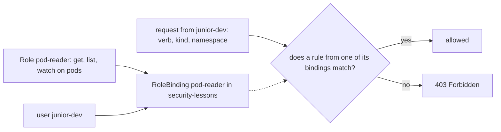

## Before you start

- [[k8s.l3.api-request-checks]] — authorization decides from who, verb, kind of object and namespace, and `kubectl auth can-i --as` asks it.
- [[k8s.l1.secrets]] — a Secret's value is only base64-encoded, and `base64 -d` turns it back into the password.
- [[k8s.l1.namespaces]] — a namespace groups objects but limits nobody by itself.
- [[backend.l2.role-based-access]] — RBAC gives rights through roles instead of user by user.

## The situation

In the previous lesson every `kubectl auth can-i` for `junior-dev` answered `no`. The teammate behind that name now needs to watch the Pods in `security-lessons` while they practise, and nothing more. A colleague suggests a shortcut: let them read everything in that namespace, Secrets included, because a list shows only names and the Secrets could be encrypted inside etcd anyway. Another colleague wants to add a rule that forbids deleting, just to be safe. You want to grant exactly the work and know what each grant really allows. How do you give one person one set of actions in one namespace, and nothing else?

## Core concepts

- A **Role (Kubernetes)** — an object in one namespace that lists rules, each naming API groups, kinds of objects and verbs, and allows those actions in that namespace only.
- An API group — a named set the API server sorts kinds of objects into; Pods and Secrets sit in the core group, written as `""`.
- A rule — one entry of a Role; it allows every combination of the API groups, kinds of objects and verbs it lists.
- A **RoleBinding** — an object that gives one Role to users or groups, in the Role's own namespace.
- **least privilege** — the principle of giving each person or program only the actions its work needs, only in the namespaces where it does that work, and nothing just in case.

## How it works



In the situation above, the teammate's work is reading Pods in `security-lessons`. A Role writes that work down as rules. Each rule names API groups, kinds of objects and verbs. The Role lives in a namespace and allows its actions there only, so the same request about `donhang` finds nothing.

A Role alone gives nobody anything. A RoleBinding names one Role and one or more users or groups, and it sits in the same namespace as that Role. A user's groups arrive with its name, from the same trusted credential. When `junior-dev` sends a request, authorization reads the rules of every binding that names `junior-dev` or one of its groups; the dotted arrow is the binding supplying those rules. If any one rule matches the request's API group, kind of object and verb, and the binding sits in the request's namespace, the request is allowed. Otherwise the answer is `403 Forbidden`, as in the previous lesson.

RBAC rules only allow. No rule forbids, so you cannot write a Role that takes `delete` back from someone whom another binding gives it. What a caller may do is the sum of all its bindings. To remove a right, you remove or narrow the binding that gives it. The colleague's rule against deleting has nowhere to go, and it is not needed: anything no rule lists is already refused.

That is why least privilege works by leaving things out. You grant the verbs the work needs, on the kinds of objects it touches, in the namespaces where it happens. A grant that is too wide cannot be fenced in later by another rule.

## In the Đơn Hàng system

```yaml file=deploy/k8s/lessons/pod-reader-role.yaml tag=stage-3 lines=6-30
kind: Role
metadata:
  name: pod-reader
  namespace: security-lessons
rules:
  - apiGroups: [""]
    resources: ["pods"]
    verbs: ["get", "list", "watch"]
---
# lesson: k8s.l3.roles-and-role-bindings
# The RoleBinding gives that Role to the user junior-dev, in the same
# namespace. Kubernetes keeps no such user: junior-dev is whoever a
# certificate or token the API server trusts names that way.
apiVersion: rbac.authorization.k8s.io/v1
kind: RoleBinding
metadata:
  name: pod-reader
  namespace: security-lessons
subjects:
  - kind: User
    name: junior-dev
    apiGroup: rbac.authorization.k8s.io
roleRef:
  kind: Role
  name: pod-reader
```

The Role `pod-reader` has one rule. `apiGroups: [""]` names the core group, and `resources: ["pods"]` names the kind of object in its plural, lower-case form. The three verbs let a caller read one Pod, list them, and watch them for changes. The RoleBinding of the same name, also in `security-lessons`, lists `junior-dev` as a `User` under `subjects` and points at the Role through `roleRef`. The certificate or token in its comment is the kind of trusted credential from the previous lesson that carries a user name.

```bash file=scripts/k8s/rbac-role.sh tag=stage-3 lines=11-31
# lesson: k8s.l3.roles-and-role-bindings
# The Role and the RoleBinding of pod-reader-role.yaml: junior-dev may get,
# list and watch Pods in security-lessons. Nothing else, nowhere else.
show kubectl apply -f deploy/k8s/lessons/pod-reader-role.yaml
can_i list pods -n security-lessons
can_i list pods -n donhang
can_i list secrets -n security-lessons
can_i delete pods -n security-lessons
can_i create pods -n security-lessons
echo

# Listing Secrets returns them whole, values and all, not only their names:
# a right to list or watch Secrets is a right to read them. (Run as the
# administrator: junior-dev has no such right.)
kubectl create secret generic demo-secret -n security-lessons --from-literal=password=not-a-real-password \
  --dry-run=client -o yaml | kubectl apply -f - >/dev/null
echo "\$ kubectl get secrets -n security-lessons -o jsonpath='{.items[*].data}'"
kubectl get secrets -n security-lessons -o jsonpath='{.items[*].data}'
echo
echo "the value, base64-decoded: $(kubectl get secret demo-secret -n security-lessons -o jsonpath='{.data.password}' | base64 -d)"
kubectl delete secret demo-secret -n security-lessons >/dev/null
```

```text output=true
$ kubectl apply -f deploy/k8s/lessons/pod-reader-role.yaml
role.rbac.authorization.k8s.io/pod-reader created
rolebinding.rbac.authorization.k8s.io/pod-reader created
$ kubectl auth can-i list pods -n security-lessons --as=junior-dev
yes
$ kubectl auth can-i list pods -n donhang --as=junior-dev
no
$ kubectl auth can-i list secrets -n security-lessons --as=junior-dev
no
$ kubectl auth can-i delete pods -n security-lessons --as=junior-dev
no
$ kubectl auth can-i create pods -n security-lessons --as=junior-dev
no

$ kubectl get secrets -n security-lessons -o jsonpath='{.items[*].data}'
{"password":"bm90LWEtcmVhbC1wYXNzd29yZA=="}
the value, base64-decoded: not-a-real-password
```

The `show kubectl apply` line applies the file, and the five `can_i` lines ask as `junior-dev`. Both helpers are defined above the excerpt: `show` prints a command before running it, and `can_i` prints the command and adds `--as=junior-dev`. Listing Pods in `security-lessons` is now `yes`; in `donhang` it is `no`, because the binding lives in `security-lessons` only. Secrets are `no` because no rule names them, and `delete` and `create` on Pods are `no` because the rule lists only `get`, `list` and `watch`. No rule forbade any of them; nothing allowed them.

The next lines run as the administrator. The dry run only prints a Secret as YAML, and `kubectl apply` creates it. Then the script lists the Secrets in the namespace; `-o jsonpath='{.items[*].data}'` only prints the `data` field of each Secret the list already returned. That field holds the base64 value, and the last `echo` decodes it to `not-a-real-password`. So a right to `list` or `watch` Secrets is a right to read every value in the namespace.

The API is not the only way in. A Pod can use any Secret of its own namespace as an environment variable or as files in a volume. Someone allowed to create Pods there can start one that prints a Secret, with no rule on Secrets at all. To let someone create Pods without reaching a Secret, keep that Secret out of their namespace.

Encrypting Secrets inside etcd changes none of this. It protects copies of etcd's data, such as a backup someone carries away. The API server still answers with the readable value to anyone whom RBAC allows to read it.

## Seniors often assume…

- **"A Role can deny one action to someone whom another binding allows."** → Actually RBAC rules only allow, and a caller may do whatever any of its bindings allows. To take a right away you narrow or remove the binding that gives it. You notice this when you bind a second, narrower Role to someone and `kubectl auth can-i` still answers `yes` for everything the first one gave.
- **"Permission to list Secrets shows only their names."** → Actually a list returns the whole objects, values included, and base64 is an encoding, not encryption. You notice this when `kubectl get secrets -o jsonpath='{.items[*].data}'` prints a value that `base64 -d` turns into the password.
- **"Encrypting Secrets inside etcd hides them from anyone using kubectl."** → Actually it protects copies of etcd's data, such as a backup; the API server returns the readable value to every caller RBAC allows to read Secrets. You notice this when `kubectl get secret` on such a cluster still prints a value that `base64 -d` decodes.
- **"Someone who cannot read Secrets cannot get at them through a Pod they create."** → Actually a Pod can use any Secret of its namespace, and authorization checked only that its author may create Pods. You notice this when a Pod created by someone with no rights on Secrets prints a password from its environment.

## Try it (3 minutes)

From the root of the Đơn Hàng repository, with `donhang-staging` running (`scripts/devops/tofu-env.sh staging up` creates it):

1. Run `scripts/k8s/rbac-role.sh`; it sends every `kubectl` command to the context `kind-donhang-staging`, whatever your current context is.
2. Before running them, predict the answers of `kubectl --context kind-donhang-staging auth can-i watch pods -n security-lessons --as=junior-dev` and the same command with `--as=someone-else`. Then run both.

Expected result: the script prints the output shown above; step 2 prints `yes` for `junior-dev` and `no` for `someone-else`.

<details><summary>Suggested answer</summary>

`watch` is one of the three verbs in the rule of `pod-reader`, and the RoleBinding gives that Role to `junior-dev` in `security-lessons`, so the first answer is `yes`. No binding names `someone-else`, so the answer is `no`. Nothing had to forbid anything.

</details>

## Connections

- [[k8s.l3.api-request-checks]] — prerequisite: the authorization step whose rules this lesson writes, turning `junior-dev`'s `no` into `yes`.
- [[backend.l2.role-based-access]] — the same idea one layer down: the api checks roles from a token, the API server checks Roles through RoleBindings.
- [[k8s.l3.service-accounts]] — the next lesson: the same kind of binding given to a program instead of a person.
- [[devops.l3.secrets-and-gitops]] — keeps Secret values out of Git; this lesson decides who may read them once they are in the cluster.
- [[devops.l3.sealed-secrets]] — a sealed value becomes an ordinary Secret in the cluster, readable by anyone a binding allows to list it.

## Five-line summary

1. A Role lists allowed actions in one namespace, and a RoleBinding gives it to users or groups there; nothing else is allowed.
2. Each rule names API groups, kinds of objects and verbs such as `get`, `list` and `delete`.
3. RBAC rules only allow: a caller may do what any binding allows, and no rule can deny.
4. Listing or watching Secrets returns their values, and creating Pods lets someone use any Secret there.
5. Encrypting Secrets in etcd protects copies of its data, not API reads; least privilege grants only what the work needs.
