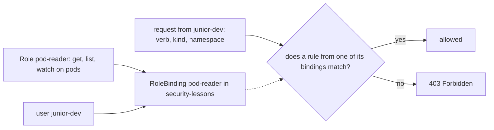

## Bạn cần biết trước

- [[k8s.l3.api-request-checks]] — phân quyền quyết định dựa trên ai, verb, loại object và namespace, và `kubectl auth can-i --as` hỏi thẳng bước đó.
- [[k8s.l1.secrets]] — giá trị của Secret chỉ được mã hóa base64, và `base64 -d` biến nó lại thành mật khẩu.
- [[k8s.l1.namespaces]] — namespace gom các object lại với nhau, nhưng tự nó không giới hạn ai cả.
- [[backend.l2.role-based-access]] — RBAC cấp quyền qua role thay vì cấp cho từng người.

## Tình huống

Ở bài trước, mọi câu `kubectl auth can-i` cho `junior-dev` đều trả lời `no`. Giờ người đồng nghiệp đứng sau cái tên đó cần theo dõi các Pod trong `security-lessons` khi luyện tập, và không cần gì thêm. Một đồng nghiệp khác gợi ý đi đường tắt: cho họ đọc mọi thứ trong namespace đó, kể cả Secret, vì danh sách chỉ hiện tên, mà Secret thì đằng nào cũng có thể được mã hóa trong etcd. Một người nữa muốn thêm một luật cấm xóa, cho chắc. Bạn muốn cấp đúng phần việc cần làm, và biết rõ mỗi quyền cấp ra thực sự cho phép những gì. Làm sao trao cho một người một nhóm hành động trong một namespace, và không gì khác?

## Khái niệm cốt lõi

- **Role (Kubernetes)** (Object RBAC liệt kê hành động (verb trên loại object) được phép trong một namespace) — object nằm trong một namespace, liệt kê các luật. Mỗi luật nêu API group, loại object và verb, và chỉ cho phép các hành động đó trong namespace ấy.
- API group — một tập có tên mà API server dùng để xếp các loại object. Pod và Secret nằm trong core group, viết là `""`.
- Luật — một mục trong Role. Nó cho phép mọi tổ hợp của các API group, loại object và verb mà nó liệt kê.
- **RoleBinding** (Object trao một Role hoặc ClusterRole cho người dùng, nhóm hay ServiceAccount trong một namespace) — object trao một Role cho user hoặc nhóm, ngay trong namespace của Role đó.
- **quyền tối thiểu** (least privilege) — nguyên tắc chỉ cho mỗi người hay mỗi chương trình đúng những hành động công việc cần, chỉ trong các namespace nơi công việc đó diễn ra, và không cấp gì phòng hờ.

## Cơ chế hoạt động



Trong tình huống trên, việc của người đồng nghiệp là đọc Pod trong `security-lessons`. Role ghi phần việc đó lại thành các luật. Mỗi luật nêu API group, loại object và verb. Role nằm trong một namespace và chỉ cho phép hành động ở đó, nên cùng request ấy nhắm vào `donhang` thì không tìm thấy gì.

Riêng Role thì không cho ai được gì. RoleBinding nêu một Role và một hay nhiều user hoặc nhóm, và nằm cùng namespace với Role đó. Các nhóm của user đi kèm tên user, trong cùng một thông tin đăng nhập được tin. Khi `junior-dev` gửi request, bước phân quyền đọc luật của mọi binding có nhắc tới `junior-dev` hoặc một nhóm của user này. Mũi tên chấm trong sơ đồ là binding đưa các luật đó vào. Nếu có một luật bất kỳ khớp với API group, loại object và verb của request, và binding nằm trong namespace của request, request được cho phép. Nếu không, câu trả lời là `403 Forbidden`, như ở bài trước.

Luật RBAC chỉ cho phép. Không luật nào cấm, nên bạn không thể viết một Role lấy lại quyền `delete` từ người mà binding khác đã cho. Người gọi được làm gì là tổng của mọi binding của họ. Muốn bỏ một quyền, bạn xóa hoặc thu hẹp chính binding đã cấp nó. Luật cấm xóa của người đồng nghiệp không có chỗ để đặt, và cũng không cần: thứ gì không luật nào liệt kê thì vốn đã bị từ chối.

Vì vậy quyền tối thiểu vận hành bằng cách bỏ bớt. Bạn cấp các verb mà công việc cần, trên các loại object nó đụng tới, trong các namespace nơi nó diễn ra. Một quyền cấp quá rộng không thể bị một luật khác rào lại sau đó.

## Trong hệ thống Đơn Hàng

```yaml file=deploy/k8s/lessons/pod-reader-role.yaml tag=stage-3 lines=6-30
kind: Role
metadata:
  name: pod-reader
  namespace: security-lessons
rules:
  - apiGroups: [""]
    resources: ["pods"]
    verbs: ["get", "list", "watch"]
---
# lesson: k8s.l3.roles-and-role-bindings
# The RoleBinding gives that Role to the user junior-dev, in the same
# namespace. Kubernetes keeps no such user: junior-dev is whoever a
# certificate or token the API server trusts names that way.
apiVersion: rbac.authorization.k8s.io/v1
kind: RoleBinding
metadata:
  name: pod-reader
  namespace: security-lessons
subjects:
  - kind: User
    name: junior-dev
    apiGroup: rbac.authorization.k8s.io
roleRef:
  kind: Role
  name: pod-reader
```

Role `pod-reader` có một luật. `apiGroups: [""]` chỉ core group, còn `resources: ["pods"]` chỉ loại object ở dạng số nhiều, viết thường. Ba verb cho người gọi đọc một Pod, list các Pod, và watch để theo dõi thay đổi. RoleBinding cùng tên, cũng nằm trong `security-lessons`, ghi `junior-dev` là một `User` dưới `subjects` và trỏ tới Role qua `roleRef`. Chứng chỉ hay token nhắc trong comment chính là loại thông tin đăng nhập được tin ở bài trước, thứ mang theo tên user.

```bash file=scripts/k8s/rbac-role.sh tag=stage-3 lines=11-31
# lesson: k8s.l3.roles-and-role-bindings
# The Role and the RoleBinding of pod-reader-role.yaml: junior-dev may get,
# list and watch Pods in security-lessons. Nothing else, nowhere else.
show kubectl apply -f deploy/k8s/lessons/pod-reader-role.yaml
can_i list pods -n security-lessons
can_i list pods -n donhang
can_i list secrets -n security-lessons
can_i delete pods -n security-lessons
can_i create pods -n security-lessons
echo

# Listing Secrets returns them whole, values and all, not only their names:
# a right to list or watch Secrets is a right to read them. (Run as the
# administrator: junior-dev has no such right.)
kubectl create secret generic demo-secret -n security-lessons --from-literal=password=not-a-real-password \
  --dry-run=client -o yaml | kubectl apply -f - >/dev/null
echo "\$ kubectl get secrets -n security-lessons -o jsonpath='{.items[*].data}'"
kubectl get secrets -n security-lessons -o jsonpath='{.items[*].data}'
echo
echo "the value, base64-decoded: $(kubectl get secret demo-secret -n security-lessons -o jsonpath='{.data.password}' | base64 -d)"
kubectl delete secret demo-secret -n security-lessons >/dev/null
```

```text output=true
$ kubectl apply -f deploy/k8s/lessons/pod-reader-role.yaml
role.rbac.authorization.k8s.io/pod-reader created
rolebinding.rbac.authorization.k8s.io/pod-reader created
$ kubectl auth can-i list pods -n security-lessons --as=junior-dev
yes
$ kubectl auth can-i list pods -n donhang --as=junior-dev
no
$ kubectl auth can-i list secrets -n security-lessons --as=junior-dev
no
$ kubectl auth can-i delete pods -n security-lessons --as=junior-dev
no
$ kubectl auth can-i create pods -n security-lessons --as=junior-dev
no

$ kubectl get secrets -n security-lessons -o jsonpath='{.items[*].data}'
{"password":"bm90LWEtcmVhbC1wYXNzd29yZA=="}
the value, base64-decoded: not-a-real-password
```

Dòng `show kubectl apply` apply file, còn năm dòng `can_i` hỏi với tư cách `junior-dev`. Cả hai hàm nhỏ này được định nghĩa phía trên đoạn trích: `show` in một lệnh rồi chạy nó, `can_i` in lệnh và thêm `--as=junior-dev`. List Pod trong `security-lessons` giờ là `yes`. Trong `donhang` vẫn là `no`, vì binding chỉ nằm trong `security-lessons`. Secret là `no` vì không luật nào nhắc tới nó, còn `delete` và `create` trên Pod là `no` vì luật chỉ liệt kê `get`, `list` và `watch`. Không luật nào cấm những việc này. Chỉ là không gì cho phép chúng.

Các dòng tiếp theo chạy với quyền quản trị viên. Lần chạy thử (dry run) chỉ in Secret ra dạng YAML, và `kubectl apply` tạo nó. Sau đó script list các Secret trong namespace. `-o jsonpath='{.items[*].data}'` chỉ in trường `data` của từng Secret mà lệnh list đã trả về sẵn. Trường đó chứa giá trị base64, và lệnh `echo` cuối giải nó ra thành `not-a-real-password`. Vậy quyền `list` hay `watch` Secret chính là quyền đọc mọi giá trị trong namespace.

API không phải lối vào duy nhất. Pod dùng được bất kỳ Secret nào trong namespace của nó, dưới dạng biến môi trường hoặc file trong volume. Ai được tạo Pod ở đó có thể chạy một Pod in Secret ra, mà không cần luật nào về Secret. Muốn cho ai đó tạo Pod mà không chạm được tới một Secret, hãy để Secret đó ở ngoài namespace của họ.

Mã hóa Secret bên trong etcd không thay đổi điều gì ở trên. Nó bảo vệ các bản sao dữ liệu của etcd, chẳng hạn một bản sao lưu bị ai đó mang đi. API server vẫn trả giá trị đọc được cho bất kỳ ai mà RBAC cho phép đọc.

## Senior hay nhầm rằng…

- **"Role có thể cấm một hành động với người mà binding khác đã cho phép."** → Thực ra luật RBAC chỉ cho phép, và người gọi được làm mọi thứ mà bất kỳ binding nào của họ cho phép. Muốn lấy lại một quyền, bạn thu hẹp hoặc xóa binding đã cấp nó. Bạn sẽ nhận ra khi gắn thêm một Role hẹp hơn cho ai đó mà `kubectl auth can-i` vẫn trả lời `yes` cho mọi thứ Role đầu tiên đã cho.
- **"Quyền list Secret chỉ cho thấy tên của chúng."** → Thực ra lệnh list trả về nguyên object, kèm cả giá trị, và base64 là cách mã hóa ký tự chứ không phải mật mã hóa. Bạn sẽ nhận ra khi `kubectl get secrets -o jsonpath='{.items[*].data}'` in ra một giá trị mà `base64 -d` biến thành mật khẩu.
- **"Mã hóa Secret bên trong etcd giấu chúng khỏi mọi người dùng kubectl."** → Thực ra nó bảo vệ các bản sao dữ liệu của etcd, chẳng hạn bản sao lưu. API server vẫn trả giá trị đọc được cho mọi người gọi mà RBAC cho phép đọc Secret. Bạn sẽ nhận ra khi `kubectl get secret` trên một cluster như vậy vẫn in ra giá trị mà `base64 -d` giải được.
- **"Ai không đọc được Secret thì cũng không lấy được chúng qua Pod mình tạo."** → Thực ra Pod dùng được mọi Secret trong namespace của nó, và bước phân quyền chỉ kiểm tra người viết Pod có được tạo Pod hay không. Bạn sẽ nhận ra khi một Pod do người không có quyền gì trên Secret tạo ra in mật khẩu từ biến môi trường của nó.

## Thử ngay (3 phút)

Ở thư mục gốc của repo Đơn Hàng, khi `donhang-staging` đang chạy (`scripts/devops/tofu-env.sh staging up` tạo ra nó):

1. Chạy `scripts/k8s/rbac-role.sh`. Script gửi mọi lệnh `kubectl` tới context `kind-donhang-staging`, dù context hiện tại của bạn là gì.
2. Trước khi chạy, đoán câu trả lời của `kubectl --context kind-donhang-staging auth can-i watch pods -n security-lessons --as=junior-dev` và của cùng lệnh đó với `--as=someone-else`. Rồi chạy cả hai.

Kết quả mong đợi: script in ra output như ở trên, và bước 2 in `yes` cho `junior-dev`, `no` cho `someone-else`.

<details><summary>Gợi ý đáp án</summary>

`watch` là một trong ba verb trong luật của `pod-reader`, và RoleBinding trao Role đó cho `junior-dev` trong `security-lessons`, nên câu trả lời đầu là `yes`. Không binding nào nhắc tới `someone-else`, nên câu trả lời là `no`. Không cần cấm gì cả.

</details>

## Liên hệ

- [[k8s.l3.api-request-checks]] — bài tiên quyết: bước phân quyền mà bài này viết luật cho nó, biến câu `no` của `junior-dev` thành `yes`.
- [[backend.l2.role-based-access]] — cùng ý tưởng ở một tầng thấp hơn: api kiểm tra role lấy từ token, còn API server kiểm tra Role qua RoleBinding.
- [[k8s.l3.service-accounts]] — bài tiếp theo: cùng kiểu binding đó, nhưng trao cho một chương trình thay vì một người.
- [[devops.l3.secrets-and-gitops]] — giữ giá trị Secret ngoài Git. Bài này quyết định ai được đọc chúng khi chúng đã vào cluster.
- [[devops.l3.sealed-secrets]] — giá trị đã niêm phong vào tới cluster thì thành một Secret bình thường, ai được binding cho phép list là đọc được.

## Tóm tắt 5 dòng

1. Role liệt kê các hành động được phép trong một namespace, và RoleBinding trao nó cho user hoặc nhóm ở đó. Ngoài ra không gì được phép.
2. Mỗi luật nêu API group, loại object và verb, như `get`, `list` và `delete`.
3. Luật RBAC chỉ cho phép: người gọi được làm những gì bất kỳ binding nào cho phép, và không luật nào cấm được.
4. List hay watch Secret là nhận về giá trị của chúng, còn quyền tạo Pod cho phép dùng mọi Secret trong namespace đó.
5. Mã hóa Secret trong etcd bảo vệ bản sao dữ liệu của nó, không bảo vệ lệnh đọc qua API. Quyền tối thiểu chỉ cấp đúng thứ công việc cần.
