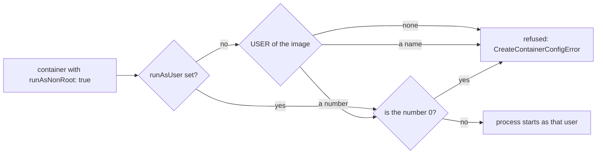

## Before you start

- [[k8s.l1.deploying-don-hang]] — the api runs as a Deployment whose Pod template lists its container, image and settings.
- [[devops.l1.multi-stage-builds]] — the api's image comes from the `final` stage of `DonHang.Api/Dockerfile`, whose instructions decide what the container starts with.
- [[foundation.l1.files-and-permissions]] — on Linux every process runs as some user, and what it may touch follows from that user's permissions.
- [[k8s.l3.service-accounts]] — staging's base already takes away one thing the api never uses: its ServiceAccount token.

## The situation

Until this module, the api's image named no user, so the api's process ran as root inside its container. A colleague shrugs: root inside a container is locked in there and cannot hurt anything. Another offers one line for the manifest that, they say, makes the container non-root. You try it on a Pod running Caddy, a ready-made web server image, and the Pod never starts. You want to know what that line really does, whether Đơn Hàng's own images would start under it, and what else a process can be denied. How do you make a container's process run as a non-root user with no more powers than its work needs?

## Core concepts

- A **securityContext** — the part of a Pod's or a container's manifest that sets which user its process runs as and which powers it keeps from the kernel, the core of the operating system that every process asks for files, network and other processes.
- The image's user — what the Dockerfile's `USER` instruction stores in the image; when the image names none, the process runs as root, the user whose number is 0.
- `runAsUser` — a securityContext field that sets the user number the process runs as, in place of the image's user.
- `runAsNonRoot: true` — a securityContext field that makes the kubelet check the user before starting the container and refuse root.
- Linux capabilities — root's special powers split into separate permissions, such as changing the owner of any file, which a process can hold one by one.
- seccomp — a Linux feature that filters which requests to the kernel a process may make.

## How it works



When the kubelet starts a container, the user comes from `runAsUser` if the manifest sets it, otherwise from the image's `USER`, otherwise root.

`runAsNonRoot: true` adds a check, not a change. Before starting the container, the kubelet looks at that user and refuses user 0. A name such as `nobody` is refused too: the kubelet does not look names up, so it cannot prove the name is not root. Only a number other than 0 passes. A refused container never starts, and the Pod shows `CreateContainerConfigError`.

Three more fields take powers away from a process that does start. On Linux a program file can carry a mark that makes it run as its owner, not as whoever starts it. `allowPrivilegeEscalation: false` stops a process from gaining more rights than it started with, for example through such a file owned by root. It has no effect on a container marked `privileged: true`, which holds nearly every power of root on the node, or on one that keeps `CAP_SYS_ADMIN`, a broad capability covering many administrative actions: one more reason to drop capabilities.

The container runtime, the program the kubelet asks to start containers on the node, grants each container a small default set of capabilities. A non-root process cannot use all of them directly, but they stay within reach of the container until dropped, and dropping `ALL` removes the set whatever user the process runs as. `seccompProfile` of type `RuntimeDefault` applies the container runtime's default seccomp profile: the runtime's own list of kernel requests it allows and blocks.

A securityContext can sit on the Pod, for all its containers, or on one container. A field set on both takes the container's value. `capabilities` and `allowPrivilegeEscalation` exist only on the container, while `runAsNonRoot` and `runAsUser` can sit on either.

## In the Đơn Hàng system

```yaml file=deploy/gitops/config-repo-kustomize/base/api.yaml tag=stage-3 lines=50-61
          # lesson: k8s.l3.security-context
          # How the process runs: never as root (the kubelet refuses to start
          # the container otherwise), unable to gain privileges, without any
          # Linux capability, under the runtime's default seccomp profile. The
          # other .NET services and the migration hooks set the same four.
          securityContext:
            runAsNonRoot: true
            allowPrivilegeEscalation: false
            capabilities:
              drop: ["ALL"]
            seccompProfile:
              type: RuntimeDefault
```

This is the api's container in the config repository's base, next to its `image` and probes, so staging's overlay inherits it. None of the four fields picks a user; that comes from the image. The final stage of `DonHang.Api/Dockerfile` now ends with `USER $APP_UID` before its `ENTRYPOINT`. The .NET base images include a non-root user named `app` and put its number, 1654, in the variable `APP_UID`, so the image stores the number, which is what the kubelet can check.

```bash file=scripts/k8s/security-context.sh tag=stage-3 lines=27-43
# lesson: k8s.l3.security-context
# runAsNonRoot makes the kubelet check the user before it starts the
# container. root-caddy would run as root; prometheus-by-name runs as
# nobody, a name the kubelet cannot check; prometheus-by-number gives the
# number with runAsUser and starts.
show kubectl apply -f deploy/k8s/lessons/root-caddy-pod.yaml
kubectl wait --for=condition=Ready pod/prometheus-by-number -n security-lessons --timeout=180s >/dev/null
for _ in $(seq 60); do
  [ "$(kubectl get pods root-caddy prometheus-by-name -n security-lessons \
        -o jsonpath='{.items[*].status.containerStatuses[0].state.waiting.reason}')" = \
    "CreateContainerConfigError CreateContainerConfigError" ] && break
  sleep 1
done
show kubectl get pods root-caddy prometheus-by-name prometheus-by-number -n security-lessons
for pod in root-caddy prometheus-by-name; do
  echo "$pod: $(kubectl get pod "$pod" -n security-lessons -o jsonpath='{.status.containerStatuses[0].state.waiting.message}' | sed -E 's/ \(pod: .*\)$//')"
done
```

```text output=true
USER of donhang-api:1.0.0: ""
USER of the api image staging runs: "1654"
$ kubectl exec deployment/api -n donhang -- id
uid=1654(app) gid=1654(app) groups=1654(app)

$ kubectl get deployment api -n donhang -o jsonpath='{...securityContext}'
{"allowPrivilegeEscalation":false,"capabilities":{"drop":["ALL"]},"runAsNonRoot":true,"seccompProfile":{"type":"RuntimeDefault"}}

$ kubectl apply -f deploy/k8s/lessons/root-caddy-pod.yaml
pod/root-caddy created
pod/prometheus-by-name created
pod/prometheus-by-number created
$ kubectl get pods root-caddy prometheus-by-name prometheus-by-number -n security-lessons
NAME                   READY   STATUS                       RESTARTS   AGE
root-caddy             0/1     CreateContainerConfigError   0          ...
prometheus-by-name     0/1     CreateContainerConfigError   0          ...
prometheus-by-number   1/1     Running                      0          ...
root-caddy: container has runAsNonRoot and image will run as root
prometheus-by-name: container has runAsNonRoot and image has non-numeric user (nobody), cannot verify user is non-root
```

Earlier lines of the script, not shown, define `show`, which prints a command before running it, and send every `kubectl` to `kind-donhang-staging`. They also read the `USER` each api image names from the registry, run `id` in an api Pod and read the api's securityContext back. The first lines of the output come from them: `1.0.0` names no user, the image staging runs names `1654`, and the process runs as user 1654, `app`. The `$` line for the securityContext is a shortened label; the script runs `-o jsonpath='{.spec.template.spec.containers[0].securityContext}'`.

In the excerpt, `root-caddy-pod.yaml` creates three Pods in `security-lessons`, each with `runAsNonRoot: true`. `caddy:2.10.0` names no user, so `root-caddy` is refused. `prom/prometheus:v3.5.5` runs as `nobody`, a name, so `prometheus-by-name` is refused as well; `prometheus-by-number` adds `runAsUser: 65534`, a number other than 0, and runs. The loop waits up to 60 seconds for both refusals, and the last lines print the kubelet's message for each. `-o jsonpath` prints one field of a Pod's status, here why its container is waiting; `sed` trims the Pod name from the end of the message.

## Seniors often assume…

- **"A process running as root inside a container cannot hurt anything outside it."** → Actually, by default, root in a container is user 0 to the node's kernel as well, and every container on the node shares that kernel; Kubernetes can map container users to other numbers on the node, but this lesson does not use that. A kernel flaw, a capability left in place or a folder of the node that the Pod's manifest makes visible inside the container as a volume lets that root act on the node. You notice this when a file the container writes into such a folder appears there owned by root.
- **"`runAsNonRoot: true` switches the container to some non-root user by itself."** → Actually it only checks the user that `runAsUser` or the image already decides, and refuses root. You notice this when a Caddy Pod stays in `CreateContainerConfigError` with `image will run as root` instead of starting.
- **"An image that runs as a named non-root user always passes `runAsNonRoot`."** → Actually the kubelet can confirm only a number, so a name fails until `runAsUser` gives the number or the Dockerfile's `USER` uses one. You notice this when the message says `non-numeric user (nobody), cannot verify user is non-root`.

## Try it (3 minutes)

From the root of the Đơn Hàng repository, with `donhang-staging` running (`scripts/devops/tofu-env.sh staging up` creates it):

1. Run `scripts/k8s/security-context.sh`.
2. Suppose the api's Dockerfile ended with `USER app` instead of `USER $APP_UID`. Predict what the api's new Pods on staging would show, and which one field added to the securityContext in `base/api.yaml` would let them start without rebuilding the image.

Expected result: the script prints the output shown above, with `root-caddy` and `prometheus-by-name` refused and `prometheus-by-number` running; step 2 matches the answer below.

<details><summary>Suggested answer</summary>

The image would name a user, `app`, but not a number, so the kubelet could not confirm it is not root. Because the base sets `runAsNonRoot: true`, each new api Pod would stay in `CreateContainerConfigError` with a `non-numeric user (app)` message, just like `prometheus-by-name`. Adding `runAsUser: 1654`, the number `id` printed for `app`, gives the kubelet a number to check, and the Pods start.

</details>

## Connections

- [[k8s.l3.service-accounts]] — prerequisite and the same move on another front: that lesson removed a token a taken-over container could use against the API server; this one limits what it can do on its node.
- [[devops.l1.multi-stage-builds]] — the image this lesson changes: `USER $APP_UID` now closes the `final` stage built there.
- [[devops.l3.software-supply-chain]] — the other half of the defence: that lesson keeps unreviewed code out of the image; this one limits what code that gets in anyway can do when it runs.
- [[k8s.l3.pod-security-admission]] — the next lesson: requiring settings like these for every Pod in a namespace instead of trusting each manifest.

## Five-line summary

1. A securityContext makes a container's process run as a non-root user and without kernel powers its work does not need.
2. A container runs as `runAsUser`, else its image's `USER`, else root; the api's Dockerfile now ends with `USER $APP_UID`.
3. `runAsNonRoot: true` only checks: the kubelet refuses root, and the Pod shows `CreateContainerConfigError`.
4. The kubelet can confirm only a number, so an image whose `USER` is a name passes only when `runAsUser` gives the number.
5. Staging's base also sets `allowPrivilegeEscalation: false`, drops `ALL` capabilities and uses `RuntimeDefault` seccomp for the .NET services.
