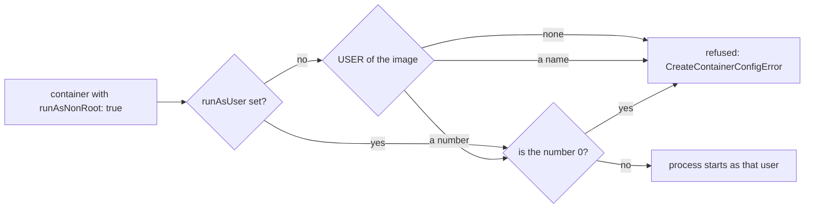

## Bạn cần biết trước

- [[k8s.l1.deploying-don-hang]] — api chạy dưới dạng một Deployment, và Pod template của nó liệt kê container, image và các thiết lập.
- [[devops.l1.multi-stage-builds]] — image của api lấy từ stage `final` của `DonHang.Api/Dockerfile`, và các lệnh trong đó quyết định container khởi động với những gì.
- [[foundation.l1.files-and-permissions]] — trên Linux, process nào cũng chạy dưới một user nào đó, và nó được đụng tới gì là do quyền của user đó.
- [[k8s.l3.service-accounts]] — base của staging đã lấy đi một thứ api không bao giờ dùng: token ServiceAccount của nó.

## Tình huống

Cho tới module này, image của api không nêu user nào, nên process của api chạy dưới root bên trong container. Một đồng nghiệp nhún vai: root trong container bị nhốt ở đó, chẳng làm hại được gì. Người khác đưa ra một dòng thêm vào manifest, mà theo họ là đủ để container không chạy dưới root. Bạn thử nó trên một Pod chạy Caddy, một image web server làm sẵn, và Pod không bao giờ khởi động. Bạn muốn biết dòng đó thực sự làm gì, các image của chính Đơn Hàng có khởi động được với nó không, và còn những quyền nào khác có thể tước khỏi một process. Làm sao để process của container chạy dưới một user không phải root, và không giữ quyền nào nhiều hơn công việc của nó cần?

## Khái niệm cốt lõi

- **securityContext** (Phần của Pod hoặc container quy định process chạy dưới user nào và với những quyền kernel nào) — phần trong manifest của Pod hoặc container quy định process chạy dưới user nào và giữ lại những quyền nào từ kernel, tức phần lõi của hệ điều hành mà mọi process phải nhờ khi cần tới file, mạng và các process khác.
- User của image — thứ mà lệnh `USER` trong Dockerfile lưu vào image. Khi image không nêu user nào, process chạy dưới root, user có số 0.
- `runAsUser` — trường của securityContext đặt số user mà process chạy dưới đó, thay cho user của image.
- `runAsNonRoot: true` — trường của securityContext khiến kubelet kiểm tra user trước khi khởi động container và từ chối root.
- Linux capability — các quyền đặc biệt của root được tách thành từng quyền riêng, như đổi chủ sở hữu của bất kỳ file nào, và một process có thể giữ từng quyền một.
- seccomp — tính năng của Linux lọc những yêu cầu nào một process được gửi tới kernel.

## Cơ chế hoạt động



Khi kubelet khởi động một container, user lấy từ `runAsUser` nếu manifest có đặt, nếu không thì từ `USER` của image, nếu không nữa thì là root.

`runAsNonRoot: true` thêm một bước kiểm tra, chứ không thay đổi gì. Trước khi khởi động container, kubelet nhìn vào user đó và từ chối user 0. Một cái tên như `nobody` cũng bị từ chối: kubelet không tra cứu tên, nên không chứng minh được tên đó không phải root. Chỉ một con số khác 0 mới qua được. Container bị từ chối sẽ không bao giờ khởi động, và Pod hiện `CreateContainerConfigError`.

Ba trường nữa tước quyền của process đã khởi động. Trên Linux, một file chương trình có thể mang một dấu khiến nó chạy dưới danh nghĩa chủ sở hữu file, chứ không phải người khởi động nó. `allowPrivilegeEscalation: false` ngăn process có thêm quyền so với lúc bắt đầu, chẳng hạn qua một file như vậy mà root sở hữu. Nó không có tác dụng với container đánh dấu `privileged: true`, loại giữ gần như mọi quyền của root trên node, hay với container còn giữ `CAP_SYS_ADMIN`, một capability rộng phủ nhiều thao tác quản trị. Thêm một lý do để bỏ capability.

Container runtime, chương trình mà kubelet nhờ khởi động container trên node, cấp cho mỗi container một tập capability mặc định nhỏ. Process không phải root không dùng trực tiếp được hết chúng, nhưng chúng vẫn nằm trong tầm với của container cho tới khi bị bỏ. Bỏ `ALL` xóa cả tập đó, bất kể process chạy dưới user nào. `seccompProfile` loại `RuntimeDefault` áp profile seccomp mặc định của container runtime: danh sách riêng của runtime về những yêu cầu tới kernel nó cho phép và nó chặn.

securityContext có thể đặt trên Pod, áp cho mọi container của nó, hoặc trên một container. Trường nào đặt ở cả hai nơi thì lấy giá trị của container. `capabilities` và `allowPrivilegeEscalation` chỉ có ở container, còn `runAsNonRoot` và `runAsUser` đặt được ở cả hai.

## Trong hệ thống Đơn Hàng

```yaml file=deploy/gitops/config-repo-kustomize/base/api.yaml tag=stage-3 lines=50-61
          # lesson: k8s.l3.security-context
          # How the process runs: never as root (the kubelet refuses to start
          # the container otherwise), unable to gain privileges, without any
          # Linux capability, under the runtime's default seccomp profile. The
          # other .NET services and the migration hooks set the same four.
          securityContext:
            runAsNonRoot: true
            allowPrivilegeEscalation: false
            capabilities:
              drop: ["ALL"]
            seccompProfile:
              type: RuntimeDefault
```

Đây là container của api trong base của repo cấu hình, nằm cạnh `image` và các probe của nó, nên overlay của staging thừa hưởng nó. Không trường nào trong bốn trường này chọn user. User đến từ image. Stage cuối của `DonHang.Api/Dockerfile` giờ kết thúc bằng `USER $APP_UID` trước `ENTRYPOINT`. Các base image .NET có sẵn một user không phải root tên `app` và đặt số của nó, 1654, vào biến `APP_UID`. Nhờ vậy image lưu con số, đúng thứ kubelet kiểm tra được.

```bash file=scripts/k8s/security-context.sh tag=stage-3 lines=27-43
# lesson: k8s.l3.security-context
# runAsNonRoot makes the kubelet check the user before it starts the
# container. root-caddy would run as root; prometheus-by-name runs as
# nobody, a name the kubelet cannot check; prometheus-by-number gives the
# number with runAsUser and starts.
show kubectl apply -f deploy/k8s/lessons/root-caddy-pod.yaml
kubectl wait --for=condition=Ready pod/prometheus-by-number -n security-lessons --timeout=180s >/dev/null
for _ in $(seq 60); do
  [ "$(kubectl get pods root-caddy prometheus-by-name -n security-lessons \
        -o jsonpath='{.items[*].status.containerStatuses[0].state.waiting.reason}')" = \
    "CreateContainerConfigError CreateContainerConfigError" ] && break
  sleep 1
done
show kubectl get pods root-caddy prometheus-by-name prometheus-by-number -n security-lessons
for pod in root-caddy prometheus-by-name; do
  echo "$pod: $(kubectl get pod "$pod" -n security-lessons -o jsonpath='{.status.containerStatuses[0].state.waiting.message}' | sed -E 's/ \(pod: .*\)$//')"
done
```

```text output=true
USER of donhang-api:1.0.0: ""
USER of the api image staging runs: "1654"
$ kubectl exec deployment/api -n donhang -- id
uid=1654(app) gid=1654(app) groups=1654(app)

$ kubectl get deployment api -n donhang -o jsonpath='{...securityContext}'
{"allowPrivilegeEscalation":false,"capabilities":{"drop":["ALL"]},"runAsNonRoot":true,"seccompProfile":{"type":"RuntimeDefault"}}

$ kubectl apply -f deploy/k8s/lessons/root-caddy-pod.yaml
pod/root-caddy created
pod/prometheus-by-name created
pod/prometheus-by-number created
$ kubectl get pods root-caddy prometheus-by-name prometheus-by-number -n security-lessons
NAME                   READY   STATUS                       RESTARTS   AGE
root-caddy             0/1     CreateContainerConfigError   0          ...
prometheus-by-name     0/1     CreateContainerConfigError   0          ...
prometheus-by-number   1/1     Running                      0          ...
root-caddy: container has runAsNonRoot and image will run as root
prometheus-by-name: container has runAsNonRoot and image has non-numeric user (nobody), cannot verify user is non-root
```

Các dòng đầu của script, không trích ở đây, định nghĩa `show`, hàm in một lệnh rồi mới chạy nó, và gửi mọi lệnh `kubectl` tới `kind-donhang-staging`. Chúng cũng đọc `USER` mà mỗi image api nêu từ registry, chạy `id` trong một Pod api và đọc lại securityContext của api. Các dòng đầu của output đến từ chúng: `1.0.0` không nêu user nào, image mà staging đang chạy nêu `1654`, và process chạy dưới user 1654, tức `app`. Dòng `$` của securityContext là một nhãn rút gọn. Lệnh thật trong script là `-o jsonpath='{.spec.template.spec.containers[0].securityContext}'`.

Trong đoạn trích, `root-caddy-pod.yaml` tạo ba Pod trong `security-lessons`, Pod nào cũng có `runAsNonRoot: true`. `caddy:2.10.0` không nêu user nào, nên `root-caddy` bị từ chối. `prom/prometheus:v3.5.5` chạy dưới `nobody`, một cái tên, nên `prometheus-by-name` cũng bị từ chối. `prometheus-by-number` thêm `runAsUser: 65534`, một số khác 0, và chạy được. Vòng lặp chờ tối đa 60 giây cho cả hai lần từ chối, rồi các dòng cuối in thông báo của kubelet cho từng Pod. `-o jsonpath` in một trường trong status của Pod, ở đây là lý do container của nó đang chờ. `sed` cắt tên Pod khỏi cuối thông báo.

## Senior hay nhầm rằng…

- **"Process chạy dưới root bên trong container không làm hại được gì bên ngoài nó."** → Thực ra, theo mặc định, root trong container cũng là user 0 đối với kernel của node, và mọi container trên node dùng chung kernel đó. Kubernetes có thể ánh xạ user của container sang số khác trên node, nhưng bài này không dùng tới. Một lỗi của kernel, một capability còn sót, hay một thư mục của node mà manifest của Pod đưa vào container dưới dạng volume đều để root đó tác động lên node. Bạn sẽ nhận ra khi một file container ghi vào thư mục như vậy xuất hiện ở đó với chủ sở hữu là root.
- **"`runAsNonRoot: true` tự chuyển container sang một user không phải root nào đó."** → Thực ra nó chỉ kiểm tra user mà `runAsUser` hoặc image đã quyết định, và từ chối root. Bạn sẽ nhận ra khi một Pod Caddy nằm mãi ở `CreateContainerConfigError` với `image will run as root` thay vì khởi động.
- **"Image chạy dưới một user không phải root có tên thì luôn qua được `runAsNonRoot`."** → Thực ra kubelet chỉ xác nhận được con số, nên một cái tên sẽ không qua cho tới khi `runAsUser` cho con số hoặc `USER` trong Dockerfile dùng số. Bạn sẽ nhận ra khi thông báo ghi `non-numeric user (nobody), cannot verify user is non-root`.

## Thử ngay (3 phút)

Ở thư mục gốc của repo Đơn Hàng, khi `donhang-staging` đang chạy (`scripts/devops/tofu-env.sh staging up` tạo ra nó):

1. Chạy `scripts/k8s/security-context.sh`.
2. Giả sử Dockerfile của api kết thúc bằng `USER app` thay vì `USER $APP_UID`. Đoán xem các Pod api mới trên staging sẽ hiện gì, và thêm đúng trường nào vào securityContext trong `base/api.yaml` thì chúng khởi động được mà không cần build lại image.

Kết quả mong đợi: script in ra output như ở trên, với `root-caddy` và `prometheus-by-name` bị từ chối còn `prometheus-by-number` đang chạy. Bước 2 khớp với đáp án bên dưới.

<details><summary>Gợi ý đáp án</summary>

Image sẽ nêu một user, `app`, nhưng không phải một con số, nên kubelet không xác nhận được đó không phải root. Vì base đặt `runAsNonRoot: true`, mỗi Pod api mới sẽ nằm ở `CreateContainerConfigError` với thông báo `non-numeric user (app)`, giống hệt `prometheus-by-name`. Thêm `runAsUser: 1654`, con số mà `id` in ra cho `app`, sẽ cho kubelet một con số để kiểm tra, và các Pod khởi động.

</details>

## Liên hệ

- [[k8s.l3.service-accounts]] — bài tiên quyết, cùng một nước đi ở mặt trận khác: bài đó gỡ một token mà container bị chiếm có thể dùng để gọi API server, bài này giới hạn những gì nó làm được trên node của mình.
- [[devops.l1.multi-stage-builds]] — image mà bài này thay đổi: `USER $APP_UID` giờ khép lại stage `final` được dựng ở bài đó.
- [[devops.l3.software-supply-chain]] — nửa còn lại của lớp phòng thủ: bài đó giữ code chưa review ngoài image, bài này giới hạn những gì code lọt vào được vẫn làm được khi chạy.
- [[k8s.l3.pod-security-admission]] — bài tiếp theo: bắt buộc các thiết lập như thế này cho mọi Pod trong một namespace thay vì tin vào từng manifest.

## Tóm tắt 5 dòng

1. securityContext cho process của container chạy dưới một user không phải root và không giữ những quyền kernel mà công việc của nó không cần.
2. Container chạy dưới `runAsUser`, nếu không thì `USER` của image, nếu không nữa thì root. Dockerfile của api giờ kết thúc bằng `USER $APP_UID`.
3. `runAsNonRoot: true` chỉ kiểm tra: kubelet từ chối root, và Pod hiện `CreateContainerConfigError`.
4. Kubelet chỉ xác nhận được con số, nên image có `USER` là một cái tên chỉ qua được khi `runAsUser` cho con số.
5. Base của staging còn đặt `allowPrivilegeEscalation: false`, bỏ `ALL` capability và dùng seccomp `RuntimeDefault` cho các service .NET.
