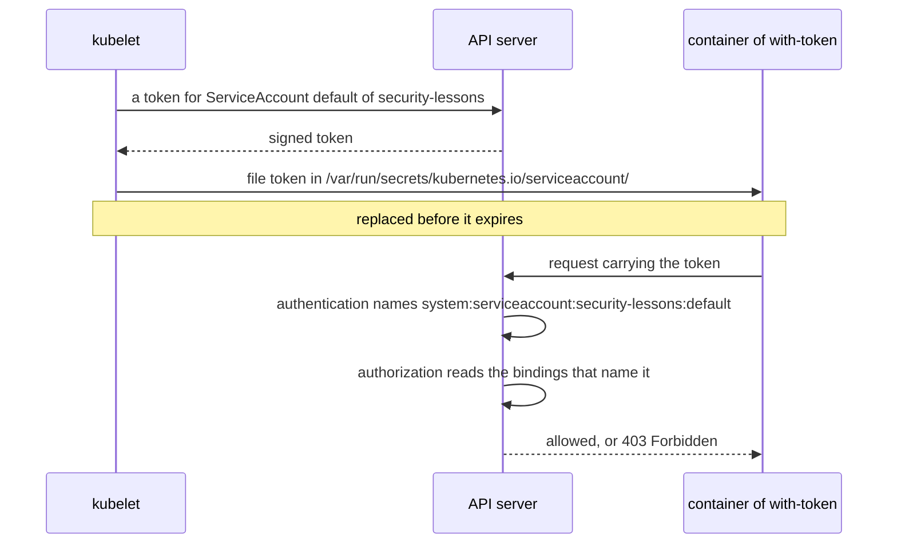

## Before you start

- [[k8s.l3.roles-and-role-bindings]] — a RoleBinding gives a Role's actions to a user name, and nothing else is allowed.
- [[k8s.l1.configmap-files]] — the kubelet can show data from the API server as files inside a container.
- [[k8s.l2.config-repo-overlays]] — the config repository's base holds every manifest once, and staging's overlay builds on it.

## The situation

You gave `junior-dev` a Role in the previous lesson, so a person now has exactly the rights their work needs. The api, Notifications and Payments Pods also run on `donhang-staging`, and nobody ever gave them a name on the API server. A colleague says that is fine: a Pod has no identity there unless someone creates one for it. Another adds that even if some credential sits inside a container, it is harmless while the application never reads it. You are not sure either is true. Under which name does a Pod reach the API server, and what can someone who gets into the container do with it?

## Core concepts

- A **ServiceAccount** — an object in one namespace that gives programs, rather than people, an identity on the API server.
- The `default` ServiceAccount — the one Kubernetes creates in every namespace; a Pod that names no ServiceAccount runs as it.
- A ServiceAccount token — a signed credential that names one ServiceAccount; the kubelet writes it into the Pod as a file.
- `automountServiceAccountToken: false` — a field in the Pod's manifest, under `spec` (the part that declares its desired state), that keeps that token file out of the Pod.

## How it works



In the situation above, take the Pod `with-token` in `security-lessons`. Its manifest names no ServiceAccount, so when it is created an admission controller fills in `default`. Every Pod therefore runs as some ServiceAccount, whether anyone chose one or not.

Unless the Pod says otherwise, the kubelet asks the API server for a token for that ServiceAccount and writes it into the container under `/var/run/secrets/kubernetes.io/serviceaccount/`. The token expires, and the kubelet replaces the file before it does, so a program that reads it finds a valid one.

A request carrying the token goes through the same checks as your `kubectl` requests. Authentication names the caller `system:serviceaccount:security-lessons:default`, in the groups `system:serviceaccounts` and `system:serviceaccounts:security-lessons`. To RBAC that is one more user name: the ServiceAccount may do only what bindings naming it or its groups allow, and anything else gets `403 Forbidden`. Kubernetes binds no rights on the objects of your own namespaces to `default`; like every signed-in caller, it only gets a few read-only ones, such as asking who it is.

The API server checks the token, not where the request comes from. Whoever reads the file holds the ServiceAccount's rights, today's and any a binding adds later. A program that never calls the API server loses nothing when the file is not there, and `automountServiceAccountToken: false` keeps it out.

## In the Đơn Hàng system

```bash file=scripts/k8s/service-accounts.sh tag=stage-3 lines=22-46
show kubectl apply -f deploy/k8s/lessons/token-pods.yaml
kubectl wait --for=condition=Ready pod/with-token pod/without-token -n security-lessons --timeout=180s >/dev/null
echo "\$ kubectl exec with-token -- ls $token_dir"
kubectl exec with-token -n security-lessons -- ls "$token_dir"
echo "\$ kubectl exec without-token -- ls $token_dir"
kubectl exec without-token -n security-lessons -- ls "$token_dir" 2>&1 || true
echo

# lesson: k8s.l3.service-accounts
# In RBAC the ServiceAccount is the user system:serviceaccount:<namespace>:<name>.
# No binding names default here, so it may do next to nothing.
sa=system:serviceaccount:security-lessons:default
for check in "list pods" "get secrets" "create deployments"; do
  echo "can $sa $check? $(kubectl auth can-i $check -n security-lessons --as="$sa" || true)"
done
echo

# Whoever reads the token file can call the API server as that
# ServiceAccount: here from this machine, with no other credential.
token=$(kubectl exec with-token -n security-lessons -- cat "$token_dir/token")
server=$(kubectl config view --minify -o jsonpath='{.clusters[0].cluster.server}')
empty=$(mktemp ./.empty-kubeconfig.XXXXXX)
echo "\$ kubectl auth whoami --token=<the token read from with-token>"
command kubectl --kubeconfig="$empty" --server="$server" --insecure-skip-tls-verify --token="$token" auth whoami \
  | grep -e Username -e Groups
```

```text output=true
$ kubectl get serviceaccounts -n security-lessons
NAME      SECRETS   AGE
default   0         ...

$ kubectl apply -f deploy/k8s/lessons/token-pods.yaml
pod/with-token created
pod/without-token created
$ kubectl exec with-token -- ls /var/run/secrets/kubernetes.io/serviceaccount
ca.crt
namespace
token
$ kubectl exec without-token -- ls /var/run/secrets/kubernetes.io/serviceaccount
ls: /var/run/secrets/kubernetes.io/serviceaccount: No such file or directory
command terminated with exit code 1

can system:serviceaccount:security-lessons:default list pods? no
can system:serviceaccount:security-lessons:default get secrets? no
can system:serviceaccount:security-lessons:default create deployments? no

$ kubectl auth whoami --token=<the token read from with-token>
Username   system:serviceaccount:security-lessons:default
Groups     [system:serviceaccounts system:serviceaccounts:security-lessons system:authenticated]

$ kubectl get deployment api -n donhang -o jsonpath='{.spec.template.spec.automountServiceAccountToken}'
false
$ kubectl exec deployment/api -n donhang -- ls /var/run/secrets/kubernetes.io/serviceaccount
ls: cannot access '/var/run/secrets/kubernetes.io/serviceaccount': No such file or directory
command terminated with exit code 2
```

Above the excerpt, `show` prints a command before running it, every `kubectl` goes to the context `kind-donhang-staging`, and `token_dir` holds the folder's path. Line 15, also above it, lists the ServiceAccounts of `security-lessons`: only `default`, which nobody created by hand. Its `SECRETS` column is `0` because the token is not kept in a Secret; the kubelet asks for one per Pod.

`token-pods.yaml` defines two Pods that name no ServiceAccount; only `without-token` sets `automountServiceAccountToken: false`. The `ls` in `with-token` shows the token next to `ca.crt`, a certificate for checking the API server, and `namespace`, the Pod's namespace. The same `ls` in `without-token` fails. `kubectl auth can-i <verb> <kind> --as=<user>` asks the API server whether that user may do it, without needing their credential. The loop asks this for the ServiceAccount's user name and gets `no` three times, because no binding names it.

The last part reads the token out of `with-token`. `kubectl config view --minify` gives the API server's address from your kubeconfig. `command kubectl` runs the real `kubectl`, skipping the script's own `kubectl` on line 7 that adds the context. It starts from an empty kubeconfig, so the token is its only credential. `--insecure-skip-tls-verify` skips checking the server's certificate, since the empty file holds none to check against.

`kubectl auth whoami`, which kubectl's help still marks experimental, answers with the ServiceAccount's name and groups: on your machine, the file works as well as inside the Pod. The third group, `system:authenticated`, holds every caller that passed authentication.

```yaml file=deploy/gitops/config-repo-kustomize/base/api.yaml tag=stage-3 lines=25-31
    spec:
      # lesson: k8s.l3.service-accounts
      # The api never calls the API server, so its Pods get no token of their
      # ServiceAccount: a taken-over container finds nothing to call it with.
      automountServiceAccountToken: false
      containers:
        - name: api
```

This is the api's Pod template in the base of the config repository, which staging's overlay builds on. Every api Pod therefore starts without a token; `notifications.yaml` and `payments.yaml` in the same base set the field the same way. The last lines of the script, below the excerpt, read the field back from the running Deployment and run the same `ls` in an api Pod, which fails. The api still runs as `default` of `donhang`; it only carries no token for it.

## Seniors often assume…

- **"A Pod has no identity on the API server unless someone gives it a ServiceAccount."** → Actually a Pod that names none runs as `default` of its namespace, which Kubernetes creates for you. You notice this when `kubectl get serviceaccounts` in a fresh namespace already lists `default`, and a token sits in a Pod nobody configured.
- **"The `default` ServiceAccount may read everything in its namespace."** → Actually it is one more user name to RBAC, and Kubernetes gives it no rights on the objects of your namespaces. You notice this when `kubectl auth can-i list pods --as=system:serviceaccount:<namespace>:default` answers `no`.
- **"A token mounted into a Pod is harmless when the application never uses it."** → Actually anyone who reads the file, such as someone who takes over the container, can call the API server with the ServiceAccount's rights, including rights a binding adds later. You notice this when `kubectl auth whoami --token=…` on your own machine answers with the ServiceAccount's name.

## Try it (3 minutes)

From the root of the Đơn Hàng repository, with `donhang-staging` running (`scripts/devops/tofu-env.sh staging up` creates it):

1. Run `scripts/k8s/service-accounts.sh`.
2. Run `scripts/k8s/rbac-role.sh` first if you skipped the previous lesson. Predict the answer of `kubectl --context kind-donhang-staging auth can-i get pods -n security-lessons --as=system:serviceaccount:security-lessons:default`, then of the same command with `--as=junior-dev`. Run both.

Expected result: the script prints the output shown above; step 2 prints `no` for the ServiceAccount and `yes` for `junior-dev`.

<details><summary>Suggested answer</summary>

The RoleBinding `pod-reader` names only the user `junior-dev`, and `get` is one of its Role's verbs, so that answer is `yes`. The ServiceAccount is a different user name, and no binding in `security-lessons` names it or its groups, so its answer is `no`. Having a token only answers who is asking.

</details>

## Connections

- [[k8s.l3.roles-and-role-bindings]] — prerequisite: the same bindings decide, with a program's user name instead of a person's.
- [[k8s.l1.configmap-files]] — the same delivery: the kubelet writes data from the API server as files in the container, here a token.
- [[backend.l2.validating-provider-tokens]] — the same idea one layer down: the api checks tokens Keycloak signed, the API server checks tokens it signed itself.
- [[k8s.l3.cluster-roles]] — the next lesson: a program that does call the API server, Argo CD, and the wide rights its ServiceAccount holds.

## Five-line summary

1. Every Pod runs as a ServiceAccount; one that names none runs as `default`, which every namespace has.
2. Unless told otherwise, the kubelet writes a token for it under `/var/run/secrets/kubernetes.io/serviceaccount/` and replaces it before it expires.
3. To RBAC a ServiceAccount is the user `system:serviceaccount:<namespace>:<name>`, with only what bindings give it.
4. Whoever reads the token file can call the API server with those rights, from anywhere it is reachable.
5. The api, Notifications and Payments never call it, so staging's base sets `automountServiceAccountToken: false` on their Pods.
