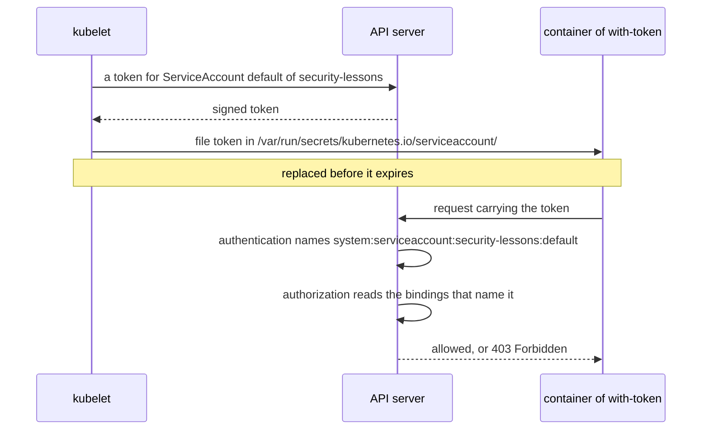

## Bạn cần biết trước

- [[k8s.l3.roles-and-role-bindings]] — RoleBinding trao các hành động của một Role cho một tên user, ngoài ra không gì được phép.
- [[k8s.l1.configmap-files]] — kubelet có thể đưa dữ liệu từ API server vào container dưới dạng file.
- [[k8s.l2.config-repo-overlays]] — base của repo cấu hình giữ mỗi manifest đúng một lần, và overlay của staging xây tiếp trên nó.

## Tình huống

Ở bài trước bạn đã cho `junior-dev` một Role, nên giờ một người có đúng những quyền công việc của họ cần. Các Pod của api, Notifications và Payments cũng chạy trên `donhang-staging`, và chưa ai từng cho chúng một cái tên trên API server. Một đồng nghiệp bảo vậy là ổn: Pod không có danh tính gì ở đó, trừ khi có người tạo cho nó. Người khác nói thêm: dù trong container có nằm sẵn một thông tin đăng nhập nào đó, nó cũng vô hại khi ứng dụng không bao giờ đọc tới. Bạn không chắc cả hai điều này đúng. Pod gọi tới API server dưới tên nào, và ai lọt được vào container thì làm được gì với nó?

## Khái niệm cốt lõi

- **ServiceAccount** (Danh tính cho chương trình trong một namespace; Pod gọi API server dưới danh tính này) — object nằm trong một namespace, cho chương trình (chứ không phải con người) một danh tính trên API server.
- ServiceAccount `default` — cái mà Kubernetes tạo sẵn trong mọi namespace. Pod không nêu ServiceAccount nào thì chạy dưới danh tính này.
- Token của ServiceAccount — thông tin đăng nhập có chữ ký, nêu đúng một ServiceAccount. kubelet ghi nó vào Pod dưới dạng file.
- `automountServiceAccountToken: false` — một trường trong manifest của Pod, nằm dưới `spec` (phần khai báo trạng thái mong muốn của nó), giữ cho file token đó không xuất hiện trong Pod.

## Cơ chế hoạt động



Trong tình huống trên, lấy ví dụ Pod `with-token` trong `security-lessons`. Manifest của nó không nêu ServiceAccount nào, nên lúc Pod được tạo, một admission controller điền vào `default`. Vì vậy Pod nào cũng chạy dưới một ServiceAccount nào đó, dù có ai chọn hay không.

Trừ khi Pod nói khác, kubelet xin API server một token cho ServiceAccount đó và ghi nó vào container, dưới `/var/run/secrets/kubernetes.io/serviceaccount/`. Token có hạn dùng, và kubelet thay file trước khi nó hết hạn, nên chương trình nào đọc file cũng thấy một token còn hiệu lực.

Request mang token này đi qua đúng các bước kiểm tra như request `kubectl` của bạn. Bước xác thực gọi người gửi là `system:serviceaccount:security-lessons:default`, thuộc các nhóm `system:serviceaccounts` và `system:serviceaccounts:security-lessons`. Với RBAC, đó chỉ là thêm một tên user: ServiceAccount chỉ được làm những gì các binding nhắc tới nó hoặc nhóm của nó cho phép, mọi thứ khác nhận `403 Forbidden`. Kubernetes không gắn cho `default` quyền nào trên object trong các namespace của bạn. Giống mọi người gọi đã đăng nhập, nó chỉ có vài quyền chỉ-đọc, chẳng hạn hỏi xem mình là ai.

API server kiểm tra token, không kiểm tra request đến từ đâu. Ai đọc được file thì nắm quyền của ServiceAccount, cả quyền hôm nay lẫn quyền mà một binding thêm vào sau này. Chương trình không bao giờ gọi API server thì chẳng mất gì khi không có file đó, và `automountServiceAccountToken: false` giữ nó ở ngoài.

## Trong hệ thống Đơn Hàng

```bash file=scripts/k8s/service-accounts.sh tag=stage-3 lines=22-46
show kubectl apply -f deploy/k8s/lessons/token-pods.yaml
kubectl wait --for=condition=Ready pod/with-token pod/without-token -n security-lessons --timeout=180s >/dev/null
echo "\$ kubectl exec with-token -- ls $token_dir"
kubectl exec with-token -n security-lessons -- ls "$token_dir"
echo "\$ kubectl exec without-token -- ls $token_dir"
kubectl exec without-token -n security-lessons -- ls "$token_dir" 2>&1 || true
echo

# lesson: k8s.l3.service-accounts
# In RBAC the ServiceAccount is the user system:serviceaccount:<namespace>:<name>.
# No binding names default here, so it may do next to nothing.
sa=system:serviceaccount:security-lessons:default
for check in "list pods" "get secrets" "create deployments"; do
  echo "can $sa $check? $(kubectl auth can-i $check -n security-lessons --as="$sa" || true)"
done
echo

# Whoever reads the token file can call the API server as that
# ServiceAccount: here from this machine, with no other credential.
token=$(kubectl exec with-token -n security-lessons -- cat "$token_dir/token")
server=$(kubectl config view --minify -o jsonpath='{.clusters[0].cluster.server}')
empty=$(mktemp ./.empty-kubeconfig.XXXXXX)
echo "\$ kubectl auth whoami --token=<the token read from with-token>"
command kubectl --kubeconfig="$empty" --server="$server" --insecure-skip-tls-verify --token="$token" auth whoami \
  | grep -e Username -e Groups
```

```text output=true
$ kubectl get serviceaccounts -n security-lessons
NAME      SECRETS   AGE
default   0         ...

$ kubectl apply -f deploy/k8s/lessons/token-pods.yaml
pod/with-token created
pod/without-token created
$ kubectl exec with-token -- ls /var/run/secrets/kubernetes.io/serviceaccount
ca.crt
namespace
token
$ kubectl exec without-token -- ls /var/run/secrets/kubernetes.io/serviceaccount
ls: /var/run/secrets/kubernetes.io/serviceaccount: No such file or directory
command terminated with exit code 1

can system:serviceaccount:security-lessons:default list pods? no
can system:serviceaccount:security-lessons:default get secrets? no
can system:serviceaccount:security-lessons:default create deployments? no

$ kubectl auth whoami --token=<the token read from with-token>
Username   system:serviceaccount:security-lessons:default
Groups     [system:serviceaccounts system:serviceaccounts:security-lessons system:authenticated]

$ kubectl get deployment api -n donhang -o jsonpath='{.spec.template.spec.automountServiceAccountToken}'
false
$ kubectl exec deployment/api -n donhang -- ls /var/run/secrets/kubernetes.io/serviceaccount
ls: cannot access '/var/run/secrets/kubernetes.io/serviceaccount': No such file or directory
command terminated with exit code 2
```

Phía trên đoạn trích, `show` in một lệnh rồi chạy nó, mọi lệnh `kubectl` đều đi tới context `kind-donhang-staging`, và `token_dir` giữ đường dẫn của thư mục. Dòng 15, cũng nằm phía trên, liệt kê các ServiceAccount của `security-lessons`: chỉ có `default`, thứ không ai tạo bằng tay. Cột `SECRETS` là `0` vì token không được cất trong Secret nào. kubelet xin một token riêng cho từng Pod.

`token-pods.yaml` định nghĩa hai Pod không nêu ServiceAccount nào, và chỉ `without-token` đặt `automountServiceAccountToken: false`. Lệnh `ls` trong `with-token` cho thấy token nằm cạnh `ca.crt`, chứng chỉ dùng để kiểm tra API server, và `namespace`, namespace của Pod. Cũng lệnh `ls` đó trong `without-token` thì thất bại. `kubectl auth can-i <verb> <kind> --as=<user>` hỏi API server xem user đó có được làm việc này không, mà không cần thông tin đăng nhập của họ. Vòng lặp hỏi câu này cho tên user của ServiceAccount và nhận về `no` cả ba lần, vì không binding nào nhắc tới nó.

Phần cuối đọc token ra khỏi `with-token`. `kubectl config view --minify` lấy địa chỉ API server từ kubeconfig của bạn. `command kubectl` chạy `kubectl` thật, bỏ qua hàm `kubectl` riêng của script ở dòng 7, hàm thêm context vào. Lệnh này bắt đầu từ một kubeconfig rỗng, nên token là thông tin đăng nhập duy nhất của nó. `--insecure-skip-tls-verify` bỏ bước kiểm tra chứng chỉ của server, vì file rỗng không có gì để đối chiếu.

`kubectl auth whoami`, lệnh mà phần help của kubectl vẫn ghi là thử nghiệm, trả lời bằng tên và các nhóm của ServiceAccount: trên máy bạn, file này dùng được y như bên trong Pod. Nhóm thứ ba, `system:authenticated`, gồm mọi người gọi đã qua bước xác thực.

```yaml file=deploy/gitops/config-repo-kustomize/base/api.yaml tag=stage-3 lines=25-31
    spec:
      # lesson: k8s.l3.service-accounts
      # The api never calls the API server, so its Pods get no token of their
      # ServiceAccount: a taken-over container finds nothing to call it with.
      automountServiceAccountToken: false
      containers:
        - name: api
```

Đây là Pod template của api trong base của repo cấu hình, nơi overlay của staging xây tiếp lên. Vì vậy mọi Pod của api khởi động mà không có token. `notifications.yaml` và `payments.yaml` trong cùng base đặt trường này y như vậy. Những dòng cuối của script, phía dưới đoạn trích, đọc lại trường này từ Deployment đang chạy và chạy cùng lệnh `ls` trong một Pod của api, và lệnh đó thất bại. api vẫn chạy dưới `default` của `donhang`, chỉ là không mang token nào của nó.

## Senior hay nhầm rằng…

- **"Pod không có danh tính gì trên API server, trừ khi có người cho nó một ServiceAccount."** → Thực ra Pod không nêu ServiceAccount nào thì chạy dưới `default` của namespace, thứ Kubernetes tạo sẵn cho bạn. Bạn sẽ nhận ra khi `kubectl get serviceaccounts` trong một namespace mới tinh đã liệt kê `default`, và một token nằm sẵn trong Pod mà không ai cấu hình.
- **"ServiceAccount `default` được đọc mọi thứ trong namespace của nó."** → Thực ra với RBAC nó chỉ là thêm một tên user, và Kubernetes không cho nó quyền nào trên object trong các namespace của bạn. Bạn sẽ nhận ra khi `kubectl auth can-i list pods --as=system:serviceaccount:<namespace>:default` trả lời `no`.
- **"Token gắn vào Pod là vô hại khi ứng dụng không bao giờ dùng tới."** → Thực ra ai đọc được file, chẳng hạn kẻ chiếm được container, đều gọi được API server với quyền của ServiceAccount, kể cả quyền mà một binding thêm vào sau này. Bạn sẽ nhận ra khi `kubectl auth whoami --token=…` chạy trên chính máy bạn trả lời bằng tên của ServiceAccount.

## Thử ngay (3 phút)

Ở thư mục gốc của repo Đơn Hàng, khi `donhang-staging` đang chạy (`scripts/devops/tofu-env.sh staging up` tạo ra nó):

1. Chạy `scripts/k8s/service-accounts.sh`.
2. Nếu bạn bỏ qua bài trước, chạy `scripts/k8s/rbac-role.sh` trước. Đoán câu trả lời của `kubectl --context kind-donhang-staging auth can-i get pods -n security-lessons --as=system:serviceaccount:security-lessons:default`, rồi của cùng lệnh đó với `--as=junior-dev`. Chạy cả hai.

Kết quả mong đợi: script in ra output như ở trên, và bước 2 in `no` cho ServiceAccount, `yes` cho `junior-dev`.

<details><summary>Gợi ý đáp án</summary>

RoleBinding `pod-reader` chỉ nhắc tới user `junior-dev`, và `get` là một trong các verb của Role mà nó trao, nên câu trả lời đó là `yes`. ServiceAccount là một tên user khác, và không binding nào trong `security-lessons` nhắc tới nó hay nhóm của nó, nên câu trả lời của nó là `no`. Có token chỉ trả lời câu hỏi ai đang hỏi.

</details>

## Liên hệ

- [[k8s.l3.roles-and-role-bindings]] — bài tiên quyết: chính các binding đó quyết định, chỉ khác là với tên user của một chương trình thay vì của một người.
- [[k8s.l1.configmap-files]] — cùng kiểu đưa dữ liệu: kubelet ghi dữ liệu từ API server thành file trong container, ở đây là token.
- [[backend.l2.validating-provider-tokens]] — cùng ý tưởng ở một tầng thấp hơn: api kiểm tra token do Keycloak ký, còn API server kiểm tra token do chính nó ký.
- [[k8s.l3.cluster-roles]] — bài tiếp theo: một chương trình có gọi API server, Argo CD, và những quyền rộng mà ServiceAccount của nó nắm.

## Tóm tắt 5 dòng

1. Pod nào cũng chạy dưới một ServiceAccount. Pod không nêu cái nào thì chạy dưới `default`, thứ mọi namespace đều có.
2. Trừ khi được bảo khác, kubelet ghi một token cho nó dưới `/var/run/secrets/kubernetes.io/serviceaccount/` và thay token trước khi hết hạn.
3. Với RBAC, ServiceAccount là user `system:serviceaccount:<namespace>:<name>`, chỉ có những gì các binding cho nó.
4. Ai đọc được file token đều gọi được API server với các quyền đó, từ bất cứ đâu tới được API server.
5. api, Notifications và Payments không bao giờ gọi nó, nên base của staging đặt `automountServiceAccountToken: false` trên Pod của chúng.
