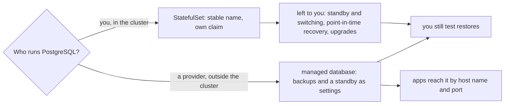

## Before you start

- [[k8s.l2.scheduled-backups]] — staging now dumps its databases every night; this lesson asks what else running PostgreSQL there leaves to you.
- [[devops.l3.point-in-time-recovery]] — a base backup plus archived WAL rebuilds the lab's server at a chosen moment; staging's `db` has nothing of the kind.
- [[devops.l3.disaster-recovery-drill]] — the drill rebuilds staging from scratch and times it; for now, that rebuild is staging's only answer to losing its node.
- [[backend.l3.read-replicas]] — a read replica applies the primary's changes as they stream in; a StatefulSet does not set that up for you.

## The situation

Staging's `db` now runs as a StatefulSet, keeps its data on `data-db-0`, and dumps three databases every night. A teammate reads the config repository and asks whether a live Đơn Hàng could run PostgreSQL the same way. You list what the Compose lab gave you: a streaming replica in the `replica` profile, a recovery to a point in time with `pitr.sh`, restore tests, a timed DR drill. Staging has none of them. Its one node holds the database, its claim and the nightly dumps together. What does running PostgreSQL in the cluster leave to you, and when should someone else run it instead?

## Core concepts

- What a StatefulSet gives PostgreSQL — a Pod that is always called `db-0` and a claim, `data-db-0`, that every `db-0` mounts; nothing in it knows what PostgreSQL is.
- A standby — a second PostgreSQL server that applies the first one's changes, as a read replica does, and can be turned into the server that takes writes when the first one fails.
- Running a database — the work that repeats after it first starts: backups and restore tests, keeping a standby and switching to it, recovering to a point in time, and upgrading PostgreSQL.
- **managed database** — a database server that a provider runs for you outside the cluster, with backups and a standby usually offered as settings, which apps in the cluster reach by address like any outside server.

## How it works



In the situation above, staging's `db` sits on the upper branch. The StatefulSet keeps the name `db-0` and the claim `data-db-0`, and that is all. It does not stream changes to a second server, does not move clients to a standby, does not archive WAL for a recovery to a point in time. Upgrading is no different: a new major version of PostgreSQL cannot simply start on the old data files. They must be converted, or the data dumped and loaded again or copied to a new server of the new version. Each of these is work someone builds, writes down and practises, as you did by hand in the Compose lab.

On the lower branch, a provider runs the server outside the cluster. Backups and a standby are usually settings you switch on, not systems you build. The api reaches the server by host name and port like any outside server, so for the code only the database address in its config changes. The trade is control for less work. The provider decides some server settings you cannot change and when maintenance happens, and the data lives on the provider's machines.

Which branch fits depends on your context. A managed database usually fits a team that rents its machines from a provider and has nobody whose job is running databases. Running one in the cluster fits when no such service exists, such as on a bank's own machines, or when the data must stay on them. Both branches end in the same box: whoever took a backup, only a restore of it shows that it gives your data back, and how long that takes.

## In the Đơn Hàng system

```yaml file=deploy/gitops/config-repo-kustomize/base/db.yaml tag=stage-3 lines=1-17
# lesson: k8s.l2.statefulsets
# PostgreSQL from stage-3: a StatefulSet with one replica. Its Pod is db-0,
# and a replacement for it is db-0 again. volumeClaimTemplates gives db-0
# its own claim, data-db-0, which every later db-0 mounts: the data no
# longer goes with the Pod, as it did with emptyDir.
apiVersion: apps/v1
kind: StatefulSet
metadata:
  name: db
  namespace: donhang
  labels:
    app: db
  annotations:
    argocd.argoproj.io/sync-wave: "0"
spec:
  serviceName: db-headless
  replicas: 1
```

Lines 2–5 list everything this StatefulSet promises: the name `db-0` and the claim `data-db-0`. The emptyDir they mention is how `deploy/k8s/db.yaml` kept the data: a folder deleted with its Pod. Line 17, `replicas: 1`, means one server and no standby; raising it would add `db-1` with its own new, empty claim `data-db-1`, and nothing copies data into it.

Further down, the file fixes the image `postgres:17.6-alpine` and asks for the claim from the cluster's default StorageClass, `standard`. On kind, the tool that runs each lab cluster as containers on your machine, `standard` keeps the volume in a folder on one node. The only scheduled work on PostgreSQL that staging does on its own is the CronJob in `db-backup.yaml`, and its dumps stay on that same node.

Staging runs PostgreSQL and RabbitMQ in the cluster because the lab rents no machines from a provider. Both hold the only copy of some data. PostgreSQL holds the orders; RabbitMQ holds messages still waiting in their queues, on `data-rabbitmq-0`.

```yaml file=deploy/gitops/config-repo-kustomize/base/redis.yaml tag=stage-3 lines=1-24
# lesson: k8s.l2.database-in-the-cluster
# Redis stays a Deployment without a claim, as in deploy/k8s/redis.yaml:
# everything in it is a copy of what PostgreSQL holds, so losing it loses
# nothing that cannot be read again.
apiVersion: apps/v1
kind: Deployment
metadata:
  name: redis
  namespace: donhang
spec:
  replicas: 1
  selector:
    matchLabels:
      app: redis
  template:
    metadata:
      labels:
        app: redis
    spec:
      containers:
        - name: redis
          image: redis:8.10.2-alpine
          ports:
            - containerPort: 6379
```

Redis is the counter-example. Lines 2–4 give the reason it gets no claim: the api fills it by cache-aside, so everything in it is a copy of rows in PostgreSQL. Lines 20–24 declare a container and a port and no `volumes`. When the Pod is replaced, Redis starts empty, the next reads are cache misses, and the api reads PostgreSQL again. The question to ask of each piece of state is the same: is this the only copy?

## Seniors often assume…

- **"Moving PostgreSQL to a StatefulSet keeps it running when its node fails."** → Actually a replacement `db-0` must run where its volume is, and kind's `standard` keeps `data-db-0` in a folder on one node. With that node gone, `db-0` cannot start anywhere else, and no second server holds the data. You notice this when `storage-class.sh` marks the node holding a volume unschedulable and the next Pod using that claim stays `Pending`.
- **"Databases must never run inside Kubernetes."** → Actually a StatefulSet, a claim and a CronJob run staging's PostgreSQL well enough for staging; the real question is who does the work around it. Where no managed database exists or the data must stay on your own machines, the cluster is a reasonable place, provided someone owns that work. You notice this when `stateful-staging.sh` places an order, deletes `db-0`, and finds that order still there.
- **"A managed database removes the need to test restores."** → Actually the provider takes the backups, but only a restore shows whether they give back Đơn Hàng's data, and how long that takes. You notice this when the first restore test is also the first time anyone compares the restore time with the RTO.

## Try it (3 minutes)

With `kind-donhang-staging` (the context of the cluster `donhang-staging`) as your current `kubectl` context:

1. Run `kubectl get statefulsets,deployments -n donhang`.
2. Run `kubectl get pvc -n donhang`.
3. For each claim, write down what Đơn Hàng would lose without it, and where else a copy exists.

Expected result: `db` and `rabbitmq` appear as StatefulSets and `redis` among the Deployments; the claims are `data-db-0`, `data-rabbitmq-0` and `db-backups`, and none belongs to `redis`.

<details><summary>Suggested answer</summary>

`data-db-0` holds the orders; its only other copy is a nightly dump, and only once `db-backup.sh` has copied it off the cluster. `data-rabbitmq-0` holds messages still waiting in queues, which the dumps of `db-backup` do not cover. `db-backups` holds those dumps, on the same node as `data-db-0`, so it is no copy until they are copied off. Redis has no claim: losing it loses only cached copies.

</details>

## Connections

- [[k8s.l2.statefulsets]] — the object whose limits this lesson lists: a stable name and a claim, not a replicated database.
- [[devops.l3.rpo-and-rto]] — the targets that decide whether nightly dumps and a rebuild are enough, in the cluster or at a provider.
- [[devops.l3.point-in-time-recovery]] — one piece of the work a StatefulSet leaves to you, done by hand in the Compose lab.
- [[backend.l3.read-replicas]] — the streaming copy a standby is built on.
- [[k8s.l3.replicated-volumes]] — the fix for a volume that lives on one node.
- [[k8s.l3.operator-pattern]] — software in the cluster that does much of this lesson's left-over work in code.

## Five-line summary

1. A StatefulSet gives PostgreSQL a stable name and its own volume; standbys, recovery and upgrades stay work someone builds and practises.
2. A managed database is a server a provider runs outside the cluster, with backups and a standby usually offered as settings, reached by address.
3. It trades control for less work: the provider decides some settings and when maintenance happens, and holds the data.
4. A managed database usually fits a team renting machines, without database staff; the cluster fits where no such service exists or data must stay.
5. Staging runs PostgreSQL and RabbitMQ in the cluster, each holding the only copy of some data; Redis, holding copies, gets no claim.
