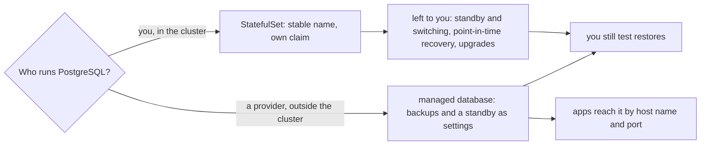

## Bạn cần biết trước

- [[k8s.l2.scheduled-backups]] — staging giờ dump các database của nó mỗi đêm. Bài này hỏi chạy PostgreSQL ở đó còn để lại cho bạn những việc gì nữa.
- [[devops.l3.point-in-time-recovery]] — một base backup cộng WAL đã lưu trữ dựng lại server của lab tại một thời điểm bạn chọn. `db` của staging không có gì như vậy.
- [[devops.l3.disaster-recovery-drill]] — buổi diễn tập dựng lại staging từ đầu và đo thời gian. Hiện tại, dựng lại như thế là cách duy nhất staging có khi mất node của nó.
- [[backend.l3.read-replicas]] — read replica áp dụng các thay đổi của primary ngay khi chúng được truyền tới. StatefulSet không dựng sẵn thứ đó cho bạn.

## Tình huống

`db` của staging giờ chạy dưới dạng StatefulSet, giữ dữ liệu trên `data-db-0` và dump ba database mỗi đêm. Một đồng nghiệp đọc repo cấu hình rồi hỏi: bản Đơn Hàng chạy thật cho khách có thể chạy PostgreSQL theo cách đó không. Bạn liệt kê những gì lab Compose đã cho bạn: một replica nhận thay đổi qua streaming trong profile `replica`, khôi phục về một thời điểm bằng `pitr.sh`, các lần kiểm thử khôi phục, một buổi diễn tập DR có đo giờ. Staging không có thứ nào trong số đó. Node duy nhất của nó chứa cả database, claim của database lẫn các bản dump hằng đêm. Chạy PostgreSQL trong cluster để lại cho bạn những việc gì, và khi nào nên để người khác chạy nó?

## Khái niệm cốt lõi

- Thứ StatefulSet cho PostgreSQL — một Pod luôn tên là `db-0` và một claim, `data-db-0`, mà mọi `db-0` đều mount. Không phần nào trong đó biết PostgreSQL là gì.
- Standby — một server PostgreSQL thứ hai áp dụng các thay đổi của server thứ nhất, giống read replica, và có thể được chuyển thành server nhận lệnh ghi khi server thứ nhất hỏng.
- Vận hành một database — phần việc lặp lại sau khi database khởi động lần đầu: sao lưu và kiểm thử khôi phục, duy trì một standby và chuyển sang nó, khôi phục về một thời điểm, nâng cấp PostgreSQL.
- **database managed (dịch vụ quản lý sẵn)** (managed database) — server database do một nhà cung cấp vận hành hộ bạn bên ngoài cluster, thường có sẵn sao lưu và standby dưới dạng thiết lập chỉ cần bật lên. App trong cluster kết nối tới nó qua địa chỉ, như với mọi server bên ngoài.

## Cơ chế hoạt động



Trong tình huống trên, `db` của staging nằm ở nhánh trên. StatefulSet giữ tên `db-0` và claim `data-db-0`, và chỉ có thế. Nó không truyền thay đổi sang server thứ hai, không chuyển client sang standby, không lưu trữ WAL để khôi phục về một thời điểm. Nâng cấp cũng vậy: một phiên bản major mới của PostgreSQL không thể cứ thế khởi động trên các file dữ liệu cũ. Các file đó phải được chuyển đổi, hoặc dữ liệu phải được dump rồi nạp lại, hay chép sang một server mới chạy phiên bản mới. Mỗi việc trên đều cần ai đó dựng, ghi lại thành tài liệu và luyện tập, như bạn đã làm bằng tay trong lab Compose.

Ở nhánh dưới, một nhà cung cấp chạy server bên ngoài cluster. Sao lưu và standby thường là thiết lập bạn bật lên, không phải hệ thống bạn tự dựng. api kết nối tới server qua host name và port như với mọi server bên ngoài, nên với code, thứ duy nhất thay đổi là địa chỉ database trong cấu hình. Cái giá là đổi quyền kiểm soát lấy bớt việc. Nhà cung cấp quyết định một số thiết lập server mà bạn không đổi được và thời điểm bảo trì, còn dữ liệu nằm trên máy của nhà cung cấp.

Nhánh nào hợp thì tùy hoàn cảnh của bạn. Database managed thường hợp với một đội thuê máy của nhà cung cấp và không có ai chuyên vận hành database. Chạy database trong cluster hợp khi không có dịch vụ như vậy, chẳng hạn trên máy riêng của một ngân hàng, hoặc khi dữ liệu phải ở lại trên các máy đó. Cả hai nhánh đều kết thúc ở cùng một ô: dù ai sao lưu, chỉ khôi phục từ bản sao lưu mới cho thấy nó có trả lại dữ liệu của bạn không, và mất bao lâu.

## Trong hệ thống Đơn Hàng

```yaml file=deploy/gitops/config-repo-kustomize/base/db.yaml tag=stage-3 lines=1-17
# lesson: k8s.l2.statefulsets
# PostgreSQL from stage-3: a StatefulSet with one replica. Its Pod is db-0,
# and a replacement for it is db-0 again. volumeClaimTemplates gives db-0
# its own claim, data-db-0, which every later db-0 mounts: the data no
# longer goes with the Pod, as it did with emptyDir.
apiVersion: apps/v1
kind: StatefulSet
metadata:
  name: db
  namespace: donhang
  labels:
    app: db
  annotations:
    argocd.argoproj.io/sync-wave: "0"
spec:
  serviceName: db-headless
  replicas: 1
```

Dòng 2–5 liệt kê mọi thứ StatefulSet này hứa: tên `db-0` và claim `data-db-0`. emptyDir được nhắc tới ở đó là cách `deploy/k8s/db.yaml` từng giữ dữ liệu: một thư mục bị xóa cùng Pod. Dòng 17, `replicas: 1`, nghĩa là một server và không có standby. Tăng con số đó sẽ thêm `db-1` với claim mới, rỗng của riêng nó là `data-db-1`, và không có gì chép dữ liệu vào đó.

Phía dưới, file cố định image `postgres:17.6-alpine` và xin claim từ StorageClass mặc định của cluster, `standard`. Trên kind, công cụ chạy mỗi cluster của lab thành các container trên máy bạn, `standard` giữ volume trong một thư mục trên một node. Việc định kỳ duy nhất trên PostgreSQL mà staging tự làm là CronJob trong `db-backup.yaml`, và các bản dump của nó cũng nằm trên chính node đó.

Staging chạy PostgreSQL và RabbitMQ trong cluster vì lab không thuê máy của nhà cung cấp nào. Cả hai đều giữ bản duy nhất của một phần dữ liệu. PostgreSQL giữ các đơn hàng, còn RabbitMQ giữ những message vẫn đang chờ trong hàng đợi, trên `data-rabbitmq-0`.

```yaml file=deploy/gitops/config-repo-kustomize/base/redis.yaml tag=stage-3 lines=1-24
# lesson: k8s.l2.database-in-the-cluster
# Redis stays a Deployment without a claim, as in deploy/k8s/redis.yaml:
# everything in it is a copy of what PostgreSQL holds, so losing it loses
# nothing that cannot be read again.
apiVersion: apps/v1
kind: Deployment
metadata:
  name: redis
  namespace: donhang
spec:
  replicas: 1
  selector:
    matchLabels:
      app: redis
  template:
    metadata:
      labels:
        app: redis
    spec:
      containers:
        - name: redis
          image: redis:8.10.2-alpine
          ports:
            - containerPort: 6379
```

Redis là ví dụ ngược lại. Dòng 2–4 nêu lý do Redis không có claim: api nạp dữ liệu vào nó theo cache-aside, nên mọi thứ trong đó đều là bản sao của các bản ghi trong PostgreSQL. Dòng 20–24 khai báo một container và một port, không có `volumes`. Khi Pod bị thay, Redis khởi động rỗng, các lần đọc tiếp theo là cache miss, và api đọc lại từ PostgreSQL. Câu hỏi cần đặt cho từng phần trạng thái vẫn là một: đây có phải bản duy nhất không?

## Senior hay nhầm rằng…

- **"Chuyển PostgreSQL sang StatefulSet là nó vẫn chạy khi node của nó hỏng."** → Thực ra `db-0` thay thế phải chạy ở nơi có volume của nó, mà `standard` của kind giữ `data-db-0` trong một thư mục trên một node. Mất node đó, `db-0` không khởi động được ở đâu khác, và không có server thứ hai nào giữ dữ liệu. Bạn sẽ nhận ra khi `storage-class.sh` đánh dấu node chứa một volume là không nhận Pod mới, và Pod tiếp theo dùng claim đó cứ nằm ở `Pending`.
- **"Database tuyệt đối không được chạy trong Kubernetes."** → Thực ra một StatefulSet, một claim và một CronJob chạy PostgreSQL của staging đủ tốt cho staging. Câu hỏi thật là ai làm phần việc xung quanh nó. Ở nơi không có database managed hoặc dữ liệu phải ở lại trên máy của chính bạn, cluster là chỗ hợp lý, miễn là có người chịu trách nhiệm phần việc đó. Bạn sẽ nhận ra khi `stateful-staging.sh` đặt một đơn hàng, xóa `db-0`, rồi thấy đơn hàng đó vẫn còn.
- **"Dùng database managed thì khỏi cần kiểm thử khôi phục."** → Thực ra nhà cung cấp lo sao lưu, nhưng chỉ khôi phục thử mới cho thấy bản sao lưu có trả lại dữ liệu của Đơn Hàng không, và mất bao lâu. Bạn sẽ nhận ra khi lần kiểm thử khôi phục đầu tiên cũng là lần đầu có người so thời gian khôi phục với RTO.

## Thử ngay (3 phút)

Với `kind-donhang-staging` (context của cluster `donhang-staging`) là context `kubectl` hiện tại:

1. Chạy `kubectl get statefulsets,deployments -n donhang`.
2. Chạy `kubectl get pvc -n donhang`.
3. Với mỗi claim, ghi lại Đơn Hàng sẽ mất gì nếu không có nó, và bản sao còn nằm ở đâu khác.

Kết quả mong đợi: `db` và `rabbitmq` hiện là StatefulSet, `redis` nằm trong số Deployment. Các claim là `data-db-0`, `data-rabbitmq-0` và `db-backups`, không claim nào thuộc về `redis`.

<details><summary>Gợi ý đáp án</summary>

`data-db-0` giữ các đơn hàng. Bản sao khác duy nhất của nó là bản dump hằng đêm, và chỉ khi `db-backup.sh` đã chép bản đó ra khỏi cluster. `data-rabbitmq-0` giữ các message vẫn đang chờ trong hàng đợi, thứ mà các bản dump của `db-backup` không bao gồm. `db-backups` giữ các bản dump đó, trên cùng node với `data-db-0`, nên chưa phải bản sao cho tới khi chúng được chép ra ngoài. Redis không có claim: mất Redis chỉ mất các bản sao trong cache.

</details>

## Liên hệ

- [[k8s.l2.statefulsets]] — object mà bài này liệt kê các giới hạn: một tên ổn định và một claim, không phải một database có bản sao chạy song song.
- [[devops.l3.rpo-and-rto]] — các mục tiêu quyết định dump hằng đêm cộng dựng lại có đủ hay không, dù trong cluster hay ở nhà cung cấp.
- [[devops.l3.point-in-time-recovery]] — một phần trong số việc StatefulSet để lại cho bạn, đã làm bằng tay trong lab Compose.
- [[backend.l3.read-replicas]] — bản sao nhận streaming, nền tảng để dựng một standby.
- [[k8s.l3.replicated-volumes]] — cách khắc phục cho một volume chỉ nằm trên một node.
- [[k8s.l3.operator-pattern]] — phần mềm trong cluster làm bằng code phần lớn số việc còn lại của bài này.

## Tóm tắt 5 dòng

1. StatefulSet cho PostgreSQL một tên ổn định và volume riêng, còn standby, khôi phục và nâng cấp vẫn là việc ai đó phải dựng và luyện tập.
2. Database managed là server do nhà cung cấp chạy bên ngoài cluster, thường có sẵn sao lưu và standby dưới dạng thiết lập, kết nối tới qua địa chỉ.
3. Nó đổi quyền kiểm soát lấy bớt việc: nhà cung cấp quyết định một số thiết lập và thời điểm bảo trì, và giữ dữ liệu.
4. Database managed thường hợp với đội thuê máy và không có người chuyên về database, còn cluster hợp khi không có dịch vụ đó hoặc dữ liệu phải ở lại.
5. Staging chạy PostgreSQL và RabbitMQ trong cluster, mỗi thứ giữ bản duy nhất của một phần dữ liệu, còn Redis chỉ giữ bản sao nên không có claim.
