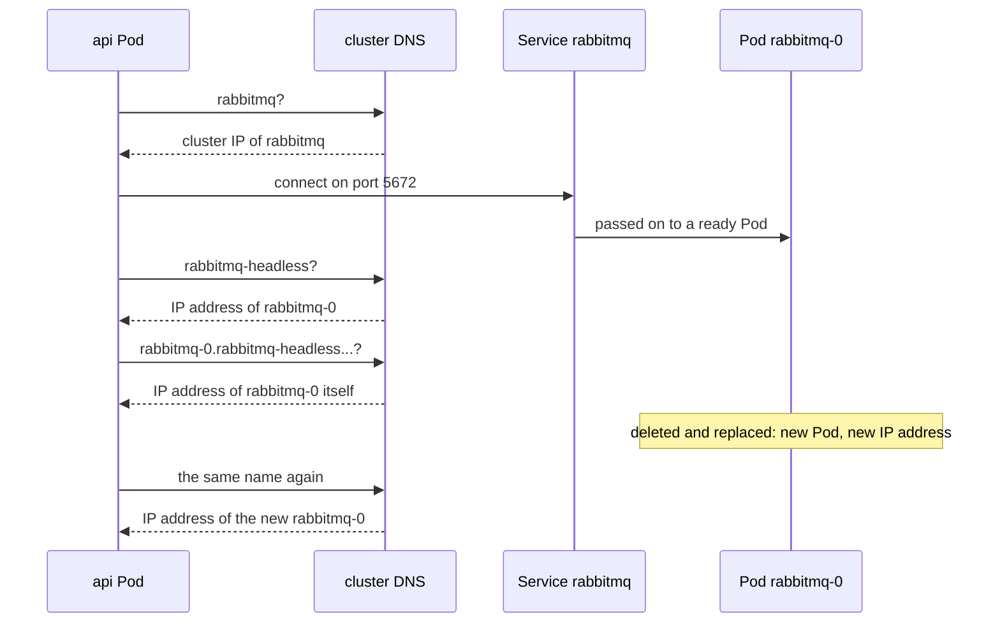

## Before you start

- [[k8s.l2.statefulsets]] — a replaced `db-0` comes back under the same name with a new IP address; this lesson gives that name a DNS entry.
- [[k8s.l1.service-and-dns]] — the cluster DNS answers a Service's name with its cluster IP; here you meet a Service that has none.
- [[backend.l3.message-broker]] — RabbitMQ keeps messages in queues until a service takes them; here those queues must outlive a Pod.

## The situation

Staging's RabbitMQ runs as a StatefulSet with one Pod, `rabbitmq-0`, its queues on the claim `data-rabbitmq-0`. The api reaches it through the Service `rabbitmq`; any Pod would do. RabbitMQ wants more: it gives itself a node name, keeps its queues in a folder called after it, and looks for that folder when it restarts. Its tools and any server joined to it reach the node by that name, so staging builds it from a DNS name for `rabbitmq-0` alone. But the Service `rabbitmq` answers with its own address, never a Pod's, and the Pod's IP address changes when it is replaced. Where does a DNS name for one Pod come from, and does it survive the replacement?

## Core concepts

- **headless Service** — a Service with `clusterIP: None`: it gets no cluster IP, and the cluster DNS answers its name with the IP addresses of its ready Pods instead.
- `serviceName` — the StatefulSet field that names a headless Service; each Pod of the StatefulSet then gets a DNS name of its own under that Service.
- Pod DNS name — `<pod>.<service>.<namespace>.svc.cluster.local`, such as `rabbitmq-0.rabbitmq-headless.donhang.svc.cluster.local`; it resolves to whichever Pod currently has that name. `cluster.local` is the cluster's domain, the default, which staging keeps.
- Node name — the name a RabbitMQ server gives itself; RabbitMQ also names the folder holding its queues and their messages after it.

## How it works



The api asks the cluster DNS for `rabbitmq` and gets the Service's cluster IP, as for any Service. It connects there on port 5672, and the Service passes the connection on to a ready Pod. The api never learns which Pod it reached.

The second Service, `rabbitmq-headless`, selects the same Pods but sets `clusterIP: None`. With no cluster IP, nothing sits between the client and the Pods, so the cluster DNS answers the Service's name with the IP addresses of the Pods themselves. The client gets Pod addresses and connects to one of them directly.

A headless Service alone gives no Pod a name built from the Pod's own name. The StatefulSet `rabbitmq` sets `serviceName: rabbitmq-headless`, and from then on each of its Pods gets a DNS name of its own: the Pod name, the Service name, the namespace, then `svc.cluster.local`. For the only Pod, that is `rabbitmq-0.rabbitmq-headless.donhang.svc.cluster.local`. The api Pod in the diagram looks these names up only as a check, as the script below does; in normal use, RabbitMQ builds its node name from the long one.

When `rabbitmq-0` is deleted, the StatefulSet creates a new `rabbitmq-0`; nothing keeps the old IP address for it, and in the run below it gets a new one. The DNS name is built from the Pod's name, not its address, so it stays the same and now resolves to the new address.

So the api, which any Pod can serve, uses the normal Service. Members that must reach one particular member, such as the servers of a replicated database or joined RabbitMQ servers, need a name per Pod, and so does a server that names itself after its Pod, as RabbitMQ does here.

## In the Đơn Hàng system

```yaml file=deploy/gitops/config-repo-kustomize/base/rabbitmq.yaml tag=stage-3 lines=66-89
# lesson: k8s.l2.headless-services
# Two Services for the same Pods. rabbitmq has a virtual IP address: the api,
# Notifications and Payments use it, as any Pod would do. rabbitmq-headless
# has none (clusterIP: None); the StatefulSet's serviceName names it, and it
# gives each Pod a DNS name of its own.
apiVersion: v1
kind: Service
metadata:
  name: rabbitmq
  namespace: donhang
spec:
  selector:
    app: rabbitmq
  ports:
    - port: 5672
      targetPort: 5672
---
apiVersion: v1
kind: Service
metadata:
  name: rabbitmq-headless
  namespace: donhang
spec:
  clusterIP: None
```

The comments' "virtual IP address" is the cluster IP. Both Services select `app: rabbitmq`, so they stand in front of the same Pod. `rabbitmq` has no `clusterIP` line and gets a cluster IP as usual; the base's `kustomization.yaml` points the api at it with `RabbitMq__Host=rabbitmq`. The excerpt stops at `clusterIP: None`; below it, `rabbitmq-headless` repeats the selector and port and adds one setting this stage does not cover.

Above the excerpt, line 13 sets `serviceName: rabbitmq-headless`. Lines 39–46 set `RABBITMQ_NODENAME` to `rabbit@$(POD_NAME).rabbitmq-headless.donhang.svc.cluster.local`, where Kubernetes fills `POD_NAME` with the Pod's own name and the part after `rabbit@` is the host; `RABBITMQ_USE_LONGNAME` lets RabbitMQ use such a full DNS name. The claim's storage appears inside the container as the folder `/var/lib/rabbitmq`, so the node's folder lives on it.

```bash file=scripts/k8s/headless-dns.sh tag=stage-3 lines=48-72
# rabbitmq resolves to the Service's virtual address; rabbitmq-headless,
# which has none, to the address of the ready Pod itself; and the Pod has
# a name of its own under it.
ip=$(pod_ip)
echo "rabbitmq           -> the Service's address: $([ "$(resolve rabbitmq)" = "$(kubectl get service rabbitmq -n donhang -o jsonpath='{.spec.clusterIP}')" ] && echo yes || echo no)"
echo "rabbitmq-headless  -> rabbitmq-0's address: $([ "$(resolve rabbitmq-headless)" = "$ip" ] && echo yes || echo no)"
echo "$pod_dns -> rabbitmq-0's address: $([ "$(resolve "$pod_dns")" = "$ip" ] && echo yes || echo no)"
echo "== queues on rabbitmq-0"
queues
echo

# lesson: k8s.l2.headless-services
# The replacement rabbitmq-0 gets a new address under the same DNS name,
# so the node name built from it is the same, and so is the folder its
# queues live in on the claim.
show kubectl delete pod rabbitmq-0 -n donhang
kubectl wait --for=condition=Ready pod/rabbitmq-0 -n donhang --timeout=300s >/dev/null
wait_rabbit
echo "rabbitmq-0's address changed: $([ "$(pod_ip)" != "$ip" ] && echo yes || echo no)"
echo "$pod_dns -> the new address: $([ "$(resolve "$pod_dns")" = "$(pod_ip)" ] && echo yes || echo no)"
echo "== the node's name and its folder on the claim"
kubectl exec rabbitmq-0 -n donhang -- rabbitmqctl eval 'node().' --quiet
kubectl exec rabbitmq-0 -n donhang -- ls /var/lib/rabbitmq/mnesia | grep -v -e '\.pid$' -e 'plugins-expand$' -e 'feature_flags$'
echo "== queues on the new rabbitmq-0"
queues
```

```text output=true
...
$ kubectl get services -n donhang
NAME                CLUSTER-IP
rabbitmq            ...
rabbitmq-headless   None

rabbitmq            -> the Service's address: yes
rabbitmq-headless   -> rabbitmq-0's address: yes
rabbitmq-0.rabbitmq-headless.donhang.svc.cluster.local -> rabbitmq-0's address: yes
== queues on rabbitmq-0
name	durable
orders.payment-events	true
orders.payment-events.dead	true

$ kubectl delete pod rabbitmq-0 -n donhang
pod "rabbitmq-0" deleted from donhang namespace
rabbitmq-0's address changed: yes
rabbitmq-0.rabbitmq-headless.donhang.svc.cluster.local -> the new address: yes
== the node's name and its folder on the claim
'rabbit@rabbitmq-0.rabbitmq-headless.donhang.svc.cluster.local'
rabbit@rabbitmq-0.rabbitmq-headless.donhang.svc.cluster.local
== queues on the new rabbitmq-0
name	durable
orders.payment-events	true
orders.payment-events.dead	true
```

Above the excerpt, the script commits `base/rabbitmq.yaml`, waits for Argo CD to sync it, and lists the two Services: `rabbitmq` with a cluster IP, hidden by `...`, and `rabbitmq-headless` with `None`. Helpers defined there: `pod_dns` holds the long name, `resolve` looks a name up from inside an api Pod, `pod_ip` reads `rabbitmq-0`'s IP address, `queues` lists its queues, `wait_rabbit` waits until RabbitMQ itself runs, and `show` prints a command first.

The block starts at line 48. Lines 52–54 compare three answers: `rabbitmq` gives the Service's cluster IP, while `rabbitmq-headless` and the long name both give `rabbitmq-0`'s own address. Lines 63–67 delete the Pod, wait for the replacement, and check that the address changed while the name now leads to the new one. Lines 69–70 print the node name and the single folder under `/var/lib/rabbitmq/mnesia` named after it. The same two queues appear before and after.

## Seniors often assume…

- **"A headless Service spreads connections across its Pods like any other Service."** → Actually it has no cluster IP, so nothing stands between the client and the Pods to pass connections on. The DNS answer is a list of Pod addresses, and the client connects to one of them itself. You notice this when the lookup of `rabbitmq-headless` returns `rabbitmq-0`'s own address and `CLUSTER-IP` reads `None`.
- **"A StatefulSet Pod keeps its IP address because it keeps its name."** → Actually the replacement is a new Pod, and nothing keeps its old address; what carries over is the DNS name, which follows the Pod's name. You notice this when the script prints `rabbitmq-0's address changed: yes` and the same long name then resolves to the new address.
- **"Clients should call `rabbitmq-0` by its own name, to know exactly where they land."** → Actually a client that any Pod can serve, such as the api, belongs on the normal Service `rabbitmq`. A per-Pod name ties the client to one member and to the headless Service's name, details the client gains nothing from. You notice this when a client's settings contain a Pod number: that client can only ever use that one Pod.

## Try it (3 minutes)

With the staging cluster `donhang-staging` as your current `kubectl` context and `scripts/k8s/headless-dns.sh` already run once:

1. Run `kubectl get pod rabbitmq-0 -n donhang -o wide` and note the `IP` column, then `kubectl get service rabbitmq -n donhang` and note `CLUSTER-IP`.
2. Run `kubectl exec deployment/api -n donhang -- getent ahostsv4 rabbitmq-headless`, then the same command with `rabbitmq` at the end. `getent ahostsv4 <name>` looks the name up as a program in that Pod would and prints one line per answer, each starting with an IPv4 address.

Expected result: every line of the first lookup starts with the Pod's address from step 1; every line of the second starts with the Service's `CLUSTER-IP`, an address no Pod has.

## Connections

- [[k8s.l2.statefulsets]] — prerequisite: the numbered Pods whose names this lesson turns into DNS names.
- [[k8s.l1.service-and-dns]] — the same cluster DNS one step further: a name per Pod instead of one per Service.
- [[backend.l3.message-broker]] — the RabbitMQ whose queues now outlive the replacement of its Pod.
- [[backend.l3.read-replicas]] — a case that needs per-Pod names: a replica copies from one particular server, not from any of them.
- [[k8s.l2.staging-keeps-its-data]] — next: the whole of staging keeping its data when its Pods are replaced.

## Five-line summary

1. A headless Service, named by a StatefulSet's `serviceName`, gives each of its Pods a DNS name that survives the Pod's replacement.
2. With `clusterIP: None` a Service gets no cluster IP, and its name resolves to the IP addresses of its ready Pods.
3. A StatefulSet's `serviceName` names that Service; each Pod then gets `<pod>.<service>.<namespace>.svc.cluster.local`.
4. Clients any Pod can serve use a normal Service; members that must reach one particular Pod use its own name.
5. RabbitMQ builds its node name, and so its data folder, from that DNS name, so a replacement Pod finds its queues.
