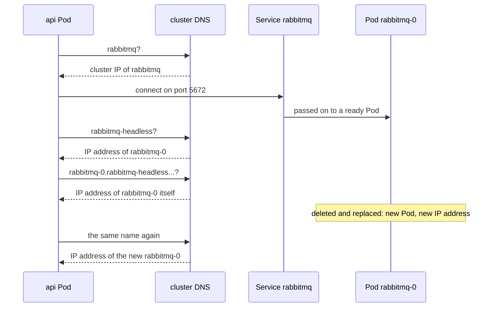

## Bạn cần biết trước

- [[k8s.l2.statefulsets]] — `db-0` bị thay sẽ quay lại dưới cùng tên nhưng với địa chỉ IP mới; bài này cho cái tên đó một mục DNS.
- [[k8s.l1.service-and-dns]] — cluster DNS trả lời tên của một Service bằng cluster IP của nó; ở đây bạn gặp một Service không có cluster IP nào.
- [[backend.l3.message-broker]] — RabbitMQ giữ message trong hàng đợi tới khi một service lấy chúng đi; ở đây các hàng đợi đó phải sống lâu hơn một Pod.

## Tình huống

RabbitMQ của staging chạy dưới dạng StatefulSet với một Pod là `rabbitmq-0`, các hàng đợi nằm trên claim `data-rabbitmq-0`. Api tới được nó qua Service `rabbitmq`, Pod nào cũng được. RabbitMQ thì cần nhiều hơn thế. Nó tự đặt cho mình một node name, cất hàng đợi trong một thư mục mang tên đó, và tìm lại thư mục ấy mỗi khi khởi động lại. Công cụ của nó và mọi server tham gia cùng nó đều gọi node bằng tên này, nên staging dựng tên từ một tên DNS chỉ dành cho `rabbitmq-0`. Nhưng Service `rabbitmq` trả lời bằng địa chỉ của chính nó, không bao giờ bằng địa chỉ của một Pod, còn địa chỉ IP của Pod lại đổi khi Pod bị thay. Tên DNS cho riêng một Pod lấy từ đâu ra, và nó có còn nguyên sau khi Pod bị thay không?

## Khái niệm cốt lõi

- **headless Service** (Service không có cluster IP (clusterIP: None); tên DNS trỏ thẳng tới IP các Pod) — Service có `clusterIP: None`: nó không nhận cluster IP nào, và cluster DNS trả lời tên của nó bằng địa chỉ IP của các Pod đang ready.
- `serviceName` — trường của StatefulSet ghi tên một headless Service; từ đó mỗi Pod của StatefulSet có một tên DNS riêng nằm dưới Service ấy.
- Tên DNS của Pod — `<pod>.<service>.<namespace>.svc.cluster.local`, chẳng hạn `rabbitmq-0.rabbitmq-headless.donhang.svc.cluster.local`; tên này trỏ tới Pod nào đang mang tên đó lúc ấy. `cluster.local` là domain của cluster, giá trị mặc định, và staging giữ nguyên nó.
- Node name — tên mà một server RabbitMQ tự đặt cho mình; RabbitMQ cũng đặt tên thư mục chứa hàng đợi và message của nó theo tên này.

## Cơ chế hoạt động



Api hỏi cluster DNS tên `rabbitmq` và nhận về cluster IP của Service, như với mọi Service khác. Nó kết nối tới đó ở port 5672, rồi Service chuyển kết nối tới một Pod đang ready. Api không bao giờ biết mình đã tới Pod nào.

Service thứ hai, `rabbitmq-headless`, chọn đúng các Pod đó nhưng đặt `clusterIP: None`. Không có cluster IP thì không có gì đứng giữa client và các Pod, nên cluster DNS trả lời tên của Service bằng địa chỉ IP của chính các Pod. Client nhận địa chỉ của Pod và tự kết nối thẳng tới một trong số đó.

Riêng một headless Service chưa cho Pod nào một tên dựng từ tên của chính Pod. StatefulSet `rabbitmq` đặt `serviceName: rabbitmq-headless`, và từ lúc đó mỗi Pod của nó có tên DNS riêng: tên Pod, tên Service, namespace, rồi `svc.cluster.local`. Với Pod duy nhất, tên đó là `rabbitmq-0.rabbitmq-headless.donhang.svc.cluster.local`. Pod api trong sơ đồ chỉ tra các tên này để kiểm tra, giống script bên dưới. Khi chạy bình thường, RabbitMQ dựng node name của nó từ tên dài.

Khi `rabbitmq-0` bị xóa, StatefulSet tạo một `rabbitmq-0` mới. Không có gì giữ địa chỉ IP cũ cho nó, và trong lần chạy bên dưới nó nhận địa chỉ mới. Tên DNS dựng từ tên Pod chứ không từ địa chỉ, nên tên vẫn như cũ và giờ trỏ tới địa chỉ mới.

Vậy api, thứ mà Pod nào cũng phục vụ được, dùng Service bình thường. Các thành viên phải gọi tới đúng một thành viên cụ thể, như các server của một database có replication hay các server RabbitMQ tham gia cùng nhau, cần tên cho từng Pod. Một server tự đặt tên theo Pod của nó, như RabbitMQ ở đây, cũng vậy.

## Trong hệ thống Đơn Hàng

```yaml file=deploy/gitops/config-repo-kustomize/base/rabbitmq.yaml tag=stage-3 lines=66-89
# lesson: k8s.l2.headless-services
# Two Services for the same Pods. rabbitmq has a virtual IP address: the api,
# Notifications and Payments use it, as any Pod would do. rabbitmq-headless
# has none (clusterIP: None); the StatefulSet's serviceName names it, and it
# gives each Pod a DNS name of its own.
apiVersion: v1
kind: Service
metadata:
  name: rabbitmq
  namespace: donhang
spec:
  selector:
    app: rabbitmq
  ports:
    - port: 5672
      targetPort: 5672
---
apiVersion: v1
kind: Service
metadata:
  name: rabbitmq-headless
  namespace: donhang
spec:
  clusterIP: None
```

"Virtual IP address" trong phần comment chính là cluster IP. Cả hai Service đều chọn `app: rabbitmq`, nên cùng đứng trước một Pod. `rabbitmq` không có dòng `clusterIP` nên nhận cluster IP như thường lệ. `kustomization.yaml` của base trỏ api tới nó bằng `RabbitMq__Host=rabbitmq`. Đoạn trích dừng ở `clusterIP: None`. Bên dưới, `rabbitmq-headless` lặp lại selector và port, rồi thêm một thiết lập mà giai đoạn này không nói tới.

Phía trên đoạn trích, dòng 13 đặt `serviceName: rabbitmq-headless`. Dòng 39–46 đặt `RABBITMQ_NODENAME` thành `rabbit@$(POD_NAME).rabbitmq-headless.donhang.svc.cluster.local`. Ở đó Kubernetes điền `POD_NAME` bằng tên của chính Pod, và phần sau `rabbit@` là host. `RABBITMQ_USE_LONGNAME` cho phép RabbitMQ dùng một tên DNS đầy đủ như vậy. Storage của claim hiện ra trong container thành thư mục `/var/lib/rabbitmq`, nên thư mục của node nằm trên claim.

```bash file=scripts/k8s/headless-dns.sh tag=stage-3 lines=48-72
# rabbitmq resolves to the Service's virtual address; rabbitmq-headless,
# which has none, to the address of the ready Pod itself; and the Pod has
# a name of its own under it.
ip=$(pod_ip)
echo "rabbitmq           -> the Service's address: $([ "$(resolve rabbitmq)" = "$(kubectl get service rabbitmq -n donhang -o jsonpath='{.spec.clusterIP}')" ] && echo yes || echo no)"
echo "rabbitmq-headless  -> rabbitmq-0's address: $([ "$(resolve rabbitmq-headless)" = "$ip" ] && echo yes || echo no)"
echo "$pod_dns -> rabbitmq-0's address: $([ "$(resolve "$pod_dns")" = "$ip" ] && echo yes || echo no)"
echo "== queues on rabbitmq-0"
queues
echo

# lesson: k8s.l2.headless-services
# The replacement rabbitmq-0 gets a new address under the same DNS name,
# so the node name built from it is the same, and so is the folder its
# queues live in on the claim.
show kubectl delete pod rabbitmq-0 -n donhang
kubectl wait --for=condition=Ready pod/rabbitmq-0 -n donhang --timeout=300s >/dev/null
wait_rabbit
echo "rabbitmq-0's address changed: $([ "$(pod_ip)" != "$ip" ] && echo yes || echo no)"
echo "$pod_dns -> the new address: $([ "$(resolve "$pod_dns")" = "$(pod_ip)" ] && echo yes || echo no)"
echo "== the node's name and its folder on the claim"
kubectl exec rabbitmq-0 -n donhang -- rabbitmqctl eval 'node().' --quiet
kubectl exec rabbitmq-0 -n donhang -- ls /var/lib/rabbitmq/mnesia | grep -v -e '\.pid$' -e 'plugins-expand$' -e 'feature_flags$'
echo "== queues on the new rabbitmq-0"
queues
```

```text output=true
...
$ kubectl get services -n donhang
NAME                CLUSTER-IP
rabbitmq            ...
rabbitmq-headless   None

rabbitmq            -> the Service's address: yes
rabbitmq-headless   -> rabbitmq-0's address: yes
rabbitmq-0.rabbitmq-headless.donhang.svc.cluster.local -> rabbitmq-0's address: yes
== queues on rabbitmq-0
name	durable
orders.payment-events	true
orders.payment-events.dead	true

$ kubectl delete pod rabbitmq-0 -n donhang
pod "rabbitmq-0" deleted from donhang namespace
rabbitmq-0's address changed: yes
rabbitmq-0.rabbitmq-headless.donhang.svc.cluster.local -> the new address: yes
== the node's name and its folder on the claim
'rabbit@rabbitmq-0.rabbitmq-headless.donhang.svc.cluster.local'
rabbit@rabbitmq-0.rabbitmq-headless.donhang.svc.cluster.local
== queues on the new rabbitmq-0
name	durable
orders.payment-events	true
orders.payment-events.dead	true
```

Phía trên đoạn trích, script commit `base/rabbitmq.yaml`, chờ Argo CD sync xong, rồi liệt kê hai Service: `rabbitmq` có cluster IP, bị che bằng `...`, và `rabbitmq-headless` với `None`. Các hàm phụ cũng định nghĩa ở đó: `pod_dns` giữ tên dài, `resolve` tra một tên từ bên trong một Pod api, `pod_ip` đọc địa chỉ IP của `rabbitmq-0`, `queues` liệt kê các hàng đợi của nó, `wait_rabbit` chờ tới khi chính RabbitMQ chạy, còn `show` in lệnh ra trước khi chạy.

Đoạn code bắt đầu ở dòng 48. Dòng 52–54 so ba câu trả lời: `rabbitmq` cho ra cluster IP của Service, còn `rabbitmq-headless` và tên dài đều cho ra địa chỉ riêng của `rabbitmq-0`. Dòng 63–67 xóa Pod, chờ Pod thay thế, rồi kiểm tra rằng địa chỉ đã đổi còn tên thì giờ dẫn tới địa chỉ mới. Dòng 69–70 in node name và thư mục duy nhất dưới `/var/lib/rabbitmq/mnesia` mang tên đó. Hai hàng đợi giống nhau xuất hiện cả trước lẫn sau.

## Senior hay nhầm rằng…

- **"Headless Service chia kết nối cho các Pod của nó như mọi Service khác."** → Thực ra nó không có cluster IP, nên không có gì đứng giữa client và các Pod để chuyển kết nối đi. Câu trả lời DNS là một danh sách địa chỉ Pod, và client tự kết nối tới một trong số đó. Bạn sẽ nhận ra khi lần tra `rabbitmq-headless` trả về đúng địa chỉ của `rabbitmq-0` và cột `CLUSTER-IP` ghi `None`.
- **"Pod của StatefulSet giữ địa chỉ IP vì nó giữ tên."** → Thực ra Pod thay thế là một Pod mới, và không có gì giữ địa chỉ cũ cho nó. Thứ được giữ lại là tên DNS, vì tên này đi theo tên Pod. Bạn sẽ nhận ra khi script in `rabbitmq-0's address changed: yes` và ngay sau đó cùng tên dài ấy trỏ tới địa chỉ mới.
- **"Client nên gọi `rabbitmq-0` bằng tên riêng của nó để biết chắc mình tới đâu."** → Thực ra client mà Pod nào cũng phục vụ được, như api, nên dùng Service bình thường `rabbitmq`. Tên riêng của Pod buộc client vào một thành viên và vào tên của headless Service, những chi tiết client chẳng được lợi gì. Bạn sẽ nhận ra khi cấu hình của một client có chứa số thứ tự Pod: client đó chỉ dùng được đúng một Pod ấy.

## Thử ngay (3 phút)

Với cluster staging `donhang-staging` là context `kubectl` hiện tại và `scripts/k8s/headless-dns.sh` đã chạy một lần:

1. Chạy `kubectl get pod rabbitmq-0 -n donhang -o wide` và ghi lại cột `IP`, rồi chạy `kubectl get service rabbitmq -n donhang` và ghi lại `CLUSTER-IP`.
2. Chạy `kubectl exec deployment/api -n donhang -- getent ahostsv4 rabbitmq-headless`, rồi chạy lại lệnh đó với `rabbitmq` ở cuối. `getent ahostsv4 <name>` tra tên giống như một chương trình trong Pod đó sẽ tra, và in mỗi câu trả lời một dòng, dòng nào cũng bắt đầu bằng một địa chỉ IPv4.

Kết quả mong đợi: mọi dòng của lần tra thứ nhất bắt đầu bằng địa chỉ của Pod ở bước 1; mọi dòng của lần tra thứ hai bắt đầu bằng `CLUSTER-IP` của Service, một địa chỉ không Pod nào có.

## Liên hệ

- [[k8s.l2.statefulsets]] — bài cần học trước: các Pod đánh số mà bài này biến tên của chúng thành tên DNS.
- [[k8s.l1.service-and-dns]] — vẫn cluster DNS đó, đi thêm một bước: mỗi Pod một tên thay vì mỗi Service một tên.
- [[backend.l3.message-broker]] — RabbitMQ, giờ đây có hàng đợi sống lâu hơn cả việc Pod của nó bị thay.
- [[backend.l3.read-replicas]] — một trường hợp cần tên cho từng Pod: replica sao chép từ đúng một server cụ thể, không phải từ server nào cũng được.
- [[k8s.l2.staging-keeps-its-data]] — bài tiếp: toàn bộ staging giữ được dữ liệu khi các Pod của nó bị thay.

## Tóm tắt 5 dòng

1. Headless Service, được `serviceName` của StatefulSet ghi tên, cho mỗi Pod của nó một tên DNS còn nguyên sau khi Pod bị thay.
2. Với `clusterIP: None`, Service không nhận cluster IP, và tên của nó trỏ tới địa chỉ IP của các Pod đang ready.
3. `serviceName` của StatefulSet ghi tên Service đó; mỗi Pod khi ấy có tên `<pod>.<service>.<namespace>.svc.cluster.local`.
4. Client mà Pod nào cũng phục vụ được thì dùng Service bình thường; thành viên phải gọi tới đúng một Pod thì dùng tên riêng của Pod đó.
5. RabbitMQ dựng node name, và vì thế cả thư mục dữ liệu, từ tên DNS đó, nên Pod thay thế tìm lại được hàng đợi của mình.
