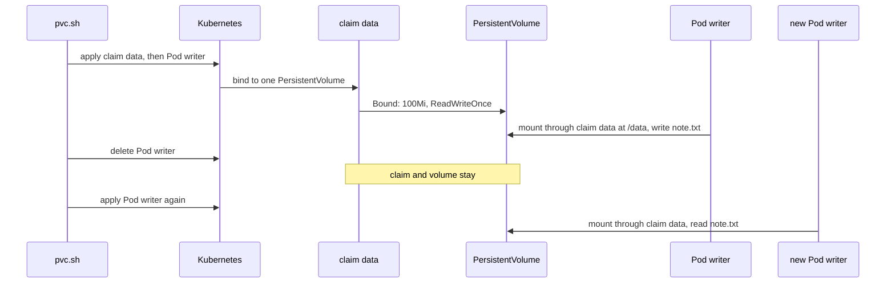

## Before you start

- [[k8s.l1.deploying-don-hang]] — `db` runs as a one-replica Deployment that keeps its data in an `emptyDir`; this lesson replaces that weak spot.
- [[k8s.l1.configmap-files]] — a Pod lists its volumes under `volumes` and mounts each one on a folder; a claim is one more kind of volume.
- [[devops.l1.volumes]] — in Compose, the named volume `db-data` kept every order when the container was removed; a claim plays that part in Kubernetes.

## The situation

On the cluster `donhang`, `deploy/k8s/db.yaml` runs PostgreSQL as a one-replica Deployment, with its data folder on an `emptyDir` volume. Suppose the `db` Pod is deleted, by you or because its node failed, and the Deployment starts a replacement that the api connects to again. Yet every order written since the deploy is gone. The replacement is a new Pod, and it began with an empty data folder: the old folder was deleted along with the old Pod. In Compose, the named volume `db-data` kept the files when the container was removed. What in Kubernetes keeps a database's files while the Pods that use them come and go?

## Core concepts

- `emptyDir` — a volume declared inside a Pod, created empty when the Pod starts on a node and deleted with the Pod.
- **PersistentVolume** — a piece of storage the cluster knows about, kept as an object of its own, apart from any Pod, and belonging to no namespace.
- **PersistentVolumeClaim (PVC)** — a request, in one namespace, for storage of a size and an access mode; Kubernetes binds it to one PersistentVolume.
- Access mode — how nodes may mount a volume; `ReadWriteOnce` means the volume can be mounted read-write by one node at a time.
- `persistentVolumeClaim` — the entry under a Pod's `volumes` that uses a claim, named by `claimName`.

## How it works



In the situation above, the `db` Pod's data folder sat on an `emptyDir`. Kubernetes creates that volume when the Pod is placed on a node and deletes it, files included, when the Pod is removed. A container restart inside the same Pod keeps it. A replacement Pod is a new Pod, so it gets a new, empty one.

A claim moves the storage out of the Pod. `pvc.sh` first applies the claim `data`, which asks for `100Mi` (100 mebibytes) with the access mode `ReadWriteOnce`. Then it applies the Pod `writer`, which names `data` under `volumes`. Kubernetes binds the claim to one PersistentVolume with at least that size and that mode, and the claim shows `Bound`. Where that PersistentVolume comes from in this cluster is the next lesson's subject.

On the Pod's node, the volume is mounted into the container at `/data`, and the script writes `note.txt` there. Deleting `writer` removes the Pod and nothing else. The claim stays `Bound` to the same PersistentVolume, and the file stays on it. A new Pod that names the same claim gets the same volume, so `cat` finds the file.

A Pod refers only to the claim, by name, in its own namespace; it never names the PersistentVolume. Once bound, the claim holds that PersistentVolume for itself, and no other claim is bound to it.

`ReadWriteOnce` counts nodes, not Pods. The script's last part starts `writer-2` on the node where `writer` runs, and both Pods write to the same file.

## In the Đơn Hàng system

```yaml file=deploy/k8s/lessons/data-writer-pod.yaml tag=stage-3 lines=1-21
# lesson: k8s.l2.persistent-volume-claims
# A Pod that mounts the claim data at /data. The volume is declared by the
# claim's name: deleting this Pod leaves the claim, and what is on its
# volume, for the next Pod that names it.
apiVersion: v1
kind: Pod
metadata:
  name: writer
  namespace: storage-lessons
spec:
  containers:
    - name: shell
      image: caddy:2.10.0
      command: ["sleep", "3600"]
      volumeMounts:
        - name: data
          mountPath: /data
  volumes:
    - name: data
      persistentVolumeClaim:
        claimName: data
```

Lines 18–21 are the whole link to the storage: the volume `data` is a `persistentVolumeClaim` entry naming the claim `data`. Lines 15–17 mount it at `/data`. Compare `deploy/k8s/db.yaml`, where the volume of the same name reads `emptyDir: {}`. The mount looks the same in both files; only the volume's source decides whether the files outlive the Pod. The claim itself is in `deploy/k8s/lessons/data-pvc.yaml`, which sets `accessModes: ["ReadWriteOnce"]` and requests `storage: 100Mi` in the same namespace. The image only supplies a shell here; the container runs `sleep 3600` only to stay up, so the script can run commands in it with `kubectl exec`.

```bash file=scripts/k8s/pvc.sh tag=stage-3 lines=24-47
echo "\$ kubectl exec writer -n storage-lessons -- sh -c 'echo \"order 13: written by \$(hostname)\" > /data/note.txt'"
kubectl exec writer -n storage-lessons -- sh -c 'echo "order 13: written by $(hostname)" > /data/note.txt'
# The Pod goes; the claim and its volume stay.
show kubectl delete pod writer -n storage-lessons
show kubectl get pvc data -n storage-lessons -o custom-columns=NAME:.metadata.name,STATUS:.status.phase
echo

# lesson: k8s.l2.persistent-volume-claims
# A new Pod from the same manifest mounts the same claim and finds the file.
show kubectl apply -f deploy/k8s/lessons/data-writer-pod.yaml
kubectl wait --for=condition=Ready pod/writer -n storage-lessons --timeout=180s >/dev/null
show kubectl exec writer -n storage-lessons -- cat /data/note.txt
echo

# ReadWriteOnce counts nodes, not Pods: a second Pod on the node where the
# volume is mounted uses it read-write at the same time.
node=$(kubectl get pod writer -n storage-lessons -o jsonpath='{.spec.nodeName}')
echo "\$ kubectl apply -f - (writer-2: the same Pod, on writer's node)"
sed -e 's/name: writer$/name: writer-2/' -e "s/^spec:$/spec:\n  nodeName: $node/" deploy/k8s/lessons/data-writer-pod.yaml \
  | kubectl apply -f -
kubectl wait --for=condition=Ready pod/writer-2 -n storage-lessons --timeout=180s >/dev/null
echo "\$ kubectl exec writer-2 -n storage-lessons -- sh -c 'echo \"order 14: written by \$(hostname)\" >> /data/note.txt; cat /data/note.txt'"
kubectl exec writer-2 -n storage-lessons -- sh -c 'echo "order 14: written by $(hostname)" >> /data/note.txt; cat /data/note.txt'
show kubectl get pods -n storage-lessons -o custom-columns=NAME:.metadata.name,STATUS:.status.phase
```

```text output=true
$ kubectl apply -f deploy/k8s/lessons/data-pvc.yaml
persistentvolumeclaim/data created
$ kubectl apply -f deploy/k8s/lessons/data-writer-pod.yaml
pod/writer created
$ kubectl get pvc data -n storage-lessons -o custom-columns=NAME:.metadata.name,STATUS:.status.phase,CAPACITY:.status.capacity.storage,ACCESS:.spec.accessModes[0]
NAME   STATUS   CAPACITY   ACCESS
data   Bound    100Mi      ReadWriteOnce

$ kubectl exec writer -n storage-lessons -- sh -c 'echo "order 13: written by $(hostname)" > /data/note.txt'
$ kubectl delete pod writer -n storage-lessons
pod "writer" deleted from storage-lessons namespace
$ kubectl get pvc data -n storage-lessons -o custom-columns=NAME:.metadata.name,STATUS:.status.phase
NAME   STATUS
data   Bound

$ kubectl apply -f deploy/k8s/lessons/data-writer-pod.yaml
pod/writer created
$ kubectl exec writer -n storage-lessons -- cat /data/note.txt
order 13: written by writer

$ kubectl apply -f - (writer-2: the same Pod, on writer's node)
pod/writer-2 created
$ kubectl exec writer-2 -n storage-lessons -- sh -c 'echo "order 14: written by $(hostname)" >> /data/note.txt; cat /data/note.txt'
order 13: written by writer
order 14: written by writer-2
$ kubectl get pods -n storage-lessons -o custom-columns=NAME:.metadata.name,STATUS:.status.phase
NAME       STATUS
writer     Running
writer-2   Running
nodes they run on: 1
```

Above the excerpt, the script creates the namespace `storage-lessons`, applies the claim and the Pod, and prints the claim's status: `Bound`, `100Mi`, `ReadWriteOnce`. `show` prints a command after `$`, then runs it; an `echo "\$ ..."` line does the same by hand, and the next line runs the command. `-o custom-columns=...` makes kubectl print only the listed columns; plain `kubectl get pvc` prints more, including `VOLUME`. After `kubectl delete pod`, the claim still reads `Bound`.

The second `writer` is a new Pod from the same manifest. `$(hostname)` inserts the name the container sees as its own; in a Pod, that name is the Pod's name. Both Pods were called `writer`, so `order 13: written by writer` is the first Pod's line.

Line 40, `node=$(...)`, reads which node `writer` runs on. Lines 42–43 apply a copy of the manifest named `writer-2` with `nodeName` set to that node, a field that places a Pod on one node directly (`sed` edits the file's text on its way to `kubectl apply -f -`). `writer-2` appends its own line and prints both. Two Pods are `Running`, and the script's last count, below the excerpt, finds them on one node.

## Seniors often assume…

- **"A volume declared inside a Pod keeps its data after the Pod is deleted."** → Actually an `emptyDir` lives and dies with its Pod, because Kubernetes creates it for that Pod and removes it with that Pod. A volume that names a claim leaves its data outside the Pod, on the claim's PersistentVolume. You notice this when a replacement `db` Pod runs the init scripts again, which the PostgreSQL image does only on an empty data folder.
- **"`ReadWriteOnce` means only one Pod can ever use the volume."** → Actually it means the volume can be mounted read-write by one node at a time; several Pods on that node can use it together. If you need a single writer, this mode alone does not give it. You notice this when the script's `writer-2` appends a line to the file `writer` wrote, while both Pods are `Running`.
- **"A PersistentVolumeClaim is the storage itself rather than a request for it."** → Actually the claim holds a size, an access mode and, once bound, the name of its PersistentVolume; the files sit on the storage that PersistentVolume stands for. The claim lives in a namespace, the PersistentVolume in none. You notice this when `kubectl get pvc` without `-o custom-columns` shows a `VOLUME` column, and `kubectl get pv` lists that name as a separate object.

## Try it (3 minutes)

With the cluster `donhang` running (`scripts/k8s/cluster-up.sh`), in the `don-hang` folder:

1. Run `scripts/k8s/pvc.sh`.
2. Find the line printed by the first `cat /data/note.txt`, right after `pod/writer created` appears for the second time.

Expected result: the output matches the one shown above. The line is `order 13: written by writer`, read by a Pod that did not exist when the file was written; the last line is `nodes they run on: 1`.

## Connections

- [[devops.l1.volumes]] — the same idea one layer down: Compose's named volume outlives a container, as a claim outlives a Pod.
- [[k8s.l2.storage-classes]] — next: where this cluster's PersistentVolume came from, and the node it stays on.
- [[k8s.l2.statefulsets]] — builds on this: `db` gets its own claim, so a replacement `db` Pod finds the orders again.
- [[devops.l3.rpo-and-rto]] — a claim covers one failure, a replaced Pod; a recovery target has to plan for the others too.

## Five-line summary

1. A PersistentVolumeClaim ties a Pod to a PersistentVolume that lives apart from any Pod, so a replacement Pod naming the claim finds the same files.
2. An `emptyDir` is created with its Pod and deleted with it, which is why a new `db` Pod starts empty.
3. A claim asks for a size and an access mode; Kubernetes binds it to one PersistentVolume, the storage itself.
4. A Pod uses a claim under `volumes` with `persistentVolumeClaim` and `claimName`, and mounts it like any volume.
5. `ReadWriteOnce` means the volume can be mounted read-write by one node at a time, so several Pods on that node can share it.
