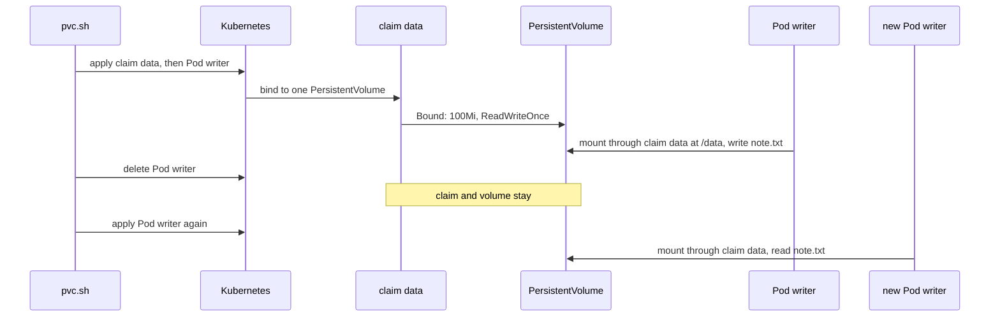

## Bạn cần biết trước

- [[k8s.l1.deploying-don-hang]] — `db` chạy thành một Deployment một replica, giữ dữ liệu trong một `emptyDir`; bài này thay chỗ yếu đó.
- [[k8s.l1.configmap-files]] — Pod liệt kê volume dưới `volumes` và mount từng cái lên một thư mục; claim chỉ là thêm một loại volume.
- [[devops.l1.volumes]] — trong Compose, named volume `db-data` giữ lại mọi đơn hàng khi container bị xóa; trong Kubernetes, claim đóng vai đó.

## Tình huống

Trên cluster `donhang`, `deploy/k8s/db.yaml` chạy PostgreSQL thành một Deployment một replica, thư mục dữ liệu nằm trên một volume `emptyDir`. Giả sử Pod `db` bị xóa, do bạn hoặc do node của nó hỏng, và Deployment khởi động một Pod thay thế, api kết nối lại được. Vậy mà mọi đơn hàng ghi từ lúc deploy đều mất. Pod thay thế là một Pod mới, và nó bắt đầu với thư mục dữ liệu trống: thư mục cũ đã bị xóa cùng Pod cũ. Trong Compose, named volume `db-data` giữ lại file khi container bị xóa. Trong Kubernetes, thứ gì giữ file của database trong khi các Pod dùng chúng đến rồi đi?

## Khái niệm cốt lõi

- `emptyDir` — volume khai báo ngay trong Pod, được tạo trống khi Pod khởi động trên một node và bị xóa cùng Pod.
- **PersistentVolume** (một phần lưu trữ cluster biết tới, sống độc lập với Pod dùng nó) — một phần lưu trữ mà cluster biết tới, là một object riêng, tách khỏi mọi Pod, và không thuộc namespace nào.
- **PersistentVolumeClaim (PVC)** (yêu cầu lưu trữ (dung lượng, access mode) trong một namespace; Kubernetes gắn nó với một PersistentVolume) — một yêu cầu, trong một namespace, xin lưu trữ với một dung lượng và một access mode; Kubernetes bind nó với đúng một PersistentVolume.
- Access mode — cách các node được phép mount một volume; `ReadWriteOnce` nghĩa là tại mỗi thời điểm chỉ một node mount được volume ở chế độ đọc-ghi.
- `persistentVolumeClaim` — mục dưới `volumes` của Pod dùng một claim, chỉ tới claim bằng `claimName`.

## Cơ chế hoạt động



Trong tình huống trên, thư mục dữ liệu của Pod `db` nằm trên một `emptyDir`. Kubernetes tạo volume đó khi Pod được đặt lên một node, và xóa nó, cả file bên trong, khi Pod bị gỡ. Container khởi động lại trong cùng Pod thì volume vẫn còn. Pod thay thế là một Pod mới, nên nó nhận một volume mới, trống trơn.

Claim đưa phần lưu trữ ra khỏi Pod. `pvc.sh` apply claim `data` trước, xin `100Mi` (100 mebibyte) với access mode `ReadWriteOnce`. Sau đó nó apply Pod `writer`, Pod này ghi tên `data` dưới `volumes`. Kubernetes bind claim với một PersistentVolume có dung lượng ít nhất bằng chừng đó và đúng mode đó, và claim hiện `Bound`. PersistentVolume đó từ đâu ra trong cluster này là chủ đề của bài sau.

Trên node của Pod, volume được mount vào container tại `/data`, và script ghi `note.txt` vào đó. Xóa `writer` chỉ gỡ Pod, không đụng gì khác. Claim vẫn `Bound` với cùng PersistentVolume, và file vẫn nằm trên đó. Một Pod mới ghi tên cùng claim sẽ nhận cùng volume, nên `cat` tìm thấy file.

Pod chỉ nhắc tới claim, bằng tên, trong namespace của chính nó; Pod không bao giờ ghi tên PersistentVolume. Khi đã bind, claim giữ riêng PersistentVolume đó, và không claim nào khác được bind vào nữa.

`ReadWriteOnce` đếm node, không đếm Pod. Phần cuối script khởi động `writer-2` trên node mà `writer` đang chạy, và cả hai Pod cùng ghi vào một file.

## Trong hệ thống Đơn Hàng

```yaml file=deploy/k8s/lessons/data-writer-pod.yaml tag=stage-3 lines=1-21
# lesson: k8s.l2.persistent-volume-claims
# A Pod that mounts the claim data at /data. The volume is declared by the
# claim's name: deleting this Pod leaves the claim, and what is on its
# volume, for the next Pod that names it.
apiVersion: v1
kind: Pod
metadata:
  name: writer
  namespace: storage-lessons
spec:
  containers:
    - name: shell
      image: caddy:2.10.0
      command: ["sleep", "3600"]
      volumeMounts:
        - name: data
          mountPath: /data
  volumes:
    - name: data
      persistentVolumeClaim:
        claimName: data
```

Dòng 18–21 là toàn bộ mối nối tới phần lưu trữ: volume `data` là một mục `persistentVolumeClaim` ghi tên claim `data`. Dòng 15–17 mount nó tại `/data`. So với `deploy/k8s/db.yaml`, nơi volume cùng tên ghi `emptyDir: {}`, phần mount ở hai file trông giống hệt nhau. Chỉ nguồn của volume quyết định file có sống lâu hơn Pod hay không. Bản thân claim nằm trong `deploy/k8s/lessons/data-pvc.yaml`, đặt `accessModes: ["ReadWriteOnce"]` và xin `storage: 100Mi` trong cùng namespace. Ở đây image chỉ để có shell; container chạy `sleep 3600` chỉ để tiếp tục chạy, nhờ đó script chạy lệnh bên trong nó bằng `kubectl exec` được.

```bash file=scripts/k8s/pvc.sh tag=stage-3 lines=24-47
echo "\$ kubectl exec writer -n storage-lessons -- sh -c 'echo \"order 13: written by \$(hostname)\" > /data/note.txt'"
kubectl exec writer -n storage-lessons -- sh -c 'echo "order 13: written by $(hostname)" > /data/note.txt'
# The Pod goes; the claim and its volume stay.
show kubectl delete pod writer -n storage-lessons
show kubectl get pvc data -n storage-lessons -o custom-columns=NAME:.metadata.name,STATUS:.status.phase
echo

# lesson: k8s.l2.persistent-volume-claims
# A new Pod from the same manifest mounts the same claim and finds the file.
show kubectl apply -f deploy/k8s/lessons/data-writer-pod.yaml
kubectl wait --for=condition=Ready pod/writer -n storage-lessons --timeout=180s >/dev/null
show kubectl exec writer -n storage-lessons -- cat /data/note.txt
echo

# ReadWriteOnce counts nodes, not Pods: a second Pod on the node where the
# volume is mounted uses it read-write at the same time.
node=$(kubectl get pod writer -n storage-lessons -o jsonpath='{.spec.nodeName}')
echo "\$ kubectl apply -f - (writer-2: the same Pod, on writer's node)"
sed -e 's/name: writer$/name: writer-2/' -e "s/^spec:$/spec:\n  nodeName: $node/" deploy/k8s/lessons/data-writer-pod.yaml \
  | kubectl apply -f -
kubectl wait --for=condition=Ready pod/writer-2 -n storage-lessons --timeout=180s >/dev/null
echo "\$ kubectl exec writer-2 -n storage-lessons -- sh -c 'echo \"order 14: written by \$(hostname)\" >> /data/note.txt; cat /data/note.txt'"
kubectl exec writer-2 -n storage-lessons -- sh -c 'echo "order 14: written by $(hostname)" >> /data/note.txt; cat /data/note.txt'
show kubectl get pods -n storage-lessons -o custom-columns=NAME:.metadata.name,STATUS:.status.phase
```

```text output=true
$ kubectl apply -f deploy/k8s/lessons/data-pvc.yaml
persistentvolumeclaim/data created
$ kubectl apply -f deploy/k8s/lessons/data-writer-pod.yaml
pod/writer created
$ kubectl get pvc data -n storage-lessons -o custom-columns=NAME:.metadata.name,STATUS:.status.phase,CAPACITY:.status.capacity.storage,ACCESS:.spec.accessModes[0]
NAME   STATUS   CAPACITY   ACCESS
data   Bound    100Mi      ReadWriteOnce

$ kubectl exec writer -n storage-lessons -- sh -c 'echo "order 13: written by $(hostname)" > /data/note.txt'
$ kubectl delete pod writer -n storage-lessons
pod "writer" deleted from storage-lessons namespace
$ kubectl get pvc data -n storage-lessons -o custom-columns=NAME:.metadata.name,STATUS:.status.phase
NAME   STATUS
data   Bound

$ kubectl apply -f deploy/k8s/lessons/data-writer-pod.yaml
pod/writer created
$ kubectl exec writer -n storage-lessons -- cat /data/note.txt
order 13: written by writer

$ kubectl apply -f - (writer-2: the same Pod, on writer's node)
pod/writer-2 created
$ kubectl exec writer-2 -n storage-lessons -- sh -c 'echo "order 14: written by $(hostname)" >> /data/note.txt; cat /data/note.txt'
order 13: written by writer
order 14: written by writer-2
$ kubectl get pods -n storage-lessons -o custom-columns=NAME:.metadata.name,STATUS:.status.phase
NAME       STATUS
writer     Running
writer-2   Running
nodes they run on: 1
```

Phía trên đoạn trích, script tạo namespace `storage-lessons`, apply claim và Pod, rồi in trạng thái của claim: `Bound`, `100Mi`, `ReadWriteOnce`. `show` in lệnh ra sau dấu `$` rồi chạy nó; dòng `echo "\$ ..."` làm điều tương tự bằng tay, và dòng kế tiếp chạy lệnh. `-o custom-columns=...` khiến kubectl chỉ in các cột được liệt kê; `kubectl get pvc` để trơn in nhiều hơn, trong đó có `VOLUME`. Sau `kubectl delete pod`, claim vẫn ghi `Bound`.

`writer` thứ hai là một Pod mới, dựng từ cùng manifest. `$(hostname)` chèn vào cái tên mà container coi là tên của mình; trong một Pod, đó là tên Pod. Cả hai Pod đều tên `writer`, nên `order 13: written by writer` là dòng của Pod đầu tiên.

Dòng 40, `node=$(...)`, đọc xem `writer` đang chạy trên node nào. Dòng 42–43 apply một bản sao manifest tên `writer-2`, có `nodeName` đặt bằng node đó; field này đặt thẳng một Pod lên một node (`sed` sửa nội dung file trên đường đi tới `kubectl apply -f -`). `writer-2` nối thêm dòng của nó rồi in cả hai. Hai Pod đều `Running`, và lần đếm cuối của script, bên dưới đoạn trích, thấy chúng trên cùng một node.

## Senior hay nhầm rằng…

- **"Volume khai báo trong Pod vẫn giữ dữ liệu sau khi Pod bị xóa."** → Thực ra `emptyDir` sống và chết cùng Pod của nó, vì Kubernetes tạo nó cho Pod đó và gỡ nó cùng Pod đó. Volume ghi tên một claim thì để dữ liệu bên ngoài Pod, trên PersistentVolume của claim. Bạn sẽ nhận ra khi một Pod `db` thay thế chạy lại các init script, điều image PostgreSQL chỉ làm khi thư mục dữ liệu trống.
- **"`ReadWriteOnce` nghĩa là chỉ một Pod được dùng volume."** → Thực ra nó nghĩa là tại mỗi thời điểm chỉ một node mount được volume ở chế độ đọc-ghi; nhiều Pod trên node đó vẫn dùng chung được. Nếu bạn cần đúng một bên ghi, riêng mode này không đảm bảo điều đó. Bạn sẽ nhận ra khi `writer-2` của script nối thêm một dòng vào file mà `writer` đã ghi, trong lúc cả hai Pod đều `Running`.
- **"PersistentVolumeClaim chính là phần lưu trữ, chứ không phải lời xin lưu trữ."** → Thực ra claim chỉ chứa dung lượng, access mode và, khi đã bind, tên PersistentVolume của nó; file nằm trên phần lưu trữ mà PersistentVolume đại diện. Claim thuộc một namespace, PersistentVolume thì không thuộc namespace nào. Bạn sẽ nhận ra khi `kubectl get pvc` không có `-o custom-columns` hiện cột `VOLUME`, và `kubectl get pv` liệt kê tên đó như một object riêng.

## Thử ngay (3 phút)

Với cluster `donhang` đang chạy (`scripts/k8s/cluster-up.sh`), trong thư mục `don-hang`:

1. Chạy `scripts/k8s/pvc.sh`.
2. Tìm dòng do lệnh `cat /data/note.txt` đầu tiên in ra, ngay sau lần thứ hai `pod/writer created` xuất hiện.

Kết quả mong đợi: output khớp với output ở trên. Dòng đó là `order 13: written by writer`, được đọc bởi một Pod chưa tồn tại lúc file được ghi; dòng cuối là `nodes they run on: 1`.

## Liên hệ

- [[devops.l1.volumes]] — cùng ý tưởng ở tầng dưới: named volume của Compose sống lâu hơn container, như claim sống lâu hơn Pod.
- [[k8s.l2.storage-classes]] — bài tiếp: PersistentVolume của cluster này từ đâu ra, và nó nằm lại trên node nào.
- [[k8s.l2.statefulsets]] — xây tiếp trên bài này: `db` có claim riêng, nên Pod `db` thay thế tìm lại được các đơn hàng.
- [[devops.l3.rpo-and-rto]] — claim chỉ che được một kiểu sự cố, Pod bị thay; mục tiêu khôi phục còn phải tính tới các kiểu khác.

## Tóm tắt 5 dòng

1. PersistentVolumeClaim nối Pod với một PersistentVolume sống tách khỏi mọi Pod, nên Pod thay thế ghi tên claim sẽ thấy lại đúng các file cũ.
2. `emptyDir` được tạo cùng Pod và bị xóa cùng Pod, vì thế Pod `db` mới bắt đầu trống.
3. Claim xin một dung lượng và một access mode; Kubernetes bind nó với một PersistentVolume, tức chính phần lưu trữ.
4. Pod dùng claim dưới `volumes` bằng `persistentVolumeClaim` và `claimName`, rồi mount nó như mọi volume khác.
5. `ReadWriteOnce` nghĩa là tại mỗi thời điểm chỉ một node mount được volume ở chế độ đọc-ghi, nên nhiều Pod trên node đó dùng chung được.
