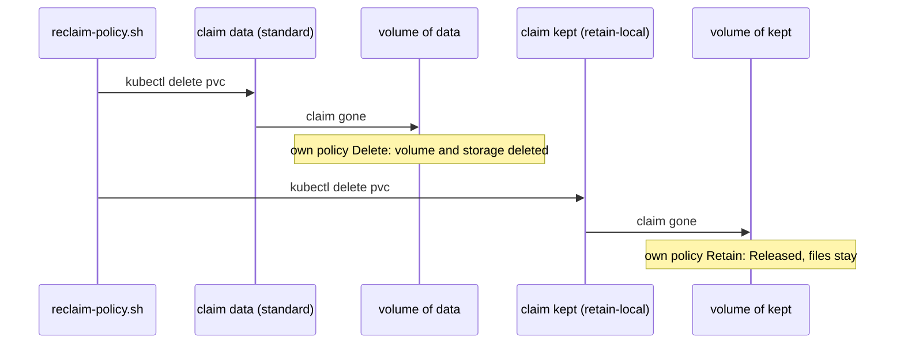

## Before you start

- [[k8s.l2.storage-classes]] — `standard` created the PersistentVolume for the claim `data`, and its `RECLAIMPOLICY` column read `Delete`; this lesson explains that column.
- [[devops.l3.self-heal]] — with `prune: true`, Argo CD deletes an object whose manifest left Git; a claim is one such object.
- [[k8s.l1.namespaces]] — a claim lives in a namespace, a PersistentVolume in none; deleting a namespace deletes what is in it.

## The situation

You plan to give `db` a claim of its own, and staging follows its config repository through `apps/staging.yaml`, with prune on. Two everyday actions now look risky: a teammate tidies the folder and a commit drops a manifest, or you run `kubectl delete namespace storage-lessons` to start the lab over. Both delete claims. A claim was only a request for storage, and the PersistentVolume is an object of its own, outside any namespace, so you might expect the volume and the orders on it to stay behind. When a claim is deleted, what happens to its PersistentVolume and the files on it?

## Core concepts

- **reclaim policy** — the setting of a PersistentVolume, in the field `persistentVolumeReclaimPolicy`, that decides what happens to it once its claim is deleted.
- `reclaimPolicy` of a StorageClass — the reclaim policy given to every PersistentVolume that the class creates; kind's `standard` sets `Delete`.
- `Delete` — when the claim is deleted, the PersistentVolume is deleted, and so is the storage behind it, files included.
- `Retain` — when the claim is deleted, the PersistentVolume and its files stay.
- `Released` — the status (the `STATUS` column) of a kept PersistentVolume whose claim is gone: it still records that claim, and is not handed to a new claim until someone deals with it by hand, for example by deleting the PersistentVolume with `kubectl`, as `reclaim-policy.sh` does at its end.

## How it works



In the situation above, what Kubernetes does once a claim is deleted is written in its volume, as the reclaim policy. A dynamically provisioned volume copies the policy of its StorageClass when it is created. Every claim so far came from `standard`, so every volume carried `Delete`.

`reclaim-policy.sh` sets two claims side by side. `data` names no class and gets `standard`. `kept` names `retain-local`, a class with the same provisioner and `Retain`. The Pod `writer` names both claims as its volumes, and both volumes turn `Bound`. Then the script deletes the Pod and both claims.

With `Delete`, the volume of `data` disappears from `kubectl get pv`, and the storage behind it is deleted with it: the data is gone. With `Retain`, the volume of `kept` stays, now `Released`. Its folder, and whatever is in it, stays, but no new claim is bound to that volume until someone deals with it by hand. A new claim of `retain-local` would get a new, empty volume instead.

The script then creates `data` again and deletes the whole namespace. Deleting a namespace deletes every claim in it, and each volume follows its own policy, so the volume of `data` goes too.

Argo CD reaches the same result through Git. With prune on, a commit that removes a claim's manifest makes the next sync delete the claim, and with `Delete` its data goes too. A class with `Retain` suits data you would rather clean up by hand than lose to one mistaken delete; the cost is volumes that pile up as `Released`.

## In the Đơn Hàng system

```yaml file=deploy/k8s/lessons/retain-storageclass.yaml tag=stage-3 lines=1-11
# lesson: k8s.l2.reclaim-policy
# The same provisioner as kind's standard, with one change: Retain. When a
# claim of this class is deleted, its PersistentVolume and the files on it
# stay, Released, until someone deals with them by hand.
apiVersion: storage.k8s.io/v1
kind: StorageClass
metadata:
  name: retain-local
provisioner: rancher.io/local-path
reclaimPolicy: Retain
volumeBindingMode: WaitForFirstConsumer
```

Line 9 names the provisioner that `standard` uses, and line 11 the binding mode `standard` has (`WaitForFirstConsumer`: wait for the first Pod using the claim before creating the volume), so volumes of this class are made the same way. Apart from its name, and `standard` being the default class, line 10 is the only difference. A claim picks this class by naming it in `storageClassName`; the script does that for `kept` by adding the line `storageClassName: retain-local` to a copy of the `data` manifest, above the excerpt. Nothing in the claim itself chooses the policy.

`volumes`, defined above the excerpt, lists the PersistentVolumes of claims named `data` or `kept` in four columns: the claim the volume records, its class, its policy and its status. `show` prints a command after `$`, then runs it. Above the excerpt, the script applies `retain-local`, creates both claims and `writer`, and prints them `Bound`.

```bash file=scripts/k8s/reclaim-policy.sh tag=stage-3 lines=37-56
# lesson: k8s.l2.reclaim-policy
# Delete both claims. Delete removes data's PersistentVolume and the files
# on it; Retain keeps kept's, Released: bound to nothing, and no new claim
# is bound to it until someone deals with it by hand.
show kubectl delete pod writer -n storage-lessons
show kubectl delete pvc data kept -n storage-lessons
sleep 10
echo "== the PersistentVolumes left"
volumes
echo

# Deleting a namespace deletes its claims, so a claim of standard takes its
# data along with the namespace.
kubectl apply -f deploy/k8s/lessons/data-pvc.yaml >/dev/null
kubectl apply -f deploy/k8s/lessons/data-writer-pod.yaml >/dev/null
kubectl wait --for=condition=Ready pod/writer -n storage-lessons --timeout=180s >/dev/null
show kubectl delete namespace storage-lessons
sleep 10
echo "== the PersistentVolumes left"
volumes
```

```text output=true
$ kubectl apply -f deploy/k8s/lessons/retain-storageclass.yaml
storageclass.storage.k8s.io/retain-local created
$ kubectl get storageclass
NAME                 PROVISIONER             RECLAIMPOLICY   VOLUMEBINDINGMODE      ALLOWVOLUMEEXPANSION   AGE
retain-local         rancher.io/local-path   Retain          WaitForFirstConsumer   false                  ...
standard (default)   rancher.io/local-path   Delete          WaitForFirstConsumer   false                  ...

== the claims data (standard) and kept (retain-local), bound
CLAIM   CLASS          RECLAIM   STATUS
data    standard       Delete    Bound
kept    retain-local   Retain    Bound

$ kubectl delete pod writer -n storage-lessons
pod "writer" deleted from storage-lessons namespace
$ kubectl delete pvc data kept -n storage-lessons
persistentvolumeclaim "data" deleted from storage-lessons namespace
persistentvolumeclaim "kept" deleted from storage-lessons namespace
== the PersistentVolumes left
CLAIM   CLASS          RECLAIM   STATUS
kept    retain-local   Retain    Released

$ kubectl delete namespace storage-lessons
namespace "storage-lessons" deleted
== the PersistentVolumes left
CLAIM   CLASS          RECLAIM   STATUS
kept    retain-local   Retain    Released
```

Line 41 deletes `writer`, the Pod that uses both claims; line 42 deletes the two claims, and line 43 waits ten seconds before listing. Only `kept`'s volume is left, `Released`, and its `CLAIM` column still names `kept`, the claim that no longer exists. Lines 50–53 create `data` and `writer` again, then delete the namespace. The second list is the same as the first: the new volume of `data` is gone, and `kept`'s is still `Released`. Below the excerpt, the script deletes that volume and `retain-local`; its comment notes that the provisioner `rancher.io/local-path` leaves the `Released` volume's folder on its node even then.

## Seniors often assume…

- **"Deleting a namespace leaves its volumes' data behind for later."** → Actually deleting a namespace deletes every claim in it, and each claim's PersistentVolume then follows its reclaim policy. With `Delete`, the volume and its files go, even though the volume belonged to no namespace. You notice this when the list printed after `kubectl delete namespace storage-lessons` has no `data` line.
- **"A `Released` volume is bound again automatically to the next claim that asks."** → Actually a `Released` volume still records the claim it had, and Kubernetes binds no new claim to it. A new claim of the same class gets a new, empty volume from the provisioner. You notice this when a re-created claim reads `Bound` while `kubectl get pv` lists the old volume, `Released`, next to a new one.
- **"A `Retain` policy is as good as a backup."** → Actually `Retain` only keeps the single copy where it was — in kind, a folder on one node — after its claim is deleted. Losing that node or the cluster takes it, and a wrong write by the application lands in those same files. A backup is a separate copy kept somewhere else. You notice this when you delete and rebuild the cluster `donhang` and the `Released` volume is no longer in `kubectl get pv`.

## Try it (3 minutes)

With the cluster `donhang` running (`scripts/k8s/cluster-up.sh`), in the `don-hang` folder:

1. Run `scripts/k8s/reclaim-policy.sh`.
2. Compare the list under `== the claims data (standard) and kept (retain-local), bound` with the two lists under `== the PersistentVolumes left`.

Expected result: the output matches the one shown above. The first list has `data` and `kept`, both `Bound`; each later list has only `kept    retain-local   Retain    Released`.

## Connections

- [[k8s.l2.storage-classes]] — prerequisite: the class that made the volume also set the policy that ends it.
- [[k8s.l2.statefulsets]] — next: `db` gets claims of its own, which by default stay in place when the object that made them is deleted.
- [[k8s.l2.scheduled-backups]] — the answer to what `Retain` cannot do: a copy of the data kept apart from its volume.
- [[devops.l3.restore-testing]] — the same caution one layer up: data counts as kept only once you have brought it back.

## Five-line summary

1. A PersistentVolume's reclaim policy decides its fate when its claim is deleted: `Delete` removes it and its data, `Retain` keeps both.
2. A dynamically provisioned volume takes the policy of its StorageClass; kind's `standard` sets `Delete`.
3. Deleting a namespace deletes its claims, and a commit removing a claim's manifest does the same under Argo CD with prune on.
4. With `Retain`, the volume stays `Released`, and no new claim is bound to it until someone deals with it by hand.
5. `Retain` keeps the one copy in place; in kind, a folder on one node, gone with the node or cluster, so no backup.
