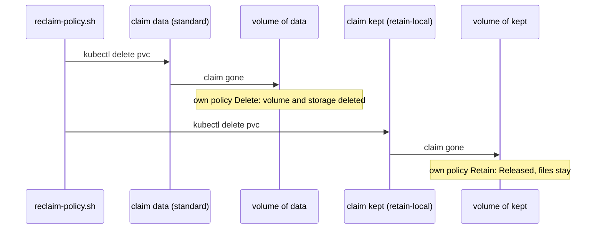

## Bạn cần biết trước

- [[k8s.l2.storage-classes]] — `standard` đã tạo PersistentVolume cho claim `data`, và cột `RECLAIMPOLICY` của nó ghi `Delete`; bài này giải thích cột đó.
- [[devops.l3.self-heal]] — với `prune: true`, Argo CD xóa object nào có manifest đã rời khỏi Git; claim cũng là một object như thế.
- [[k8s.l1.namespaces]] — claim nằm trong một namespace, PersistentVolume thì không thuộc namespace nào; xóa namespace là xóa mọi thứ bên trong nó.

## Tình huống

Bạn định cho `db` một claim riêng, còn staging bám theo config repository của nó qua `apps/staging.yaml`, có bật prune. Lúc này hai thao tác thường ngày bỗng trở nên đáng lo: một đồng đội dọn thư mục và một commit làm rơi mất một manifest, hoặc bạn chạy `kubectl delete namespace storage-lessons` để làm lại bài lab từ đầu. Cả hai đều xóa claim. Claim chỉ là lời xin lưu trữ, còn PersistentVolume là một object riêng, nằm ngoài mọi namespace, nên bạn có thể nghĩ volume và các đơn hàng trên đó sẽ còn lại. Khi một claim bị xóa, PersistentVolume của nó và các file trên đó ra sao?

## Khái niệm cốt lõi

- **reclaim policy** (quy định PersistentVolume bị xóa (Delete) hay giữ lại (Retain) khi claim của nó bị xóa) — thiết lập của một PersistentVolume, nằm ở field `persistentVolumeReclaimPolicy`, quyết định số phận của volume khi claim của nó bị xóa.
- `reclaimPolicy` của StorageClass — reclaim policy gán cho mọi PersistentVolume mà class đó tạo ra; `standard` của kind đặt `Delete`.
- `Delete` — khi claim bị xóa, PersistentVolume bị xóa, kéo theo phần lưu trữ phía sau, cả file bên trong.
- `Retain` — khi claim bị xóa, PersistentVolume và các file của nó vẫn còn.
- `Released` — trạng thái (cột `STATUS`) của một PersistentVolume được giữ lại sau khi claim đã mất: volume vẫn ghi tên claim cũ, và không được giao cho claim mới nào cho tới khi có người xử lý bằng tay, chẳng hạn xóa PersistentVolume bằng `kubectl` như `reclaim-policy.sh` làm ở cuối.

## Cơ chế hoạt động



Trong tình huống trên, Kubernetes làm gì sau khi một claim bị xóa được ghi ngay trong volume của claim, dưới dạng reclaim policy. Volume tạo bằng dynamic provisioning chép policy của StorageClass lúc được tạo. Mọi claim từ trước tới giờ đều đến từ `standard`, nên mọi volume đều mang `Delete`.

`reclaim-policy.sh` đặt hai claim cạnh nhau. `data` không ghi tên class nào nên nhận `standard`. `kept` ghi tên `retain-local`, một class có cùng provisioner nhưng đặt `Retain`. Pod `writer` ghi tên cả hai claim làm volume, và cả hai volume chuyển sang `Bound`. Sau đó script xóa Pod và cả hai claim.

Với `Delete`, volume của `data` biến mất khỏi `kubectl get pv`, phần lưu trữ phía sau cũng bị xóa theo: dữ liệu không còn. Với `Retain`, volume của `kept` vẫn còn, giờ ở trạng thái `Released`. Thư mục của nó và mọi thứ bên trong vẫn nằm đó, nhưng không claim mới nào được bind vào volume này cho tới khi có người xử lý bằng tay. Một claim mới của `retain-local` sẽ nhận một volume mới, trống.

Tiếp theo, script tạo lại `data` rồi xóa cả namespace. Xóa namespace là xóa mọi claim trong đó, và mỗi volume làm theo policy của chính nó, nên volume của `data` cũng mất.

Argo CD dẫn tới cùng kết quả qua đường Git. Khi bật prune, một commit gỡ manifest của claim khiến lần sync kế tiếp xóa claim, và với `Delete` thì dữ liệu đi theo. Class đặt `Retain` hợp với dữ liệu mà bạn thà tự dọn bằng tay còn hơn mất vì một lệnh xóa nhầm; cái giá là các volume `Released` cứ chồng chất dần.

## Trong hệ thống Đơn Hàng

```yaml file=deploy/k8s/lessons/retain-storageclass.yaml tag=stage-3 lines=1-11
# lesson: k8s.l2.reclaim-policy
# The same provisioner as kind's standard, with one change: Retain. When a
# claim of this class is deleted, its PersistentVolume and the files on it
# stay, Released, until someone deals with them by hand.
apiVersion: storage.k8s.io/v1
kind: StorageClass
metadata:
  name: retain-local
provisioner: rancher.io/local-path
reclaimPolicy: Retain
volumeBindingMode: WaitForFirstConsumer
```

Dòng 9 ghi tên provisioner mà `standard` dùng, dòng 11 là binding mode của `standard` (`WaitForFirstConsumer`: chờ Pod đầu tiên dùng claim rồi mới tạo volume), nên volume của class này được tạo y hệt. Bỏ qua cái tên và vai trò class mặc định của `standard`, dòng 10 là khác biệt duy nhất. Claim chọn class này bằng cách ghi tên nó ở `storageClassName`; script làm vậy cho `kept` bằng cách thêm dòng `storageClassName: retain-local` vào một bản sao manifest của `data`, phía trên đoạn trích. Bản thân claim không có gì chọn policy.

`volumes`, định nghĩa phía trên đoạn trích, liệt kê PersistentVolume của các claim tên `data` hoặc `kept` thành bốn cột: claim mà volume ghi nhận, class, policy và trạng thái. `show` in lệnh ra sau dấu `$` rồi chạy nó. Phía trên đoạn trích, script apply `retain-local`, tạo cả hai claim và `writer`, rồi in chúng ở trạng thái `Bound`.

```bash file=scripts/k8s/reclaim-policy.sh tag=stage-3 lines=37-56
# lesson: k8s.l2.reclaim-policy
# Delete both claims. Delete removes data's PersistentVolume and the files
# on it; Retain keeps kept's, Released: bound to nothing, and no new claim
# is bound to it until someone deals with it by hand.
show kubectl delete pod writer -n storage-lessons
show kubectl delete pvc data kept -n storage-lessons
sleep 10
echo "== the PersistentVolumes left"
volumes
echo

# Deleting a namespace deletes its claims, so a claim of standard takes its
# data along with the namespace.
kubectl apply -f deploy/k8s/lessons/data-pvc.yaml >/dev/null
kubectl apply -f deploy/k8s/lessons/data-writer-pod.yaml >/dev/null
kubectl wait --for=condition=Ready pod/writer -n storage-lessons --timeout=180s >/dev/null
show kubectl delete namespace storage-lessons
sleep 10
echo "== the PersistentVolumes left"
volumes
```

```text output=true
$ kubectl apply -f deploy/k8s/lessons/retain-storageclass.yaml
storageclass.storage.k8s.io/retain-local created
$ kubectl get storageclass
NAME                 PROVISIONER             RECLAIMPOLICY   VOLUMEBINDINGMODE      ALLOWVOLUMEEXPANSION   AGE
retain-local         rancher.io/local-path   Retain          WaitForFirstConsumer   false                  ...
standard (default)   rancher.io/local-path   Delete          WaitForFirstConsumer   false                  ...

== the claims data (standard) and kept (retain-local), bound
CLAIM   CLASS          RECLAIM   STATUS
data    standard       Delete    Bound
kept    retain-local   Retain    Bound

$ kubectl delete pod writer -n storage-lessons
pod "writer" deleted from storage-lessons namespace
$ kubectl delete pvc data kept -n storage-lessons
persistentvolumeclaim "data" deleted from storage-lessons namespace
persistentvolumeclaim "kept" deleted from storage-lessons namespace
== the PersistentVolumes left
CLAIM   CLASS          RECLAIM   STATUS
kept    retain-local   Retain    Released

$ kubectl delete namespace storage-lessons
namespace "storage-lessons" deleted
== the PersistentVolumes left
CLAIM   CLASS          RECLAIM   STATUS
kept    retain-local   Retain    Released
```

Dòng 41 xóa `writer`, Pod dùng cả hai claim; dòng 42 xóa hai claim, và dòng 43 chờ mười giây trước khi liệt kê. Chỉ còn volume của `kept`, ở trạng thái `Released`, và cột `CLAIM` vẫn ghi `kept`, một claim không còn tồn tại. Dòng 50–53 tạo lại `data` và `writer`, rồi xóa namespace. Danh sách thứ hai giống hệt danh sách đầu: volume mới của `data` đã mất, còn volume của `kept` vẫn `Released`. Bên dưới đoạn trích, script xóa volume đó và `retain-local`; comment của nó lưu ý rằng provisioner `rancher.io/local-path` vẫn để lại thư mục của volume `Released` trên node, kể cả sau bước đó.

## Senior hay nhầm rằng…

- **"Xóa namespace thì dữ liệu trên các volume của nó vẫn để lại đó, dùng sau được."** → Thực ra xóa namespace là xóa mọi claim trong đó, rồi PersistentVolume của từng claim làm theo reclaim policy của nó. Với `Delete`, volume và file của nó đều mất, dù volume không thuộc namespace nào. Bạn sẽ nhận ra khi danh sách in ra sau `kubectl delete namespace storage-lessons` không còn dòng `data`.
- **"Volume `Released` sẽ tự động được bind lại cho claim kế tiếp xin lưu trữ."** → Thực ra volume `Released` vẫn ghi tên claim cũ, và Kubernetes không bind claim mới nào vào nó. Claim mới cùng class nhận một volume mới, trống, từ provisioner. Bạn sẽ nhận ra khi một claim tạo lại hiện `Bound` trong lúc `kubectl get pv` liệt kê volume cũ, `Released`, nằm cạnh một volume mới.
- **"Policy `Retain` tốt ngang một bản backup."** → Thực ra `Retain` chỉ giữ lại đúng một bản dữ liệu ở chỗ cũ — trong kind là một thư mục trên một node — sau khi claim bị xóa. Mất node đó hay mất cluster là mất luôn bản này, và một lần ứng dụng ghi sai cũng rơi vào chính những file đó. Backup là một bản sao riêng, cất ở nơi khác. Bạn sẽ nhận ra khi xóa rồi dựng lại cluster `donhang` và volume `Released` không còn trong `kubectl get pv`.

## Thử ngay (3 phút)

Với cluster `donhang` đang chạy (`scripts/k8s/cluster-up.sh`), trong thư mục `don-hang`:

1. Chạy `scripts/k8s/reclaim-policy.sh`.
2. So danh sách dưới `== the claims data (standard) and kept (retain-local), bound` với hai danh sách dưới `== the PersistentVolumes left`.

Kết quả mong đợi: output khớp với output ở trên. Danh sách đầu có `data` và `kept`, cả hai `Bound`; mỗi danh sách sau chỉ còn `kept    retain-local   Retain    Released`.

## Liên hệ

- [[k8s.l2.storage-classes]] — bài cần học trước: class tạo ra volume cũng là class đặt policy kết thúc nó.
- [[k8s.l2.statefulsets]] — bài tiếp: `db` có claim riêng, và mặc định các claim đó vẫn nằm lại khi object tạo ra chúng bị xóa.
- [[k8s.l2.scheduled-backups]] — lời đáp cho điều `Retain` không làm được: một bản sao dữ liệu cất tách khỏi volume của nó.
- [[devops.l3.restore-testing]] — cùng sự thận trọng ở tầng trên: dữ liệu chỉ tính là giữ được khi bạn đã khôi phục được nó.

## Tóm tắt 5 dòng

1. Reclaim policy của PersistentVolume quyết định số phận của nó khi claim bị xóa: `Delete` xóa volume và dữ liệu, `Retain` giữ cả hai.
2. Volume tạo bằng dynamic provisioning nhận policy của StorageClass; `standard` của kind đặt `Delete`.
3. Xóa namespace là xóa các claim trong đó, và dưới Argo CD có bật prune, một commit gỡ manifest của claim cũng làm điều tương tự.
4. Với `Retain`, volume ở lại trạng thái `Released`, và không claim mới nào được bind vào nó cho tới khi có người xử lý bằng tay.
5. `Retain` giữ đúng một bản tại chỗ, trong kind là một thư mục trên một node, mất theo node hay cluster, nên không phải backup.
