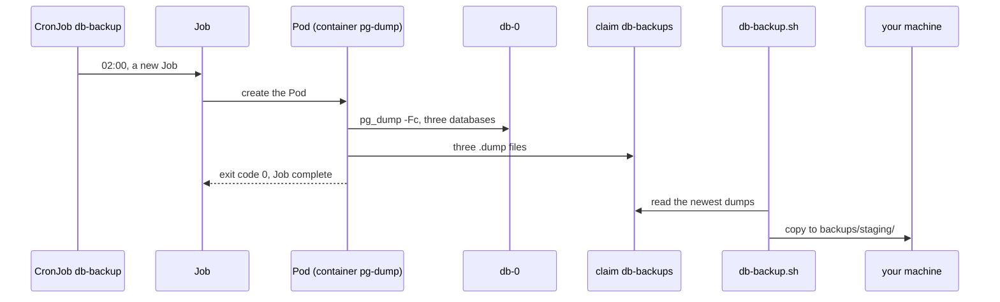

## Before you start

- [[k8s.l2.staging-keeps-its-data]] — staging's `db` keeps its data on the claim `data-db-0`, but only on staging's single node; this lesson copies that data elsewhere.
- [[devops.l3.logical-backups]] — `pg_dump -Fc` writes one database to a file; here a Pod in the cluster runs it for you.
- [[devops.l3.restore-testing]] — a backup counts only once a restore of it has been tested; the dumps copied here still need that test.

## The situation

Since the last lesson, staging keeps the orders you place on `data-db-0`, and they survive a deleted `db-0`. Yet the DR drill deletes the whole cluster, and every order placed since the seed goes with it. In Compose you ran `backup-logical.sh` by hand whenever you wanted a dump. Nobody will run a script against staging at two in the morning. You want the cluster itself to start a backup every night, and you want to know whether it worked. How does staging back up its databases on a schedule, and where must the dumps end up before they count?

## Core concepts

- **Job (Kubernetes)** — an object that runs a Pod from its template until the Pod exits successfully, trying again after a failure up to `backoffLimit` times, and then stops for good.
- **CronJob** — an object that creates a new Job from its `jobTemplate` each time its `schedule`, written in cron syntax, comes round.
- `concurrencyPolicy: Forbid` — a CronJob setting under which the CronJob does not start a new Job while the Job of the previous run is still running.
- `kubectl create job --from` — a command that creates a Job at once from a CronJob's template, without waiting for the schedule.
- The claim `db-backups` — a PersistentVolumeClaim of its own, next to `data-db-0`, that the backup Pods write their dumps to.

## How it works



In the situation above, the thing that starts a backup every night is the CronJob `db-backup`. A `schedule` has five fields, minute, hour, day of month, month and day of week, and `*` means every value. So `0 2 * * *` is minute 0 of hour 2, every day, in the time zone of the cluster's control plane. Then the CronJob creates a new Job from its `jobTemplate`, and the Job creates a Pod.

The Pod runs `pg_dump -Fc` for `donhang`, `donhang_notifications` and `donhang_payments`, from `db-0` through the Service `db`, and writes each dump to the claim `db-backups`. When the script ends with exit code `0`, the Pod has succeeded and the Job is complete. The Job does not start the Pod again after that. In a Deployment's Pod, a container that exits would be restarted, because those Pods exist to keep running, while a Job's Pod exists to finish.

If a `pg_dump` fails, `set -e` stops the script with a non-zero exit code, and the Pod fails. The Job then creates a new Pod, up to `backoffLimit: 2` more times, and is then marked failed. The CronJob does not try again either: its next Job comes at the next 02:00.

A dump can take longer one night than the next. With `concurrencyPolicy: Forbid`, the CronJob does not start a second Job of its own while the previous one is still running.

Up to that point, the dumps sit on one claim on staging's single node, next to `data-db-0`. The last two arrows make them a backup: `db-backup.sh` copies the newest dumps off the cluster, to `backups/staging/` on your machine. Nothing in staging makes that copy on its own: you run `db-backup.sh` by hand, so a nightly dump stays on the cluster until you do.

## In the Đơn Hàng system

```yaml file=deploy/gitops/config-repo-kustomize/base/db-backup.yaml tag=stage-3 lines=32-56
  schedule: "0 2 * * *"
  concurrencyPolicy: Forbid
  jobTemplate:
    spec:
      backoffLimit: 2
      template:
        metadata:
          labels:
            app: db-backup
        spec:
          restartPolicy: Never
          automountServiceAccountToken: false
          containers:
            - name: pg-dump
              image: postgres:17.6-alpine
              command:
                - sh
                - -c
                - |
                  set -e
                  stamp=$(date -u +%Y%m%dT%H%M%SZ)
                  for db in donhang donhang_notifications donhang_payments; do
                    pg_dump -Fc -h db -U donhang -d "$db" -f "/backups/$db-$stamp.dump"
                    echo "wrote $db-$stamp.dump"
                  done
```

Lines 32, 33 and 36 hold the three settings from the diagram: the schedule, the policy and the limit on retries. Line 42, `restartPolicy: Never`, means a failed container is not restarted inside the same Pod, so each retry is a new Pod. Line 43 only stops Kubernetes from giving the Pod credentials for the API server, which the backup does not need. Line 45 names the container `pg-dump`; the Pod's name is made from the Job's. Each dump's file name carries the time of the run, so a new night never overwrites an older dump.

Outside the excerpt, lines 57–69 take the password from the Secret `db` and mount the claim `db-backups` at `/backups`, and lines 1–17 declare that claim. Both objects are in sync wave 3, after everything else in staging.

```bash file=scripts/k8s/db-backup.sh tag=stage-3 lines=27-37
# lesson: k8s.l2.scheduled-backups
# No waiting for 02:00: a Job from the CronJob's template, started now.
# It runs its Pod until pg_dump has written all three dumps, and then stops.
kubectl delete job db-backup-now -n donhang --ignore-not-found >/dev/null
show kubectl create job db-backup-now --from=cronjob/db-backup -n donhang
kubectl wait --for=condition=Complete job/db-backup-now -n donhang --timeout=300s >/dev/null
app_wait_sync "$(config_head --verify)" >/dev/null
app_wait Synced Healthy "$(config_head --verify)"
show kubectl get job db-backup-now -n donhang -o custom-columns=NAME:.metadata.name,COMPLETIONS:.status.succeeded,FAILED:.status.failed
kubectl logs job/db-backup-now -n donhang | sed -E 's/-[0-9]{8}T[0-9]{6}Z/-<time>/'
echo
```

```text output=true
$ kubectl get cronjob db-backup -n donhang -o custom-columns=NAME:.metadata.name,SCHEDULE:.spec.schedule,CONCURRENCY:.spec.concurrencyPolicy
NAME        SCHEDULE    CONCURRENCY
db-backup   0 2 * * *   Forbid

$ kubectl create job db-backup-now --from=cronjob/db-backup -n donhang
Warning: would violate PodSecurity ...
job.batch/db-backup-now created
staging: Synced, Healthy
$ kubectl get job db-backup-now -n donhang -o custom-columns=NAME:.metadata.name,COMPLETIONS:.status.succeeded,FAILED:.status.failed
NAME            COMPLETIONS   FAILED
db-backup-now   1             <none>
wrote donhang-<time>.dump
wrote donhang_notifications-<time>.dump
wrote donhang_payments-<time>.dump
...
== the newest dumps, copied to backups/staging/
donhang_notifications-<time>.dump
donhang_payments-<time>.dump
donhang-<time>.dump
== each one is a pg_dump archive pg_restore can read
...
$ kubectl get jobs -n donhang -o custom-columns=NAME:.metadata.name,COMPLETIONS:.status.succeeded,FAILED:.status.failed
NAME            COMPLETIONS   FAILED
db-backup-now   1             <none>
```

Above the excerpt, the script commits `base/db-backup.yaml` to the config repository and prints the CronJob, the first lines of the output; `show` prints a command before running it, which gives the `$` lines. Line 31 creates the Job `db-backup-now` from the CronJob's template, and line 32 waits until it is complete. The `Warning:` line lists security settings the Pod does not set; it is a warning, not a refusal, and the next line shows the Job created.

Lines 33–34 wait for Argo CD. With the StorageClass `standard`, the claim `db-backups` gets its volume only when the first Pod using it is created, and until then Argo CD does not report staging as `Healthy`. In the Job's line, `COMPLETIONS` `1` and `FAILED` `<none>` mean one Pod succeeded and none failed. Line 36 prints the Pod's log, with the time in each file name replaced by `<time>`.

After the excerpt, lines 43–67 start a Pod that mounts the claim, so `kubectl cp` can copy the three newest dumps to `backups/staging/`; each copy starts with `PGDMP`, the mark of a `pg_dump` archive. The last command lists the Jobs. A failed nightly run would show there as a Job with a number under `FAILED`, and nothing in staging tells anyone about it.

## Seniors often assume…

- **"A backup written to a volume in the cluster survives losing the cluster."** → Actually the claim `db-backups` uses staging's StorageClass `standard`, which keeps its volume in a folder on the single node that also holds `data-db-0`. Deleting the cluster or losing the node takes the database and its dumps together. You notice this when `dr-drill.sh` rebuilds staging and the only dumps left are those in `backups/staging/` on your machine.
- **"A CronJob keeps retrying a failed backup until it works."** → Actually the Job tries again only up to `backoffLimit` times, here 2, and is then marked failed; the CronJob creates no extra Job for it and waits for the next 02:00. You notice this when `kubectl get jobs -n donhang` shows a Job with a number under `FAILED` and no newer Job until the next night.
- **"A Job starts its Pod again after it succeeds, as a Deployment would."** → Actually a Job's work is done once its Pod succeeds, so it records the completion and creates no further Pods. You notice this when the Pod of `db-backup-now` stays `Completed` in `kubectl get pods -n donhang` instead of restarting.

## Try it (3 minutes)

With `donhang-staging` as your current `kubectl` context and `scripts/k8s/db-backup.sh` just run:

1. Run `kubectl create job backup-try --from=cronjob/db-backup -n donhang`. A `Warning:` line like the one in the script's output may appear first.
2. Run `kubectl wait --for=condition=Complete job/backup-try -n donhang --timeout=300s`, then `kubectl get pods -n donhang -l app=db-backup`.
3. Run `kubectl logs job/backup-try -n donhang`, then `kubectl delete job backup-try -n donhang`.

Expected result: the Pod whose name starts with `backup-try` shows `Completed` with `0` restarts, and the log prints three `wrote` lines, one for each database.

## Connections

- [[devops.l3.logical-backups]] — the same `pg_dump -Fc`, now started by the cluster instead of by you.
- [[devops.l3.restore-testing]] — the step after this one: the copied dumps count only once a restore of them is tested.
- [[devops.l3.rpo-and-rto]] — a nightly schedule sets the RPO: a failure can cost every order since the last run that succeeded.
- [[devops.l3.ordering-a-sync]] — waves again: the backup objects sit in wave 3, after everything they dump.
- [[k8s.l2.staging-keeps-its-data]] — prerequisite: the claims this backup copies from, and the limit this lesson works around.
- [[k8s.l2.database-in-the-cluster]] — next: what else running PostgreSQL in the cluster leaves to you.

## Five-line summary

1. A CronJob dumps staging's databases on a schedule, but the dumps count as a backup only once copied off the cluster.
2. A Job runs its Pod until it succeeds, retries a failure up to `backoffLimit` times, and never restarts a finished Pod.
3. `db-backup` runs `pg_dump -Fc` for three databases at 02:00 into the claim `db-backups`; `Forbid` starts no second Job while one runs.
4. `kubectl create job --from=cronjob/db-backup` runs it now; `db-backup.sh` then copies the dumps to `backups/staging/`.
5. A failed run leaves only a failed Job behind; nobody hears of it unless something watches the Jobs.
