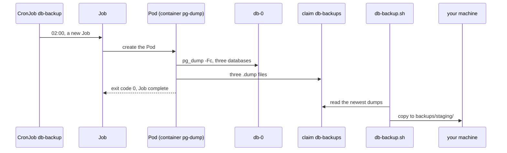

## Bạn cần biết trước

- [[k8s.l2.staging-keeps-its-data]] — `db` của staging giữ dữ liệu trên claim `data-db-0`, nhưng chỉ trên node duy nhất của staging. Bài này chép dữ liệu đó ra nơi khác.
- [[devops.l3.logical-backups]] — `pg_dump -Fc` ghi một database ra một file. Ở đây một Pod trong cluster chạy lệnh đó thay bạn.
- [[devops.l3.restore-testing]] — bản sao lưu chỉ có giá trị khi bạn đã thử khôi phục từ nó. Các bản dump chép ra trong bài này vẫn cần phép thử đó.

## Tình huống

Từ bài trước, staging giữ các đơn hàng bạn đặt trên `data-db-0`, và chúng vẫn còn khi `db-0` bị xóa. Nhưng diễn tập DR xóa cả cluster, và mọi đơn hàng đặt sau dữ liệu seed đều mất theo. Trong Compose, bạn chạy `backup-logical.sh` bằng tay mỗi khi cần một bản dump. Chẳng ai ngồi chạy script cho staging lúc hai giờ sáng. Bạn muốn chính cluster khởi động một lần sao lưu mỗi đêm, và muốn biết lần đó có thành công không. Staging sao lưu các database của nó theo lịch bằng cách nào, và các bản dump phải nằm ở đâu thì mới được tính là bản sao lưu?

## Khái niệm cốt lõi

- **Job (Kubernetes)** (Object Kubernetes chạy Pod tới khi xong thành công, thử lại khi lỗi trong giới hạn) — object chạy một Pod từ template của nó cho tới khi Pod kết thúc thành công. Nếu Pod lỗi, Job thử lại, tối đa `backoffLimit` lần, rồi dừng hẳn.
- **CronJob** (Object Kubernetes tạo một Job mới mỗi lần tới lịch viết theo cú pháp cron) — object tạo một Job mới từ `jobTemplate` của nó mỗi khi tới lịch `schedule`, viết theo cú pháp cron.
- `concurrencyPolicy: Forbid` — thiết lập của CronJob: CronJob không khởi động Job mới khi Job của lần chạy trước vẫn đang chạy.
- `kubectl create job --from` — lệnh tạo ngay một Job từ template của một CronJob, không cần chờ tới lịch.
- Claim `db-backups` — một PersistentVolumeClaim riêng, nằm cạnh `data-db-0`, nơi các Pod sao lưu ghi bản dump vào.

## Cơ chế hoạt động



Trong tình huống trên, thứ khởi động một lần sao lưu mỗi đêm là CronJob `db-backup`. Một `schedule` có năm trường: phút, giờ, ngày trong tháng, tháng và ngày trong tuần, và `*` nghĩa là mọi giá trị. Vậy `0 2 * * *` là phút 0 của giờ 2, mỗi ngày, theo múi giờ của control plane trong cluster. Tới lúc đó, CronJob tạo một Job mới từ `jobTemplate` của nó, và Job tạo một Pod.

Pod chạy `pg_dump -Fc` cho `donhang`, `donhang_notifications` và `donhang_payments`, đọc từ `db-0` qua Service `db`, rồi ghi từng bản dump vào claim `db-backups`. Khi script kết thúc với exit code `0`, Pod đã thành công và Job hoàn tất. Sau đó Job không khởi động lại Pod nữa. Với Pod của một Deployment, container thoát ra sẽ được khởi động lại, vì các Pod đó tồn tại để chạy mãi, còn Pod của Job tồn tại để làm xong rồi thôi.

Nếu một lệnh `pg_dump` lỗi, `set -e` dừng script với exit code khác 0, và Pod thất bại. Job khi đó tạo một Pod mới, thêm tối đa `backoffLimit: 2` lần nữa, rồi bị đánh dấu là thất bại. CronJob cũng không thử lại: Job kế tiếp của nó chỉ tới vào 02:00 hôm sau.

Có đêm bản dump chạy lâu hơn đêm khác. Với `concurrencyPolicy: Forbid`, CronJob không khởi động Job thứ hai của chính nó khi Job trước vẫn đang chạy.

Tới bước này, các bản dump vẫn nằm trên một claim trên node duy nhất của staging, cạnh `data-db-0`. Hai mũi tên cuối mới biến chúng thành bản sao lưu: `db-backup.sh` chép các bản dump mới nhất ra khỏi cluster, vào `backups/staging/` trên máy bạn. Không có gì trong staging tự làm bước chép đó: bạn chạy `db-backup.sh` bằng tay, nên bản dump mỗi đêm vẫn nằm trong cluster cho tới khi bạn chạy.

## Trong hệ thống Đơn Hàng

```yaml file=deploy/gitops/config-repo-kustomize/base/db-backup.yaml tag=stage-3 lines=32-56
  schedule: "0 2 * * *"
  concurrencyPolicy: Forbid
  jobTemplate:
    spec:
      backoffLimit: 2
      template:
        metadata:
          labels:
            app: db-backup
        spec:
          restartPolicy: Never
          automountServiceAccountToken: false
          containers:
            - name: pg-dump
              image: postgres:17.6-alpine
              command:
                - sh
                - -c
                - |
                  set -e
                  stamp=$(date -u +%Y%m%dT%H%M%SZ)
                  for db in donhang donhang_notifications donhang_payments; do
                    pg_dump -Fc -h db -U donhang -d "$db" -f "/backups/$db-$stamp.dump"
                    echo "wrote $db-$stamp.dump"
                  done
```

Dòng 32, 33 và 36 chứa ba thiết lập trong sơ đồ: lịch chạy, chính sách chạy đồng thời và giới hạn thử lại. Dòng 42, `restartPolicy: Never`, nghĩa là container lỗi không được khởi động lại trong cùng Pod, nên mỗi lần thử lại là một Pod mới. Dòng 43 chỉ ngăn Kubernetes cấp cho Pod thông tin xác thực để gọi API server, thứ mà bản sao lưu không cần. Dòng 45 đặt tên container là `pg-dump`, còn tên Pod được tạo từ tên Job. Tên file của mỗi bản dump mang thời điểm chạy, nên đêm mới không bao giờ ghi đè bản dump cũ.

Ngoài đoạn trích, dòng 57–69 lấy mật khẩu từ Secret `db` và mount claim `db-backups` vào `/backups`, còn dòng 1–17 khai báo claim đó. Cả hai object đều ở sync wave 3, sau mọi thứ khác trong staging.

```bash file=scripts/k8s/db-backup.sh tag=stage-3 lines=27-37
# lesson: k8s.l2.scheduled-backups
# No waiting for 02:00: a Job from the CronJob's template, started now.
# It runs its Pod until pg_dump has written all three dumps, and then stops.
kubectl delete job db-backup-now -n donhang --ignore-not-found >/dev/null
show kubectl create job db-backup-now --from=cronjob/db-backup -n donhang
kubectl wait --for=condition=Complete job/db-backup-now -n donhang --timeout=300s >/dev/null
app_wait_sync "$(config_head --verify)" >/dev/null
app_wait Synced Healthy "$(config_head --verify)"
show kubectl get job db-backup-now -n donhang -o custom-columns=NAME:.metadata.name,COMPLETIONS:.status.succeeded,FAILED:.status.failed
kubectl logs job/db-backup-now -n donhang | sed -E 's/-[0-9]{8}T[0-9]{6}Z/-<time>/'
echo
```

```text output=true
$ kubectl get cronjob db-backup -n donhang -o custom-columns=NAME:.metadata.name,SCHEDULE:.spec.schedule,CONCURRENCY:.spec.concurrencyPolicy
NAME        SCHEDULE    CONCURRENCY
db-backup   0 2 * * *   Forbid

$ kubectl create job db-backup-now --from=cronjob/db-backup -n donhang
Warning: would violate PodSecurity ...
job.batch/db-backup-now created
staging: Synced, Healthy
$ kubectl get job db-backup-now -n donhang -o custom-columns=NAME:.metadata.name,COMPLETIONS:.status.succeeded,FAILED:.status.failed
NAME            COMPLETIONS   FAILED
db-backup-now   1             <none>
wrote donhang-<time>.dump
wrote donhang_notifications-<time>.dump
wrote donhang_payments-<time>.dump
...
== the newest dumps, copied to backups/staging/
donhang_notifications-<time>.dump
donhang_payments-<time>.dump
donhang-<time>.dump
== each one is a pg_dump archive pg_restore can read
...
$ kubectl get jobs -n donhang -o custom-columns=NAME:.metadata.name,COMPLETIONS:.status.succeeded,FAILED:.status.failed
NAME            COMPLETIONS   FAILED
db-backup-now   1             <none>
```

Phía trên đoạn trích, script commit `base/db-backup.yaml` vào repo cấu hình và in CronJob ra, đó là những dòng đầu của output. `show` in lệnh ra trước khi chạy, nên mới có các dòng `$`. Dòng 31 tạo Job `db-backup-now` từ template của CronJob, và dòng 32 chờ tới khi Job hoàn tất. Dòng `Warning:` liệt kê các thiết lập bảo mật mà Pod không đặt. Đó chỉ là cảnh báo, không phải từ chối, và dòng tiếp theo cho thấy Job đã được tạo.

Dòng 33–34 chờ Argo CD. Với StorageClass `standard`, claim `db-backups` chỉ nhận volume khi Pod đầu tiên dùng nó được tạo, và trước lúc đó Argo CD không báo staging là `Healthy`. Ở dòng của Job, `COMPLETIONS` bằng `1` và `FAILED` bằng `<none>` nghĩa là một Pod thành công và không Pod nào thất bại. Dòng 36 in log của Pod, với thời điểm trong mỗi tên file được thay bằng `<time>`.

Sau đoạn trích, dòng 43–67 khởi động một Pod mount claim, để `kubectl cp` chép ba bản dump mới nhất vào `backups/staging/`. Mỗi bản chép đều bắt đầu bằng `PGDMP`, dấu hiệu của một archive `pg_dump`. Lệnh cuối liệt kê các Job. Một lần chạy đêm bị lỗi sẽ hiện ở đó thành một Job có số dưới cột `FAILED`, và không có gì trong staging báo cho ai biết chuyện đó.

## Senior hay nhầm rằng…

- **"Bản sao lưu ghi vào một volume trong cluster vẫn còn khi mất cluster."** → Thực ra claim `db-backups` dùng StorageClass `standard` của staging, vốn giữ volume trong một thư mục trên node duy nhất, cũng là node chứa `data-db-0`. Xóa cluster hay mất node là mất cả database lẫn các bản dump của nó. Bạn sẽ nhận ra khi `dr-drill.sh` dựng lại staging và bản dump duy nhất còn lại là những bản trong `backups/staging/` trên máy bạn.
- **"CronJob cứ thử lại một lần sao lưu lỗi cho tới khi thành công."** → Thực ra Job chỉ thử lại tối đa `backoffLimit` lần, ở đây là 2, rồi bị đánh dấu là thất bại. CronJob không tạo thêm Job nào cho lần đó mà chờ tới 02:00 hôm sau. Bạn sẽ nhận ra khi `kubectl get jobs -n donhang` hiện một Job có số dưới cột `FAILED` và không có Job nào mới hơn cho tới đêm sau.
- **"Job khởi động lại Pod sau khi Pod thành công, giống Deployment."** → Thực ra Pod thành công là Job xong việc, nên nó ghi nhận lần hoàn tất và không tạo thêm Pod nào. Bạn sẽ nhận ra khi Pod của `db-backup-now` cứ ở trạng thái `Completed` trong `kubectl get pods -n donhang` thay vì khởi động lại.

## Thử ngay (3 phút)

Với `donhang-staging` là context `kubectl` hiện tại và `scripts/k8s/db-backup.sh` vừa chạy xong:

1. Chạy `kubectl create job backup-try --from=cronjob/db-backup -n donhang`. Có thể một dòng `Warning:` giống trong output của script hiện ra trước.
2. Chạy `kubectl wait --for=condition=Complete job/backup-try -n donhang --timeout=300s`, rồi `kubectl get pods -n donhang -l app=db-backup`.
3. Chạy `kubectl logs job/backup-try -n donhang`, rồi `kubectl delete job backup-try -n donhang`.

Kết quả mong đợi: Pod có tên bắt đầu bằng `backup-try` hiện `Completed` với `0` lần khởi động lại, và log in ba dòng `wrote`, mỗi database một dòng.

## Liên hệ

- [[devops.l3.logical-backups]] — vẫn lệnh `pg_dump -Fc` đó, giờ do cluster khởi động thay vì bạn.
- [[devops.l3.restore-testing]] — bước sau bước này: các bản dump đã chép chỉ có giá trị khi bạn đã thử khôi phục từ chúng.
- [[devops.l3.rpo-and-rto]] — lịch chạy mỗi đêm quyết định RPO: một sự cố có thể làm mất mọi đơn hàng kể từ lần chạy thành công gần nhất.
- [[devops.l3.ordering-a-sync]] — lại là các wave: các object sao lưu nằm ở wave 3, sau mọi thứ mà chúng dump.
- [[k8s.l2.staging-keeps-its-data]] — bài cần học trước: các claim mà bản sao lưu này chép từ đó, và giới hạn mà bài này tìm cách vượt qua.
- [[k8s.l2.database-in-the-cluster]] — bài tiếp: chạy PostgreSQL trong cluster còn để lại cho bạn những việc gì.

## Tóm tắt 5 dòng

1. CronJob dump các database của staging theo lịch, nhưng bản dump chỉ được tính là bản sao lưu khi đã chép ra khỏi cluster.
2. Job chạy Pod tới khi thành công, thử lại khi lỗi tối đa `backoffLimit` lần, và không bao giờ khởi động lại Pod đã xong.
3. `db-backup` chạy `pg_dump -Fc` cho ba database lúc 02:00, ghi vào claim `db-backups`, còn `Forbid` không cho Job thứ hai chạy khi một Job đang chạy.
4. `kubectl create job --from=cronjob/db-backup` chạy nó ngay, rồi `db-backup.sh` chép các bản dump vào `backups/staging/`.
5. Một lần chạy lỗi chỉ để lại một Job thất bại, và không ai biết trừ khi có thứ gì đó theo dõi các Job.
