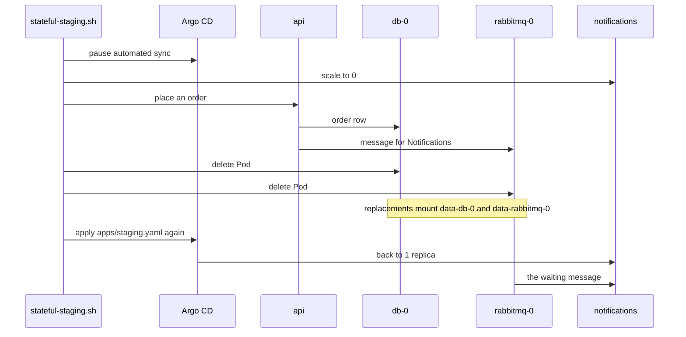

## Before you start

- [[k8s.l2.headless-services]] — `db` and `rabbitmq` already run as StatefulSets on their own claims; this lesson tests both at once.
- [[backend.l3.payments-service]] — Payments owns refunds and its own database; here it moves into staging.
- [[devops.l3.ordering-a-sync]] — hooks in wave 1 run before Deployments in wave 2; the new services reuse that order.
- [[k8s.l2.gateway-api]] — staging's HTTPRoute sends paths to Services; here it gains a rule for Payments.

## The situation

Staging now keeps `db` and `rabbitmq` on claims, but it still runs only part of Đơn Hàng. Notifications and Payments, which left the api in the backend lessons, are not there, so a request for `/api/v1/refunds` on staging's Gateway falls under the `/api/v1` rule and reaches the api, which has no refunds endpoint. You add them, and Notifications gives you a crash test: an order placed while it is stopped leaves a message waiting in its RabbitMQ queue. If `db-0` and `rabbitmq-0` were both replaced at that moment, would the order and its message still be there?

## Core concepts

- The module's base files — `db.yaml`, `rabbitmq.yaml`, `notifications.yaml`, `payments.yaml` and `fake-gateway.yaml` (a stand-in for the outside payment provider that Payments sends refunds to, not a Gateway API Gateway) in the Kustomize base, listed in its `kustomization.yaml`; `stateful-staging.sh` commits the ones staging lacks to the config repository.
- A migration hook per service — a Pod marked as a `Sync` hook in wave 1 that migrates one service's own database before that service's Deployment, in wave 2, is applied.
- The refunds rule — a second rule of the HTTPRoute `api` that sends `/api/v1/refunds` to the Service `payments`.
- Init scripts — the SQL files of the ConfigMap `db-init`, mounted at `/docker-entrypoint-initdb.d`; the PostgreSQL image runs them only when its data directory is empty.
- Pausing automated sync — removing `automated` from the Application `staging`, so Argo CD neither syncs on its own nor self-heals until the Application is applied again.

## How it works



The script first commits the new base files. On the sync that follows, the hooks `notifications-migrate` and `payments-migrate` each migrate their own database in wave 1, as `migrate` does for the api. Only when they succeed does Argo CD apply the Deployments of wave 2.

`db` started once from an empty claim when it became a StatefulSet, and the init scripts seeded it then. From then on the data directory on `data-db-0` is never empty, so neither a later sync nor a replaced Pod reseeds the database. Before `db` had a claim, its data lived only inside the Pod, so every new Pod started empty and was seeded again.

Next comes the crash test in the diagram. Scaling `notifications` to 0 by hand is a change self-heal would undo, so the script first pauses automated sync. It places an order through the api, which writes the order row to `db-0`; a message for Notifications then goes to `rabbitmq-0`. With no service reading it, the message stays in its queue. RabbitMQ writes it to its data folder on `data-rabbitmq-0`, because the message is marked to be kept on disk.

The script then deletes `db-0` and `rabbitmq-0` together. Each StatefulSet creates a replacement with the same name, which mounts the claim of the Pod it replaces. The order and the waiting message are both still there. Applying the Application's file `apps/staging.yaml` again, which still contains `automated`, turns automated sync back on; Argo CD scales Notifications back to 1, and it takes the message.

The claims live on staging's single node. Deleting the cluster deletes them too, so `dr-drill.sh`, which deletes and rebuilds `donhang-staging`, still starts from seed data.

## In the Đơn Hàng system

```yaml file=deploy/gitops/config-repo/platform/edge/httproutes.yaml tag=stage-3 lines=17-39
    - matches:
        - path:
            type: PathPrefix
            value: /api/v1
        - path:
            type: PathPrefix
            value: /api/v2
        - path:
            type: PathPrefix
            value: /openapi
      backendRefs:
        - name: api
          port: 8080
    # lesson: k8s.l2.staging-keeps-its-data
    # Payments answers /api/v1/refunds, as Caddy routes it in Compose: the
    # longer path wins over /api/v1, and the api never sees these requests.
    - matches:
        - path:
            type: PathPrefix
            value: /api/v1/refunds
      backendRefs:
        - name: payments
          port: 8080
```

Both rules match `/api/v1/refunds`. Gateway API picks the rule with the longest matching path, whatever the order of the rules, so these requests reach the Service `payments` and never the api. The comment's Caddy is the reverse proxy Đơn Hàng uses in Compose, which already sends this path to Payments. In `base/payments.yaml`, outside the excerpts, lines 6–16 make the Pod `payments-migrate` a `Sync` hook in wave `"1"`, and lines 38–44 put the Deployment `payments` in wave `"2"`.

```bash file=scripts/k8s/stateful-staging.sh tag=stage-3 lines=61-80
# lesson: k8s.l2.staging-keeps-its-data
# Argo CD's automated sync is paused while Notifications is scaled to 0 (it
# would scale it back up), so the message for a new order waits in its queue.
kubectl patch application staging -n argocd --type merge -p '{"spec":{"syncPolicy":{"automated":null}}}' >/dev/null
show kubectl scale deployment notifications -n donhang --replicas=0
kubectl wait --for=delete pod -n donhang -l app=notifications --timeout=120s >/dev/null 2>&1 || true
customer=$(gateway_token anh.tran@example.com)
order=$(curl -s -H "Authorization: Bearer $customer" -H 'Content-Type: application/json' \
  -d '{"items":[{"productId":8,"quantity":1}]}' "$gateway/api/v1/orders" | grep -o '"id":[0-9]*' | head -n 1 | cut -d: -f2)
echo "placed order $order"
for _ in $(seq 60); do [ "$(waiting)" = 1 ] && break; sleep 1; done
echo "messages waiting for Notifications: $(waiting)"
echo

# Both StatefulSet Pods go at once; their replacements mount the same claims.
show kubectl delete pod db-0 rabbitmq-0 -n donhang
kubectl wait --for=condition=Ready pod/db-0 pod/rabbitmq-0 -n donhang --timeout=300s >/dev/null
wait_rabbit
echo "order $order: $(psql_db "SELECT status FROM orders WHERE id = $order")"
echo "messages waiting for Notifications: $(waiting)"
```

```text output=true
   M base/kustomization.yaml
   M platform/edge/httproutes.yaml
  ?? base/fake-gateway.yaml
  ?? base/notifications.yaml
  ?? base/payments.yaml
staging: Synced, Healthy
edge-staging: Synced, Healthy

== the hooks of the last sync, and the services after them
NAME                    STATUS
migrate                 Succeeded
notifications-migrate   Succeeded
payments-migrate        Succeeded
NAME                    READY
api                     2
fake-gateway            1
keycloak                1
mailpit                 1
notifications           1
payments                1
redis                   1

== GET https://donhang.localhost:18443/api/v1/refunds as a member of staff
[]
HTTP 200

$ kubectl scale deployment notifications -n donhang --replicas=0
deployment.apps/notifications scaled
placed order 13
messages waiting for Notifications: 1

$ kubectl delete pod db-0 rabbitmq-0 -n donhang
pod "db-0" deleted from donhang namespace
pod "rabbitmq-0" deleted from donhang namespace
order 13: new
messages waiting for Notifications: 1

Notifications back: messages waiting 0
```

Above the excerpt, the script commits the base files and the route, then waits for the Applications `staging` and `edge-staging` (which holds the HTTPRoute) to be `Synced` and `Healthy`. `db.yaml` and `rabbitmq.yaml` were committed by the two lessons before, so only the three new services, the list and the route show as changes. Lines 48–58 list the three hooks, all `Succeeded`, and the Deployments, then call `/api/v1/refunds` as a member of staff: Payments answers `HTTP 200` with an empty list. Helpers defined there: `waiting` counts messages in the queue `notifications.order-events`, `psql_db` runs a query in `db-0`, `wait_rabbit` waits until RabbitMQ itself runs, and `show` prints a command first; from `scripts/lib/gateway.sh`, `gateway_token` gets an access token for a user and `$gateway` is staging's Gateway address.

In the excerpt, line 64 removes `automated` from the Application, lines 65–73 scale Notifications to 0, place an order as a customer and wait until its message shows up in the queue, and lines 76–80 delete both Pods and read the order and the queue again. After the excerpt, line 85 applies `apps/staging.yaml` again, and the last output line shows Notifications took the message.

## Seniors often assume…

- **"A sync from Git can wipe and reseed the database once it has a claim."** → Actually the init scripts run only when the data directory is empty, and `data-db-0` stays bound with its data whatever the sync applies. You notice this when order 13 is still there after a sync or a deleted `db-0`.
- **"Persistent claims protect staging's data from losing the whole cluster."** → Actually staging's StorageClass `standard` keeps each volume in a folder on staging's single node, and deleting the cluster deletes the node with it. You notice this when `dr-drill.sh` rebuilds staging and the orders you placed are gone, leaving only the seed data.
- **"The api must forward refund requests to Payments, since the path starts with `/api/v1`."** → Actually the HTTPRoute has its own rule for `/api/v1/refunds`, and the longer matching path wins, so the Gateway sends these requests straight to `payments`. You notice this when the rule's `backendRefs` names `payments`, and the call in the output gets `HTTP 200` from Payments.

## Try it (3 minutes)

With `donhang-staging` as your current `kubectl` context and `scripts/k8s/stateful-staging.sh` just run, use the number it printed after `placed order` in place of `13` if yours differs:

1. Run `kubectl exec db-0 -n donhang -- psql -U donhang -d donhang -tAc "SELECT status FROM orders WHERE id = 13"`.
2. Run `kubectl delete pod db-0 -n donhang`, then `kubectl wait --for=condition=Ready pod/db-0 -n donhang --timeout=300s`. If `kubectl wait` reports that `db-0` is not found, the replacement is not created yet: run it again.
3. Run the command from step 1 again.

Expected result: both runs print `new`. A reseeded database would print nothing, because the seed data has only 12 orders.

## Connections

- [[k8s.l2.headless-services]] — prerequisite: the StatefulSet `rabbitmq` whose queue keeps the waiting message here.
- [[devops.l3.ordering-a-sync]] — the same waves and hook, now one per service that owns a database.
- [[k8s.l2.gateway-api]] — the HTTPRoute one rule larger: a longer path sends refunds to another Service.
- [[backend.l3.outbox-relay]] — where the waiting message comes from, and why it is marked to be kept on disk.
- [[devops.l3.disaster-recovery-drill]] — the limit of this lesson: the drill deletes the cluster, and the claims go with it.
- [[k8s.l2.scheduled-backups]] — next: copying staging's data off the cluster on a schedule.

## Five-line summary

1. On claims, staging's orders and waiting messages survive replaced Pods, but not the loss of its single node or cluster.
2. `stateful-staging.sh` commits Notifications, Payments and the fake gateway next to the StatefulSets `db` and `rabbitmq`.
3. Each new service migrates its own database with a hook in wave 1 before its Deployment in wave 2.
4. The HTTPRoute's longer `/api/v1/refunds` rule sends refunds straight to `payments`; the api never sees them.
5. The init scripts seed `db` once, from an empty claim; later syncs and restarts find the data directory full.
