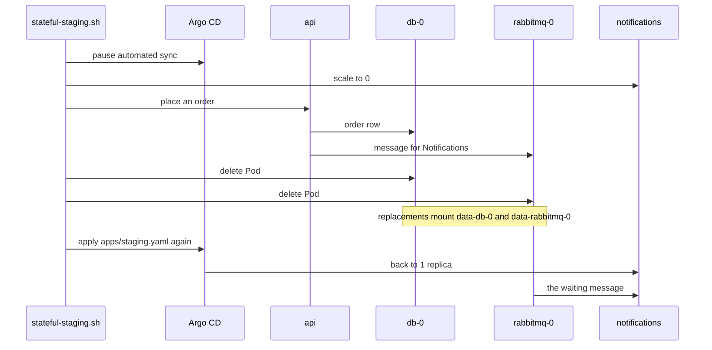

## Bạn cần biết trước

- [[k8s.l2.headless-services]] — `db` và `rabbitmq` đã chạy dưới dạng StatefulSet trên claim riêng; bài này thử cả hai cùng lúc.
- [[backend.l3.payments-service]] — Payments giữ phần hoàn tiền và có database riêng; ở đây nó được đưa vào staging.
- [[devops.l3.ordering-a-sync]] — hook ở wave 1 chạy trước các Deployment ở wave 2; các service mới dùng lại đúng thứ tự đó.
- [[k8s.l2.gateway-api]] — HTTPRoute của staging chuyển các đường dẫn tới Service; ở đây nó có thêm một rule cho Payments.

## Tình huống

Staging giờ giữ `db` và `rabbitmq` trên claim, nhưng vẫn mới chạy một phần Đơn Hàng. Notifications và Payments, hai service đã tách khỏi api trong các bài backend, chưa có mặt. Vì thế một request tới `/api/v1/refunds` trên Gateway của staging rơi vào rule `/api/v1` và tới api, mà api thì không có endpoint hoàn tiền. Bạn thêm hai service đó vào, và Notifications cho bạn một phép thử sự cố: đơn hàng đặt trong lúc nó đang dừng sẽ để lại một message nằm chờ trong hàng đợi RabbitMQ của nó. Nếu đúng lúc ấy cả `db-0` lẫn `rabbitmq-0` bị thay, đơn hàng và message đó có còn không?

## Khái niệm cốt lõi

- Các file base của module — `db.yaml`, `rabbitmq.yaml`, `notifications.yaml`, `payments.yaml` và `fake-gateway.yaml` (bản đứng thay cho nhà cung cấp thanh toán bên ngoài mà Payments gửi yêu cầu hoàn tiền tới, không phải một Gateway của Gateway API) nằm trong base Kustomize và được liệt kê trong `kustomization.yaml` của nó. `stateful-staging.sh` commit những file staging còn thiếu vào repo cấu hình.
- Mỗi service một hook migration — một Pod được đánh dấu là hook `Sync` ở wave 1, chạy migration cho database riêng của một service trước khi Deployment của service đó, ở wave 2, được apply.
- Rule hoàn tiền — rule thứ hai của HTTPRoute `api`, chuyển `/api/v1/refunds` tới Service `payments`.
- Init script — các file SQL trong ConfigMap `db-init`, mount vào `/docker-entrypoint-initdb.d`. Image PostgreSQL chỉ chạy chúng khi thư mục dữ liệu còn trống.
- Tạm dừng sync tự động — bỏ `automated` khỏi Application `staging`, để Argo CD không tự sync và cũng không self-heal cho tới khi Application được apply lại.

## Cơ chế hoạt động



Đầu tiên script commit các file base mới. Ở lần sync ngay sau đó, hai hook `notifications-migrate` và `payments-migrate` chạy migration cho database của riêng mình ở wave 1, giống `migrate` làm cho api. Chỉ khi chúng thành công, Argo CD mới apply các Deployment của wave 2.

`db` đã khởi động một lần từ claim trống khi nó trở thành StatefulSet, và init script đã seed nó lúc đó. Từ đó về sau, thư mục dữ liệu trên `data-db-0` không bao giờ trống, nên cả lần sync sau lẫn Pod bị thay đều không seed lại database. Trước khi `db` có claim, dữ liệu của nó chỉ nằm bên trong Pod, nên Pod mới nào cũng khởi động với database trống và được seed lại.

Tiếp theo là phép thử sự cố trong sơ đồ. Scale `notifications` về 0 bằng tay là một thay đổi mà self-heal sẽ đảo lại, nên script tạm dừng sync tự động trước. Nó đặt một đơn hàng qua api, api ghi dòng đơn hàng vào `db-0`, rồi một message cho Notifications được gửi tới `rabbitmq-0`. Không có service nào đọc, message nằm yên trong hàng đợi. RabbitMQ ghi nó vào thư mục dữ liệu trên `data-rabbitmq-0`, vì message được đánh dấu là phải giữ trên đĩa.

Sau đó script xóa `db-0` và `rabbitmq-0` cùng lúc. Mỗi StatefulSet tạo một Pod thay thế cùng tên, và Pod này mount claim của Pod mà nó thay. Đơn hàng và message đang chờ đều còn nguyên. Apply lại file `apps/staging.yaml` của Application, file vẫn chứa `automated`, sẽ bật sync tự động trở lại. Argo CD scale Notifications về lại 1, và Notifications lấy message đi.

Các claim nằm trên node duy nhất của staging. Xóa cluster là xóa luôn chúng, nên `dr-drill.sh`, script xóa rồi dựng lại `donhang-staging`, vẫn bắt đầu từ dữ liệu seed.

## Trong hệ thống Đơn Hàng

```yaml file=deploy/gitops/config-repo/platform/edge/httproutes.yaml tag=stage-3 lines=17-39
    - matches:
        - path:
            type: PathPrefix
            value: /api/v1
        - path:
            type: PathPrefix
            value: /api/v2
        - path:
            type: PathPrefix
            value: /openapi
      backendRefs:
        - name: api
          port: 8080
    # lesson: k8s.l2.staging-keeps-its-data
    # Payments answers /api/v1/refunds, as Caddy routes it in Compose: the
    # longer path wins over /api/v1, and the api never sees these requests.
    - matches:
        - path:
            type: PathPrefix
            value: /api/v1/refunds
      backendRefs:
        - name: payments
          port: 8080
```

Cả hai rule đều khớp `/api/v1/refunds`. Gateway API chọn rule có đường dẫn khớp dài nhất, bất kể thứ tự các rule, nên các request này tới Service `payments` và không bao giờ tới api. Caddy trong comment là reverse proxy mà Đơn Hàng dùng trong Compose, vốn đã chuyển đường dẫn này tới Payments. Trong `base/payments.yaml`, ngoài các đoạn trích, dòng 6–16 biến Pod `payments-migrate` thành hook `Sync` ở wave `"1"`, còn dòng 38–44 đặt Deployment `payments` vào wave `"2"`.

```bash file=scripts/k8s/stateful-staging.sh tag=stage-3 lines=61-80
# lesson: k8s.l2.staging-keeps-its-data
# Argo CD's automated sync is paused while Notifications is scaled to 0 (it
# would scale it back up), so the message for a new order waits in its queue.
kubectl patch application staging -n argocd --type merge -p '{"spec":{"syncPolicy":{"automated":null}}}' >/dev/null
show kubectl scale deployment notifications -n donhang --replicas=0
kubectl wait --for=delete pod -n donhang -l app=notifications --timeout=120s >/dev/null 2>&1 || true
customer=$(gateway_token anh.tran@example.com)
order=$(curl -s -H "Authorization: Bearer $customer" -H 'Content-Type: application/json' \
  -d '{"items":[{"productId":8,"quantity":1}]}' "$gateway/api/v1/orders" | grep -o '"id":[0-9]*' | head -n 1 | cut -d: -f2)
echo "placed order $order"
for _ in $(seq 60); do [ "$(waiting)" = 1 ] && break; sleep 1; done
echo "messages waiting for Notifications: $(waiting)"
echo

# Both StatefulSet Pods go at once; their replacements mount the same claims.
show kubectl delete pod db-0 rabbitmq-0 -n donhang
kubectl wait --for=condition=Ready pod/db-0 pod/rabbitmq-0 -n donhang --timeout=300s >/dev/null
wait_rabbit
echo "order $order: $(psql_db "SELECT status FROM orders WHERE id = $order")"
echo "messages waiting for Notifications: $(waiting)"
```

```text output=true
   M base/kustomization.yaml
   M platform/edge/httproutes.yaml
  ?? base/fake-gateway.yaml
  ?? base/notifications.yaml
  ?? base/payments.yaml
staging: Synced, Healthy
edge-staging: Synced, Healthy

== the hooks of the last sync, and the services after them
NAME                    STATUS
migrate                 Succeeded
notifications-migrate   Succeeded
payments-migrate        Succeeded
NAME                    READY
api                     2
fake-gateway            1
keycloak                1
mailpit                 1
notifications           1
payments                1
redis                   1

== GET https://donhang.localhost:18443/api/v1/refunds as a member of staff
[]
HTTP 200

$ kubectl scale deployment notifications -n donhang --replicas=0
deployment.apps/notifications scaled
placed order 13
messages waiting for Notifications: 1

$ kubectl delete pod db-0 rabbitmq-0 -n donhang
pod "db-0" deleted from donhang namespace
pod "rabbitmq-0" deleted from donhang namespace
order 13: new
messages waiting for Notifications: 1

Notifications back: messages waiting 0
```

Phía trên đoạn trích, script commit các file base và route, rồi chờ hai Application `staging` và `edge-staging` (Application giữ HTTPRoute) ở trạng thái `Synced` và `Healthy`. `db.yaml` và `rabbitmq.yaml` đã được commit ở hai bài trước, nên chỉ ba service mới, danh sách và route hiện ra là thay đổi. Dòng 48–58 liệt kê ba hook, tất cả đều `Succeeded`, cùng các Deployment, rồi gọi `/api/v1/refunds` với tư cách nhân viên: Payments trả `HTTP 200` kèm một danh sách rỗng. Các hàm phụ cũng định nghĩa ở đó: `waiting` đếm message trong hàng đợi `notifications.order-events`, `psql_db` chạy một truy vấn trong `db-0`, `wait_rabbit` chờ tới khi chính RabbitMQ chạy, còn `show` in lệnh ra trước. Từ `scripts/lib/gateway.sh`, `gateway_token` lấy access token cho một user, còn `$gateway` là địa chỉ Gateway của staging.

Trong đoạn trích, dòng 64 bỏ `automated` khỏi Application. Dòng 65–73 scale Notifications về 0, đặt một đơn hàng dưới tư cách khách hàng và chờ tới khi message của nó xuất hiện trong hàng đợi. Dòng 76–80 xóa cả hai Pod rồi đọc lại đơn hàng và hàng đợi. Sau đoạn trích, dòng 85 apply lại `apps/staging.yaml`, và dòng output cuối cho thấy Notifications đã lấy message đi.

## Senior hay nhầm rằng…

- **"Khi database đã có claim, một lần sync từ Git vẫn có thể xóa sạch rồi seed lại nó."** → Thực ra init script chỉ chạy khi thư mục dữ liệu trống, còn `data-db-0` vẫn gắn với dữ liệu của nó dù lần sync apply thứ gì. Bạn sẽ nhận ra khi đơn hàng 13 vẫn còn sau một lần sync hay sau khi `db-0` bị xóa.
- **"Claim lâu dài bảo vệ dữ liệu của staging kể cả khi mất cả cluster."** → Thực ra StorageClass `standard` của staging giữ mỗi volume trong một thư mục trên node duy nhất của staging, và xóa cluster là xóa luôn node đó. Bạn sẽ nhận ra khi `dr-drill.sh` dựng lại staging và các đơn hàng bạn đặt biến mất, chỉ còn dữ liệu seed.
- **"Api phải chuyển tiếp request hoàn tiền sang Payments, vì đường dẫn bắt đầu bằng `/api/v1`."** → Thực ra HTTPRoute có rule riêng cho `/api/v1/refunds`, và đường dẫn khớp dài hơn sẽ thắng, nên Gateway gửi thẳng các request này tới `payments`. Bạn sẽ nhận ra khi `backendRefs` của rule ghi `payments`, và lời gọi trong output nhận `HTTP 200` từ Payments.

## Thử ngay (3 phút)

Với `donhang-staging` là context `kubectl` hiện tại và `scripts/k8s/stateful-staging.sh` vừa chạy xong. Nếu script in sau `placed order` một số khác `13`, dùng số đó thay cho `13`:

1. Chạy `kubectl exec db-0 -n donhang -- psql -U donhang -d donhang -tAc "SELECT status FROM orders WHERE id = 13"`.
2. Chạy `kubectl delete pod db-0 -n donhang`, rồi `kubectl wait --for=condition=Ready pod/db-0 -n donhang --timeout=300s`. Nếu `kubectl wait` báo không tìm thấy `db-0`, nghĩa là Pod thay thế chưa được tạo: chạy lại lệnh đó.
3. Chạy lại lệnh ở bước 1.

Kết quả mong đợi: cả hai lần đều in `new`. Một database đã bị seed lại sẽ không in gì, vì dữ liệu seed chỉ có 12 đơn hàng.

## Liên hệ

- [[k8s.l2.headless-services]] — bài cần học trước: StatefulSet `rabbitmq`, nơi hàng đợi giữ message đang chờ trong bài này.
- [[devops.l3.ordering-a-sync]] — vẫn các wave và hook đó, giờ mỗi service có database riêng một hook.
- [[k8s.l2.gateway-api]] — HTTPRoute thêm một rule: đường dẫn dài hơn đưa yêu cầu hoàn tiền tới một Service khác.
- [[backend.l3.outbox-relay]] — message đang chờ đến từ đâu, và vì sao nó được đánh dấu phải giữ trên đĩa.
- [[devops.l3.disaster-recovery-drill]] — giới hạn của bài này: buổi diễn tập xóa cluster, và các claim mất theo.
- [[k8s.l2.scheduled-backups]] — bài tiếp: chép dữ liệu của staging ra ngoài cluster theo lịch.

## Tóm tắt 5 dòng

1. Nhờ claim, đơn hàng và message đang chờ của staging còn nguyên khi Pod bị thay, nhưng không còn nếu mất node duy nhất hay cả cluster.
2. `stateful-staging.sh` commit Notifications, Payments và fake gateway bên cạnh hai StatefulSet `db` và `rabbitmq`.
3. Mỗi service mới chạy migration cho database riêng bằng một hook ở wave 1, trước Deployment của nó ở wave 2.
4. Rule `/api/v1/refunds` dài hơn của HTTPRoute gửi thẳng yêu cầu hoàn tiền tới `payments`; api không bao giờ thấy chúng.
5. Init script seed `db` đúng một lần, từ claim trống; các lần sync và khởi động lại sau đó thấy thư mục dữ liệu đã có sẵn.
