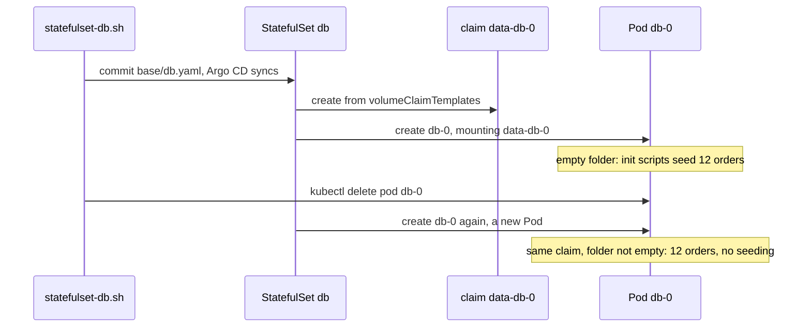

## Before you start

- [[k8s.l2.reclaim-policy]] — a claim from `standard` takes its data with it when it is deleted; this lesson shows who creates and keeps the claims of `db`.
- [[k8s.l1.deployments]] — a Deployment replaces a deleted Pod with a new one under a new random name; this lesson needs that contrast.
- [[k8s.l2.config-repo-overlays]] — staging follows the base and overlays of its config repository, so one commit to `base/db.yaml` changes staging's `db`.

## The situation

Staging's `db` is still a Deployment, its data in an `emptyDir`: a volume created empty with the Pod and deleted with it. Each time that Pod is replaced, PostgreSQL starts on an empty folder, inserts the 12 starting orders again (seeds them), and every order placed since is gone. A claim would keep the data. But a Deployment's template can only name one claim for every Pod it runs, including the new Pod a rolling update starts before it stops the old one. A database wants one server on one folder. How do you make a replacement Pod come back as the same member, on the same volume?

## Core concepts

- **StatefulSet** — an object that runs Pods from a Pod template, like a Deployment, but names each Pod after itself plus a number, `db-0`, `db-1`, and gives each one its own claim, which a replacement Pod under that name takes over. A Pod mounts a claim: the claim's volume appears as a folder inside the container, at the path the Pod names.
- `volumeClaimTemplates` — the part of a StatefulSet that describes a claim; the StatefulSet creates one claim from it per Pod, named after the template and the Pod, such as `data-db-0`.
- Ordered start and stop — by default the StatefulSet starts `db-1` only once `db-0` is running and ready, and when you lower `replicas` it removes the highest number first.
- Claims left in place — by default, deleting the StatefulSet or lowering `replicas` removes Pods, not their claims, so the data waits for the Pod that comes back under the same name.

## How it works



The script `statefulset-db.sh` commits a new `base/db.yaml` that makes `db` a StatefulSet; Argo CD syncs it, and the StatefulSet then creates the claim and the Pod. In the situation above, the object that pairs one Pod with one claim is the StatefulSet. It names its Pods after itself plus a number: with `replicas: 1`, the StatefulSet `db` runs one Pod, `db-0`. When `db-0` is deleted, the StatefulSet creates a new Pod, again called `db-0`. It is a new Pod, so it can get a different IP address, as it does here; the name and the claim are what carry over.

The claim comes from `volumeClaimTemplates`. For each Pod, the StatefulSet creates a claim from the template, named after the template and the Pod: `data-db-0`. It never makes a second claim with that name: every later `db-0` mounts the claim that is already there. The template names no StorageClass, so the cluster's default StorageClass, `standard`, creates the volume, as in the earlier lessons.

PostgreSQL does the rest. Its image runs the scripts in `/docker-entrypoint-initdb.d` only when the data folder is empty. The first `db-0` finds an empty claim and seeds the 12 orders; every later `db-0` finds the database and skips that step.

With more replicas, the StatefulSet by default works in order. It creates `db-1` only once `db-0` is running and ready, and when you lower `replicas` it removes the highest number first. By default, lowering `replicas`, or deleting the StatefulSet, removes Pods but leaves their claims, so raising `replicas` again gives the new `db-1` the old `data-db-1`.

## In the Đơn Hàng system

```yaml file=deploy/gitops/config-repo-kustomize/base/db.yaml tag=stage-3 lines=48-69
          # The init scripts of the ConfigMap db-init run only while the data
          # directory is empty: once, on the first start with a new claim.
          volumeMounts:
            - name: init-scripts
              mountPath: /docker-entrypoint-initdb.d
            - name: data
              mountPath: /var/lib/postgresql/data
      volumes:
        - name: init-scripts
          configMap:
            name: db-init
  # lesson: k8s.l2.statefulsets
  # One claim per Pod, named <template>-<Pod>: data-db-0. With no
  # storageClassName it gets the cluster's default StorageClass.
  volumeClaimTemplates:
    - metadata:
        name: data
      spec:
        accessModes: ["ReadWriteOnce"]
        resources:
          requests:
            storage: 1Gi
```

Lines 53–54 mount a volume called `data` at PostgreSQL's data folder, yet `volumes` on lines 55–58 lists only `init-scripts`. The volume `data` comes from the claim template on lines 62–69, which has the same name; `ReadWriteOnce`, shown as `RWO` below, is the claim's access mode, as in the earlier claim lesson. Above the excerpt, the file sets `kind: StatefulSet`, `replicas: 1` and the label `app: db`. Below it, the file keeps the Service `db`, the address the api has used all along.

```bash file=scripts/k8s/statefulset-db.sh tag=stage-3 lines=35-45
# lesson: k8s.l2.statefulsets
# The replacement is db-0 again, with a new IP address, and mounts the
# same claim: the data directory is not empty, so nothing is seeded again.
ip_before=$(db_ip)
show kubectl delete pod db-0 -n donhang
kubectl wait --for=condition=Ready pod/db-0 -n donhang --timeout=300s >/dev/null
show kubectl get pods -n donhang -l app=db
echo "same IP address as before: $([ "$(db_ip)" = "$ip_before" ] && echo yes || echo no)"
echo "orders: $(orders)"
echo "== the new db-0's log"
kubectl logs db-0 -n donhang | grep -e 'Skipping initialization' -e 'database system is ready'
```

```text output=true
...
$ kubectl get pvc data-db-0 -n donhang
NAME        STATUS   VOLUME    CAPACITY   ACCESS MODES   STORAGECLASS   VOLUMEATTRIBUTESCLASS   AGE
data-db-0   Bound    pvc-...   1Gi        RWO            standard       <unset>                 ...
orders: 12

$ kubectl delete pod db-0 -n donhang
pod "db-0" deleted from donhang namespace
$ kubectl get pods -n donhang -l app=db
NAME   READY   STATUS    RESTARTS   AGE
db-0   1/1     Running   0          ...
same IP address as before: no
orders: 12
== the new db-0's log
PostgreSQL Database directory appears to contain a database; Skipping initialization
... +07 [1] LOG:   database system is ready to accept connections
```

Above the excerpt, one commit swaps the Deployment `db` for this StatefulSet and the script waits for Argo CD to sync it; it then prints the claim `data-db-0`, `Bound`, and counts 12 orders. `db_ip` and `orders`, also defined above, read the Pod's IP address and count the rows of `orders`, and `show` prints a command before running it.

Line 38 keeps the IP address, line 39 deletes `db-0`, and line 40 waits for the replacement. The output shows the same name, a different IP address and the same 12 orders. Line 45 prints the new Pod's log: PostgreSQL found a database in its folder and skipped the init scripts.

## Seniors often assume…

- **"A StatefulSet with two replicas gives PostgreSQL a second server holding the same data, ready to take over if the first stops."** → Actually `db-1` would be a second, separate PostgreSQL server on a new claim, `data-db-1`. Its folder starts empty, so it runs the same init scripts and starts with the same 12 orders, then receives nothing written to `db-0`. The StatefulSet copies the Pod template, never the data; keeping a second server in step is PostgreSQL's own work, and nothing in this manifest sets it up. You notice this when, with `replicas: 2`, the Service `db` sends a connection of the api to `db-1` and an order just placed on `db-0` is not there.
- **"Deleting a StatefulSet also deletes the data of its Pods."** → Actually by default the claims stay when the StatefulSet or its Pods are deleted, and with them the volumes and the data. A StatefulSet created again with the same name finds `data-db-0` and mounts it. The data goes only when someone deletes the claim, and then the reclaim policy decides. You notice this when `kubectl get pvc -n donhang` still lists `data-db-0` after the StatefulSet is gone.
- **"`db-0` keeps its IP address, since it keeps its name."** → Actually the replacement is a new Pod, and nothing keeps the old IP address for it; the name and the claim are all that carry over. The api is not affected because it connects through the Service `db`, whose name stays. You notice this when the script prints `same IP address as before: no`.

## Try it (3 minutes)

With the staging kind cluster `donhang-staging` as your current `kubectl` context and `scripts/k8s/statefulset-db.sh` already run once, in the `don-hang` folder:

1. Run `kubectl get pvc data-db-0 -n donhang` and note the `VOLUME` column.
2. Run `kubectl delete pod db-0 -n donhang`, wait until `kubectl get pods -n donhang -l app=db` shows `db-0` as `1/1` `Running`, then run the command from step 1 again.

Expected result: `db-0` is back, with an `AGE` of a few seconds, and `data-db-0` is still `Bound` to the same `VOLUME` as in step 1, with an `AGE` older than the Pod's.

## Connections

- [[k8s.l2.reclaim-policy]] — prerequisite: the claims a StatefulSet leaves in place follow that policy once someone deletes them.
- [[k8s.l1.deployments]] — the contrast: interchangeable Pods with random names, where a StatefulSet keeps numbered ones.
- [[k8s.l2.headless-services]] — next: a kind of Service that gives each numbered Pod its own DNS name.
- [[backend.l3.read-replicas]] — what a second replica here does not give you: a server that receives every write of the first.

## Five-line summary

1. A StatefulSet brings a replaced Pod back under the same numbered name, on the same claim, so a database keeps its data.
2. `volumeClaimTemplates` creates one claim per Pod, named after the template and the Pod, such as `data-db-0`.
3. By default Pods start in number order, each after the one before is ready, and scaling down removes the highest number first.
4. By default, deleting the StatefulSet or scaling it down leaves the claims and their data; a replacement Pod is not promised its old IP address.
5. A second replica is a second, separate PostgreSQL server: the StatefulSet copies the Pod template, never the data.
