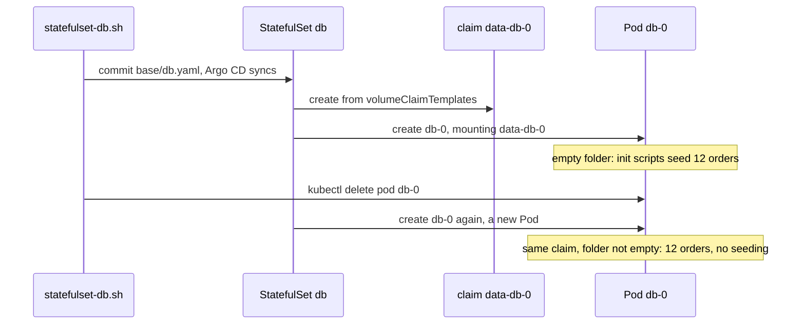

## Bạn cần biết trước

- [[k8s.l2.reclaim-policy]] — claim tạo từ `standard` mang dữ liệu đi theo khi nó bị xóa; bài này cho thấy ai tạo và ai giữ các claim của `db`.
- [[k8s.l1.deployments]] — Deployment thay một Pod bị xóa bằng Pod mới mang tên ngẫu nhiên mới; bài này cần đến sự tương phản đó.
- [[k8s.l2.config-repo-overlays]] — staging bám theo base và overlay trong config repository của nó, nên một commit vào `base/db.yaml` sẽ thay đổi `db` của staging.

## Tình huống

`db` của staging vẫn là một Deployment, dữ liệu nằm trong một `emptyDir`: volume tạo ra trống cùng lúc với Pod và bị xóa cùng Pod. Mỗi lần Pod đó bị thay, PostgreSQL khởi động trên một thư mục trống, chèn lại 12 đơn hàng ban đầu (seed), và mọi đơn đặt từ đó tới giờ đều mất. Một claim sẽ giữ được dữ liệu. Nhưng template của Deployment chỉ ghi được tên một claim cho mọi Pod nó chạy, kể cả Pod mới mà rolling update khởi động trước khi dừng Pod cũ. Database thì cần một server trên một thư mục. Làm sao để Pod thay thế quay lại đúng là thành viên cũ, trên đúng volume cũ?

## Khái niệm cốt lõi

- **StatefulSet** (Object chạy Pod đánh số cố định (db-0, db-1), mỗi Pod có claim riêng đi theo nó khi bị thay) — object chạy Pod từ một Pod template, giống Deployment, nhưng đặt tên mỗi Pod bằng tên của chính nó cộng một con số, `db-0`, `db-1`, và cho mỗi Pod một claim riêng, mà Pod thay thế mang cùng tên sẽ nhận lại. Pod mount một claim nghĩa là volume của claim hiện ra thành một thư mục trong container, ở đường dẫn mà Pod chỉ định.
- `volumeClaimTemplates` — phần của StatefulSet mô tả một claim; StatefulSet tạo từ đó một claim cho mỗi Pod, đặt tên theo template và Pod, chẳng hạn `data-db-0`.
- Khởi động và dừng theo thứ tự — mặc định StatefulSet chỉ khởi động `db-1` khi `db-0` đã chạy và sẵn sàng, còn khi bạn giảm `replicas` thì nó gỡ Pod có số lớn nhất trước.
- Claim được giữ lại — mặc định, xóa StatefulSet hay giảm `replicas` chỉ gỡ Pod, không gỡ claim của chúng, nên dữ liệu nằm chờ Pod quay lại dưới cùng tên.

## Cơ chế hoạt động



Script `statefulset-db.sh` commit một `base/db.yaml` mới, biến `db` thành StatefulSet; Argo CD sync nó, rồi StatefulSet tạo claim và Pod. Trong tình huống trên, object ghép đúng một Pod với đúng một claim chính là StatefulSet. Nó đặt tên Pod bằng tên của nó cộng một con số: với `replicas: 1`, StatefulSet `db` chạy một Pod là `db-0`. Khi `db-0` bị xóa, StatefulSet tạo một Pod mới, vẫn tên `db-0`. Đây là Pod mới nên có thể nhận địa chỉ IP khác, và ở đây đúng là vậy. Thứ được giữ lại là tên và claim.

Claim đến từ `volumeClaimTemplates`. Với mỗi Pod, StatefulSet tạo một claim từ template, đặt tên theo template và Pod: `data-db-0`. Nó không bao giờ tạo claim thứ hai trùng tên đó: mọi `db-0` về sau đều mount claim đã có sẵn. Template không ghi tên StorageClass nào, nên StorageClass mặc định của cluster, `standard`, tạo volume, giống các bài trước.

Phần còn lại do PostgreSQL lo. Image của nó chỉ chạy các script trong `/docker-entrypoint-initdb.d` khi thư mục dữ liệu trống. `db-0` đầu tiên gặp claim trống nên seed 12 đơn hàng; mọi `db-0` sau đó thấy database đã có và bỏ qua bước này.

Khi có nhiều replica hơn, mặc định StatefulSet làm theo thứ tự. Nó chỉ tạo `db-1` khi `db-0` đã chạy và sẵn sàng, còn khi bạn giảm `replicas` thì nó gỡ Pod có số lớn nhất trước. Mặc định, giảm `replicas` hay xóa StatefulSet chỉ gỡ Pod mà để lại claim, nên khi tăng `replicas` trở lại, `db-1` mới sẽ nhận lại `data-db-1` cũ.

## Trong hệ thống Đơn Hàng

```yaml file=deploy/gitops/config-repo-kustomize/base/db.yaml tag=stage-3 lines=48-69
          # The init scripts of the ConfigMap db-init run only while the data
          # directory is empty: once, on the first start with a new claim.
          volumeMounts:
            - name: init-scripts
              mountPath: /docker-entrypoint-initdb.d
            - name: data
              mountPath: /var/lib/postgresql/data
      volumes:
        - name: init-scripts
          configMap:
            name: db-init
  # lesson: k8s.l2.statefulsets
  # One claim per Pod, named <template>-<Pod>: data-db-0. With no
  # storageClassName it gets the cluster's default StorageClass.
  volumeClaimTemplates:
    - metadata:
        name: data
      spec:
        accessModes: ["ReadWriteOnce"]
        resources:
          requests:
            storage: 1Gi
```

Dòng 53–54 mount một volume tên `data` vào thư mục dữ liệu của PostgreSQL, vậy mà `volumes` ở dòng 55–58 chỉ liệt kê `init-scripts`. Volume `data` đến từ claim template ở dòng 62–69, có cùng tên đó. `ReadWriteOnce`, hiển thị là `RWO` ở output bên dưới, là access mode của claim, như trong bài về claim trước đây. Phía trên đoạn trích, file đặt `kind: StatefulSet`, `replicas: 1` và label `app: db`. Phía dưới, file giữ nguyên Service `db`, địa chỉ mà api vẫn dùng từ trước tới giờ.

```bash file=scripts/k8s/statefulset-db.sh tag=stage-3 lines=35-45
# lesson: k8s.l2.statefulsets
# The replacement is db-0 again, with a new IP address, and mounts the
# same claim: the data directory is not empty, so nothing is seeded again.
ip_before=$(db_ip)
show kubectl delete pod db-0 -n donhang
kubectl wait --for=condition=Ready pod/db-0 -n donhang --timeout=300s >/dev/null
show kubectl get pods -n donhang -l app=db
echo "same IP address as before: $([ "$(db_ip)" = "$ip_before" ] && echo yes || echo no)"
echo "orders: $(orders)"
echo "== the new db-0's log"
kubectl logs db-0 -n donhang | grep -e 'Skipping initialization' -e 'database system is ready'
```

```text output=true
...
$ kubectl get pvc data-db-0 -n donhang
NAME        STATUS   VOLUME    CAPACITY   ACCESS MODES   STORAGECLASS   VOLUMEATTRIBUTESCLASS   AGE
data-db-0   Bound    pvc-...   1Gi        RWO            standard       <unset>                 ...
orders: 12

$ kubectl delete pod db-0 -n donhang
pod "db-0" deleted from donhang namespace
$ kubectl get pods -n donhang -l app=db
NAME   READY   STATUS    RESTARTS   AGE
db-0   1/1     Running   0          ...
same IP address as before: no
orders: 12
== the new db-0's log
PostgreSQL Database directory appears to contain a database; Skipping initialization
... +07 [1] LOG:   database system is ready to accept connections
```

Phía trên đoạn trích, một commit đổi Deployment `db` thành StatefulSet này và script chờ Argo CD sync xong; sau đó nó in claim `data-db-0` ở trạng thái `Bound` và đếm được 12 đơn hàng. `db_ip` và `orders`, cũng định nghĩa phía trên, lần lượt đọc địa chỉ IP của Pod và đếm số dòng trong `orders`, còn `show` in lệnh ra rồi mới chạy nó.

Dòng 38 lưu lại địa chỉ IP, dòng 39 xóa `db-0`, và dòng 40 chờ Pod thay thế. Output cho thấy cùng tên, địa chỉ IP khác và vẫn 12 đơn hàng. Dòng 45 in log của Pod mới: PostgreSQL thấy một database trong thư mục của nó và bỏ qua các init script.

## Senior hay nhầm rằng…

- **"StatefulSet với hai replica cho PostgreSQL một server thứ hai giữ cùng dữ liệu, sẵn sàng thay chỗ khi server đầu dừng."** → Thực ra `db-1` sẽ là một server PostgreSQL thứ hai, tách biệt, trên một claim mới là `data-db-1`. Thư mục của nó lúc đầu trống, nên nó chạy cùng các init script và khởi đầu với cùng 12 đơn hàng, rồi không nhận được gì ghi vào `db-0`. StatefulSet sao chép Pod template, không bao giờ sao chép dữ liệu. Giữ server thứ hai đồng bộ là việc của chính PostgreSQL, và manifest này không thiết lập gì cho chuyện đó. Bạn sẽ nhận ra khi, với `replicas: 2`, Service `db` đưa một kết nối của api tới `db-1` và đơn hàng vừa đặt trên `db-0` không có ở đó.
- **"Xóa StatefulSet thì dữ liệu của các Pod cũng bị xóa theo."** → Thực ra mặc định các claim vẫn còn khi StatefulSet hay Pod của nó bị xóa, kéo theo volume và dữ liệu cũng còn. Một StatefulSet tạo lại với cùng tên sẽ tìm thấy `data-db-0` và mount nó. Dữ liệu chỉ mất khi có người xóa claim, và lúc đó reclaim policy quyết định. Bạn sẽ nhận ra khi `kubectl get pvc -n donhang` vẫn liệt kê `data-db-0` sau khi StatefulSet đã không còn.
- **"`db-0` giữ địa chỉ IP của nó, vì nó giữ tên."** → Thực ra Pod thay thế là một Pod mới, và không có gì giữ địa chỉ IP cũ cho nó; thứ được giữ lại chỉ là tên và claim. Api không bị ảnh hưởng vì nó kết nối qua Service `db`, mà tên Service thì không đổi. Bạn sẽ nhận ra khi script in `same IP address as before: no`.

## Thử ngay (3 phút)

Với kind cluster staging `donhang-staging` là context `kubectl` hiện tại và `scripts/k8s/statefulset-db.sh` đã chạy một lần, trong thư mục `don-hang`:

1. Chạy `kubectl get pvc data-db-0 -n donhang` và ghi lại cột `VOLUME`.
2. Chạy `kubectl delete pod db-0 -n donhang`, chờ tới khi `kubectl get pods -n donhang -l app=db` hiện `db-0` là `1/1` `Running`, rồi chạy lại lệnh ở bước 1.

Kết quả mong đợi: `db-0` đã quay lại, `AGE` chỉ vài giây, còn `data-db-0` vẫn `Bound` vào cùng `VOLUME` như ở bước 1, với `AGE` lớn hơn của Pod.

## Liên hệ

- [[k8s.l2.reclaim-policy]] — bài cần học trước: các claim mà StatefulSet để lại sẽ theo policy đó khi có người xóa chúng.
- [[k8s.l1.deployments]] — sự tương phản: các Pod thay thế được cho nhau với tên ngẫu nhiên, trong khi StatefulSet giữ các Pod đánh số.
- [[k8s.l2.headless-services]] — bài tiếp: một loại Service cho mỗi Pod đánh số một tên DNS riêng.
- [[backend.l3.read-replicas]] — thứ mà một replica thứ hai ở đây không cho bạn: một server nhận mọi lần ghi của server đầu.

## Tóm tắt 5 dòng

1. StatefulSet đưa Pod bị thay quay lại dưới cùng tên đánh số, trên cùng claim, nhờ vậy database giữ được dữ liệu.
2. `volumeClaimTemplates` tạo một claim cho mỗi Pod, đặt tên theo template và Pod, chẳng hạn `data-db-0`.
3. Mặc định Pod khởi động theo thứ tự số, mỗi Pod chờ Pod trước sẵn sàng, còn khi scale xuống thì Pod số lớn nhất bị gỡ trước.
4. Mặc định, xóa StatefulSet hay scale xuống vẫn để lại claim và dữ liệu; Pod thay thế không được hứa nhận lại địa chỉ IP cũ.
5. Replica thứ hai là một server PostgreSQL thứ hai, tách biệt: StatefulSet sao chép Pod template, không bao giờ sao chép dữ liệu.
