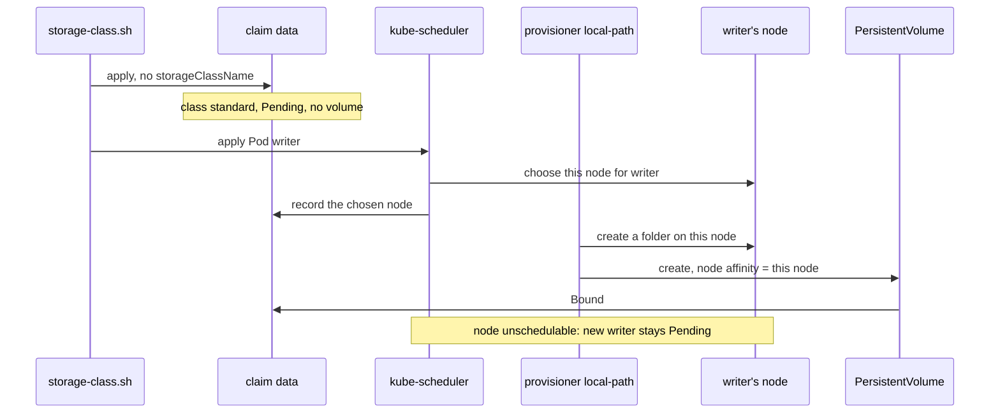

## Before you start

- [[k8s.l2.persistent-volume-claims]] — the claim `data` turned `Bound` to a PersistentVolume you never wrote; this lesson shows where that volume came from.
- [[k8s.l1.control-plane-components]] — kube-scheduler assigns each Pod to a node; here that choice also decides where a volume is created.
- [[k8s.l1.cluster-nodes-and-control-plane]] — `donhang` has one control-plane node and two workers, each a Docker container made by kind; a volume ends up inside one of them.

## The situation

In the last lesson, `pvc.sh` applied the claim `data` and the Pod `writer`, and the claim turned `Bound` to a PersistentVolume. You never wrote that PersistentVolume. Next you want `db` to keep the orders on a claim of its own. Before you trust it with them, you want to know where in the cluster `donhang` the files physically sit, and what happens to them if a worker node is lost, or if you delete the cluster and create it again. `kubectl get pv` lists the volume, but its columns do not say who made it. Who created that PersistentVolume, and what ties its files to one place?

## Core concepts

- **StorageClass** — an object that names a provisioner, the component that creates PersistentVolumes, together with the settings it uses; a claim picks one by name in `storageClassName`.
- Default StorageClass — the class marked `(default)` by `kubectl get storageclass`; a claim that names no class gets it, and in a kind cluster it is `standard`.
- **dynamic provisioning** — creating a PersistentVolume at the moment a claim needs one, through the claim's StorageClass, so nobody creates volumes ahead of time.
- `WaitForFirstConsumer` — a binding mode, the StorageClass setting that decides when its provisioner creates a claim's volume: here the claim stays `Pending` until a Pod that uses it is scheduled, and the volume is then created to suit that Pod's node.
- Node affinity of a PersistentVolume — the nodes the volume records as the ones it can be used from; a Pod that uses the volume can run only on one of them.
- Unschedulable node — a node kube-scheduler places no new Pods on, while Pods already running there keep running; `kubectl cordon` marks a node so, `kubectl uncordon` undoes it.

## How it works



In the situation above, the claim `data` names no class, so Kubernetes gives it the cluster's default StorageClass, `standard`. `kubectl get storageclass` shows its provisioner, `rancher.io/local-path`, and its binding mode, `WaitForFirstConsumer`.

Because of that mode, the claim first reads `Pending` and no PersistentVolume exists: nothing is created while no Pod needs the storage. The script then applies `writer`. kube-scheduler chooses a node for it and, through the API server, records that node on the claim. The provisioner runs in the cluster and reads claims through the API server, so only then does it act: it creates a folder under `/var/local-path-provisioner/` on that node, and a PersistentVolume that describes the folder. The claim turns `Bound`. This is dynamic provisioning: the StorageClass decided who answers the claim, and the answer was made on demand.

The folder exists on one node, so the PersistentVolume records that node in its node affinity. From then on, every Pod that uses `data` can run only there. The script marks that node unschedulable, deletes `writer` and applies it again. The new `writer` has nowhere to go: the other worker is not the volume's node, and the volume's node takes no new Pods. It stays `Pending` until the node is schedulable again.

The same tie sets what a failure costs. kind runs each node as a Docker container, and `deploy/k8s/kind-config.yaml` maps no folder of your machine into the nodes, so the folder lives only inside that one node. Lose that node and the cluster loses the folder; delete the cluster and every node goes, the folder with it. Copies on other nodes take a provisioner built to make them.

## In the Đơn Hàng system

```yaml file=deploy/k8s/lessons/data-pvc.yaml tag=stage-3 lines=1-15
# lesson: k8s.l2.persistent-volume-claims
# lesson: k8s.l2.storage-classes
# A request for storage, not storage: 100 MiB that one node at a time may
# mount read-write. No storageClassName, so the cluster's default
# StorageClass provides it (standard in a kind cluster).
apiVersion: v1
kind: PersistentVolumeClaim
metadata:
  name: data
  namespace: storage-lessons
spec:
  accessModes: ["ReadWriteOnce"]
  resources:
    requests:
      storage: 100Mi
```

This is the same claim as in the last lesson. Look at what `spec` leaves out: there is no `storageClassName`, so the choice of class falls to the cluster's default. In the output below, `kubectl get storageclass` marks `standard` as `(default)`, and the PersistentVolume that appears later reports `storage class: standard`.

```bash file=scripts/k8s/storage-class.sh tag=stage-3 lines=28-49
# The provisioner created the volume as a folder on the node kube-scheduler
# chose for writer, and the PersistentVolume records that node.
pod_node=$(kubectl get pod writer -n storage-lessons -o jsonpath='{.spec.nodeName}')
pv=$(kubectl get pvc data -n storage-lessons -o jsonpath='{.spec.volumeName}')
pv_node=$(kubectl get pv "$pv" -o jsonpath='{.spec.nodeAffinity.required.nodeSelectorTerms[0].matchExpressions[0].values[0]}')
echo "== the PersistentVolume"
kubectl get pv "$pv" -o jsonpath='storage class: {.spec.storageClassName}{"\n"}reclaim policy: {.spec.persistentVolumeReclaimPolicy}{"\n"}folder: {.spec.hostPath.path}{.spec.local.path}{"\n"}'
echo "node in its nodeAffinity is writer's node: $([ "$pv_node" = "$pod_node" ] && echo yes || echo no)"
echo

# lesson: k8s.l2.storage-classes
# Mark that node unschedulable, delete writer and create it again: the only
# node its volume can be mounted on takes no new Pods, so it stays Pending.
echo "\$ kubectl cordon <writer's node>"
kubectl cordon "$pod_node" >/dev/null
show kubectl delete pod writer -n storage-lessons
show kubectl apply -f deploy/k8s/lessons/data-writer-pod.yaml
sleep 10
show kubectl get pod writer -n storage-lessons -o custom-columns=NAME:.metadata.name,STATUS:.status.phase
echo "== why, from the scheduler"
kubectl get events -n storage-lessons --field-selector involvedObject.name=writer,reason=FailedScheduling \
  -o jsonpath='{.items[-1:].message}{"\n"}' | sed -E 's/^0\/[0-9]+ nodes are available: //'
```

```text output=true
$ kubectl get storageclass
NAME                 PROVISIONER             RECLAIMPOLICY   VOLUMEBINDINGMODE      ALLOWVOLUMEEXPANSION   AGE
standard (default)   rancher.io/local-path   Delete          WaitForFirstConsumer   false                  ...

$ kubectl apply -f deploy/k8s/lessons/data-pvc.yaml
persistentvolumeclaim/data created
claim data: Pending, PersistentVolumes for it: 0
$ kubectl apply -f deploy/k8s/lessons/data-writer-pod.yaml
pod/writer created
claim data: Bound

== the PersistentVolume
storage class: standard
reclaim policy: Delete
folder: /var/local-path-provisioner/pvc-..._storage-lessons_data
node in its nodeAffinity is writer's node: yes

$ kubectl cordon <writer's node>
$ kubectl delete pod writer -n storage-lessons
pod "writer" deleted from storage-lessons namespace
$ kubectl apply -f deploy/k8s/lessons/data-writer-pod.yaml
pod/writer created
$ kubectl get pod writer -n storage-lessons -o custom-columns=NAME:.metadata.name,STATUS:.status.phase
NAME     STATUS
writer   Pending
== why, from the scheduler
1 node(s) didn't match PersistentVolume's node affinity, 1 node(s) had untolerated taint(s), 1 node(s) were unschedulable. no new claims to deallocate, preemption: 0/3 nodes are available: 3 Preemption is not helpful for scheduling.

$ kubectl uncordon <writer's node>
$ kubectl get pod writer -n storage-lessons -o custom-columns=NAME:.metadata.name,STATUS:.status.phase
NAME     STATUS
writer   Running
```

Above the excerpt, the script applies the claim, waits five seconds and counts PersistentVolumes for it: none, and the claim is `Pending`. Only after `writer` is applied does it read `Bound`. `show`, also defined above the excerpt, prints a command after `$` and then runs it.

Lines 30–32 read three names: the node `writer` runs on, the volume bound to the claim, and the node in that volume's node affinity. Line 34 prints the volume's class, policy and folder; the folder can sit in either of two fields, so it reads both. Line 35 compares the two nodes and prints `yes`.

Lines 41–42 mark the node unschedulable with `kubectl cordon`, then the script recreates `writer`. When the scheduler cannot place a Pod, it records a `FailedScheduling` event about that Pod whose message lists why each node was ruled out, and `kubectl get events` lists such events. Lines 48–49 print the last one, with the `0/3 nodes are available:` prefix cut off by `sed`. The other worker does not match the volume's node affinity, the volume's node is unschedulable, and the control-plane node is excluded for a reason outside this lesson, as is the rest of the line after `were unschedulable.` Below the excerpt, `kubectl uncordon` makes the node schedulable again, and `writer` turns `Running` there. `RECLAIMPOLICY` and the `reclaim policy:` line belong to the next lesson; `ALLOWVOLUMEEXPANSION` is not used here.

## Seniors often assume…

- **"A volume in a kind cluster lives on the laptop's disk and survives deleting the cluster."** → Actually it is a folder inside one node, and kind runs each node as a Docker container. Deleting the cluster deletes every node container, and the folder goes with its node. You notice this when `storage-class.sh` prints the folder `/var/local-path-provisioner/...`, a path inside the node, and `deploy/k8s/kind-config.yaml` lists only nodes, no folder of your machine.
- **"A Pod with a persistent volume can be moved to any node, like a Pod without one."** → Actually its PersistentVolume records one node in its node affinity, and kube-scheduler places Pods that use the volume only there. If that node is unschedulable or gone, the Pod waits. You notice this when a replacement Pod stays `Pending` and its events say `didn't match PersistentVolume's node affinity`.
- **"Every cluster's default StorageClass behaves the way kind's does."** → Actually the default is whatever class was marked as default in that cluster; its provisioner decides where volumes live, and its binding mode decides when they are created. With the mode `Immediate`, a volume is created as soon as the claim exists, before any Pod. Some clusters have no default at all. You notice this when `kubectl get storageclass` on another cluster shows a different `PROVISIONER` or `VOLUMEBINDINGMODE`, or no `(default)`.

## Try it (3 minutes)

With the cluster `donhang` running (`scripts/k8s/cluster-up.sh`), in the `don-hang` folder:

1. Run `scripts/k8s/storage-class.sh`.
2. Find the first `claim data:` line, printed before `writer` is applied, and the line under `== why, from the scheduler`.

Expected result: the output matches the one shown above. The first line reads `claim data: Pending, PersistentVolumes for it: 0`; the scheduler's line names `PersistentVolume's node affinity` for one node and `unschedulable` for another; the script ends with `writer` `Running`.

## Connections

- [[k8s.l2.persistent-volume-claims]] — prerequisite: the same claim and Pod, now seen from the storage side.
- [[k8s.l2.reclaim-policy]] — next: what happens to this PersistentVolume and its folder when the claim is deleted.
- [[k8s.l3.replicated-volumes]] — the fix for one gap left here: a provisioner that keeps copies of each volume on several nodes, so one lost node no longer loses the data.
- [[devops.l3.disaster-recovery-drill]] — the reason to rehearse recovery: a volume kept on one node is lost with that node or its cluster.

## Five-line summary

1. A StorageClass names a provisioner that creates a PersistentVolume when a claim asks, so nobody creates volumes ahead of time.
2. A claim without `storageClassName` gets the default StorageClass; in kind that is `standard`, with the provisioner `rancher.io/local-path`.
3. `standard` waits for the first Pod using the claim, then creates the volume as a folder on that Pod's node.
4. The PersistentVolume records that node, so later Pods using the claim run only there; while it is unschedulable, they stay `Pending`.
5. kind's volumes have no copy elsewhere: losing the node or deleting the cluster loses the data; copies need a different provisioner.
