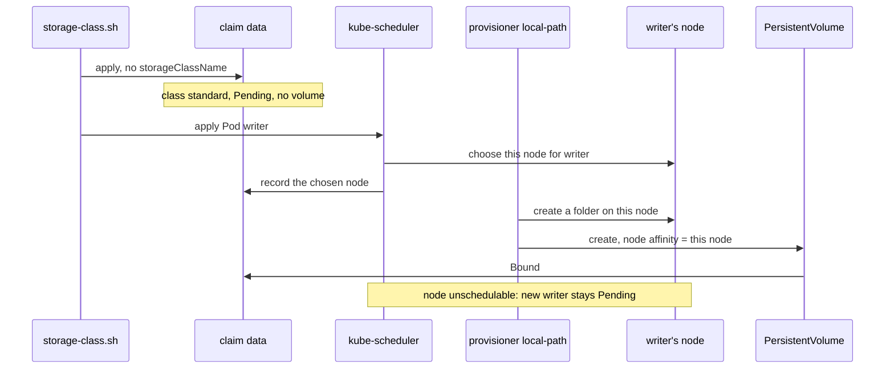

## Bạn cần biết trước

- [[k8s.l2.persistent-volume-claims]] — claim `data` chuyển sang `Bound` với một PersistentVolume mà bạn chưa hề viết; bài này cho thấy volume đó từ đâu ra.
- [[k8s.l1.control-plane-components]] — kube-scheduler chọn node cho từng Pod; ở đây lựa chọn đó còn quyết định volume được tạo ở đâu.
- [[k8s.l1.cluster-nodes-and-control-plane]] — `donhang` có một node control-plane và hai worker, mỗi node là một container Docker do kind tạo; volume rốt cuộc nằm bên trong một trong số đó.

## Tình huống

Ở bài trước, `pvc.sh` apply claim `data` và Pod `writer`, rồi claim chuyển sang `Bound` với một PersistentVolume. Bạn chưa hề viết PersistentVolume đó. Bước tiếp theo, bạn muốn `db` giữ các đơn hàng trên một claim riêng. Trước khi giao dữ liệu cho nó, bạn muốn biết file thực sự nằm ở đâu trong cluster `donhang`, và chuyện gì xảy ra với chúng khi mất một worker node, hoặc khi bạn xóa cluster rồi tạo lại. `kubectl get pv` liệt kê volume, nhưng không cột nào cho biết ai tạo ra nó. Ai đã tạo PersistentVolume đó, và điều gì buộc file của nó vào một chỗ?

## Khái niệm cốt lõi

- **StorageClass** (Object nêu provisioner và tham số dùng để tạo PersistentVolume khi có claim yêu cầu) — object ghi tên một provisioner, tức thành phần tạo ra PersistentVolume, cùng các thiết lập nó dùng; claim chọn một StorageClass bằng tên trong `storageClassName`.
- StorageClass mặc định — class được `kubectl get storageclass` đánh dấu `(default)`; claim không ghi tên class nào sẽ nhận class này, và trong cluster kind đó là `standard`.
- **dynamic provisioning** (Tạo PersistentVolume tự động khi có claim, theo StorageClass, thay vì tạo sẵn bằng tay) — tạo PersistentVolume đúng lúc một claim cần, thông qua StorageClass của claim, nên không ai phải tạo volume trước.
- `WaitForFirstConsumer` — một binding mode, tức thiết lập của StorageClass quyết định khi nào provisioner tạo volume cho claim: ở mode này claim nằm ở `Pending` cho tới khi một Pod dùng nó được xếp lịch, rồi volume được tạo cho hợp với node của Pod đó.
- Node affinity của PersistentVolume — các node mà volume ghi lại là nơi được phép dùng nó; Pod dùng volume chỉ chạy được trên một trong các node đó.
- Node unschedulable — node mà kube-scheduler không đặt thêm Pod mới nào lên, trong khi các Pod đang chạy ở đó vẫn chạy tiếp; `kubectl cordon` đánh dấu node như vậy, `kubectl uncordon` gỡ dấu đó.

## Cơ chế hoạt động



Trong tình huống trên, claim `data` không ghi tên class nào, nên Kubernetes gán cho nó StorageClass mặc định của cluster là `standard`. `kubectl get storageclass` cho thấy provisioner của class này là `rancher.io/local-path`, và binding mode là `WaitForFirstConsumer`.

Vì mode đó, lúc đầu claim ở `Pending` và chưa có PersistentVolume nào: khi chưa Pod nào cần lưu trữ thì chưa có gì được tạo. Sau đó script apply `writer`. kube-scheduler chọn một node cho Pod và, thông qua API server, ghi node đó lên claim. Provisioner chạy trong cluster và đọc claim qua API server, nên tới lúc này nó mới ra tay: nó tạo một thư mục dưới `/var/local-path-provisioner/` trên node đó, cùng một PersistentVolume mô tả thư mục ấy. Claim chuyển sang `Bound`. Đây chính là dynamic provisioning: StorageClass quyết định ai đáp ứng claim, và phần đáp ứng được tạo ra đúng lúc cần.

Thư mục chỉ tồn tại trên một node, nên PersistentVolume ghi node đó vào node affinity của mình. Từ đó trở đi, mọi Pod dùng `data` chỉ chạy được trên node ấy. Script đánh dấu node đó unschedulable, xóa `writer` rồi apply lại. `writer` mới không có chỗ nào để đi: worker còn lại không phải node của volume, còn node của volume thì không nhận Pod mới. Pod nằm ở `Pending` cho tới khi node được xếp lịch trở lại.

Cũng chính mối ràng buộc này quyết định một sự cố gây thiệt hại tới đâu. kind chạy mỗi node thành một container Docker, và `deploy/k8s/kind-config.yaml` không map thư mục nào trên máy bạn vào các node, nên thư mục chỉ nằm bên trong đúng một node. Mất node đó thì cluster mất thư mục. Xóa cluster thì mọi node đều biến mất, thư mục đi theo. Muốn có bản sao trên các node khác thì cần một provisioner được làm ra để tạo bản sao.

## Trong hệ thống Đơn Hàng

```yaml file=deploy/k8s/lessons/data-pvc.yaml tag=stage-3 lines=1-15
# lesson: k8s.l2.persistent-volume-claims
# lesson: k8s.l2.storage-classes
# A request for storage, not storage: 100 MiB that one node at a time may
# mount read-write. No storageClassName, so the cluster's default
# StorageClass provides it (standard in a kind cluster).
apiVersion: v1
kind: PersistentVolumeClaim
metadata:
  name: data
  namespace: storage-lessons
spec:
  accessModes: ["ReadWriteOnce"]
  resources:
    requests:
      storage: 100Mi
```

Đây vẫn là claim của bài trước. Hãy để ý thứ `spec` bỏ trống: không có `storageClassName`, nên chọn class nào là do class mặc định của cluster. Trong output bên dưới, `kubectl get storageclass` đánh dấu `standard` là `(default)`, và PersistentVolume xuất hiện sau đó báo `storage class: standard`.

```bash file=scripts/k8s/storage-class.sh tag=stage-3 lines=28-49
# The provisioner created the volume as a folder on the node kube-scheduler
# chose for writer, and the PersistentVolume records that node.
pod_node=$(kubectl get pod writer -n storage-lessons -o jsonpath='{.spec.nodeName}')
pv=$(kubectl get pvc data -n storage-lessons -o jsonpath='{.spec.volumeName}')
pv_node=$(kubectl get pv "$pv" -o jsonpath='{.spec.nodeAffinity.required.nodeSelectorTerms[0].matchExpressions[0].values[0]}')
echo "== the PersistentVolume"
kubectl get pv "$pv" -o jsonpath='storage class: {.spec.storageClassName}{"\n"}reclaim policy: {.spec.persistentVolumeReclaimPolicy}{"\n"}folder: {.spec.hostPath.path}{.spec.local.path}{"\n"}'
echo "node in its nodeAffinity is writer's node: $([ "$pv_node" = "$pod_node" ] && echo yes || echo no)"
echo

# lesson: k8s.l2.storage-classes
# Mark that node unschedulable, delete writer and create it again: the only
# node its volume can be mounted on takes no new Pods, so it stays Pending.
echo "\$ kubectl cordon <writer's node>"
kubectl cordon "$pod_node" >/dev/null
show kubectl delete pod writer -n storage-lessons
show kubectl apply -f deploy/k8s/lessons/data-writer-pod.yaml
sleep 10
show kubectl get pod writer -n storage-lessons -o custom-columns=NAME:.metadata.name,STATUS:.status.phase
echo "== why, from the scheduler"
kubectl get events -n storage-lessons --field-selector involvedObject.name=writer,reason=FailedScheduling \
  -o jsonpath='{.items[-1:].message}{"\n"}' | sed -E 's/^0\/[0-9]+ nodes are available: //'
```

```text output=true
$ kubectl get storageclass
NAME                 PROVISIONER             RECLAIMPOLICY   VOLUMEBINDINGMODE      ALLOWVOLUMEEXPANSION   AGE
standard (default)   rancher.io/local-path   Delete          WaitForFirstConsumer   false                  ...

$ kubectl apply -f deploy/k8s/lessons/data-pvc.yaml
persistentvolumeclaim/data created
claim data: Pending, PersistentVolumes for it: 0
$ kubectl apply -f deploy/k8s/lessons/data-writer-pod.yaml
pod/writer created
claim data: Bound

== the PersistentVolume
storage class: standard
reclaim policy: Delete
folder: /var/local-path-provisioner/pvc-..._storage-lessons_data
node in its nodeAffinity is writer's node: yes

$ kubectl cordon <writer's node>
$ kubectl delete pod writer -n storage-lessons
pod "writer" deleted from storage-lessons namespace
$ kubectl apply -f deploy/k8s/lessons/data-writer-pod.yaml
pod/writer created
$ kubectl get pod writer -n storage-lessons -o custom-columns=NAME:.metadata.name,STATUS:.status.phase
NAME     STATUS
writer   Pending
== why, from the scheduler
1 node(s) didn't match PersistentVolume's node affinity, 1 node(s) had untolerated taint(s), 1 node(s) were unschedulable. no new claims to deallocate, preemption: 0/3 nodes are available: 3 Preemption is not helpful for scheduling.

$ kubectl uncordon <writer's node>
$ kubectl get pod writer -n storage-lessons -o custom-columns=NAME:.metadata.name,STATUS:.status.phase
NAME     STATUS
writer   Running
```

Phía trên đoạn trích, script apply claim, chờ năm giây rồi đếm số PersistentVolume của claim: không có cái nào, và claim đang `Pending`. Chỉ sau khi `writer` được apply, claim mới hiện `Bound`. `show`, cũng được định nghĩa phía trên đoạn trích, in lệnh ra sau dấu `$` rồi chạy nó.

Dòng 30–32 đọc ba cái tên: node mà `writer` đang chạy, volume đã bind với claim, và node nằm trong node affinity của volume đó. Dòng 34 in class, policy và thư mục của volume. Thư mục có thể nằm ở một trong hai field, nên lệnh đọc cả hai. Dòng 35 so sánh hai node và in `yes`.

Dòng 41–42 đánh dấu node unschedulable bằng `kubectl cordon`, rồi script tạo lại `writer`. Khi không xếp được một Pod, scheduler ghi một event `FailedScheduling` về Pod đó, trong message liệt kê lý do từng node bị loại, và `kubectl get events` liệt kê các event như thế. Dòng 48–49 in event cuối cùng, phần đầu `0/3 nodes are available:` bị `sed` cắt đi. Worker còn lại không khớp node affinity của volume, node của volume đang unschedulable, còn node control-plane bị loại vì một lý do nằm ngoài bài này, phần còn lại của dòng sau `were unschedulable.` cũng vậy. Phía dưới đoạn trích, `kubectl uncordon` cho node được xếp lịch trở lại, và `writer` chuyển sang `Running` ở đó. `RECLAIMPOLICY` và dòng `reclaim policy:` thuộc về bài sau. `ALLOWVOLUMEEXPANSION` không dùng ở đây.

## Senior hay nhầm rằng…

- **"Volume trong cluster kind nằm trên ổ đĩa laptop và vẫn còn sau khi xóa cluster."** → Thực ra nó là một thư mục bên trong một node, và kind chạy mỗi node thành một container Docker. Xóa cluster là xóa mọi container node, và thư mục đi theo node của nó. Bạn sẽ nhận ra khi `storage-class.sh` in thư mục `/var/local-path-provisioner/...`, một đường dẫn bên trong node, còn `deploy/k8s/kind-config.yaml` chỉ liệt kê các node, không có thư mục nào trên máy bạn.
- **"Pod có persistent volume chuyển sang node nào cũng được, như Pod không có volume."** → Thực ra PersistentVolume của nó ghi một node trong node affinity, và kube-scheduler chỉ đặt Pod dùng volume đó lên node ấy. Nếu node đó unschedulable hoặc không còn, Pod phải chờ. Bạn sẽ nhận ra khi một Pod thay thế cứ nằm ở `Pending` và event của nó ghi `didn't match PersistentVolume's node affinity`.
- **"StorageClass mặc định của cluster nào cũng hoạt động giống của kind."** → Thực ra class mặc định là class nào được đánh dấu mặc định trong cluster đó. Provisioner của nó quyết định volume nằm ở đâu, binding mode của nó quyết định khi nào volume được tạo. Với mode `Immediate`, volume được tạo ngay khi claim xuất hiện, trước khi có Pod nào. Có cluster còn không có class mặc định. Bạn sẽ nhận ra khi `kubectl get storageclass` trên một cluster khác hiện `PROVISIONER` hoặc `VOLUMEBINDINGMODE` khác, hoặc không có `(default)`.

## Thử ngay (3 phút)

Với cluster `donhang` đang chạy (`scripts/k8s/cluster-up.sh`), trong thư mục `don-hang`:

1. Chạy `scripts/k8s/storage-class.sh`.
2. Tìm dòng `claim data:` đầu tiên, in ra trước khi `writer` được apply, và dòng dưới `== why, from the scheduler`.

Kết quả mong đợi: output khớp với output ở trên. Dòng đầu tiên là `claim data: Pending, PersistentVolumes for it: 0`. Dòng của scheduler nêu `PersistentVolume's node affinity` cho một node và `unschedulable` cho một node khác. Script kết thúc với `writer` ở `Running`.

## Liên hệ

- [[k8s.l2.persistent-volume-claims]] — bài cần trước: cùng claim và Pod đó, giờ nhìn từ phía lưu trữ.
- [[k8s.l2.reclaim-policy]] — bài tiếp: PersistentVolume này và thư mục của nó ra sao khi claim bị xóa.
- [[k8s.l3.replicated-volumes]] — cách lấp một lỗ hổng còn để lại ở đây: provisioner giữ bản sao của mỗi volume trên nhiều node, nên mất một node không còn làm mất dữ liệu.
- [[devops.l3.disaster-recovery-drill]] — lý do phải diễn tập khôi phục: volume nằm trên một node sẽ mất cùng node đó hoặc cùng cluster của nó.

## Tóm tắt 5 dòng

1. StorageClass ghi tên một provisioner, thành phần tạo PersistentVolume khi claim yêu cầu, nên không ai phải tạo volume trước.
2. Claim không có `storageClassName` nhận StorageClass mặc định; trong kind đó là `standard`, với provisioner `rancher.io/local-path`.
3. `standard` chờ Pod đầu tiên dùng claim, rồi tạo volume thành một thư mục trên node của Pod đó.
4. PersistentVolume ghi lại node đó, nên các Pod dùng claim về sau chỉ chạy ở đó; khi node unschedulable, chúng nằm ở `Pending`.
5. Volume của kind không có bản sao ở đâu khác: mất node hoặc xóa cluster là mất dữ liệu; muốn có bản sao thì cần provisioner khác.
