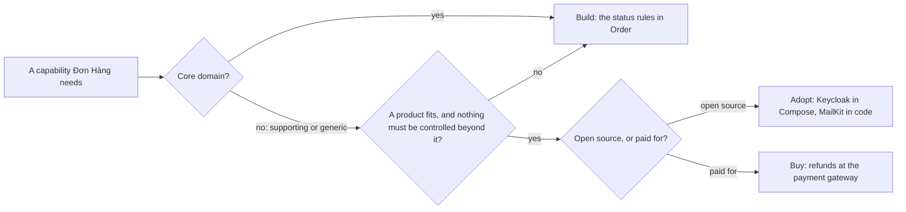

## Before you start

- [[design.l3.subdomains]] — you know the core domain is where Đơn Hàng competes, and that signing in and sending email are generic subdomains that others' work already solves.
- [[management.l3.weighing-options-in-an-adr]] — you know a decision weighs the options the team seriously considered against the same needs.

## The situation

Before Sprint 15 planning, a new teammate reads `docs/team/refund-requirements.md` at stage-2. Today, it says, staff refund an order by hand on the admin page of the payment gateway, another company's service that takes customers' payments for Đơn Hàng. The teammate has also looked at the repository: the order rules sit in `Order`, and signing in is a Keycloak container in `docker-compose.yml`. "So some of this we wrote, some we run, and some we pay for," they say. "Refunds are about money. Shouldn't we write that part ourselves?" How does a team decide, for each thing the system must do, whether to write it, run someone else's software, or pay someone else for it?

## Core concepts

- **build vs buy** — the decision about how to get a capability: build it in the team's own code, buy it, or adopt open source; the name keeps only two of the three ways.
- capability — something the system must be able to do, such as checking a password, sending an email or returning a customer's money.
- build — the team writes the code and keeps it working itself, as Đơn Hàng does with the status rules in `Order`.
- buy — the team pays for a product, or for a service that someone else runs, as Đơn Hàng does with the payment gateway.
- adopt — the team takes open source software, whose code anyone may use and run without paying a licence fee, and runs it itself, either as a library inside its code or as a server of its own.

## How it works



The diagram takes one capability at a time, from the left.

The first question is whether the capability belongs to the core domain. Đơn Hàng competes on taking and handling orders, so the rules for cancelling, shipping and marking an order paid are built: they are methods of `Order`.

Signing in is not core; it is generic. Up to stage-1, Đơn Hàng signed its own tokens and hashed passwords itself. Stage-2 removed `JwtTokenService` and `PasswordHasher` and handed signing in to Keycloak, because others' work already solves it. A supporting subdomain, such as the product list, takes the same branch; at stage-2 the team builds it simply, as a direct query.

The second question is whether a product fits the need, and whether the team must control something no product offers. For example, the refund requirements ask that no order is ever refunded twice, even when a request to the gateway is retried; if the gateway could not promise that, Đơn Hàng would keep that check in its own code. If nothing fits, or control is needed, the team builds.

Otherwise the last question is whether the team takes open source or pays. Keycloak runs as a container in Compose, and MailKit is a library inside `MailKitEmailSender`: both adopted. Refunds happen on the payment gateway: bought. The gateway moves the money back; what Đơn Hàng will write, and what ADR `0003` places, is the part around it: taking a customer's request and passing it to the gateway.

That path is a common default, not a law. It also answers the teammate: returning money is critical, but it does not set Đơn Hàng apart, and the gateway already does it.

## In the Đơn Hàng system

Adopting comes in two sizes. The first is a library inside the code:

```csharp file=DonHang.Infrastructure/MailKitEmailSender.cs tag=stage-2 lines=15-34
// lesson: design.l2.adapter-pattern
// Implements Đơn Hàng's IEmailSender with MailKit: builds a MimeMessage and
// hands it to MailKit's SmtpClient. Only this class knows MailKit exists.
public sealed class MailKitEmailSender(SmtpSettings smtp) : IEmailSender
{
    public async Task SendAsync(string toAddress, string subject, string body, CancellationToken cancellationToken)
    {
        var message = new MimeMessage();
        message.From.Add(new MailboxAddress("Đơn Hàng", "orders@donhang.local"));
        message.To.Add(MailboxAddress.Parse(toAddress));
        message.Subject = subject;
        message.Body = new TextPart("plain") { Text = body };

        using var client = new SmtpClient { Timeout = 10_000 };
        // Mailpit in the lab speaks plain SMTP, without TLS.
        await client.ConnectAsync(smtp.Host, smtp.Port, SecureSocketOptions.None, cancellationToken);
        await client.SendAsync(message, cancellationToken);
        await client.DisconnectAsync(quit: true, cancellationToken);
    }
}
```

Line 17 says only this class knows MailKit exists. MailKit arrives as a package and runs inside the API's own process, so there is nothing extra to start. The team's work is this adapter and keeping the package version current. Line 29 is about the lab only: Mailpit is the stand-in mail server it runs, SMTP is the protocol for sending email, and neither matters here.

The second is a whole server:

```yaml file=docker-compose.yml tag=stage-2 lines=188-208
  # lesson: backend.l2.oauth2-roles
  # The authorization server: customers and staff type their passwords here,
  # never into DonHang.App or DonHang.Api. start-dev keeps its data inside the
  # container and imports the realm file below the first time it starts.
  keycloak:
    image: quay.io/keycloak/keycloak:26.7.4
    container_name: donhang-keycloak
    hostname: keycloak
    command: ["start-dev", "--import-realm"]
    environment:
      KC_BOOTSTRAP_ADMIN_USERNAME: "admin"
      KC_BOOTSTRAP_ADMIN_PASSWORD: "${KEYCLOAK_ADMIN_PASSWORD}"
      # Every URL Keycloak hands out, and the issuer in every token, uses
      # this one address, however the request reached it.
      KC_HOSTNAME: "http://localhost:8180"
      # ...except the endpoints a server calls directly (keys, token): asked
      # as keycloak:8080 by the api, Keycloak answers with keycloak:8080 URLs.
      KC_HOSTNAME_BACKCHANNEL_DYNAMIC: "true"
      KC_HEALTH_ENABLED: "true"
    volumes:
      - ./keycloak/donhang-realm.json:/opt/keycloak/data/import/donhang-realm.json:ro
```

Keycloak is a service of its own, and this block sets four things for it:

- line 193 pins its image;
- line 199 sets an admin password;
- line 202 sets the address it hands out;
- line 208 imports the realm file, Đơn Hàng's own sign-in setup: its roles, its app and its users.

The other lines, including the comments about tokens, are settings this lesson does not need. Lines 190–191 say `start-dev` keeps its data inside the container. Every one of these is the team's to set, to check on each upgrade and, for data that must survive, to back up. MailKit brings none of the server's share: no image, password, address or data to back up, only its package version.

Neither charges a licence fee, since both are open source. That does not make them free: the team's time is the price, and the next lessons count it.

## Seniors often assume…

- **"Building in-house is cheaper, because there is no licence fee to pay."** → Actually the team pays with its own time, first to write the code and then to keep it working for as long as it exists. Up to stage-1 Đơn Hàng's tokens and password hashes were code of that kind; stage-2 removed it. You notice this when a part that was "free" because the team built it keeps taking sprint time nobody planned for.
- **"Open source software costs nothing, because nobody sends an invoice."** → Actually the cost moves from an invoice to the team's work: installing, configuring, upgrading and backing up what it runs. The tag `26.7.4` on line 193 changes only when someone on the team changes it and checks the result. You notice this when an adopted server is several versions behind and its upgrade has become a task of its own.
- **"Anything critical to the business, like signing in, must be built in-house."** → Actually critical and core are different questions: a part can be critical without setting the business apart. Signing in is critical to Đơn Hàng and generic, which is why stage-2 handed it to Keycloak. You notice this when a proposal to rewrite a generic part gives "it is critical" as its only reason.

## Try it (3 minutes)

1. Open `docker-compose.yml` in the `don-hang` repository at tag `stage-2` and list the services that have a `build:` key.
2. For every other service, note its `image:` line.

Expected result: three services have `build:`. `lab` is the box the lessons run on; `migrate` and `api` are both built from `DonHang.Api/Dockerfile`, Đơn Hàng's own code. Every other service runs an image someone else publishes, such as `postgres:17.6-alpine` or `quay.io/keycloak/keycloak:26.7.4`, which the team runs itself.

One capability from the situation appears in no service of this file. Which one, and why?

<details><summary>Suggested answer</summary>

Refunds. They are bought: the payment gateway, which someone else runs, moves the money back, and staff use its admin page. Đơn Hàng runs no part of it, so nothing in `docker-compose.yml` starts it. Building that part instead would make a generic problem, returning money, the team's own code to write and keep working.

</details>

## Connections

- [[design.l3.subdomains]] — the kinds of subdomain that the default in this lesson follows.
- [[management.l3.weighing-options-in-an-adr]] — how to write the choice down, with build, buy and adopt as the options.
- [[backend.l2.oauth2-roles]] — the move of signing in from Đơn Hàng's code to Keycloak, seen from the protocol side.
- [[design.l3.conformist]] — one consequence of adopting Keycloak: Đơn Hàng uses its names as they are.
- [[design.l3.anti-corruption-layer]] — how `MailKitEmailSender` keeps an adopted library at the edge.
- [[management.l3.total-cost-of-ownership]] — the next step: counting what each way costs over several years.
- [[management.l3.self-hosting-costs]] — the work that running Keycloak and other adopted servers brings.

## Five-line summary

1. Build vs buy chooses how to get a capability: write it yourself, buy it, or adopt open source the team runs.
2. At stage-2 Đơn Hàng uses all three: `Order`'s rules are built, Keycloak is adopted, refunds are bought from the payment gateway.
3. Stage-2 removed the team's own token signing and password hashing, because signing in is generic and others' work already solves it.
4. Adopting can mean a library inside the code, like MailKit, or a whole server to run, like Keycloak, which brings far more work.
5. A common default builds the core domain and buys or adopts generic subdomains; open source charges no licence fee but costs the team's time.
