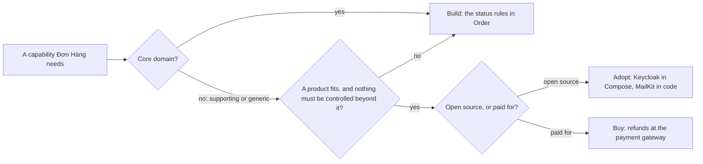

## Bạn cần biết trước

- [[design.l3.subdomains]] — bạn biết core domain là nơi Đơn Hàng cạnh tranh, còn đăng nhập và gửi email là generic subdomain, những bài toán người khác đã giải xong.
- [[management.l3.weighing-options-in-an-adr]] — bạn biết một quyết định cân các phương án đội đã xét nghiêm túc theo cùng những nhu cầu.

## Tình huống

Trước buổi lập kế hoạch Sprint 15, một đồng đội mới đọc `docs/team/refund-requirements.md` ở stage-2. Theo file này, hiện nhân viên hoàn tiền cho một đơn bằng tay trên trang quản trị của cổng thanh toán, dịch vụ của một công ty khác chuyên nhận tiền khách trả cho Đơn Hàng. Đồng đội ấy cũng đã xem repository: các quy tắc của đơn nằm trong `Order`, còn đăng nhập là một container Keycloak trong `docker-compose.yml`. "Vậy là có phần mình tự viết, có phần mình tự chạy, có phần mình trả tiền," họ nói. "Hoàn tiền dính tới tiền. Phần đó chẳng phải nên tự viết sao?" Với từng việc hệ thống phải làm, đội quyết định thế nào giữa tự viết, chạy phần mềm của người khác, hay trả tiền cho người khác lo?

## Khái niệm cốt lõi

- **build vs buy** (quyết định tự viết một năng lực, mua sản phẩm hay dịch vụ, hoặc dùng mã nguồn mở và tự chạy) — cách đội có được một năng lực: tự xây bằng code của mình, mua, hoặc dùng mã nguồn mở. Cái tên chỉ giữ lại hai trong ba cách.
- năng lực (capability) — một việc hệ thống phải làm được, như kiểm tra mật khẩu, gửi email hay trả lại tiền cho khách.
- tự xây (build) — đội tự viết code và tự giữ cho nó chạy được, như Đơn Hàng làm với các quy tắc trạng thái trong `Order`.
- mua (buy) — đội trả tiền cho một sản phẩm, hoặc cho một dịch vụ do người khác chạy, như Đơn Hàng làm với cổng thanh toán.
- dùng mã nguồn mở (adopt) — đội lấy phần mềm mã nguồn mở, loại phần mềm mà ai cũng được dùng và chạy code mà không trả phí bản quyền, rồi tự chạy nó, hoặc như một thư viện trong code, hoặc như một server riêng.

## Cơ chế hoạt động



Sơ đồ xét từng năng lực một, đi từ trái sang.

Câu hỏi đầu tiên: năng lực đó có thuộc core domain không. Đơn Hàng cạnh tranh ở khâu nhận và xử lý đơn, nên các quy tắc hủy đơn, giao đơn và đánh dấu đơn đã thanh toán do đội tự xây: chúng là các method của `Order`.

Đăng nhập không thuộc core mà là generic. Cho tới hết stage-1, Đơn Hàng vẫn tự ký token và tự hash mật khẩu. Stage-2 bỏ `JwtTokenService` và `PasswordHasher`, giao đăng nhập cho Keycloak, vì người khác đã giải xong bài toán này. Một supporting subdomain, như danh sách sản phẩm, cũng đi nhánh đó. Ở stage-2 đội xây nó thật đơn giản, chỉ là một truy vấn trực tiếp.

Câu hỏi thứ hai: có sản phẩm nào đáp ứng nhu cầu không, và đội có phải kiểm soát điều gì mà không sản phẩm nào cho không. Ví dụ, yêu cầu hoàn tiền đòi không đơn nào bị hoàn tiền hai lần, kể cả khi một request tới cổng được gửi lại. Nếu cổng không hứa được điều đó, Đơn Hàng sẽ giữ phần kiểm tra ấy trong code của mình. Không có gì phù hợp, hoặc cần kiểm soát, thì đội tự xây.

Nếu có sản phẩm phù hợp và không cần kiểm soát thêm, câu hỏi cuối là đội dùng mã nguồn mở hay trả tiền. Keycloak chạy như một container trong Compose, còn MailKit là một thư viện bên trong `MailKitEmailSender`: cả hai đều là dùng mã nguồn mở. Hoàn tiền diễn ra trên cổng thanh toán: đó là mua. Cổng lo chuyển tiền trả lại. Phần Đơn Hàng sẽ viết, cũng là phần mà ADR `0003` xác định chỗ đặt, là phần bao quanh: nhận yêu cầu của khách rồi chuyển cho cổng.

Con đường đó là một mặc định phổ biến, không phải luật. Nó cũng trả lời đồng đội mới: trả lại tiền là việc hệ trọng, nhưng không làm Đơn Hàng khác biệt, và cổng đã làm sẵn việc đó.

## Trong hệ thống Đơn Hàng

Dùng mã nguồn mở có hai cỡ. Cỡ thứ nhất là một thư viện bên trong code:

```csharp file=DonHang.Infrastructure/MailKitEmailSender.cs tag=stage-2 lines=15-34
// lesson: design.l2.adapter-pattern
// Implements Đơn Hàng's IEmailSender with MailKit: builds a MimeMessage and
// hands it to MailKit's SmtpClient. Only this class knows MailKit exists.
public sealed class MailKitEmailSender(SmtpSettings smtp) : IEmailSender
{
    public async Task SendAsync(string toAddress, string subject, string body, CancellationToken cancellationToken)
    {
        var message = new MimeMessage();
        message.From.Add(new MailboxAddress("Đơn Hàng", "orders@donhang.local"));
        message.To.Add(MailboxAddress.Parse(toAddress));
        message.Subject = subject;
        message.Body = new TextPart("plain") { Text = body };

        using var client = new SmtpClient { Timeout = 10_000 };
        // Mailpit in the lab speaks plain SMTP, without TLS.
        await client.ConnectAsync(smtp.Host, smtp.Port, SecureSocketOptions.None, cancellationToken);
        await client.SendAsync(message, cancellationToken);
        await client.DisconnectAsync(quit: true, cancellationToken);
    }
}
```

Dòng 17 nói chỉ class này biết MailKit tồn tại. MailKit đến dưới dạng một package và chạy bên trong process của chính API, nên không có gì phải khởi động thêm. Phần việc của đội là adapter này và giữ phiên bản package luôn mới. Dòng 29 chỉ liên quan tới lab: Mailpit là mail server thay thế mà lab chạy, SMTP là giao thức gửi email, và cả hai đều không quan trọng ở đây.

Cỡ thứ hai là cả một server:

```yaml file=docker-compose.yml tag=stage-2 lines=188-208
  # lesson: backend.l2.oauth2-roles
  # The authorization server: customers and staff type their passwords here,
  # never into DonHang.App or DonHang.Api. start-dev keeps its data inside the
  # container and imports the realm file below the first time it starts.
  keycloak:
    image: quay.io/keycloak/keycloak:26.7.4
    container_name: donhang-keycloak
    hostname: keycloak
    command: ["start-dev", "--import-realm"]
    environment:
      KC_BOOTSTRAP_ADMIN_USERNAME: "admin"
      KC_BOOTSTRAP_ADMIN_PASSWORD: "${KEYCLOAK_ADMIN_PASSWORD}"
      # Every URL Keycloak hands out, and the issuer in every token, uses
      # this one address, however the request reached it.
      KC_HOSTNAME: "http://localhost:8180"
      # ...except the endpoints a server calls directly (keys, token): asked
      # as keycloak:8080 by the api, Keycloak answers with keycloak:8080 URLs.
      KC_HOSTNAME_BACKCHANNEL_DYNAMIC: "true"
      KC_HEALTH_ENABLED: "true"
    volumes:
      - ./keycloak/donhang-realm.json:/opt/keycloak/data/import/donhang-realm.json:ro
```

Keycloak là một service riêng, và khối này đặt bốn thứ cho nó:

- dòng 193 ghim image,
- dòng 199 đặt mật khẩu admin,
- dòng 202 đặt địa chỉ mà Keycloak trao ra,
- dòng 208 import file realm, tức phần cài đặt đăng nhập của riêng Đơn Hàng: các vai trò, ứng dụng và người dùng của nó.

Các dòng còn lại, kể cả các comment về token, là cài đặt bài này không cần. Dòng 190–191 nói `start-dev` giữ dữ liệu bên trong container. Mọi thứ trong số này đều do đội đặt, đội kiểm tra lại mỗi lần nâng cấp, và với dữ liệu cần giữ lại thì đội phải sao lưu. MailKit không kéo theo phần nào trong số việc của server: không image, không mật khẩu, không địa chỉ, không dữ liệu phải sao lưu, chỉ có phiên bản package.

Cả hai đều không thu phí bản quyền, vì đều là mã nguồn mở. Điều đó không có nghĩa là chúng miễn phí: cái giá là thời gian của đội, và các bài tiếp theo sẽ đếm nó.

## Senior hay nhầm rằng…

- **"Tự xây thì rẻ hơn, vì không phải trả phí bản quyền."** → Thực ra đội trả bằng thời gian của chính mình, trước là để viết code, sau là để giữ code chạy được chừng nào nó còn tồn tại. Cho tới hết stage-1, phần token và password hash của Đơn Hàng là loại code như vậy, và stage-2 đã bỏ đi. Bạn sẽ nhận ra khi một phần "miễn phí" vì đội tự xây cứ ngốn thời gian sprint mà không ai lên kế hoạch.
- **"Phần mềm mã nguồn mở không tốn gì, vì chẳng ai gửi hóa đơn."** → Thực ra chi phí chỉ chuyển từ hóa đơn sang công sức của đội: cài đặt, cấu hình, nâng cấp và sao lưu những gì đội chạy. Tag `26.7.4` ở dòng 193 chỉ đổi khi có người trong đội đổi nó và kiểm tra kết quả. Bạn sẽ nhận ra khi một server mã nguồn mở đã chậm vài phiên bản, và lần nâng cấp nó đã thành hẳn một task riêng.
- **"Cái gì hệ trọng với doanh nghiệp, như đăng nhập, thì phải tự xây."** → Thực ra hệ trọng và core là hai câu hỏi khác nhau: một phần có thể hệ trọng mà không làm doanh nghiệp khác biệt. Đăng nhập hệ trọng với Đơn Hàng nhưng là generic, vì thế stage-2 đã giao nó cho Keycloak. Bạn sẽ nhận ra khi một đề xuất viết lại một phần generic chỉ đưa ra mỗi lý do "nó hệ trọng".

## Thử ngay (3 phút)

1. Mở `docker-compose.yml` trong repository `don-hang` ở tag `stage-2` và liệt kê các service có key `build:`.
2. Với mỗi service còn lại, ghi lại dòng `image:` của nó.

Kết quả mong đợi: ba service có `build:`. `lab` là máy chạy các bài học. `migrate` và `api` đều được build từ `DonHang.Api/Dockerfile`, tức code của chính Đơn Hàng. Mọi service còn lại chạy một image do người khác phát hành, như `postgres:17.6-alpine` hay `quay.io/keycloak/keycloak:26.7.4`, và đội tự chạy chúng.

Có một năng lực trong tình huống không xuất hiện ở service nào của file này. Đó là năng lực nào, và vì sao?

<details><summary>Gợi ý đáp án</summary>

Hoàn tiền. Đội mua năng lực này: cổng thanh toán, do người khác chạy, chuyển tiền trả lại, và nhân viên dùng trang quản trị của cổng. Đơn Hàng không chạy phần nào của cổng, nên trong `docker-compose.yml` không có gì khởi động nó. Nếu tự xây phần đó, đội sẽ biến một bài toán generic, trả lại tiền, thành code của chính mình phải viết và giữ cho chạy được.

</details>

## Liên hệ

- [[design.l3.subdomains]] — các loại subdomain mà mặc định trong bài này dựa theo.
- [[management.l3.weighing-options-in-an-adr]] — cách ghi lại lựa chọn, với tự xây, mua và dùng mã nguồn mở là các phương án.
- [[backend.l2.oauth2-roles]] — chuyện đăng nhập chuyển từ code của Đơn Hàng sang Keycloak, nhìn từ phía giao thức.
- [[design.l3.conformist]] — một hệ quả khi dùng Keycloak: Đơn Hàng dùng nguyên các tên của nó.
- [[design.l3.anti-corruption-layer]] — cách `MailKitEmailSender` giữ một thư viện mã nguồn mở ở rìa hệ thống.
- [[management.l3.total-cost-of-ownership]] — bước tiếp theo: tính mỗi cách tốn bao nhiêu qua vài năm.
- [[management.l3.self-hosting-costs]] — phần việc mà Keycloak và các server mã nguồn mở khác kéo theo khi đội tự chạy.

## Tóm tắt 5 dòng

1. Build vs buy chọn cách có được một năng lực: tự viết, mua, hoặc dùng mã nguồn mở do đội tự chạy.
2. Ở stage-2 Đơn Hàng dùng cả ba: quy tắc của `Order` do đội tự xây, Keycloak là mã nguồn mở, hoàn tiền thì mua ở cổng thanh toán.
3. Stage-2 bỏ phần tự ký token và tự hash mật khẩu, vì đăng nhập là generic và người khác đã giải xong.
4. Dùng mã nguồn mở có thể là một thư viện trong code, như MailKit, hoặc cả một server phải chạy, như Keycloak, kéo theo nhiều việc hơn hẳn.
5. Mặc định phổ biến là tự xây core domain, còn mua hoặc dùng mã nguồn mở cho generic subdomain. Mã nguồn mở không thu phí bản quyền nhưng tốn thời gian của đội.
