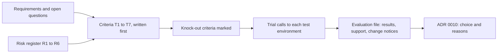

## Before you start

- [[management.l3.vendor-contract-terms]] — you have read the contract section of the gateway evaluation; this lesson reads the criteria and trials that come before it.
- [[management.l2.risk-register]] — you know the refund risks R1 to R6; this lesson turns two of them into criteria.
- [[management.l2.requirements-document]] — you know the numbered refund requirements and their open questions; this lesson takes criteria from them.

## The situation

It is the first week of Sprint 15. Before anyone writes the job that sends refunds, Đơn Hàng needs a payment gateway that accepts refund calls, and two candidates are on the table: Gateway A and Gateway B. Each vendor sends an overview of its features, prices and promises. A teammate suggests a shortcut: lay the two overviews side by side, pick the one with more features at the lower price, and start coding. You recall the refund requirements say an order must never be refunded twice, and the risk register warns that the refund API may behave differently from its documentation. How do you choose a vendor so that the choice answers your needs rather than its overview?

## Core concepts

- vendor evaluation — a written check of each candidate against criteria the team took from its own requirements and risks, with the result of every check recorded.
- criterion — one checkable need, numbered and traced to the requirement, open question or risk it comes from.
- knock-out criterion — a criterion a candidate must meet to stay in; a candidate that fails it is ruled out before anything else, price included, is compared.
- trial — checking a vendor's promise by calling its test environment, instead of reading its documentation.

## How it works



In the situation above, the evaluation starts on the left, with documents the team wrote before either vendor said anything. The requirements give the needs, such as YC-9: an order is never refunded twice, even when sending it to the gateway has to be retried. Their open questions give needs nobody can answer yet, such as whether bank transfer orders can be refunded through the gateway. The risk register gives the doubts, such as R1, which warns that the refund API may behave differently from its documentation, and rates that both likely and costly.

Each need becomes a numbered criterion with its source beside it. Writing them first matters because criteria written after reading the overviews tend to describe what the favourite already offers.

Next, the team marks which criteria are knock-out. A candidate that fails one is out, so a low price or a long feature list cannot buy back a missing idempotency key. A failure on any other criterion is a cost the team plans around, not a reason to rule the candidate out.

Then each promise that matters is tried. A trial call shows what the vendor's system does today; documentation shows what the vendor wrote about it. Because of R1, the team decides each criterion by the trial call, not by the documentation.

The evaluation file records every result, plus two things beyond features: how support answered during the trial and how the vendor announces changes. Last, the decision record names the chosen gateway and why, and points to the evaluation instead of copying it.

## In the Đơn Hàng system

The criteria section of the team's evaluation, written before either gateway was tried:

```markdown file=docs/team/payment-gateway-evaluation.md tag=stage-3 lines=8-23
### Tiêu chí, viết trước khi xem ứng viên

Mỗi tiêu chí lấy từ `refund-requirements.md` hoặc sổ rủi ro
(`risk-register-example.md`), không từ tài liệu giới thiệu của vendor. Tiêu
chí loại ngay đánh dấu "Loại ngay": ứng viên không đạt thì bị loại trước khi
so bất cứ điều gì khác, kể cả giá.

| Số | Tiêu chí | Nguồn | Loại ngay |
|---|---|---|---|
| T1 | Nhận idempotency key: gửi lại cùng key không hoàn tiền lần hai | YC-9, R2 | Loại ngay |
| T2 | Trả kết quả hoàn tiền ngay trong câu trả lời của lời gọi | thiết kế bước 6, R1 | |
| T3 | Có môi trường test, và môi trường đó chạy đúng như tài liệu | R1 | Loại ngay |
| T4 | Hoàn tiền được cho đơn chuyển khoản ngân hàng | câu hỏi mở của yêu cầu | |
| T5 | Thời hạn tối đa để hoàn tiền sau khi thanh toán | câu hỏi mở của yêu cầu | |
| T6 | Trả lý do khi từ chối hoàn tiền, để nhân viên xử lý | YC-6, R4 | |
| T7 | Xuất được lịch sử hoàn tiền cho kế toán | mục tiêu 2 của yêu cầu, R5 | |
```

Lines 10–13 state the rule: every criterion comes from `refund-requirements.md` or the risk register, not from a vendor's material, and a candidate that fails a knock-out criterion (`Loại ngay`) is out before anything else, price included, is compared. The `Nguồn` (source) column traces each row. T1, accepting an idempotency key so a resend with the same key does not refund twice, comes from YC-9 and R2, the risk that the gateway accepts no such key. T2, the refund result in the call's own answer, comes from R1 and step 6 of the refund design doc, which would have to change if a gateway reported only later by calling back. T4 and T5, refunding bank transfer orders and the longest time after payment a refund is allowed, come from the requirements' open questions. Only T1 and T3, a test environment that behaves as documented, are knock-out.

The results, each from a real call to a test environment:

```markdown file=docs/team/payment-gateway-evaluation.md tag=stage-3 lines=25-41
### Kết quả, thử trên môi trường test

Rủi ro R1 nói API hoàn tiền có thể chạy khác tài liệu, nên đội thử chứ không
đọc: mỗi tiêu chí là một lời gọi thật tới môi trường test của từng cổng.

| Số | Cổng A | Cổng B |
|---|---|---|
| T1 | Có: gửi lại cùng key trả lại đúng kết quả lần đầu, không tạo hoàn tiền mới | Không: tài liệu không nhắc tới; gửi hai lần tạo hai hoàn tiền |
| T2 | Có | Không: trả "đang xử lý", kết quả gọi ngược vào hệ thống sau |
| T3 | Có, chạy đúng tài liệu ở mọi lời gọi đã thử | Có, nhưng mã lỗi khác tài liệu ở hai lời gọi |
| T4 | Không: từ chối với lý do "chuyển khoản không hoàn qua cổng thẻ" | Có |
| T5 | 180 ngày | 120 ngày |
| T6 | Có, lý do bằng chữ trong câu trả lời 422 | Chỉ mã số, phải tra bảng |
| T7 | Có, tải CSV mọi lúc từ trang quản trị và qua API | Có, chỉ qua trang quản trị, mỗi tháng một lần |

Cổng B bị loại ở T1. Các dòng còn lại của Cổng B vẫn được ghi để lần đánh giá
sau không phải thử lại.
```

Lines 27–28 tie the method to R1: the team tried each criterion instead of reading about it. Line 32 shows why: Gateway B's documentation does not mention idempotency keys, and sending the same refund twice created two refunds. On line 34, Gateway B's error codes differ from its documentation in two calls. The file records that T3 as met with a caveat; by T3's own wording it would fail too, but B was already out at T1. Gateway A fails T4 on line 35, which is not knock-out; later the file closes that open question by having customer care refund bank transfers by hand, the response the risk register already gives R4 for refunds the gateway refuses. Lines 40–41 keep Gateway B's other rows, so a later evaluation need not try them again.

Further down, the same file records the two things beyond features. During the trial, Gateway A answered two technical questions within the day, with someone able to read the logs of the calls; Gateway B answered after three days with a link to its documentation. Gateway A keeps a page of changes for each API version and emails registered engineers; Gateway B posts news on its home page. The file notes that the team will live with both for years.

ADR `0010` records the choice of Gateway A and its reason, Gateway B ruled out at T1 because a resend after a network error could refund twice, against YC-9. It points to this file for the criteria, results, SLA and contract terms instead of repeating them. Every figure about the two gateways is assumed for teaching, not taken from a real vendor.

## Seniors often assume…

- **"The vendor with the longest feature list is the safest choice."** → Actually a feature list answers the vendor's question, what it can do, not yours, whether it meets each criterion. A missing feature does not appear on a list at all: Gateway B's documentation never mentions idempotency keys. You notice this when a gateway chosen for its many features refunds an order twice after a retry, and the one feature you needed was the one nobody checked.
- **"A vendor's documentation is enough to judge whether its API fits."** → Actually documentation says what the vendor intends, and a trial shows what its system does. Gateway B's test environment returned error codes that differ from its documentation in two calls. You notice this when your client code handles every documented error and a real answer still lands in the wrong branch.
- **"The criteria can be written after seeing what the candidates offer."** → Actually criteria written afterwards tend to follow the favourite's strengths and leave out needs no candidate advertises, such as the open question on refunding bank transfers. Writing them first, each with its source, keeps the evaluation about Đơn Hàng. You notice this when no criterion in an evaluation traces back to a requirement or a risk, and every one matches a line in one vendor's overview.

## Try it (3 minutes)

1. Open `docs/team/payment-gateway-evaluation.md` in the `don-hang` repository at tag `stage-3` and read the criteria table, lines 15–23.
2. A third candidate, Gateway C, arrives late. Its overview lists more features than both others, its price is the lowest, and its documentation says it accepts an idempotency key and refunds bank transfers. It offers no test environment. Using the table, decide what happens to Gateway C and at which criterion.

Expected result: Gateway C is ruled out at T3, a knock-out criterion, before its price or features are compared. T3 is the row that fails outright; T1 cannot be checked at all without a test environment.

Why is the documentation's promise not enough to pass T1?

<details><summary>Suggested answer</summary>

T1 is about what a resend actually does, and R1 warns that the refund API may behave differently from its documentation. Only a trial call can show the answer, which is how T1's result for Gateway B was found: sending the same refund twice created two refunds. A written promise would be a reading, not a check.

</details>

## Connections

- [[management.l3.vendor-contract-terms]] — the same evaluation file; that lesson reads its contract section, this one the criteria and trials before it.
- [[management.l2.requirements-document]] — prerequisite: the numbered requirements and open questions the criteria are taken from.
- [[management.l2.risk-register]] — prerequisite: R1 and R2 become criteria and decide that promises are tried, not read.
- [[management.l3.weighing-options-in-an-adr]] — the same idea in a decision record: options judged against the same needs; ADR `0010` records this evaluation's outcome.
- [[backend.l3.safe-to-repeat-saga-steps]] — the reason T1 is knock-out: the refund step resends with the same key after no answer.
- [[management.l3.exit-plan]] — the next step: ADR `0010`'s plan for leaving starts with a new evaluation using the same criteria.

## Five-line summary

1. Evaluate a vendor against criteria taken from your own requirements and risks, written before you look at what candidates offer.
2. `payment-gateway-evaluation.md` traces each criterion to a requirement, an open question or a risk, such as T1 from YC-9 and R2.
3. Promises that matter are tried in each test environment, because risk R1 warned the refund API might differ from its documentation.
4. A knock-out criterion is checked before anything is compared, so a lower price cannot make up for a missing idempotency key.
5. The evaluation also records support during the trial and how changes are announced; ADR `0010` points to it instead of repeating it.
