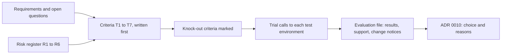

## Bạn cần biết trước

- [[management.l3.vendor-contract-terms]] — bạn đã đọc phần hợp đồng trong bản đánh giá cổng thanh toán. Bài này đọc phần tiêu chí và phần thử nằm trước nó.
- [[management.l2.risk-register]] — bạn biết các rủi ro hoàn tiền R1 đến R6. Bài này biến hai trong số đó thành tiêu chí.
- [[management.l2.requirements-document]] — bạn biết các yêu cầu hoàn tiền được đánh số và những câu hỏi mở của chúng. Bài này lấy tiêu chí từ đó.

## Tình huống

Tuần đầu Sprint 15. Trước khi ai đó viết job gửi hoàn tiền, Đơn Hàng cần một cổng thanh toán nhận lời gọi hoàn tiền, và đang có hai ứng viên: Cổng A và Cổng B. Mỗi vendor gửi một bản giới thiệu về tính năng, giá và những điều họ hứa. Một đồng đội gợi ý đi tắt: đặt hai bản giới thiệu cạnh nhau, chọn bên nhiều tính năng hơn mà giá thấp hơn, rồi bắt tay viết code. Bạn nhớ yêu cầu hoàn tiền nói một đơn không bao giờ được hoàn tiền hai lần, và sổ rủi ro cảnh báo API hoàn tiền có thể chạy khác tài liệu của nó. Làm sao chọn vendor để lựa chọn đó trả lời nhu cầu của mình, chứ không trả lời bản giới thiệu của họ?

## Khái niệm cốt lõi

- đánh giá vendor — một bản kiểm tra bằng văn bản, đối chiếu từng ứng viên với các tiêu chí mà đội lấy từ yêu cầu và rủi ro của chính mình, có ghi lại kết quả của mọi lần kiểm.
- tiêu chí — một nhu cầu kiểm được, có đánh số và truy về được yêu cầu, câu hỏi mở hay rủi ro sinh ra nó.
- tiêu chí loại ngay — tiêu chí ứng viên bắt buộc phải đạt để còn ở lại. Ứng viên không đạt bị loại trước khi so bất cứ điều gì khác, kể cả giá.
- thử — kiểm một lời hứa của vendor bằng cách gọi vào môi trường test của họ, thay vì đọc tài liệu.

## Cơ chế hoạt động



Trong tình huống trên, bản đánh giá bắt đầu từ bên trái, với những tài liệu đội viết trước khi vendor nào lên tiếng. Yêu cầu cho biết nhu cầu, như YC-9: một đơn không bao giờ bị hoàn tiền hai lần, kể cả khi phải gửi lại sang cổng. Các câu hỏi mở của yêu cầu cho biết những nhu cầu chưa ai trả lời được, như đơn chuyển khoản ngân hàng có hoàn tiền qua cổng được không. Sổ rủi ro cho biết những mối nghi ngờ, như R1 cảnh báo API hoàn tiền có thể chạy khác tài liệu, và xếp nó vào loại vừa dễ xảy ra vừa tốn kém.

Mỗi nhu cầu thành một tiêu chí có đánh số, ghi nguồn ngay bên cạnh. Phải viết chúng trước, vì tiêu chí viết sau khi đọc bản giới thiệu thường chỉ mô tả lại những gì ứng viên được ưa thích đã có sẵn.

Tiếp theo, đội đánh dấu tiêu chí nào là loại ngay. Ứng viên trượt một tiêu chí như vậy là bị loại, nên giá rẻ hay danh sách tính năng dài cũng không bù được việc thiếu idempotency key. Trượt một tiêu chí khác chỉ là một khoản chi phí đội phải lên kế hoạch xử lý, không phải lý do để loại ứng viên.

Sau đó, mỗi lời hứa quan trọng đều được thử. Lời gọi thử cho thấy hệ thống của vendor đang làm gì hôm nay, còn tài liệu cho thấy vendor đã viết gì về nó. Vì R1, đội quyết định từng tiêu chí theo lời gọi thử, không theo tài liệu.

File đánh giá ghi mọi kết quả, thêm hai điều ngoài tính năng: bộ phận hỗ trợ trả lời thế nào trong lúc thử, và vendor thông báo thay đổi ra sao. Cuối cùng, bản ghi quyết định nêu cổng được chọn và lý do, rồi trỏ tới bản đánh giá thay vì chép lại.

## Trong hệ thống Đơn Hàng

Phần tiêu chí trong bản đánh giá của đội, viết trước khi thử cổng nào:

```markdown file=docs/team/payment-gateway-evaluation.md tag=stage-3 lines=8-23
### Tiêu chí, viết trước khi xem ứng viên

Mỗi tiêu chí lấy từ `refund-requirements.md` hoặc sổ rủi ro
(`risk-register-example.md`), không từ tài liệu giới thiệu của vendor. Tiêu
chí loại ngay đánh dấu "Loại ngay": ứng viên không đạt thì bị loại trước khi
so bất cứ điều gì khác, kể cả giá.

| Số | Tiêu chí | Nguồn | Loại ngay |
|---|---|---|---|
| T1 | Nhận idempotency key: gửi lại cùng key không hoàn tiền lần hai | YC-9, R2 | Loại ngay |
| T2 | Trả kết quả hoàn tiền ngay trong câu trả lời của lời gọi | thiết kế bước 6, R1 | |
| T3 | Có môi trường test, và môi trường đó chạy đúng như tài liệu | R1 | Loại ngay |
| T4 | Hoàn tiền được cho đơn chuyển khoản ngân hàng | câu hỏi mở của yêu cầu | |
| T5 | Thời hạn tối đa để hoàn tiền sau khi thanh toán | câu hỏi mở của yêu cầu | |
| T6 | Trả lý do khi từ chối hoàn tiền, để nhân viên xử lý | YC-6, R4 | |
| T7 | Xuất được lịch sử hoàn tiền cho kế toán | mục tiêu 2 của yêu cầu, R5 | |
```

Dòng 10–13 nêu quy tắc: mọi tiêu chí lấy từ `refund-requirements.md` hoặc sổ rủi ro, không từ tài liệu của vendor, và ứng viên trượt một tiêu chí loại ngay (`Loại ngay`) bị loại trước khi so bất cứ điều gì khác, kể cả giá. Cột `Nguồn` truy nguồn gốc của từng dòng. T1, nhận idempotency key để gửi lại cùng key không hoàn tiền lần hai, đến từ YC-9 và R2, rủi ro cổng không nhận key nào như vậy. T2, kết quả hoàn tiền nằm ngay trong câu trả lời của lời gọi, đến từ R1 và bước 6 của tài liệu thiết kế hoàn tiền. Bước đó sẽ phải đổi nếu cổng chỉ báo kết quả sau bằng cách gọi ngược lại. T4 và T5, hoàn tiền cho đơn chuyển khoản ngân hàng và khoảng thời gian dài nhất sau thanh toán còn được hoàn tiền, đến từ các câu hỏi mở của yêu cầu. Chỉ T1 và T3, có môi trường test chạy đúng như tài liệu, là tiêu chí loại ngay.

Kết quả, mỗi dòng từ một lời gọi thật tới môi trường test:

```markdown file=docs/team/payment-gateway-evaluation.md tag=stage-3 lines=25-41
### Kết quả, thử trên môi trường test

Rủi ro R1 nói API hoàn tiền có thể chạy khác tài liệu, nên đội thử chứ không
đọc: mỗi tiêu chí là một lời gọi thật tới môi trường test của từng cổng.

| Số | Cổng A | Cổng B |
|---|---|---|
| T1 | Có: gửi lại cùng key trả lại đúng kết quả lần đầu, không tạo hoàn tiền mới | Không: tài liệu không nhắc tới; gửi hai lần tạo hai hoàn tiền |
| T2 | Có | Không: trả "đang xử lý", kết quả gọi ngược vào hệ thống sau |
| T3 | Có, chạy đúng tài liệu ở mọi lời gọi đã thử | Có, nhưng mã lỗi khác tài liệu ở hai lời gọi |
| T4 | Không: từ chối với lý do "chuyển khoản không hoàn qua cổng thẻ" | Có |
| T5 | 180 ngày | 120 ngày |
| T6 | Có, lý do bằng chữ trong câu trả lời 422 | Chỉ mã số, phải tra bảng |
| T7 | Có, tải CSV mọi lúc từ trang quản trị và qua API | Có, chỉ qua trang quản trị, mỗi tháng một lần |

Cổng B bị loại ở T1. Các dòng còn lại của Cổng B vẫn được ghi để lần đánh giá
sau không phải thử lại.
```

Dòng 27–28 gắn cách làm với R1: đội thử từng tiêu chí thay vì đọc về nó. Dòng 32 cho thấy lý do: tài liệu của Cổng B không nhắc gì tới idempotency key, và gửi cùng một lệnh hoàn tiền hai lần tạo ra hai lần hoàn tiền. Ở dòng 34, mã lỗi của Cổng B khác tài liệu ở hai lời gọi. File ghi T3 là đạt kèm lưu ý. Theo đúng câu chữ của T3 thì Cổng B cũng trượt, nhưng B đã bị loại từ T1. Cổng A trượt T4 ở dòng 35, và đó không phải tiêu chí loại ngay. Về sau, file đóng câu hỏi mở này bằng cách để bộ phận chăm sóc khách hàng hoàn tiền chuyển khoản bằng tay, cũng là cách xử lý sổ rủi ro đã đặt cho R4 với những lần hoàn tiền cổng từ chối. Dòng 40–41 giữ các dòng còn lại của Cổng B, để lần đánh giá sau khỏi phải thử lại.

Phía dưới, cùng file ghi hai điều ngoài tính năng. Trong lúc thử, Cổng A trả lời hai câu hỏi kỹ thuật ngay trong ngày, có người đọc được log của các lời gọi. Cổng B trả lời sau ba ngày, kèm một đường dẫn tới tài liệu của họ. Cổng A có một trang ghi thay đổi cho từng phiên bản API và gửi email cho các kỹ sư đã đăng ký. Cổng B đăng tin trên trang chủ. File ghi chú rằng đội sẽ sống chung với cả hai điều này nhiều năm.

ADR `0010` ghi lại việc chọn Cổng A và lý do: Cổng B bị loại ở T1 vì gửi lại sau lỗi mạng có thể hoàn tiền hai lần, trái với YC-9. ADR trỏ tới file này cho phần tiêu chí, kết quả, SLA và điều khoản hợp đồng thay vì nhắc lại. Mọi con số về hai cổng đều là giả định để dạy, không lấy từ vendor thật.

## Senior hay nhầm rằng…

- **"Vendor có danh sách tính năng dài nhất là lựa chọn an toàn nhất."** → Thực ra danh sách tính năng trả lời câu hỏi của vendor, họ làm được gì, chứ không trả lời câu hỏi của bạn, họ có đạt từng tiêu chí không. Một tính năng còn thiếu thì không hề có mặt trong danh sách: tài liệu của Cổng B chưa bao giờ nhắc tới idempotency key. Bạn sẽ nhận ra khi một cổng được chọn vì nhiều tính năng lại hoàn tiền một đơn hai lần sau một lần gửi lại, và tính năng duy nhất bạn cần lại là tính năng chưa ai kiểm.
- **"Đọc tài liệu của vendor là đủ để biết API của họ có hợp không."** → Thực ra tài liệu nói vendor định làm gì, còn lần thử cho thấy hệ thống của họ thực sự làm gì. Môi trường test của Cổng B trả mã lỗi khác tài liệu ở hai lời gọi. Bạn sẽ nhận ra khi code client đã xử lý mọi lỗi có trong tài liệu mà một câu trả lời thật vẫn rơi vào nhánh sai.
- **"Có thể viết tiêu chí sau khi xem các ứng viên có gì."** → Thực ra tiêu chí viết sau thường bám theo điểm mạnh của ứng viên được ưa thích và bỏ sót những nhu cầu không ứng viên nào quảng cáo, như câu hỏi mở về hoàn tiền chuyển khoản. Viết trước, mỗi tiêu chí kèm nguồn, giữ cho bản đánh giá xoay quanh Đơn Hàng. Bạn sẽ nhận ra khi trong một bản đánh giá không tiêu chí nào truy về được một yêu cầu hay một rủi ro, và tiêu chí nào cũng khớp với một dòng trong bản giới thiệu của một vendor.

## Thử ngay (3 phút)

1. Mở `docs/team/payment-gateway-evaluation.md` trong repository `don-hang` ở tag `stage-3` và đọc bảng tiêu chí, dòng 15–23.
2. Một ứng viên thứ ba, Cổng C, đến muộn. Bản giới thiệu của họ liệt kê nhiều tính năng hơn cả hai cổng kia, giá thấp nhất, và tài liệu nói họ nhận idempotency key và hoàn tiền được cho chuyển khoản ngân hàng. Họ không có môi trường test. Dựa vào bảng, quyết định Cổng C sẽ ra sao và ở tiêu chí nào.

Kết quả mong đợi: Cổng C bị loại ở T3, một tiêu chí loại ngay, trước khi giá hay tính năng của họ được đem ra so. T3 là dòng trượt thẳng. T1 thì hoàn toàn không kiểm được khi không có môi trường test.

Vì sao lời hứa trong tài liệu không đủ để đạt T1?

<details><summary>Gợi ý đáp án</summary>

T1 nói về điều một lần gửi lại thực sự gây ra, và R1 cảnh báo API hoàn tiền có thể chạy khác tài liệu. Chỉ một lời gọi thử mới cho thấy câu trả lời, và kết quả T1 của Cổng B cũng tìm ra đúng theo cách đó: gửi cùng một lệnh hoàn tiền hai lần tạo ra hai lần hoàn tiền. Một lời hứa bằng chữ chỉ là thứ để đọc, không phải một lần kiểm.

</details>

## Liên hệ

- [[management.l3.vendor-contract-terms]] — cùng file đánh giá. Bài đó đọc phần hợp đồng, bài này đọc phần tiêu chí và phần thử nằm trước nó.
- [[management.l2.requirements-document]] — kiến thức nền: các yêu cầu được đánh số và những câu hỏi mở mà tiêu chí lấy ra từ đó.
- [[management.l2.risk-register]] — kiến thức nền: R1 và R2 thành tiêu chí, và quyết định rằng lời hứa phải được thử chứ không chỉ đọc.
- [[management.l3.weighing-options-in-an-adr]] — cùng ý tưởng trong một bản ghi quyết định: các phương án được cân theo cùng những nhu cầu. ADR `0010` ghi kết quả của bản đánh giá này.
- [[backend.l3.safe-to-repeat-saga-steps]] — lý do T1 là tiêu chí loại ngay: bước hoàn tiền gửi lại với cùng key khi không nhận được câu trả lời.
- [[management.l3.exit-plan]] — bước tiếp theo: kế hoạch rời đi trong ADR `0010` bắt đầu bằng một bản đánh giá mới dùng cùng các tiêu chí.

## Tóm tắt 5 dòng

1. Đánh giá vendor theo tiêu chí lấy từ yêu cầu và rủi ro của chính mình, viết trước khi xem các ứng viên có gì.
2. `payment-gateway-evaluation.md` truy mỗi tiêu chí về một yêu cầu, một câu hỏi mở hay một rủi ro, như T1 từ YC-9 và R2.
3. Lời hứa quan trọng được thử trên môi trường test của từng cổng, vì rủi ro R1 đã cảnh báo API hoàn tiền có thể chạy khác tài liệu.
4. Tiêu chí loại ngay được kiểm trước khi so bất cứ điều gì, nên giá thấp hơn không bù được việc thiếu idempotency key.
5. Bản đánh giá còn ghi cách hỗ trợ trả lời lúc thử và cách vendor báo thay đổi. ADR `0010` trỏ tới nó thay vì nhắc lại.
