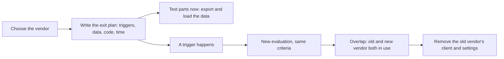

## Before you start

- [[management.l3.evaluating-a-vendor]] — you know how the team chose Gateway A against its own criteria; this lesson asks how it would stop using it.
- [[management.l3.vendor-lock-in]] — you know where the cost of leaving Keycloak and the gateway sits; this lesson writes down how to pay it.
- [[devops.l3.restore-testing]] — you know a backup counts only once a restore of it is tested; one part of leaving a vendor is checked the same way.

## The situation

ADR `0010`, the record of choosing Gateway A, is open for review. Below its decision sits a section on how the team would leave Gateway A, which the ADR says was written as soon as Gateway A was chosen. A teammate comments: "Why plan to leave a vendor we just picked for good reasons? If it ever goes wrong, we will work it out then." You notice the section names things that would be hard to work out later: the contract clause for exporting refund history, and a period when two gateways run side by side. What should a plan for leaving a vendor contain, and why write it on the day you choose that vendor?

## Core concepts

- **exit plan** — a plan written in advance for how the team would stop using a vendor: what would make it leave, where the data goes and in what format, which code changes, and how long the move takes.
- trigger — an event the plan names in advance as a reason to start leaving, such as a promise in the contract broken again and again.
- overlap period — the time when the old and the new vendor are both in use, because some work started with the old one can only be finished there.
- testable part — a step of the plan the team can run now, without leaving, to check it works on the day it is needed.

## How it works



In the situation above, the section below the decision is an exit plan, and the diagram follows its life. It starts at the moment of choosing, because that is when the team knows every place the vendor is used. It is also before signing, when the team can still ask for a contract term the plan depends on, such as a way to export its data in a stated format.

The plan names its triggers, so leaving becomes a decision against criteria written in calm conditions, not a reaction during an outage. Then it lists the steps: how the next vendor is chosen, which code changes, where the data goes, and an estimate of the work.

Two branches come out of the plan. One, "A trigger happens", waits. The other, "Test parts now", runs today: any step that does not need the old vendor gone, such as exporting its data and loading it somewhere. A plan whose steps were never tried is a guess, as an untested backup is.

When a trigger does happen, a new evaluation on the same criteria chooses the next vendor. Leaving is then often not one day's switch: if work begun with the old vendor can only be finished by it, there is an overlap period. Only when that work runs out does the team remove the old vendor's client and settings.

## In the Đơn Hàng system

The triggers and steps of ADR `0010`'s exit plan:

```markdown file=docs/adr/0010-cong-thanh-toan-ben-ngoai.md tag=stage-3 lines=42-65
Dấu hiệu phải rời đi:

- Cổng A không giữ cam kết khả dụng ba tháng trong sáu tháng liền.
- Cổng A báo bỏ phiên bản API đang dùng mà không có bản thay thế làm được ba
  kết quả trên.
- Giá gia hạn tăng quá mức hợp đồng cho phép.

Các bước:

1. Chọn cổng mới bằng một lần đánh giá như `payment-gateway-evaluation.md`,
   cùng tiêu chí.
2. Viết một client mới cho cổng mới, trả đúng ba kết quả mà
   `GatewayRefundClient` trả, kèm test của nó. Saga hoàn tiền,
   `RefundSender` và các service khác không đổi.
3. Xuất lịch sử hoàn tiền từ Cổng A (CSV, theo điều khoản xuất dữ liệu) và lưu
   cùng các bản sao lưu, để kế toán vẫn đối soát được sau khi hợp đồng kết
   thúc.
4. Chạy cả hai cổng trong một giai đoạn: khoản thanh toán qua Cổng A chỉ hoàn
   được qua Cổng A, nên mỗi dòng hoàn tiền phải biết khoản thanh toán của nó đi
   qua cổng nào, cho tới khi khoản cuối cùng của Cổng A hết hạn hoàn tiền (180
   ngày).
5. Hết giai đoạn đó, gỡ client cũ và cấu hình của Cổng A.

Ước lượng: 10–20 ngày công cho bước 2 tới 4, chưa tính lần đánh giá.
```

Lines 42–47 are the triggers: Gateway A misses its availability promise in three months out of six in a row; it announces the end of the API version in use with no replacement able to give the three outcomes `GatewayRefundClient` returns (named below); or its renewal price rises more than the contract allows. Each one can be checked against a record, not a mood.

Step 2, lines 53–55, is short because of the anti-corruption layer. `RefundOutcome` in `DonHang.Payments/GatewayRefundClient.cs` has three values, `Refunded`, `Refused` and `TryAgainLater`. A new client returns the same three, so the refund saga and `RefundSender`, the background job that calls the gateway for each refund, stay unchanged.

Step 3 depends on a contract clause: the refund history leaves as CSV under the data export term, and is kept with the backups so accounting can still reconcile after the contract ends.

Step 4 is the overlap period: a payment taken by Gateway A can only be refunded through Gateway A, so each refund row must know which gateway took its payment, until the refund window of Gateway A's last payment, 180 days, runs out. Line 65 estimates 10–20 person-days for steps 2 to 4, not counting the evaluation.

Lines 67–71, outside the excerpt, give the testable part: export refund history from the test environment, in the lab `GET /v1/refunds` on `fake-gateway`, the program that plays Gateway A there. Load it into a new table made only for this check. Besides payments taken, the `payments` table in `donhang_payments` holds a row for each refund Đơn Hàng asked for, marked refunded once the gateway made it. Compare the row count and amounts with those refunded rows: each exported line should match one with the same amount, and a difference means the export or the records miss something. The ADR checks this like a restore test instead of trusting it.

ADR `0009` gives Keycloak a much shorter plan:

```markdown file=docs/adr/0009-dung-keycloak-thay-vi-tu-lam-dang-nhap.md tag=stage-3 lines=69-78
### Kế hoạch rời đi

Ngắn, vì đăng nhập đi qua OpenID Connect:

- Dấu hiệu: Keycloak ngừng phát hành bản vá bảo mật cho dòng đang dùng, hoặc
  công vận hành vượt 20 ngày một năm hai năm liền.
- Chuyển tài khoản: xuất người dùng từ Keycloak; nếu nơi mới không nhận được
  mật khẩu đã băm, khách đặt lại mật khẩu lần đăng nhập đầu.
- Sửa API: chỗ đọc claim vai trò trong `Program.cs` và địa chỉ của nhà cung
  cấp trong cấu hình.
```

Line 71 says why it is short: signing in goes through OpenID Connect, which keeps most sign-in code free of anything only Keycloak knows. The triggers are Keycloak no longer shipping security fixes for the line in use, or operating work above 20 days a year for two years running. The work lies in the accounts: export the users, and if the new provider cannot take the hashed passwords, customers reset theirs at first sign-in. The code change is the line in `Program.cs` that reads the role claim, the field in the token's payload that lists the user's roles, plus the provider's address in configuration.

## Seniors often assume…

- **"An exit plan signals that we chose the wrong vendor."** → Actually it is part of choosing any vendor, the way a restore test is part of taking backups. ADR `0010` chooses Gateway A after ruling out Gateway B on a knock-out criterion, and still writes the plan in the same record. You notice this when a team leaves the section out to look decisive, and later finds the contract was signed with no term for exporting its data.
- **"We can work out how to leave when the time comes."** → Actually by then the contract is signed, so a missing export term is much harder to get, at best at the next renewal, and the people who knew every place the vendor is used may have moved on. The trigger also sets your deadline: an API end date or a contract end date is the day the move must be done. You notice this when a vendor announces the end of an API version and the team spends the notice period finding out what it depends on.
- **"Leaving a vendor is a switch flipped on one day."** → Actually work begun with the old vendor often finishes there. ADR `0010` keeps Gateway A for refunds of its own payments until the last one's 180-day window ends. You notice this when a refund for an order paid before the move has nowhere to go, because the new gateway never took that payment.

## Try it (3 minutes)

1. Open `docs/adr/0010-cong-thanh-toan-ben-ngoai.md` in the `don-hang` repository at tag `stage-3`, and read steps 4 and 5 of the section `### Kế hoạch rời đi`.
2. Suppose the new gateway goes live on a Monday, and Gateway A takes its last payment the Sunday before. Decide the earliest day the team can carry out step 5.

Expected result: the day after the 180-day refund window of that Sunday's payment closes, when the last payment Gateway A took can no longer be refunded; until then Gateway A's client and settings must stay.

Why does step 3 keep the refund history with the backups instead of loading it into the new gateway?

<details><summary>Suggested answer</summary>

The new gateway never took those payments, so it has nothing to refund or reconcile against them. Accounting still needs the history after Gateway A's contract ends, so the team keeps its own copy, exported as CSV under the data export term the contract was asked to include.

</details>

## Connections

- [[management.l3.evaluating-a-vendor]] — prerequisite: the evaluation whose criteria step 1 of the plan reuses for the next gateway.
- [[management.l3.vendor-lock-in]] — prerequisite: measures the cost of leaving; the exit plan writes down how that cost would be paid.
- [[devops.l3.restore-testing]] — the same idea for vendor data: a step counts once it has been tried, not when it is written.
- [[management.l3.vendor-contract-terms]] — where the export and notice terms the plan relies on are checked before signing.
- [[management.l3.superseding-an-adr]] — what follows a trigger: the decision for a new gateway would supersede ADR `0010`.

## Five-line summary

1. An exit plan, written when a vendor is chosen, states how the team would leave it: triggers, data, code changes and time.
2. Writing it then works because the team still knows every point of use and can still ask for the contract terms the plan needs.
3. ADR `0010` names checkable triggers and steps: a new client giving `GatewayRefundClient`'s three outcomes, and the refund history exported as CSV.
4. Leaving takes an overlap period: Gateway A refunds its own payments until the last one's 180-day window ends.
5. Test parts of the plan now, such as exporting and loading vendor data, the way you test a restore.
