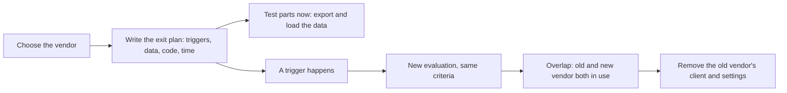

## Bạn cần biết trước

- [[management.l3.evaluating-a-vendor]] — bạn biết đội đã chọn Cổng A theo chính các tiêu chí của mình. Bài này hỏi đội sẽ thôi dùng nó ra sao.
- [[management.l3.vendor-lock-in]] — bạn biết cái giá rời Keycloak và cổng thanh toán nằm ở đâu. Bài này ghi lại cách trả cái giá đó.
- [[devops.l3.restore-testing]] — bạn biết một bản sao lưu chỉ được tính khi đã thử khôi phục nó. Một phần của việc rời vendor cũng được kiểm theo cách đó.

## Tình huống

ADR `0010`, bản ghi việc chọn Cổng A, đang được review. Bên dưới phần quyết định có một mục nói đội sẽ rời Cổng A thế nào, và ADR ghi rằng mục này được viết ngay khi chọn Cổng A. Một đồng đội bình luận: "Sao lại lên kế hoạch rời một vendor mình vừa chọn vì lý do chính đáng? Có chuyện gì thì lúc đó tính." Bạn để ý mục này nêu những thứ khó tính về sau: điều khoản hợp đồng cho phép xuất lịch sử hoàn tiền, và một giai đoạn hai cổng cùng chạy song song. Kế hoạch rời một vendor cần có những gì, và vì sao phải viết nó ngay hôm chọn vendor đó?

## Khái niệm cốt lõi

- **kế hoạch rời đi (exit plan)** — kế hoạch viết sẵn cho cách đội sẽ thôi dùng một vendor: điều gì khiến đội rời đi, dữ liệu đi đâu và theo định dạng nào, code nào phải đổi, và cuộc chuyển mất bao lâu.
- dấu hiệu rời đi — một sự kiện kế hoạch nêu trước là lý do để bắt đầu rời đi, như một cam kết trong hợp đồng bị vi phạm hết lần này tới lần khác.
- giai đoạn chồng lấn — khoảng thời gian vendor cũ và vendor mới cùng được dùng, vì có việc bắt đầu với vendor cũ chỉ hoàn tất được ở đó.
- phần kiểm được — một bước trong kế hoạch mà đội chạy được ngay bây giờ, không cần rời đi, để chắc nó chạy đúng vào ngày cần tới.

## Cơ chế hoạt động



Trong tình huống trên, mục nằm dưới phần quyết định chính là kế hoạch rời đi, và sơ đồ đi theo vòng đời của nó. Kế hoạch bắt đầu ở lúc chọn vendor, vì đó là lúc đội biết mọi chỗ vendor được dùng. Đó cũng là lúc chưa ký hợp đồng, nên đội vẫn đòi được điều khoản mà kế hoạch cần, như quyền xuất dữ liệu theo định dạng ghi rõ.

Kế hoạch nêu các dấu hiệu rời đi, nên rời đi trở thành một quyết định theo tiêu chí viết lúc bình tĩnh, chứ không phải phản ứng giữa một sự cố. Sau đó nó liệt kê các bước: chọn vendor tiếp theo thế nào, code nào đổi, dữ liệu đi đâu, và ước lượng khối lượng công việc.

Từ kế hoạch tách ra hai nhánh. Nhánh "A trigger happens" thì chờ. Nhánh "Test parts now" chạy ngay hôm nay: mọi bước không cần vendor cũ biến mất, như xuất dữ liệu của nó rồi nạp vào một chỗ khác. Kế hoạch có những bước chưa từng thử chỉ là một phỏng đoán, giống một bản sao lưu chưa từng thử khôi phục.

Khi một dấu hiệu thực sự xảy ra, một lần đánh giá mới theo cùng tiêu chí sẽ chọn vendor tiếp theo. Lúc đó rời đi thường không phải chuyện bật công tắc trong một ngày: nếu việc bắt đầu với vendor cũ chỉ hoàn tất được ở vendor cũ, sẽ có một giai đoạn chồng lấn. Chỉ khi những việc đó đã hết, đội mới gỡ client và cấu hình của vendor cũ.

## Trong hệ thống Đơn Hàng

Các dấu hiệu và các bước trong kế hoạch rời đi của ADR `0010`:

```markdown file=docs/adr/0010-cong-thanh-toan-ben-ngoai.md tag=stage-3 lines=42-65
Dấu hiệu phải rời đi:

- Cổng A không giữ cam kết khả dụng ba tháng trong sáu tháng liền.
- Cổng A báo bỏ phiên bản API đang dùng mà không có bản thay thế làm được ba
  kết quả trên.
- Giá gia hạn tăng quá mức hợp đồng cho phép.

Các bước:

1. Chọn cổng mới bằng một lần đánh giá như `payment-gateway-evaluation.md`,
   cùng tiêu chí.
2. Viết một client mới cho cổng mới, trả đúng ba kết quả mà
   `GatewayRefundClient` trả, kèm test của nó. Saga hoàn tiền,
   `RefundSender` và các service khác không đổi.
3. Xuất lịch sử hoàn tiền từ Cổng A (CSV, theo điều khoản xuất dữ liệu) và lưu
   cùng các bản sao lưu, để kế toán vẫn đối soát được sau khi hợp đồng kết
   thúc.
4. Chạy cả hai cổng trong một giai đoạn: khoản thanh toán qua Cổng A chỉ hoàn
   được qua Cổng A, nên mỗi dòng hoàn tiền phải biết khoản thanh toán của nó đi
   qua cổng nào, cho tới khi khoản cuối cùng của Cổng A hết hạn hoàn tiền (180
   ngày).
5. Hết giai đoạn đó, gỡ client cũ và cấu hình của Cổng A.

Ước lượng: 10–20 ngày công cho bước 2 tới 4, chưa tính lần đánh giá.
```

Dòng 42–47 là các dấu hiệu rời đi: Cổng A không giữ cam kết khả dụng trong ba tháng của sáu tháng liền, Cổng A báo bỏ phiên bản API đang dùng mà không có bản thay thế trả được ba kết quả của `GatewayRefundClient` (nêu bên dưới), hoặc giá gia hạn tăng quá mức hợp đồng cho phép. Dấu hiệu nào cũng đối chiếu được với một bản ghi, không dựa vào cảm giác.

Bước 2, dòng 53–55, ngắn là nhờ anti-corruption layer. `RefundOutcome` trong `DonHang.Payments/GatewayRefundClient.cs` có ba giá trị: `Refunded`, `Refused` và `TryAgainLater`. Client mới trả đúng ba giá trị đó, nên saga hoàn tiền và `RefundSender`, job chạy nền gọi cổng thanh toán cho từng lệnh hoàn tiền, giữ nguyên.

Bước 3 dựa vào một điều khoản hợp đồng: lịch sử hoàn tiền được xuất ra dạng CSV theo điều khoản xuất dữ liệu, rồi lưu cùng các bản sao lưu để kế toán vẫn đối soát được sau khi hợp đồng kết thúc.

Bước 4 là giai đoạn chồng lấn: khoản thanh toán qua Cổng A chỉ hoàn được qua Cổng A, nên mỗi dòng hoàn tiền phải biết khoản thanh toán của nó đi qua cổng nào, cho tới khi khoản thanh toán cuối cùng của Cổng A hết hạn hoàn tiền 180 ngày. Dòng 65 ước lượng 10–20 ngày công cho bước 2 tới 4, chưa tính lần đánh giá.

Dòng 67–71, nằm ngoài đoạn trích, nêu phần kiểm được: xuất lịch sử hoàn tiền từ môi trường test, trong lab là `GET /v1/refunds` trên `fake-gateway`, chương trình đóng vai Cổng A ở đó. Nạp nó vào một bảng mới chỉ tạo ra cho lần kiểm này. Ngoài các khoản thanh toán đã nhận, bảng `payments` trong `donhang_payments` có một dòng cho mỗi lệnh hoàn tiền Đơn Hàng đã yêu cầu, được đánh dấu đã hoàn khi cổng thanh toán hoàn xong. So số dòng và số tiền với các dòng đã hoàn đó: mỗi dòng xuất ra phải khớp với một dòng cùng số tiền, và chênh lệch nghĩa là bản xuất hoặc bản ghi đang thiếu gì đó. ADR kiểm bước này như một lần kiểm thử khôi phục thay vì tin rằng nó sẽ chạy.

ADR `0009` cho Keycloak một kế hoạch ngắn hơn nhiều:

```markdown file=docs/adr/0009-dung-keycloak-thay-vi-tu-lam-dang-nhap.md tag=stage-3 lines=69-78
### Kế hoạch rời đi

Ngắn, vì đăng nhập đi qua OpenID Connect:

- Dấu hiệu: Keycloak ngừng phát hành bản vá bảo mật cho dòng đang dùng, hoặc
  công vận hành vượt 20 ngày một năm hai năm liền.
- Chuyển tài khoản: xuất người dùng từ Keycloak; nếu nơi mới không nhận được
  mật khẩu đã băm, khách đặt lại mật khẩu lần đăng nhập đầu.
- Sửa API: chỗ đọc claim vai trò trong `Program.cs` và địa chỉ của nhà cung
  cấp trong cấu hình.
```

Dòng 71 nói lý do nó ngắn: đăng nhập đi qua OpenID Connect, nên phần lớn code đăng nhập không dính tới thứ gì chỉ Keycloak mới biết. Dấu hiệu rời đi là Keycloak ngừng ra bản vá bảo mật cho dòng phiên bản đang dùng, hoặc công vận hành vượt 20 ngày một năm trong hai năm liền. Phần việc nằm ở tài khoản: xuất người dùng ra, và nếu nhà cung cấp mới không nhận được mật khẩu đã hash, khách sẽ đặt lại mật khẩu ở lần đăng nhập đầu. Phần code phải đổi là dòng trong `Program.cs` đọc claim vai trò, tức trường trong payload của token liệt kê các vai trò của người dùng, cộng với địa chỉ của nhà cung cấp trong cấu hình.

## Senior hay nhầm rằng…

- **"Có kế hoạch rời đi nghĩa là mình đã chọn sai vendor."** → Thực ra nó là một phần của việc chọn bất kỳ vendor nào, giống như kiểm thử khôi phục là một phần của việc sao lưu. ADR `0010` chọn Cổng A sau khi loại Cổng B ở một tiêu chí loại ngay, và vẫn viết kế hoạch trong cùng bản ghi. Bạn sẽ nhận ra khi một đội bỏ mục này đi cho có vẻ quyết đoán, rồi về sau mới thấy hợp đồng đã ký mà không có điều khoản xuất dữ liệu.
- **"Tới lúc cần rời đi thì mình sẽ tính cách rời."** → Thực ra lúc đó hợp đồng đã ký, nên một điều khoản xuất dữ liệu còn thiếu sẽ khó đòi hơn nhiều, may lắm là ở lần gia hạn tới, và những người biết mọi chỗ vendor được dùng có thể đã đi nơi khác. Dấu hiệu rời đi cũng đặt luôn hạn chót cho bạn: ngày một API ngừng hay ngày hợp đồng kết thúc là ngày cuộc chuyển phải xong. Bạn sẽ nhận ra khi một vendor báo ngừng một phiên bản API và đội dùng hết thời gian báo trước chỉ để tìm xem mình phụ thuộc vào những gì.
- **"Rời một vendor là bật một công tắc trong một ngày."** → Thực ra việc bắt đầu với vendor cũ thường phải hoàn tất ở đó. ADR `0010` giữ Cổng A để hoàn tiền cho chính các khoản thanh toán của nó, cho tới khi hạn 180 ngày của khoản cuối cùng kết thúc. Bạn sẽ nhận ra khi một lệnh hoàn tiền cho đơn đã thanh toán trước cuộc chuyển không còn chỗ nào để gửi, vì cổng mới chưa bao giờ nhận khoản thanh toán đó.

## Thử ngay (3 phút)

1. Mở `docs/adr/0010-cong-thanh-toan-ben-ngoai.md` trong repository `don-hang` ở tag `stage-3`, đọc bước 4 và bước 5 của mục `### Kế hoạch rời đi`.
2. Giả sử cổng mới chạy chính thức vào một ngày thứ Hai, và Cổng A nhận khoản thanh toán cuối cùng vào Chủ nhật ngay trước đó. Xác định ngày sớm nhất đội có thể làm bước 5.

Kết quả mong đợi: ngày sau khi hạn hoàn tiền 180 ngày của khoản thanh toán hôm Chủ nhật đó đóng lại, lúc khoản thanh toán cuối cùng Cổng A đã nhận không còn hoàn tiền được nữa. Trước ngày đó, client và cấu hình của Cổng A phải giữ nguyên.

Vì sao bước 3 lưu lịch sử hoàn tiền cùng các bản sao lưu thay vì nạp nó vào cổng mới?

<details><summary>Gợi ý đáp án</summary>

Cổng mới chưa bao giờ nhận những khoản thanh toán đó, nên nó không có gì để hoàn tiền hay đối soát với chúng. Kế toán vẫn cần lịch sử này sau khi hợp đồng với Cổng A kết thúc, nên đội giữ bản sao của riêng mình, xuất ra dạng CSV theo điều khoản xuất dữ liệu mà đội đã đòi đưa vào hợp đồng.

</details>

## Liên hệ

- [[management.l3.evaluating-a-vendor]] — kiến thức nền: bản đánh giá có các tiêu chí mà bước 1 của kế hoạch dùng lại để chọn cổng tiếp theo.
- [[management.l3.vendor-lock-in]] — kiến thức nền: đo cái giá rời đi. Kế hoạch rời đi ghi lại cách trả cái giá đó.
- [[devops.l3.restore-testing]] — cùng ý tưởng cho dữ liệu của vendor: một bước chỉ được tính khi đã thử, không phải khi đã viết ra.
- [[management.l3.vendor-contract-terms]] — nơi các điều khoản xuất dữ liệu và báo trước mà kế hoạch dựa vào được kiểm trước khi ký.
- [[management.l3.superseding-an-adr]] — điều diễn ra sau một dấu hiệu rời đi: quyết định chọn cổng mới sẽ thay thế ADR `0010`.

## Tóm tắt 5 dòng

1. Kế hoạch rời đi, viết lúc chọn vendor, nêu cách đội sẽ rời vendor đó: dấu hiệu, dữ liệu, code phải đổi và thời gian.
2. Viết vào lúc đó có lợi vì đội còn biết mọi chỗ dùng và vẫn đòi được những điều khoản hợp đồng kế hoạch cần.
3. ADR `0010` nêu các dấu hiệu và các bước kiểm được: một client mới trả ba kết quả của `GatewayRefundClient`, và lịch sử hoàn tiền xuất ra dạng CSV.
4. Rời đi cần một giai đoạn chồng lấn: Cổng A hoàn tiền cho chính các khoản thanh toán của nó tới khi hạn 180 ngày của khoản cuối cùng kết thúc.
5. Kiểm các phần của kế hoạch ngay bây giờ, như xuất và nạp dữ liệu của vendor, giống cách bạn kiểm thử khôi phục.
