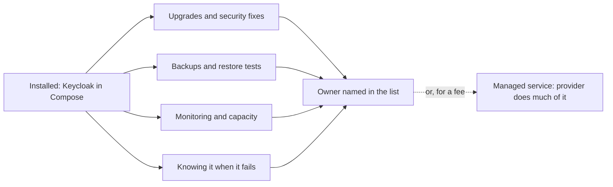

## Before you start

- [[management.l3.total-cost-of-ownership]] — you know the operating line of a cost (upgrades, security fixes, backups, failures) repeats every year and is counted in person-days.
- [[k8s.l2.database-in-the-cluster]] — you know a managed database is a server a provider runs for you, trading control for less work.
- [[devops.l3.automated-dependency-updates]] — you know `.github/dependabot.yml` proposes updates only for what it lists.
- [[devops.l3.restore-testing]] — you know a backup counts only once a restore of it has been tested.

## The situation

At stage-3 Đơn Hàng runs Keycloak for signing in, as ADR `0009` chose. Each week Dependabot opens its pull requests: NuGet packages, Dart packages, workflow actions, base images. None of them touches `quay.io/keycloak/keycloak:26.7.4` in `docker-compose.yml`. A teammate shrugs: "Keycloak had no fee, it is installed and it works in the lab. What else is there?" You remember that Keycloak is the door every customer and every staff member signs in through, and if a security fix for it came out today, nothing in the repository would tell anyone. What does a component you run yourself keep costing after it is installed, and who pays it?

## Core concepts

- recurring work — the work a component needs again and again for as long as you run it: upgrades and security fixes, backups and restore tests, monitoring, capacity, and knowing it when it fails.
- owner — the person named for one component, who follows its releases, does or plans its recurring work and is the one called when it fails.
- development mode — a way of starting a server that is quick for a lab but skips what real use needs; Keycloak's `start-dev` is one.
- **managed service** — software a provider runs for you as a service, such as a managed database or a hosted message broker; it trades the recurring work for a fee, less control and your data on the provider's machines.

## How it works



In the situation above, installing Keycloak was the getting line of its total cost of ownership, paid once. The diagram shows what follows: four kinds of recurring work that come back for as long as the component runs, whether or not anything breaks.

Upgrades and security fixes come first, because new releases keep coming. For Keycloak, the entrance to the whole system, a security fix left waiting matters more than for most components. Backups and restore tests follow wherever a component holds the only copy of some data. Monitoring catches a full disk or a long queue before users do; capacity is acting on it, such as limiting how long data is kept, as the Prometheus row does. Last, someone has to know the component well enough to fix it when it fails.

All four arrows end at one person, the owner. Work with no owner tends not to get done at all: nobody is watching for the release, so nobody starts the upgrade. Dependabot helps with part of the first box, for what its file lists; the rest is the owner's to watch.

The dashed arrow is the other way to pay. A managed service moves much of the recurring work to a provider, who runs the machines, backups and upgrades. The team pays a fee, gives up some control, usually including when maintenance happens, and keeps its data on the provider's machines. Some work stays: the team still chooses settings, watches how its own system uses the service, and checks that it can get its data back.

## In the Đơn Hàng system

The list of what Đơn Hàng runs itself, from `docs/team/self-run-components.md`:

```markdown file=docs/team/self-run-components.md tag=stage-3 lines=10-26
| Thành phần | Vì sao tự chạy | Việc định kỳ | Người lo | Phương án managed |
|---|---|---|---|---|
| PostgreSQL | Dữ liệu chính của đơn, Payments, Notifications và Keycloak; đội quen nó từ đầu | Nâng cấp bản vá mỗi quý; sao lưu hằng ngày, WAL lưu liên tục, thử khôi phục mỗi tháng; theo dõi dung lượng đĩa và kết nối | Lập trình viên backend, luân phiên | Database managed: nhà cung cấp lo sao lưu, bản sao và nâng cấp |
| RabbitMQ | Chuyển message giữa API, Notifications và Payments | Nâng cấp; theo dõi độ dài queue và dead-letter queue; dữ liệu queue nằm trên volume | Lập trình viên backend | Message broker managed |
| Keycloak | Đăng nhập cho khách và nhân viên (ADR 0009) | Nâng cấp và vá bảo mật thường xuyên vì đây là cửa vào hệ thống; sao lưu realm và database của nó; xoay khóa ký | Trưởng nhóm | Dịch vụ đăng nhập trả phí (phương án C của ADR 0009) |
| Prometheus, Grafana, Loki | Số đo, dashboard và log | Nâng cấp; giới hạn thời gian giữ dữ liệu để đĩa không đầy; giữ dashboard trong Git | Lập trình viên backend | Dịch vụ giám sát managed |
| Mailpit | Bắt mọi email trong lab để xem, không gửi đi đâu | Gần như không có | Không ai: chỉ dùng trong lab | Không áp dụng: production cần một dịch vụ gửi email thật, đội chưa có, xem bên dưới |

Keycloak trong lab chạy ở chế độ phát triển (`start-dev`). Trong Compose dữ
liệu của nó nằm trong database `keycloak` của PostgreSQL chung; trong cluster
staging nó giữ dữ liệu trong chính container và mất khi Pod bị thay. Chạy thật
cần thêm chế độ khởi động production (hostname, TLS), database riêng có sao
lưu, và người theo dõi các bản vá: việc lab bỏ qua.

Gửi email cho khách là năng lực còn phải mua: Mailpit chỉ bắt email, không
gửi. Trước khi có khách thật, đội cần một dịch vụ gửi email và một lần đánh
giá như `payment-gateway-evaluation.md`.
```

Each row of lines 12–16, under the header on line 10, names a component, why the team runs it, its recurring work, owner and managed option. Line 12 gives PostgreSQL the most: a patch upgrade each quarter, a daily backup with WAL archived continuously, a restore test each month, and watching disk and connections. Line 14 makes the team lead Keycloak's owner and asks for frequent security fixes, because it is the entrance to the system, plus backups of its sign-in settings and database and rotation of its signing keys. Its managed option is the paid sign-in service, option C of ADR `0009`.

Mailpit, on line 16, catches every email in the lab and sends none, so nobody owns it. Lines 24–26 draw the consequence: sending email to customers is a capability the team still has to buy, after an evaluation like the one for the payment gateway, before real customers arrive.

Lines 18–22 say what the lab skips for Keycloak. The Compose service shows the lab's side:

```yaml file=docker-compose.yml tag=stage-3 lines=431-445
  keycloak:
    image: quay.io/keycloak/keycloak:26.7.4
    container_name: donhang-keycloak
    hostname: keycloak
    command: ["start-dev", "--import-realm"]
    environment:
      # lesson: devops.l3.secret-rotation
      # From stage-3 Keycloak keeps its data, the realm's signing keys
      # included, in the keycloak database on db, not inside its container:
      # a new container starts with the same keys, and they are backed up
      # with the other databases.
      KC_DB: "postgres"
      KC_DB_URL: "jdbc:postgresql://db:5432/keycloak"
      KC_DB_USERNAME: "donhang"
      KC_DB_PASSWORD: "${POSTGRES_PASSWORD}"
```

Line 435 starts Keycloak with `start-dev`, its development mode; `--import-realm` loads a realm, Keycloak's word for its sign-in settings, from files at start. Lines 438–441 say why lines 442–445 point it at the `keycloak` database on the shared server `db`: its data, signing keys included, survives a new container and is backed up with the other databases.

In the staging cluster no database is set, so Keycloak keeps its data inside its container and loses it when the Pod is replaced. Running it for real, lines 20–22 of the list add, needs a production start with a hostname and TLS, a database of its own with backups, and someone following its patches.

Lines 33–37 of the same file, outside the excerpt, close the gap from the situation: the images of the table's components are not on Dependabot's list, so following their releases and release notes is the owner's job. `.github/dependabot.yml` itself watches base images only in five directories that hold Dockerfiles: `/DonHang.Api`, `/DonHang.Notifications`, `/DonHang.Payments`, `/fake-gateway` and `/lab`.

## Seniors often assume…

- **"Once open source software is installed, the work is done until something breaks."** → Actually the list schedules work for components that are working fine: PostgreSQL's patch upgrade each quarter and restore test each month, Keycloak's frequent security fixes. Releases, filling disks and keys due for rotation arrive whether or not anything has broken. You notice this when the first restore of a backup is tried during an outage.
- **"A managed service takes all operating work off the team."** → Actually it takes the provider's share: the machines, backups, copies and server upgrades, as the PostgreSQL row's managed option says. The team still chooses the settings, watches how its own code uses the service, plans around maintenance and version changes the provider schedules, and checks that it can get its data back. You notice this when a managed database runs out of connections because of your own code while the provider's page shows the service as healthy.
- **"Running everything ourselves is always cheaper while the system is small."** → Actually much of the recurring work does not grow in step with the system: a Keycloak upgrade needs the same reading of release notes and the same test run whether it serves ten customers or ten thousand, while a fee like the paid sign-in service's in ADR `0009`, which grows with the number of users, is smallest when the system is. Running it yourself is the cheaper choice when the team already knows the component and has time for it, or when no managed option fits the need. You notice the opposite case when a small team spends a sprint upgrading components no customer ever sees.

## Try it (3 minutes)

1. Open `docker-compose.yml` in the `don-hang` repository at tag `stage-3`. Read the comment above the `redis` service, and the comment on `redis` under the `api` service's `depends_on`.
2. Write the row Redis would get in the table of `docs/team/self-run-components.md`: why the team runs it, its recurring work, its owner and its managed option.

Expected result: a row whose recurring work has no backup and no restore test, because the comment says nothing in Redis is the only copy of a fact; PostgreSQL has them all.

Which recurring work is left, and who is told when a new Redis image comes out?

<details><summary>Suggested answer</summary>

Upgrades and security fixes are left, and watching it run. The image `redis:8.10.2-alpine` is named in `docker-compose.yml`, outside the directories `dependabot.yml` lists, so nobody is told unless an owner follows its releases. A backend developer could own it, as for RabbitMQ, and its managed option would be a hosted key-value store.

</details>

## Connections

- [[management.l3.total-cost-of-ownership]] — this lesson details its operating line for each self-run component.
- [[k8s.l2.database-in-the-cluster]] — the same trade for one component, PostgreSQL; this lesson applies it to every component in the list.
- [[devops.l3.automated-dependency-updates]] — covers part of the upgrade work; this lesson names what it leaves to an owner.
- [[devops.l3.restore-testing]] — one recurring task the list schedules monthly for PostgreSQL.
- [[k8s.l3.operator-pattern]] — a way to do part of a component's recurring work in code instead of by hand.
- [[k8s.l3.clusters-without-a-cloud]] — where no provider hands out addresses or disks, so more components land on the list.
- [[devops.l3.software-supply-chain]] — the security fixes of the first box, for the code inside your own images.
- [[management.l3.vendor-lock-in]] — the next step: what it costs to leave a provider or project.

## Five-line summary

1. Running open source yourself saves the licence fee but brings recurring work, which someone on the team must own.
2. The recurring work: upgrades and security fixes, backups and restore tests, monitoring and capacity, and knowing it when it fails.
3. `self-run-components.md` lists Đơn Hàng's self-run components at stage-3 with each one's recurring work, owner and managed option.
4. The lab runs Keycloak in development mode; running it for real adds a production start, its own backed-up database and patch watching.
5. A managed service trades recurring work for a fee, less control and data on the provider's machines; some work stays.
