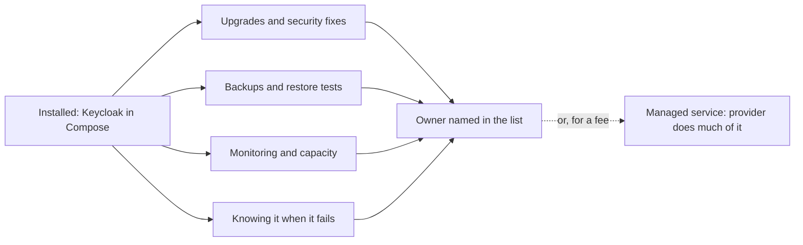

## Bạn cần biết trước

- [[management.l3.total-cost-of-ownership]] — bạn biết khoản vận hành trong chi phí (nâng cấp, bản vá bảo mật, sao lưu, sự cố) lặp lại mỗi năm và được tính bằng ngày công.
- [[k8s.l2.database-in-the-cluster]] — bạn biết database managed là một server nhà cung cấp chạy hộ bạn, đổi bớt quyền kiểm soát lấy bớt việc.
- [[devops.l3.automated-dependency-updates]] — bạn biết `.github/dependabot.yml` chỉ đề xuất cập nhật cho những gì nó liệt kê.
- [[devops.l3.restore-testing]] — bạn biết một bản sao lưu chỉ được tính khi đã thử khôi phục nó.

## Tình huống

Ở stage-3, Đơn Hàng chạy Keycloak để đăng nhập, theo lựa chọn của ADR `0009`. Tuần nào Dependabot cũng mở pull request: package NuGet, package Dart, action của workflow, base image. Không cái nào động tới `quay.io/keycloak/keycloak:26.7.4` trong `docker-compose.yml`. Một đồng đội nhún vai: "Keycloak có mất phí đâu, cài rồi, chạy ngon trong lab. Còn gì nữa?" Bạn nhớ ra Keycloak là cánh cửa mọi khách hàng và mọi nhân viên đi qua để đăng nhập. Nếu hôm nay có bản vá bảo mật cho nó, không có gì trong repository báo cho ai biết. Một thành phần tự chạy còn tốn gì sau khi đã cài xong, và ai trả khoản đó?

## Khái niệm cốt lõi

- việc định kỳ — công việc một thành phần cần lặp đi lặp lại chừng nào bạn còn chạy nó: nâng cấp và vá bảo mật, sao lưu và thử khôi phục, theo dõi, dung lượng, và hiểu nó khi nó hỏng.
- người lo — người được giao đích danh cho một thành phần: theo dõi các bản phát hành của nó, làm hoặc lên kế hoạch cho việc định kỳ, và là người bị gọi khi nó hỏng.
- chế độ phát triển — cách khởi động server nhanh gọn cho lab nhưng bỏ qua những gì dùng thật cần tới. `start-dev` của Keycloak là một ví dụ.
- **dịch vụ managed (vận hành hộ)** (managed service) — phần mềm nhà cung cấp chạy hộ bạn dưới dạng dịch vụ, như database managed hay message broker được host sẵn. Nó đổi việc định kỳ lấy một khoản phí, bớt quyền kiểm soát, và dữ liệu nằm trên máy của nhà cung cấp.

## Cơ chế hoạt động



Trong tình huống trên, cài Keycloak là khoản có được trong tổng chi phí sở hữu, trả một lần. Sơ đồ cho thấy phần đến sau: bốn loại việc định kỳ quay lại chừng nào thành phần còn chạy, dù có gì hỏng hay không.

Đứng đầu là nâng cấp và vá bảo mật, vì bản phát hành mới cứ ra đều. Với Keycloak, lối vào của cả hệ thống, một bản vá bảo mật bị để chờ nguy hiểm hơn so với hầu hết thành phần khác. Tiếp theo là sao lưu và kiểm thử khôi phục, ở bất cứ đâu một thành phần giữ bản duy nhất của một phần dữ liệu. Monitoring phát hiện đĩa đầy hay queue dài trước khi người dùng thấy. Dung lượng là hành động dựa trên đó, chẳng hạn giới hạn thời gian giữ dữ liệu, như hàng Prometheus làm. Cuối cùng, phải có người hiểu thành phần đủ để sửa khi nó hỏng.

Cả bốn mũi tên dồn về một người: người lo. Việc không có người lo thường không ai làm cả: không ai để mắt tới bản phát hành, nên không ai bắt đầu nâng cấp. Dependabot gánh giúp một phần của ô đầu tiên, cho những gì file của nó liệt kê. Phần còn lại là người lo phải tự theo dõi.

Mũi tên nét đứt là cách trả khác. Một dịch vụ managed chuyển phần lớn việc định kỳ sang nhà cung cấp, bên chạy máy, sao lưu và nâng cấp. Đội trả phí, mất bớt quyền kiểm soát, thường gồm cả quyền chọn lúc bảo trì, và để dữ liệu trên máy của nhà cung cấp. Vẫn còn việc ở lại với đội: chọn cấu hình, theo dõi hệ thống của mình dùng dịch vụ ra sao, và kiểm tra rằng mình lấy lại được dữ liệu.

## Trong hệ thống Đơn Hàng

Danh sách những gì Đơn Hàng tự chạy, trích từ `docs/team/self-run-components.md`:

```markdown file=docs/team/self-run-components.md tag=stage-3 lines=10-26
| Thành phần | Vì sao tự chạy | Việc định kỳ | Người lo | Phương án managed |
|---|---|---|---|---|
| PostgreSQL | Dữ liệu chính của đơn, Payments, Notifications và Keycloak; đội quen nó từ đầu | Nâng cấp bản vá mỗi quý; sao lưu hằng ngày, WAL lưu liên tục, thử khôi phục mỗi tháng; theo dõi dung lượng đĩa và kết nối | Lập trình viên backend, luân phiên | Database managed: nhà cung cấp lo sao lưu, bản sao và nâng cấp |
| RabbitMQ | Chuyển message giữa API, Notifications và Payments | Nâng cấp; theo dõi độ dài queue và dead-letter queue; dữ liệu queue nằm trên volume | Lập trình viên backend | Message broker managed |
| Keycloak | Đăng nhập cho khách và nhân viên (ADR 0009) | Nâng cấp và vá bảo mật thường xuyên vì đây là cửa vào hệ thống; sao lưu realm và database của nó; xoay khóa ký | Trưởng nhóm | Dịch vụ đăng nhập trả phí (phương án C của ADR 0009) |
| Prometheus, Grafana, Loki | Số đo, dashboard và log | Nâng cấp; giới hạn thời gian giữ dữ liệu để đĩa không đầy; giữ dashboard trong Git | Lập trình viên backend | Dịch vụ giám sát managed |
| Mailpit | Bắt mọi email trong lab để xem, không gửi đi đâu | Gần như không có | Không ai: chỉ dùng trong lab | Không áp dụng: production cần một dịch vụ gửi email thật, đội chưa có, xem bên dưới |

Keycloak trong lab chạy ở chế độ phát triển (`start-dev`). Trong Compose dữ
liệu của nó nằm trong database `keycloak` của PostgreSQL chung; trong cluster
staging nó giữ dữ liệu trong chính container và mất khi Pod bị thay. Chạy thật
cần thêm chế độ khởi động production (hostname, TLS), database riêng có sao
lưu, và người theo dõi các bản vá: việc lab bỏ qua.

Gửi email cho khách là năng lực còn phải mua: Mailpit chỉ bắt email, không
gửi. Trước khi có khách thật, đội cần một dịch vụ gửi email và một lần đánh
giá như `payment-gateway-evaluation.md`.
```

Mỗi hàng ở dòng 12–16, dưới dòng tiêu đề ở dòng 10, nêu một thành phần, lý do đội tự chạy nó, việc định kỳ, người lo và phương án managed. Dòng 12 giao cho PostgreSQL nhiều việc nhất: nâng cấp bản vá mỗi quý, sao lưu hằng ngày kèm WAL lưu liên tục, thử khôi phục mỗi tháng, và theo dõi đĩa cùng kết nối. Dòng 14 giao Keycloak cho trưởng nhóm và đòi vá bảo mật thường xuyên, vì đây là lối vào hệ thống, cộng thêm sao lưu cấu hình đăng nhập và database của nó, và xoay khóa ký. Phương án managed của nó là dịch vụ đăng nhập trả phí, phương án C của ADR `0009`.

Mailpit ở dòng 16 bắt mọi email trong lab và không gửi đi email nào, nên không ai lo nó. Dòng 24–26 rút ra hệ quả: gửi email cho khách là năng lực đội vẫn phải mua, sau một lần đánh giá giống lần đánh giá cổng thanh toán, trước khi có khách thật.

Dòng 18–22 nói lab bỏ qua những gì với Keycloak. Service trong Compose cho thấy phía lab:

```yaml file=docker-compose.yml tag=stage-3 lines=431-445
  keycloak:
    image: quay.io/keycloak/keycloak:26.7.4
    container_name: donhang-keycloak
    hostname: keycloak
    command: ["start-dev", "--import-realm"]
    environment:
      # lesson: devops.l3.secret-rotation
      # From stage-3 Keycloak keeps its data, the realm's signing keys
      # included, in the keycloak database on db, not inside its container:
      # a new container starts with the same keys, and they are backed up
      # with the other databases.
      KC_DB: "postgres"
      KC_DB_URL: "jdbc:postgresql://db:5432/keycloak"
      KC_DB_USERNAME: "donhang"
      KC_DB_PASSWORD: "${POSTGRES_PASSWORD}"
```

Dòng 435 khởi động Keycloak bằng `start-dev`, chế độ phát triển của nó. `--import-realm` nạp một realm, từ Keycloak dùng để gọi bộ cấu hình đăng nhập, từ file lúc khởi động. Dòng 438–441 giải thích vì sao dòng 442–445 trỏ nó tới database `keycloak` trên server dùng chung `db`: dữ liệu của nó, kể cả khóa ký, sống sót qua container mới và được sao lưu cùng các database khác.

Trong cluster staging không có database nào được cấu hình, nên Keycloak giữ dữ liệu bên trong container và mất sạch khi Pod bị thay. Dòng 20–22 của danh sách nói thêm: chạy thật cần khởi động ở chế độ production với hostname và TLS, một database riêng có sao lưu, và người theo dõi các bản vá của nó.

Dòng 33–37 của cùng file, nằm ngoài đoạn trích, lấp chỗ hở trong tình huống: image của các thành phần trong bảng không nằm trong danh sách của Dependabot, nên theo dõi bản phát hành và ghi chú phát hành của chúng là việc của người lo. Bản thân `.github/dependabot.yml` chỉ theo dõi base image ở năm thư mục có Dockerfile: `/DonHang.Api`, `/DonHang.Notifications`, `/DonHang.Payments`, `/fake-gateway` và `/lab`.

## Senior hay nhầm rằng…

- **"Phần mềm mã nguồn mở cài xong là hết việc, cho tới khi có gì hỏng."** → Thực ra danh sách xếp lịch việc cho cả những thành phần đang chạy tốt: nâng cấp bản vá mỗi quý và thử khôi phục mỗi tháng của PostgreSQL, vá bảo mật thường xuyên của Keycloak. Bản phát hành mới, đĩa đầy dần, khóa đến hạn xoay đều tới, dù có gì hỏng hay chưa. Bạn sẽ nhận ra khi lần khôi phục bản sao lưu đầu tiên lại diễn ra giữa một sự cố.
- **"Dịch vụ managed gánh hết việc vận hành cho đội."** → Thực ra nó chỉ gánh phần của nhà cung cấp: máy, sao lưu, bản sao và nâng cấp server, như phương án managed ở hàng PostgreSQL ghi. Đội vẫn chọn cấu hình, theo dõi code của mình dùng dịch vụ ra sao, tính trước các đợt bảo trì và đổi phiên bản do nhà cung cấp xếp lịch, và kiểm tra rằng mình lấy lại được dữ liệu. Bạn sẽ nhận ra khi một database managed hết kết nối vì chính code của bạn, trong lúc trang của nhà cung cấp vẫn báo dịch vụ khỏe.
- **"Hệ thống còn nhỏ thì tự chạy mọi thứ bao giờ cũng rẻ hơn."** → Thực ra phần lớn việc định kỳ không lớn lên theo hệ thống: nâng cấp Keycloak cần đọc cùng một bộ ghi chú phát hành và chạy cùng một lượt test, dù phục vụ mười khách hay mười nghìn. Còn một khoản phí như phí của dịch vụ đăng nhập trả phí trong ADR `0009`, vốn tăng theo số người dùng, lại nhỏ nhất khi hệ thống còn nhỏ. Tự chạy là lựa chọn rẻ hơn khi đội đã quen thành phần và có thời gian cho nó, hoặc khi không có phương án managed nào đáp ứng nhu cầu. Bạn sẽ nhận ra trường hợp ngược lại khi một đội nhỏ mất cả sprint để nâng cấp những thành phần không khách hàng nào nhìn thấy.

## Thử ngay (3 phút)

1. Mở `docker-compose.yml` trong repository `don-hang` ở tag `stage-3`. Đọc comment phía trên service `redis`, và comment cho `redis` trong `depends_on` của service `api`.
2. Viết hàng mà Redis sẽ có trong bảng của `docs/team/self-run-components.md`: vì sao đội tự chạy nó, việc định kỳ, người lo và phương án managed.

Kết quả mong đợi: một hàng mà việc định kỳ không có sao lưu và không có thử khôi phục, vì comment nói không có gì trong Redis là bản duy nhất của một dữ kiện. PostgreSQL thì có đủ cả.

Việc định kỳ nào còn lại, và ai được báo khi có image Redis mới?

<details><summary>Gợi ý đáp án</summary>

Còn lại nâng cấp và vá bảo mật, cùng với theo dõi nó chạy. Image `redis:8.10.2-alpine` được ghi trong `docker-compose.yml`, nằm ngoài các thư mục `dependabot.yml` liệt kê, nên không ai được báo trừ khi có người lo theo dõi bản phát hành của nó. Một lập trình viên backend có thể lo nó, giống RabbitMQ, và phương án managed của nó sẽ là một kho key-value được host sẵn.

</details>

## Liên hệ

- [[management.l3.total-cost-of-ownership]] — bài này đi vào chi tiết khoản vận hành của bài đó, cho từng thành phần tự chạy.
- [[k8s.l2.database-in-the-cluster]] — cùng phép đổi đó cho một thành phần là PostgreSQL. Bài này áp dụng nó cho mọi thành phần trong danh sách.
- [[devops.l3.automated-dependency-updates]] — lo một phần việc nâng cấp. Bài này chỉ ra phần nó để lại cho người lo.
- [[devops.l3.restore-testing]] — một việc định kỳ danh sách xếp lịch mỗi tháng cho PostgreSQL.
- [[k8s.l3.operator-pattern]] — để code làm thay tay một phần việc định kỳ của thành phần.
- [[k8s.l3.clusters-without-a-cloud]] — nơi không có nhà cung cấp nào cấp địa chỉ hay đĩa, nên danh sách có thêm thành phần.
- [[devops.l3.software-supply-chain]] — phần vá bảo mật của ô đầu tiên, cho code bên trong image của chính đội.
- [[management.l3.vendor-lock-in]] — bước tiếp theo: rời một nhà cung cấp hay một dự án tốn gì.

## Tóm tắt 5 dòng

1. Tự chạy mã nguồn mở tiết kiệm phí bản quyền nhưng kéo theo việc định kỳ, và phải có người trong đội lo nó.
2. Việc định kỳ gồm: nâng cấp và vá bảo mật, sao lưu và thử khôi phục, theo dõi và dung lượng, và hiểu thành phần khi nó hỏng.
3. `self-run-components.md` liệt kê các thành phần Đơn Hàng tự chạy ở stage-3, kèm việc định kỳ, người lo và phương án managed của từng cái.
4. Lab chạy Keycloak ở chế độ phát triển. Chạy thật cần thêm khởi động production, database riêng có sao lưu và người theo dõi bản vá.
5. Dịch vụ managed đổi việc định kỳ lấy phí, bớt quyền kiểm soát và dữ liệu trên máy nhà cung cấp. Vẫn còn việc ở lại với đội.
